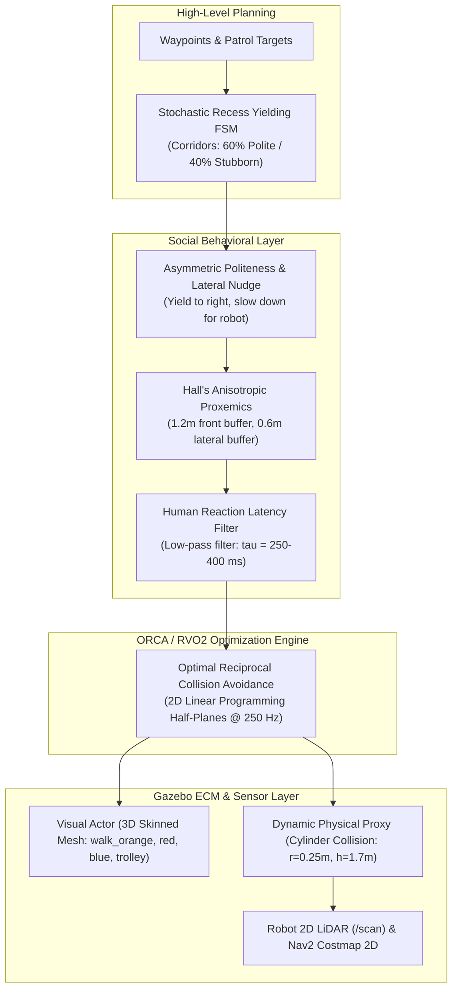

# RVO2 / ORCA Social Navigation System Guide 🚶‍♂️🤖

> **Comprehensive Technical Guide and Operational Handbook for Multi-Agent Social Navigation in Gazebo Sim 8 & ROS 2 Jazzy**

---

## 📑 Table of Contents
1. [Overview & Core Motivation](#1-overview--core-motivation)
2. [Multi-Layer Architecture](#2-multi-layer-architecture)
   - [2.1 Mathematical Core: RVO2 & ORCA](#21-mathematical-core-rvo2--orca)
   - [2.2 Social Behavioral Layers](#22-social-behavioral-layers)
   - [2.3 Dual-Layer Physical Entity Model](#23-dual-layer-physical-entity-model)
3. [Supported Simulation Environments](#3-supported-simulation-environments)
   - [Corridor (0.70m, 0.90m, 1.20m)](#corridor-environments)
   - [Open Arena (rvo2, arena, dataset)](#open-arena-environments)
   - [Hospital Arena (easy, medium, hard)](#hospital-environments)
   - [School Campus Arena](#school-campus-arena)
4. [Step-by-Step Testing & Benchmarking Guide](#4-step-by-step-testing--benchmarking-guide)
5. [SDF Plugin Configuration Parameters](#5-sdf-plugin-configuration-parameters)
6. [Troubleshooting & Best Practices](#6-troubleshooting--best-practices)

---

## 1. Overview & Core Motivation

In real-world social robot navigation (e.g. patrol, delivery, hospital care), mobile robots like **TurtleBot3 Burger** must navigate safely, efficiently, and politely among human pedestrians.

Standard simulation setups face key limitations:
1. **Geometric-Only ORCA / RVO2**: Pure ORCA treats robots and pedestrians symmetrically as uncoordinated circles. In narrow spaces, it suffers from head-on deadlocks, zero social respect, and abrupt, jittery movements.
2. **Heavyweight SFM / External Simulators**: Simulators like HuNavSim or PedSim running through ROS bridges introduce network overhead, VRAM bottlenecks (>4 GB), and clock desynchronization, which hinder high-throughput reinforcement learning on single consumer GPUs (e.g., RTX 4060 with 8GB VRAM).
3. **Sim-to-Real Sensor Disconnect**: Animated 3D visual actors in Gazebo often lack proper physical collision hulls, causing 2D LiDAR rays to pass through humans, leading to phantom costs or unobserved collisions.

**DynamuhSim** resolves these issues by embedding an in-engine **C++ Gazebo Sim 8 World System Plugin** (`librvo2_human_system.so`) with social compliance mechanisms, multi-agent diversity, and tight ROS 2 Nav2 integration.

---

## 2. Multi-Layer Architecture



### 2.1 Mathematical Core: RVO2 & ORCA
* **ORCA (Optimal Reciprocal Collision Avoidance)** computes collision-free velocities by constructing velocity half-planes in 2D Euclidean space using Linear Programming.
* **Execution Frequency**: Evaluated inside `PreUpdate()` at physics step rate ($250\text{ Hz}$, $\Delta t = 0.004\text{ s}$) with zero inter-process latency.

### 2.2 Social Behavioral Layers
* **Asymmetric Politeness**: Humans have individual `politeness` factors $\in [0.0, 1.0]$. When approaching a robot head-on, polite agents apply a lateral velocity nudge to their right and decelerate proportionally to clear the path.
* **Anisotropic Proxemics (Hall's Personal Space)**: The interpersonal comfort zone is modeled as an ellipse ($1.2\text{m}$ in front, $0.6\text{m}$ to the sides) rather than an isotropic circle.
* **Biological Reaction Latency**: Humans cannot pivot instantaneously. A 1st-order low-pass filter ($\tau \approx 0.3\text{ s}$) models the cognitive and neuromotor delay between perception and footstep execution.
* **Corridor Social Navigation & Recess Yielding FSM**:
  * **Wide Corridor ($1.20\text{m}$)**: Pedestrians naturally shift to their right side ($y \approx \pm 0.28\text{m}$) and cruise smoothly past the robot without stopping.
  * **Narrow Bottlenecks ($0.70\text{m}$ & $0.90\text{m}$)**: Pedestrians hug the right wall ($y \approx \pm 0.27\text{m}$), leaving $0.72\text{m}$ of open passage for TurtleBot ($0.18\text{m}$ width).
  * **Proximity Recess Yielding**: If near an alcove ($x \in [1.15, 2.95]$) and the oncoming robot is in close proximity ($dist < 3.5\text{m}$), pedestrians step into the recess, turn $90^\circ$ to monitor the robot, wait for clearance ($x_{\text{robot}} > 2.65\text{m}$), and then smoothly resume patrol. A $5.0\text{s}$ timeout ensures agents never remain trapped.

### 2.3 Dual-Layer Physical Entity Model
To guarantee realistic perception and physics:
* **Visual Layer (`<actor>`)**: Renders high-fidelity 3D DAE animated meshes (`walk_orange.dae`, `walk_red.dae`, `walk_blue.dae`, `push_trolley.dae`) for RGB-D cameras (RealSense D435i).
  * **Zero Foot-Sliding**: Stride animation rate is locked to forward ground velocity ($k_{\text{anim}} = 4.1534$).
  * **Zero Elevation Drift**: Anchored at $z = 0.85\text{--}1.02\text{ m}$ to eliminate floating or sinking feet.
* **Collision Layer (`<model name="*_proxy">`)**: Kinematic rigid body with a collision cylinder ($r = 0.25\text{--}0.28\text{ m}$, $h = 1.70\text{ m}$) synchronized synchronously to the visual actor pose each simulation step. This guarantees $100\%$ reliable LiDAR beam reflection into ROS 2 `/scan`.

---

## 3. Supported Simulation Environments

DynamuhSim standardizes 4 major environment groups across all simulation and evaluation pipelines:

| Environment | SDF World | Nav2 Map | Dynamic Obstacles | Robot Spawn `(x, y)` |
|---|---|---|---|---|
| **Corridor 0.70m** | `corridor_070.sdf` | `corridor_090` | 1 human (stochastic recess yielding) | `(-13.0, 0.0)` |
| **Corridor 0.90m** | `corridor_090.sdf` | `corridor_090` | 1 human (stochastic recess yielding) | `(-13.0, 0.0)` |
| **Corridor 1.20m** | `corridor_120.sdf` | `corridor_090` | 1 human (stochastic recess yielding) | `(-13.0, 0.0)` |
| **Arena Obstacle** | `arena_obstacle.sdf`| `arena_obstacle` | 1 RVO2 human walker | `(-13.0, 0.0)` |
| **Arena RVO2** | `arena_rvo2.sdf` | `arena_obstacle` | 4 multi-color RVO2 humans (Red, Blue, Orange, Green) | `(-13.0, 0.0)` |
| **Arena Dataset** | `arena_dataset.sdf` | `arena_obstacle` | 24 multi-density RVO2 humans | `(-13.0, 0.0)` |
| **School Arena** | `school_arena.sdf` | `school_arena` | 8 student actors (classrooms, corridor A-F, stairs) | `(-13.5, -8.15)` |
| **Hospital Easy** | `hospital_easy.sdf` | `hospital_easy` | 3 hospital staff/patients (patrol corridors) | `(0.0, 0.0)` |
| **Hospital Medium**| `hospital_medium.sdf`| `hospital_medium`| 8 agents (staff, patients, trolley pusher + cart proxy)| `(0.0, 0.0)` |
| **Hospital Hard** | `hospital_hard.sdf` | `hospital_hard` | 16 agents (crossings, pairs, delivery cart) | `(0.0, 0.0)` |

---

## 4. Step-by-Step Testing & Benchmarking Guide

### 4.1 Prerequisites
Ensure workspace is built and sourced in every terminal:
```bash
cd ~/nav_ws   # or ~/DynamuhSim
source /opt/ros/jazzy/setup.bash
source install/setup.bash
```

---

### Group 1: Corridors (0.70m / 0.90m / 1.20m)
* **Goal**: Test robot navigation in narrow corridors where pedestrian and robot meet head-on.

**Terminal 1 — Launch Gazebo & TurtleBot3:**
```bash
ros2 launch custom_corridor corridor_tb3.launch.py width:=0.90 obstacle:=human gui:=true rviz:=true
```
*(Use `width:=0.70` for extreme bottleneck testing or `width:=1.20` for standard hallway).*

**Terminal 2 — Launch Nav2 Stack:**
```bash
ros2 launch custom_corridor nav2_corridor.launch.py map:=corridor_090 controller:=dwb
```
*(Switch to `controller:=mppi` to test Model Predictive Path Integral).*

**Terminal 3 — Send Nav2 Goal:**
```bash
ros2 action send_goal /navigate_to_pose nav2_msgs/action/NavigateToPose \
  "{pose: {header: {frame_id: 'map'}, pose: {position: {x: 20.0, y: 0.0, z: 0.0}, orientation: {w: 1.0}}}}"
```

---

### Group 2: Open Arena (`rvo2`, `arena`, `dataset`)
* **Goal**: Test multi-agent reciprocal collision avoidance in open space.

**Terminal 1 — Launch Gazebo & TurtleBot3:**
```bash
ros2 launch custom_corridor corridor_tb3.launch.py width:=rvo2 gui:=true rviz:=true
```
*(Replace `width:=rvo2` with `width:=arena` for 1 agent or `width:=dataset` for 24 agents).*

**Terminal 2 — Launch Nav2 Stack:**
```bash
ros2 launch custom_corridor nav2_corridor.launch.py map:=arena_obstacle controller:=dwb
```

**Terminal 3 — Send Nav2 Goal:**
```bash
ros2 action send_goal /navigate_to_pose nav2_msgs/action/NavigateToPose \
  "{pose: {header: {frame_id: 'map'}, pose: {position: {x: 2.0, y: 0.0, z: 0.0}, orientation: {w: 1.0}}}}"
```

---

### Group 3: School Campus Arena
* **Goal**: Navigate through a large school facility (15 classrooms, corridors A–F, stairways) with 8 student pedestrians.

**Terminal 1 — Launch Gazebo & TurtleBot3:**
```bash
ros2 launch custom_corridor corridor_tb3.launch.py width:=school gui:=true rviz:=true
```

**Terminal 2 — Launch Nav2 Stack:**
```bash
ros2 launch custom_corridor nav2_corridor.launch.py map:=school controller:=dwb
```

**Terminal 3 — Send Nav2 Goal:**
```bash
ros2 action send_goal /navigate_to_pose nav2_msgs/action/NavigateToPose \
  "{pose: {header: {frame_id: 'map'}, pose: {position: {x: 10.0, y: -8.15, z: 0.0}, orientation: {w: 1.0}}}}"
```

---

### Group 4: Hospital Facility (`easy`, `medium`, `hard`)
* **Goal**: Navigate a large $60\text{m} \times 17\text{m}$ medical facility with rooms, hallway crossings, and trolley pushers.

**Terminal 1 — Launch Gazebo & TurtleBot3:**
```bash
ros2 launch custom_corridor hospital_arena.launch.py difficulty:=medium gui:=true rviz:=true
```
*(Use `difficulty:=easy` for 3 agents or `difficulty:=hard` for 16 agents).*

**Terminal 2 — Launch Nav2 Stack:**
```bash
ros2 launch custom_corridor nav2_hospital.launch.py map:=medium auto_route:=false
```

**Terminal 3 — Send Nav2 Goal:**
```bash
ros2 action send_goal /navigate_to_pose nav2_msgs/action/NavigateToPose \
  "{pose: {header: {frame_id: 'map'}, pose: {position: {x: 8.0, y: 0.0, z: 0.0}, orientation: {w: 1.0}}}}"
```

*(You can also use the RViz2 interactive GUI tool **"2D Goal Pose"** / **"Nav2 Goal"** to click destinations directly).*

---

## 5. SDF Plugin Configuration Parameters

The plugin is instantiated in world SDF files via:

```xml
<plugin filename="librvo2_human_system.so" name="custom_corridor::RVO2HumanSystem">
  <human_count>8</human_count>
  <robot_name>burger</robot_name>
  <robot_radius>0.35</robot_radius>
  <human_radius>0.28</human_radius>
  <max_speed>1.2</max_speed>
  <neighbor_dist>10.0</neighbor_dist>
  <max_neighbors>10</max_neighbors>
  <time_horizon>4.0</time_horizon>
  <time_horizon_obst>3.0</time_horizon_obst>

  <!-- Social Compliance -->
  <politeness_balance_point>0.60</politeness_balance_point>
  <randomize_politeness>true</randomize_politeness>
  <proxemic_margin_front>1.20</proxemic_margin_front>
  <proxemic_margin_side>0.60</proxemic_margin_side>
  <reaction_latency>0.30</reaction_latency>

  <!-- Corridor Recess Yielding -->
  <corridor_mode>true</corridor_mode>
  <corridor_half_width>0.45</corridor_half_width>
  <recess_approach_dist>5.0</recess_approach_dist>
  <recess_threshold>0.40</recess_threshold>
  <recess_x_min>1.35</recess_x_min>
  <recess_x_max>2.65</recess_x_max>
  <recess_x_center>2.00</recess_x_center>
  <recess_y>0.75</recess_y>

  <!-- Ground-Truth & Scenario -->
  <ground_truth_topic>/rvo2_human/ground_truth</ground_truth_topic>
  <default_scenario_file>default</default_scenario_file>
</plugin>
```

### Parameter Reference:
* `politeness_balance_point`: Mean yielding compliance ($0.0$ = completely stubborn, $1.0$ = always yields).
* `randomize_politeness`: When `true`, samples individual politeness Gaussian-distributed around `politeness_balance_point`.
* `reaction_latency`: Low-pass filter time constant ($\tau$ in seconds, default `0.3s`).
* `proxemic_margin_front`: Forward social buffer distance for lateral nudges (default `1.2m`).
* `corridor_mode`: Set to `true` for `corridor_070/090/120` to activate the corridor social navigation model.
* `recess_approach_dist`: Proximity distance to activate recess yielding (default `5.0m`).

---

## 6. Troubleshooting & Best Practices

1. **Headless Execution for High-Throughput Benchmarks**:
   Add `gui:=false rviz:=false` to launch commands. This runs Gazebo Sim server-only (`gz sim -s`), dropping VRAM usage to $\sim 1.2\text{ GB}$ and achieving Real Time Factor ($\text{RTF} > 3.0\text{--}5.0$).

2. **Real-Time Factor (RTF 1.0) & Physics**:
   Corridor worlds feature explicit ODE physics step size (`<max_step_size>0.004</max_step_size>`, `real_time_factor: 1.0` @ $250\text{ Hz}$) and disabled scene shadows (`<scene><shadows>false</shadows></scene>`). This guarantees smooth $100\%$ Real-Time Factor (RTF $\approx 1.0$) on RTX 4060 / Linux systems without GPU or CPU lag.

3. **DDS Stalls or Node Discovery Failures**:
   Ensure `RMW_IMPLEMENTATION=rmw_fastrtps_cpp` and `FASTDDS_BUILTIN_TRANSPORTS=UDPv4` are exported to prevent shared memory deadlocks when running multiple background simulators.

4. **AMCL Localization Mismatch**:
   Launch files automatically apply correct initial poses (`corridor`: `(0, 0)`, `arena`: `(-13, 0)`, `school`: `(-13.5, -8.15)`, `hospital`: `(0, 0)`). If manually dispatching goals, ensure frame is `'map'`.

5. **Synchronized MCAP Recording**:
   Use `record_obstacle.py` or `run_baseline_trials.sh` to record both ROS 2 topic bags and ground-truth obstacle positions synchronously indexed by `/clock`.
