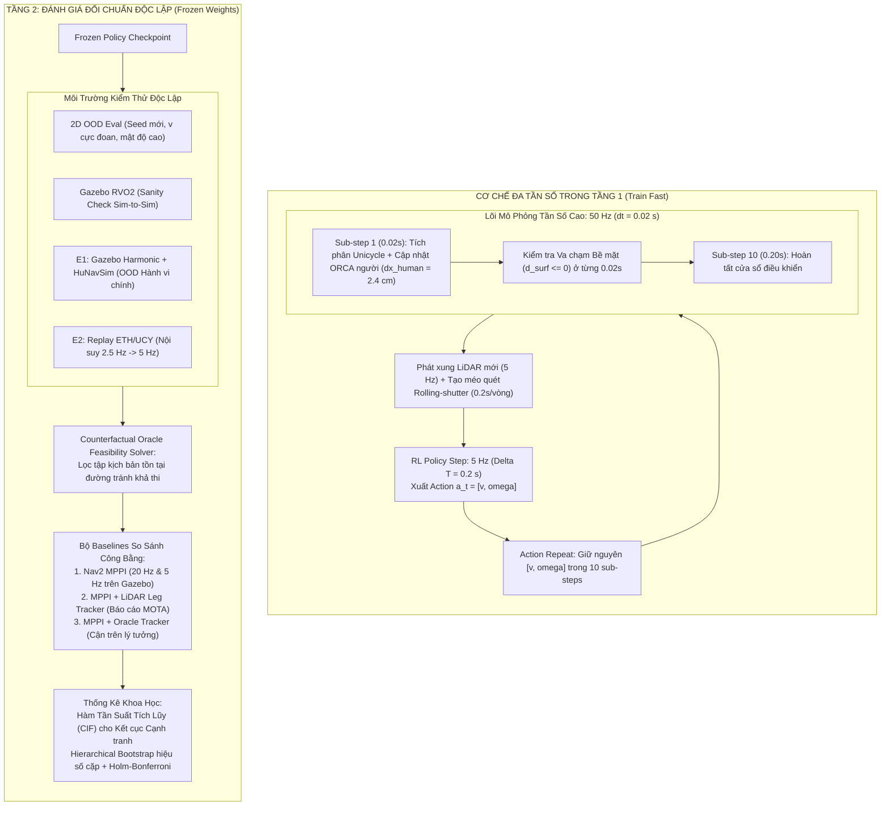
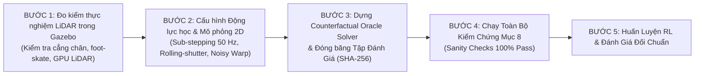

# Đặc Tả Kỹ Thuật: Pipeline Huấn Luyện & Đánh Giá Điều Hướng Xã Hội (Social Robot Navigation)
## Phiên bản v3.0: Cảm Biến Thực Tế, Động Lực Học Đa Tần Số & Chuẩn Mực Thống Kê Khoa Học

Tài liệu này là đặc tả kỹ thuật chính thức (Master Technical Specification) cho hệ sinh thái huấn luyện và đánh giá điều hướng xã hội trong dự án **DynamuhSim**. 

Tài liệu thiết lập các nguyên tắc nghiên cứu chuẩn mực:
1. **Tách biệt tuyệt đối giữa Huấn luyện (Training) và Đánh giá (Evaluation)**.
2. **Khóa chặt cảm biến 2D LiDAR thực tế (LDS-01)**: Mô hình hóa méo quét cơ khí (rolling-shutter), bù chuyển động có nhiễu odometry, và mô hình cẳng chân tham số hóa.
3. **Động lực học đa tần số (Multi-Rate Simulation)**: Khắc phục triệt để hiện tượng xuyên thủng (tunneling) của người đi nhanh.
4. **Bộ giải khả thi phản thực tế (Counterfactual Oracle Feasibility Solver)**.
5. **Đo lường đối chuẩn khoa học**: Phân tích rủi ro cạnh tranh (Competing Risks / CIF) và Bootstrap phân cấp.

---

## 0. Bảng Đối Chiếu Tiến Hóa Kiến Trúc (Changelog v1 $\rightarrow$ v2 $\rightarrow$ v3.0)

| Khía cạnh Kỹ thuật | Phiên bản v1 (Sơ khai) | Phiên bản v2 / v2.2 (Hiệu chỉnh) | Phiên bản v3.0 (Đặc tả Chuẩn Tối Hậu) |
| :--- | :--- | :--- | :--- |
| **Không gian Quan sát (Actor)** | Nhận vector trạng thái $K$ người gần nhất ($x, y, v_x, v_y, r$). | LiDAR 2D thô xếp $k$ khung + Đích + Vận tốc. Bù odometry lý tưởng. | **Warped & Deskewed LiDAR Tensor**: Khử méo quét rolling-shutter (0.2s/vòng), bù chuyển động với **nhiễu odometry trôi dạt thực tế**, dùng **Circular Padding** cho Conv1D. |
| **Hồ sơ Phản xạ LiDAR của Người** | Coi người là vật thể hình học bất kỳ. | Chia nhị phân $50/50$ giữa `circle` và `two_legs`. | **Mô hình Chân Tham số hóa liên tục**: $d_{\text{legs}}(v), A(v), f(v)$ co cụm thành 1 khối khi dừng/đi chậm; hiệu chỉnh theo dữ liệu LiDAR thật ở độ cao $17\text{ cm}$. Có quy trình đo kiểm thực nghiệm trên Gazebo. |
| **Tần số Mô phỏng & Điều khiển** | Gộp chung 10 Hz hoặc 5 Hz. | Khóa điều khiển ở 5 Hz. | **Mô phỏng Đa tần số (Multi-Rate)**: Policy điều khiển ở **$5\text{ Hz}$** ($0.2\text{ s}$ action repeat); Lõi vật lý và ORCA chạy ở **$50\text{ Hz}$** ($dt = 0.02\text{ s}$, 10 sub-steps). Triệt tiêu hiện tượng người $1.2\text{ m/s}$ bị xuyên thủng va chạm. |
| **Bộ Giải Khả Thi (Feasibility Solver)** | Dùng ngưỡng kinh nghiệm ($d > 1.5\text{ m}$). | Dùng RRT* dựa trên quỹ đạo người tương lai đã biết. | **Counterfactual Oracle Feasibility Solver**: Đo tính khả thi trên quỹ đạo người **trong kịch bản phản thực tế không có robot**. Báo cáo chỉ số *"Tồn tại đường khả thi tìm được"* kèm ngân sách tính toán. |
| **So sánh Đối chuẩn (Baselines)** | Nav2 MPPI chung chung. | MPPI chạy ở 20 Hz và 5 Hz; thêm tracker LiDAR. | **Thiết kế rõ LiDAR Leg Tracker (Clustering + Hungarian + EKF, báo cáo MOTA)**. Bổ sung biến thể **Oracle Tracker (Cận trên lý tưởng)** để tách bạch lỗi bộ điều khiển vs lỗi bám vết. |
| **Phương pháp Thống kê** | Báo cáo trung bình đơn lẻ, t-test. | Hierarchical Bootstrap, McNemar, Kaplan-Meier. | **Hierarchical Bootstrap cho hiệu số cặp**. Xử lý kết cục cạnh tranh (thành công, va chạm, hết giờ) bằng **Hàm Tần suất Tích lũy (Cumulative Incidence Function - CIF)** thay vì Kaplan-Meier. Hiệu chỉnh Holm-Bonferroni. |
| **Kiểm chứng H3** | "Góc quay của H3 luôn bằng 0". | Phản thực tế so sánh quỹ đạo. | **Isolated Counterfactual Test với luồng RNG độc lập** cho từng agent và dung sai số học $10^{-9}\text{ m}$. |
| **Dữ liệu Thực tế E2 (ETH/UCY)** | Replay trực tiếp. | Nội suy cubic spline lên 5 Hz. | **Nội suy Spline bậc ba $2.5\text{ Hz} \rightarrow 5\text{ Hz}$**, ánh xạ không gian hành lang; đối chiếu thống kê đám đông ở cùng mật độ diện tích. |

---

## 1. Kiến Trúc Hai Tầng & Cơ Chế Đa Tần Số (Multi-Rate Architecture)

### 1.1. Khắc Phục Hiện Tượng Xuyên Thủng (Anti-Tunneling Mechanism)
* **Vấn đề**: Ở vận tốc $1.2\text{ m/s}$, người đi bộ di chuyển **$24\text{ cm}$** trong một bước điều khiển $0.2\text{ s}$ ($5\text{ Hz}$). Trong khi đó, robot di chuyển tối đa **$4.4\text{ cm}$**. Nếu chỉ kiểm tra va chạm ở đầu và cuối bước $0.2\text{ s}$, người có thể đi xuyên qua thân robot hoặc nhảy cóc qua chướng ngại vật mà không bị phát hiện va chạm (tunneling effect).
* **Giải pháp chuẩn hóa**:
  * **Tần số chính sách (Policy Loop)**: Hoạt động ở **$5\text{ Hz}$** ($\Delta T = 0.2\text{ s}$) đồng bộ với cảm biến LDS-01.
  * **Tần số mô phỏng vi mô (Simulation Sub-stepping)**: Lõi mô phỏng vật lý unicycle và thuật toán ORCA/SFM chạy ở **$50\text{ Hz}$** ($dt = 0.02\text{ s}$).
  * Trong mỗi chu kỳ $0.2\text{ s}$, hành động của robot $[v_t, \omega_t]$ được giữ nguyên (**Action Repeat qua 10 sub-steps**). 
  * Ở mỗi sub-step ($0.02\text{ s}$), người chỉ di chuyển một đoạn cực nhỏ $\Delta s \approx 2.4\text{ cm}$, va chạm bề mặt ($d_{\text{surface}} \le 0$) được kiểm tra liên tục, và độ trễ phản ứng của người ($\tau \in [0.1, 0.4]\text{ s}$) được cập nhật ở độ phân giải mịn $0.02\text{ s}$.

---

## 2. Xử Lý Cảm Biến 2D LiDAR LDS-01 Thực Tế

### 2.1. Méo Do Quét Cơ Khí Không Đồng Thời (Rolling-Shutter Distortion)
* Cảm biến LDS-01 sử dụng một đầu phát/thu quang học quay vật lý với chu kỳ quét $T_{scan} = 0.2\text{ s}$ ($5\text{ Hz}$).
* Các tia quét không được chụp đồng thời tại một thời điểm: tia ở góc $\phi$ được bắn ra tại thời điểm $t(\phi) = t_{start} + \frac{\phi}{2\pi} T_{scan}$.
* Khi robot quay với vận tốc góc lớn ($\omega \le 2.84\text{ rad/s}$), tư thế của robot thay đổi liên tục trong suốt vòng quét, tạo ra hiện tượng méo chùm tia (rolling-shutter distortion) lên tới vài chục độ.
* **Giải pháp trong Tầng 1 (Train)**:
  * Mô phỏng chính xác thời điểm quét từng tia trong 2D: tư thế robot để bắn tia $\phi_j$ được nội suy từ trạng thái tích phân vi mô ở $50\text{ Hz}$.
  * Hoặc áp dụng thuật toán khử méo (deskewing) bằng dữ liệu odometry/IMU đồng nhất cho cả pha huấn luyện lẫn khi triển khai trên robot thật.

### 2.2. Bù Chuyển Động Robot (Ego-Motion Warping) Với Nhiễu Odometry Thực Tế
* Để mạng nơ-ron nhận diện chuyển động thực tế của người mà không bị rối loạn bởi chuyển động quay của bản thân robot, $k=4$ khung LiDAR quá khứ ($t, t-0.2\text{s}, t-0.4\text{s}, t-0.6\text{s}$) được warp về **hệ quy chiếu của robot tại thời điểm $t$** thông qua ma trận biến đổi odometry $\Delta \mathbf{T}_{t, t-i} = [\Delta x, \Delta y, \Delta \theta]$.
* **Cơ chế chống Overfit vào Odometry lý tưởng**:
  > [!IMPORTANT]
  > Nếu trong pha huấn luyện dùng $\Delta \mathbf{T}$ chính xác tuyệt đối từ Ground Truth, khi triển khai thực tế trên robot mecanum nhỏ, hiện tượng trượt con lăn bánh xe (roller slip) và trôi dạt tích phân (drift) sẽ làm các khung warp bị lệch, khiến mạng nơ-ron suy đoán sai hoàn toàn vận tốc của người.
  * **Quy chuẩn**: Phép warp trong pha Train bắt buộc sử dụng **Odometry mô phỏng có nhiễu**:
    $$\Delta \mathbf{T}_{\text{noisy}} = \Delta \mathbf{T}_{\text{true}} + \boldsymbol{\epsilon}_{\text{odom}}, \quad \boldsymbol{\epsilon}_{\text{odom}} \sim \mathcal{N}\big(0, \boldsymbol{\Sigma}_{\text{odom}}\big)$$
    với sai số góc $\sigma_\theta = 0.03\text{ rad}$ và sai số tịnh tiến $\sigma_{xy} = 0.015\text{ m}$ sau mỗi $0.2\text{ s}$.

### 2.3. Circular Padding Cho Lớp Mạng Conv1D
* LiDAR $360^\circ$ có tính chất vòng kín ($360^\circ \equiv 0^\circ$). Tia số 0 (hướng thẳng trước mặt) tiếp giáp tia số 359.
* Mọi lớp tích chập 1D-CNN xử lý tensor LiDAR bắt buộc dùng **`mode='circular'`** để bảo toàn tính liên tục không gian quét, tuyệt đối không dùng Zero-padding.

### 2.4. Mô Hình Cẳng Chân Tham Số Hóa (Parameterized Leg Profile Model)
Thay vì chia nhị phân cứng nhắc giữa `circle` và `two_legs`, môi trường 2D áp dụng mô hình cẳng chân tham số hóa liên tục:
* Mỗi con người được biểu diễn bằng 2 đĩa tròn cẳng chân bán kính $r_{leg} = 0.06\text{ m}$.
* Khoảng cách giữa 2 chân và biên độ bước được mô hình hóa theo vận tốc di chuyển $v$:
  $$d_{\text{legs}}(v) = d_{\text{base}} + A(v) \sin(2\pi f(v) t + \psi_0)$$
  * Tần số bước chân $f(v) = k_f \cdot \sqrt{v}$ (theo động học dáng đi con người).
  * Biên độ bước $A(v) = k_a \cdot v$.
  * Khoảng cách cơ sở khi đứng yên: $d_{\text{base}} \approx 0.12 - 0.18\text{ m}$.
* **Trường hợp suy biến (Degenerate case)**: Khi người đứng yên ($v=0$) hoặc đi chậm ($v < 0.1\text{ m/s}$), khoảng cách hai chân co lại sát nhau, chùm tia LiDAR nhìn thấy một cụm phản xạ duy nhất tương đương với mô hình khối trụ tròn (`circle`).

### 2.5. Giao Thức Đo Kiểm Thực Nghiệm Gazebo `gpu_lidar` & Kiểm Tra Trượt Chân (Foot-Skate)
Trước khi ấn định tham số cho mô hình chân 2D, bắt buộc thực hiện bài đo thực nghiệm trong Gazebo:
1. **Kiểm tra bản chất phản xạ của `gpu_lidar`**:
   * Khởi chạy robot Burger và cho actor người (`walk_blue.dae`) đi ngang qua ở cự ly $1.5\text{ m}$ tại độ cao tia quét $z = 0.171\text{ m}$.
   * Vẽ chuỗi điểm quét LiDAR trên mặt phẳng 2D: Xác nhận xem `gpu_lidar` trong Gazebo Harmonic phản xạ từ **mesh da chân cử động** hay phản xạ từ **khối trụ proxy va chạm**.
2. **Kiểm tra hiện tượng trượt chân (Foot-Skate Check)**:
   * Đo vận tốc di chuyển tuyến tính $v$ của actor so với tần số hoạt ảnh bước chân.
   * Xác nhận hệ số đồng bộ `animSpeedFactor` trong [`rvo2_human_system.cpp`](file:///home/cuongbien/DynamuhSim/src/custom_corridor_plugins/src/rvo2_human_system.cpp#L390-L395) đảm bảo bàn chân tiếp đất đứng yên tương đối so với mặt sàn trong pha tựa (stance phase), không bị trượt lê phi thực tế.

---

## 3. Phổ Hành Vi Người (Pedestrian Spectrum) & Quy Tắc Khả Thi Hình Học

### 3.0. Lộ Trình Cột Mốc Nghiên Cứu (Research Milestones M1–M4)

| Mốc | Nội Dung | Vai Trò & Ghi Chú |
| :-: | :--- | :--- |
| **M1** | Dự đoán quỹ đạo người trong 3 s tới, có điều kiện theo hành động của robot | Mức tối thiểu có thể nộp (Baseline Conditional Trajectory Prediction) |
| **M2** | Thêm chiếm dụng BEV (lưới nhìn từ trên xuống - Bird's Eye View) tính **thuần từ kênh Depth** *(chỉ dùng depth, không dùng RGB)* | Mở rộng biểu diễn không gian quan sát |
| **M3** | Thêm suy luận kiểu phản ứng **H1–H5** của từng người xung quanh | **Đóng góp khoa học chính (Core Contribution)** |
| **M4** | Chạy trên robot thật (**robot mecanum nhỏ / camera depth**, khung gầm đa hướng omnidirectional), kiểm chứng Sim-to-Real | Đánh giá thực nghiệm chuyển giao thực tế |

### 3.1. Bảng Phân Bổ Hành Vi Khởi Đầu & Cơ Chế Hiện Thực

| Mã | Loại Hành Vi | Hệ Số Trách Nhiệm ($\alpha$) | Hiện Thực Kỹ Thuật | Tỷ Lệ Cảnh |
| :-: | :--- | :---: | :--- | :---: |
| **H1** | **Hợp tác đầy đủ (Cooperative)** | $\alpha = 0.50$ (Cố định) | ORCA đối xứng chuẩn. Hai bên chia sẻ $50\%$ trách nhiệm tránh va chạm. | $40\%$ |
| **H2** | **Ít nhường / Trách nhiệm thấp (Unyielding)** | $\alpha \in [0.10, 0.35]$ | ORCA bất đối xứng. Người chỉ nhận $10\% - 35\%$ trách nhiệm né robot, đòi hỏi robot phải chủ động né nhiều hơn. Log giá trị thực liên tục `responsibility_weight`. | $10\%$ |
| **H3** | **Không phản ứng (Robot-Blind)** | $\alpha = 0.0$ | **Lọc hàng xóm (Neighbor Exclusion)**: Loại hoàn toàn robot khỏi danh sách neighbor của agent trong KdTree. Người vẫn né người khác bằng ORCA chuẩn nhưng hoàn toàn lờ robot. | $25\%$ |
| **H4** | **Tĩnh & Nhóm đàm thoại (Static & O-Space)** | $v_{\text{pref}} = 0$ | Người đứng yên hoặc dao động nhẹ tại chỗ ($0.8 - 1.2\text{ m}$). *(Tách riêng khi đánh giá M3)* | $15\%$ |
| **H5** | **Trường lực xã hội mềm (Soft Social Force)** | Lực đẩy mềm | Trường lực đẩy mềm $F_{\text{rep}} = A \exp(-d_{\text{surf}}/B)$ cộng dồn vào preferred velocity + bộ lọc thông thấp (LPF): $v_t = \gamma v_{t-1} + (1-\gamma)v_{\text{target}}$. Người lờ ORCA với robot. | $10\%$ |

#### ⚠️ Quy Tắc Đánh Giá & Huấn Luyện Quan Trọng Cho M3 (Persona Inference):
1. **Khắc phục triệt để vùng chồng lấn H1 vs H2**:
   - Trước đây H2 đặt $\alpha \in [0.2, 0.7]$ khiến dải $[0.5, 0.7]$ né nhiều hơn cả H1 ($\alpha = 0.5$), gây nhiễu nhãn.
   - Chuẩn hóa: H2 **nghiêm ngặt trong khoảng $\alpha \in [0.10, 0.35]$**, tách rời hoàn toàn khỏi $0.50$.
   - Ground-truth luôn lưu song song cả nhãn rời rạc `persona` ("H1"–"H5") và hệ số liên tục `responsibility_weight` để phục vụ cả bài toán phân loại và hồi quy.
2. **Tách riêng H4 khi báo cáo chỉ số tương tác M3**:
   - Tác nhân đứng yên (H4) có thể nhận diện tầm thường chỉ qua vận tốc ($v \approx 0$), không phản ánh khả năng suy luận động học xã hội.
   - Khi báo cáo kết quả M3, **bắt buộc tách riêng**:
     - *Toàn bộ tập kiểm tra (Overall Macro-F1 / Accuracy)*.
     - *Tập tương tác động (Dynamic Subset: H1, H2, H3, H5)* để tránh làm đẹp kết quả nhân tạo.
3. **Cân bằng lớp khi huấn luyện M3**:
   - Trong bối cảnh thực, H2 chỉ chiếm $10\%$ và là lớp khó học nhất (dễ bị nhầm với H1 hoặc H3).
   - Khi huấn luyện mạng suy luận Persona của M3, bắt buộc áp dụng **Class-Balanced Loss (hoặc Focal Loss / Stratified Sampling)** để bù trừ tỷ lệ 40/10/25/15/10.
4. **Giữ H5 trong huấn luyện & Thiết kế thí nghiệm chuyển giao HuNavSim**:
   - H5 là cơ chế né lực mềm thực tế (khác với ORCA dự đoán vận tốc hình học). Giữ đầy đủ H1–H5 trong tập Train.
   - Do HuNavSim cũng dựa trên Social Force Model, kịch bản test trên HuNavSim sẽ gần H5. Bổ sung bài nghiên cứu triệt tiêu (Ablation B2) bỏ H5 khi train để đo lường chính xác mức độ H5 đóng góp cho khả năng chuyển giao sang HuNavSim.
5. **Huấn luyện trên toàn bộ tập dữ liệu (Không lọc theo $d_{\min}$)**:
   - Trong pha huấn luyện, mô hình được train trên toàn bộ tập dữ liệu quan sát, không cắt bỏ các mẫu xa hay mẫu không va chạm.
   - Khi không có kích thích tương tác hình học, con người đi thẳng theo vận tốc ưa thích; mô hình học cách xuất phân bố xác suất xấp xỉ phân bố tiên nghiệm (prior distribution) thay vì đoán mò nhãn cứng.
6. **Đầu ra xác suất & Hệ chỉ số đánh giá M3 (Probabilistic Output & Calibration)**:
   - M3 xuất ra vector phân bố xác suất $P(H_i \mid \mathbf{o}_{1:t})$ với $\sum_{i=1}^5 P(H_i) = 1$. Khi chưa xuất hiện tương tác, phân bố tự nhiên hồi quy về tiên nghiệm $P(H) \to [0.40, 0.10, 0.25, 0.15, 0.10]$.
   - Bên cạnh Accuracy và Macro-F1 (tách riêng subset Dynamic), M3 bắt buộc được đánh giá bằng các thước đo xác suất nghiêm ngặt:
     * **Negative Log-Likelihood (NLL)** và **Brier Score** để đo độ chính xác của phân bố dự đoán.
     * **Expected Calibration Error (ECE)** để đảm bảo độ tin cậy được hiệu chuẩn tốt (well-calibrated), tránh hiện tượng overconfident.
     * **Độ trễ phát hiện sớm (Early Detection Latency)**: Đo độ chính xác, NLL và độ tự tin theo các cửa sổ quan sát thời gian thực tăng dần ($0.5\text{ s} \to 1.0\text{ s} \to 1.5\text{ s} \to 2.0\text{ s}$).
7. **Đánh giá tương tác bằng Điểm tiếp cận gần nhất danh định (Nominal CPA)**:
   - **Chống thiên lệch lựa chọn (Selection Bias)**: Tuyệt đối không dùng khoảng cách nhỏ nhất đo được ($d_{\min}$) sau khi đã né để chọn tập đánh giá, vì H3 không né nên tự động có $d_{\min}$ nhỏ, gây sai lệch kết quả.
   - Chuẩn hóa: Đánh giá tập xung đột hình học dựa trên **Nominal CPA (Closest Point of Approach)** tính từ vector vận tốc ban đầu tại $t=0$:
     $$d_{\text{CPA}}^{\text{nominal}} \le 1.20\text{ m}$$
   - Cửa sổ quan sát thực tế của M3 được cố định nghiêm ngặt ở **$2.0\text{ s}$** (20 bước ở 10 Hz), không sử dụng thông tin tương lai của quỹ đạo để loại trừ hoàn toàn rò rỉ dữ liệu (data leakage).

### 3.2. Quy Tắc Khả Thi Bề Rộng Hành Lang
* **Ngưỡng Tránh Nhau Tối Thiểu (Geometric Passing Threshold)**:
  $$W_{\text{pass}} = 2 \cdot r_{human}^{\max} + 2 \cdot r_{robot} + \delta_{\text{margin}} = 2(0.35) + 2(0.18) + 0.15 = 1.21\text{ m}$$
* **Phân lớp Kịch bản**:
  1. **Lớp Hẹp / Kịch bản Nhường-Chờ (Yielding/Waiting)** ($W \le 1.20\text{ m}$):
     * Gồm: [`corridor_070.sdf`](file:///home/cuongbien/DynamuhSim/src/custom_corridor_plugins/worlds/corridor_070.sdf) ($0.7\text{ m}$), [`corridor_090.sdf`](file:///home/cuongbien/DynamuhSim/src/custom_corridor_plugins/worlds/corridor_090.sdf) ($0.9\text{ m}$), và [`corridor_120.sdf`](file:///home/cuongbien/DynamuhSim/src/custom_corridor_plugins/worlds/corridor_120.sdf) ($1.20\text{ m}$).
     * ✅ **Đã xác minh**: Đều có hốc tường vật lý tại $x \in [1.35, 2.65]\text{ m}$. Bắt buộc robot hoặc người phải tấp vào hốc.
  2. **Lớp Rộng / Kịch bản Tránh Nhau Thông Thường (Passing)** ($W > 1.21\text{ m}$):
     * Bổ sung world **`corridor_140.sdf`** ($W = 1.40\text{ m}$) trong Gazebo và 2D. Tránh nhau trực tiếp trong lòng đường.

---

## 4. Không Gian Quan Sát, Hành Động & Ranh Giới Cá Nhân

### 4.1. Định Nghĩa Khoảng Cách Bề Mặt (Surface-to-Surface Distance)
$$d_{\text{surface}} = \|\mathbf{p}_{\text{robot}} - \mathbf{p}_{\text{human}}\| - (r_{\text{robot}} + r_{\text{human}})$$
* **Va chạm**: $d_{\text{surface}} \le 0.0\text{ m}$.
* **Xâm phạm Không gian Thân mật (Intimate Space Intrusion - PSI)**:
  Quét độ nhạy thực nghiệm trên 3 mốc: **$d_{\text{proxemic}} \in \{0.20\text{ m}, 0.30\text{ m}, 0.45\text{ m}\}$**.

### 4.2. Không Gian Quan Sát Actor (LiDAR-First)
$$o_t^{\text{Actor}} = \Big[ \mathbf{S}_{lidar}^{\text{deskewed\_warped}(t)}, d_{goal}, \theta_{goal}, v_t, \omega_t, a_{t-1} \Big]$$
* Tensor LiDAR gồm 4 khung quét đã khử méo và bù chuyển động bằng odometry có nhiễu, kích thước $(4, 360)$.
* $d_{goal}, \theta_{goal}$: Khoảng cách đường đi ngắn nhất (Dijkstra/A*) và góc lệch đến waypoint.
* $v_t, \omega_t$: Vận tốc đo được từ Odometry bánh xe.
* $a_{t-1}$: Hành động bước trước.

### 4.3. Không Gian Quan Sát Đặc Quyền Của Critic (Asymmetric Actor-Critic)
Critic nhận thêm vector trạng thái chân trị của $K=6$ người gần nhất lúc train:
$$s_t^{\text{Critic}} = \Big[ o_t^{\text{Actor}}, \{x_i^{rel}, y_i^{rel}, v_{xi}^{rel}, v_{yi}^{rel}, r_i, \text{type}_i\}_{i=1}^K \Big]$$

---

## 5. Thiết Kế Hàm Phần Thưởng

$$R_t = R_{\text{goal}} + R_{\text{progress}} + R_{\text{collision}} + R_{\text{discomfort}} + R_{\text{smoothness}} + R_{\text{time}}$$

| Thành phần | Công thức | Giá trị Khởi đầu | Cơ chế chống gian lận (Anti-Hacking) |
| :--- | :--- | :---: | :--- |
| $R_{\text{goal}}$ | Khi $d_{goal} < 0.25\text{ m}$ | $+20.0$ | Thưởng kết thúc an toàn. |
| $R_{\text{progress}}$ | $k_{prog} \cdot (d_{path, t-1} - d_{path, t})$ | $+2.5$ | Tính theo **đường dẫn Dijkstra/A*** trên bản đồ hành lang. Tránh phạt âm khi robot lùi vào hốc. |
| $R_{\text{collision}}$ | Khi $d_{\text{surface}} \le 0$ (người hoặc tường) | $-30.0$ | Chấm dứt episode ngay lập tức. |
| $R_{\text{discomfort}}$ | Khi $d_{\text{surface}} < d_{\text{proxemic}}$ | $-1.5 \cdot (d_{\text{proxemic}} - d_{\text{surface}})$ | Phạt theo độ sâu xâm phạm bề mặt không gian cá nhân. |
| $R_{\text{smoothness}}$ | $-\big(\|\Delta v\|^2 + 0.1 \|\Delta \omega\|^2\big)$ | $-0.05$ | Giảm giật động cơ và trượt bánh vi sai. |
| $R_{\text{time}}$ | Mỗi bước không đến đích | $-0.01$ | Phạt đứng yên. Episode timeout phạt thêm $-10.0$. |

---

## 6. Bộ Giải Khả Thi Phản Thực Tế (Counterfactual Oracle Feasibility Solver)

### 6.1. Định Nghĩa Tồn Tại Đường Tránh Khả Thi
Do người H1 và H2 thay đổi quỹ đạo theo chuyển động của robot, không thể giả định quỹ đạo tương lai của họ là cố định.
* **Định nghĩa chuẩn hóa**: Tính khả thi được định nghĩa đối chiếu với **quỹ đạo của con người trong một lần chạy phản thực tế hoàn toàn không có robot (Counterfactual Trajectory)**:
  $$\mathbf{P}_{\text{humans}}^{\text{counterfactual}}(t) = \{\mathbf{p}_1^{\text{cf}}(t), \mathbf{p}_2^{\text{cf}}(t), \dots, \mathbf{p}_M^{\text{cf}}(t)\}$$
  * Với tác nhân H3: Định nghĩa này chính xác $100\%$ vì H3 vốn dĩ không phản ứng với robot.
  * Với tác nhân H1 và H2: Định nghĩa này mang tính **bảo thủ (conservative)** vì phản xạ nhường nhịn thực tế của người chỉ giúp robot tránh va chạm dễ dàng hơn.

### 6.2. Bộ Giải Lấy Mẫu & Chỉ Số Đo Lường
* Sử dụng bộ giải Spatio-Temporal Lattice Planner / RRT* với đầy đủ ràng buộc động học đa hướng (omnidirectional) của robot mecanum nhỏ ($|v_x| \le v_{x}^{\max}, |v_y| \le v_{y}^{\max}, |\omega| \le \omega^{\max}$ và giới hạn gia tốc tương ứng).
* Do các thuật toán sampling không có tính đầy đủ tuyệt đối (incompleteness), việc bộ giải không tìm thấy đường không đồng nghĩa với việc kịch bản bất khả thi $100\%$.
* **Quy chuẩn tên gọi và báo cáo**:
  * Chỉ số được đặt tên là: **"Tỷ lệ tìm được quỹ đạo khả thi (Found Feasible Path Rate)"** (đóng vai trò là cận dưới của tập khả thi thực tế).
  * Bắt buộc công bố ngân sách tính toán của bộ giải: ví dụ $N_{\text{iterations}} = 50,000$ nút và thời gian giới hạn $T_{\text{solve}} \le 2.0\text{ s}$ cho mỗi kịch bản.
  * Báo cáo song song hai bảng kết quả: (1) Toàn bộ kịch bản thô, và (2) Tập kịch bản tìm được quỹ đạo khả thi. Tách riêng lớp kịch bản hẹp có H3.

---

## 7. Quy Trình Đánh Giá, Baselines & Phương Pháp Thống Kê Chuẩn

### 7.1. Phân Định Môi Trường Chạy Baselines & Thiết Kế Tracker
* **Môi trường thực thi**:
  * **Nav2 MPPI Controller**: Chạy độc quyền trên **Gazebo Harmonic + ROS 2 Jazzy**. Báo cáo ở cả 2 tần số: **$20\text{ Hz}$** (chuẩn Nav2) và **$5\text{ Hz}$** (đồng bộ Policy RL).
  * **Baseline 2 (MPPI + Constant Velocity)** và **Baseline 3 (MPPI + Social Force)**: Bắt buộc sử dụng module **LiDAR Leg Tracker** (Euclidean Clustering $\rightarrow$ Hungarian Leg-pair Matching $\rightarrow$ EKF), báo cáo độ chính xác **MOTA**.
  * **Biến thể Cận trên Lý tưởng (Oracle Tracker Upper Bound)**: Cấp vị trí chân thực của người cho Baseline 2 & 3 để tách biệt rõ phần hiệu năng bị mất do bộ điều khiển hay do sai số của tracker.

### 7.2. Phân Tích Rủi Ro Cạnh Tranh (Competing Risks Analysis) Bằng CIF
> [!CAUTION]
> **Không được dùng đường cong Kaplan-Meier thông thường**: Kaplan-Meier giả định các biến cố bị cắt (censoring) độc lập với biến cố mục tiêu. Trong điều hướng robot, **Va chạm (Collision)** và **Hết giờ (Timeout)** là các **kết cục cạnh tranh trực tiếp (Competing Risks)** loại trừ khả năng thành công (Success).
* **Quy chuẩn khoa học**: Sử dụng **Hàm Tần Suất Tích Lũy (Cumulative Incidence Function - CIF)** để ước lượng xác suất độc lập cho từng loại biến cố theo thời gian:
  $$\text{CIF}_k(t) = P(T \le t, \text{Event} = k), \quad k \in \{\text{Success}, \text{Collision}, \text{Timeout}\}$$

### 7.3. Thống Kê Phân Cấp (Hierarchical Bootstrap) Cho Hiệu Số Cặp
* Áp dụng Hierarchical Bootstrap ($10,000$ resamples) cho hiệu số cặp giữa Policy và Baseline:
  * Tầng 1: Lấy mẫu lại các seed huấn luyện của Policy.
  * Tầng 2: Lấy mẫu lại các kịch bản đánh giá (Baseline mang tính tất định nên không có tầng seed huấn luyện; sự bất đối xứng này được tính toán trong bootstrap).
* Kiểm định ý nghĩa thống kê bằng **Kiểm định McNemar** (cho tỷ lệ thành công nhị phân) và **Wilcoxon signed-rank test** (cho các biến liên tục).
* Áp dụng hiệu chỉnh **Holm-Bonferroni** để kiểm soát sai số loại I khi so sánh đồng thời nhiều mô hình.

### 7.4. Đánh Giá Tập Quỹ Đạo Thực Tế E2 (ETH/UCY)
* Dữ liệu gốc ghi ở tần số $2.5\text{ FPS}$ ($0.4\text{ s}$/khung). Khi đưa vào hệ thống, dữ liệu được **nội suy spline bậc ba (Cubic Spline Interpolation) lên $5\text{ Hz}$** và ánh xạ tọa độ vào hành lang.
* Người trong log không hề phản ứng với robot $\rightarrow$ Báo cáo E2 tách riêng hoàn toàn với E1 (HuNavSim) dưới tên gọi: *"Năng lực né chướng ngại vật động thụ động (Passive Dynamic Obstacle Avoidance)"*. Đối chiếu thống kê đám đông ở cùng mật độ diện tích.

---

## 8. Bộ Kiểm Chứng Hành Vi Trước Huấn Luyện (Pre-Training Sanity Checks)

1. **Kiểm Tra Phản Thực Tế Cô Lập Cho H3 (Isolated Counterfactual Test)**:
   * Chạy kịch bản cô lập chỉ gồm riêng H3 và tường ở 2 điều kiện: Có Robot vs Không có Robot.
   * Cấp luồng sinh số ngẫu nhiên độc lập (Isolated RNG Stream) cho từng tác nhân để sự hiện diện của robot không làm lệch chuỗi số ngẫu nhiên của H3.
   * Cơ chế giải quyết va chạm vật lý không được tác động lực đẩy vào H3.
   * **Tiêu chuẩn nghiệm thu**: Quỹ đạo phải trùng khớp với dung sai số học cực nhỏ:
     $$\max_t \|\mathbf{p}_{H3}^{\text{with\_robot}}(t) - \mathbf{p}_{H3}^{\text{no\_robot}}(t)\| \le 10^{-9}\text{ m}$$
2. **Định Lượng Trạng Thái Kẹt (Jamming / Freezing Check)**:
   * Trạng thái kẹt: $\|\mathbf{v}\| < 0.05\text{ m/s}$ liên tục trong $t > 5.0\text{ s}$ khi khoảng cách tới đích còn $> 1.0\text{ m}$. Tỷ lệ thời gian xảy ra trạng thái kẹt trong hành lang có hốc phải $< 0.5\%$.
3. **Đối Chiếu Thống Kê Đám Đông Nổi Lên Với Dữ Liệu Thực**:
   * Đo khoảng cách tối thiểu giữa các cặp người ($d_{\min}^{\text{pair}}$) và độ cong quỹ đạo ($\kappa$). Đối chiếu với dữ liệu thực nghiệm trích xuất từ tập ETH/UCY ở cùng mật độ người.
4. **Đối Chiếu Chéo SFM vs HuNavSim**:
   * Đo độ lệch né ngang cực đại ($y_{\text{deflection}}$) trong kịch bản đối đầu $1.4\text{ m}$. Coi sai số $< 15\%$ là mốc kiểm tra phát hiện lỗi lập trình.

---

## 9. Ma Trận Nghiên Cứu Triệt Tiêu (Ablation Matrix) & Quản Lý Ngân Sách Tính Toán

Mọi cấu hình bắt buộc được đánh giá trên cùng một tập kịch bản đóng băng (cố định mã băm SHA-256):

| Mã Cấu Hình | Mô Tả Huấn Luyện | Mục Tiêu Khoa Học | Môi Trường Đánh Giá | Số Seeds |
| :---: | :--- | :--- | :---: | :---: |
| **Ablation A** | $100\%$ H1 (ORCA chuẩn) | Đo lường mức độ rơi vào bẫy ỷ lại (Reciprocity trap) | 2D + Gazebo | 5 |
| **Ablation B1** | $70\%$ H1 + $25\%$ H3 + $5\%$ H4 | Kiểm chứng vai trò phá vỡ bẫy đối xứng của H3 | 2D + Gazebo | 5 |
| **Ablation B2** | $45\%$ H1 + $15\%$ H2 + $25\%$ H3 + $15\%$ H4 *(Bỏ hoàn toàn H5)* | **Đo lường sự đóng góp của H5**: Đánh giá mức độ suy giảm hiệu năng khi chuyển giao sang benchmark HuNavSim (vốn dựa trên Social Force Model) | 2D + HuNavSim / Gazebo | 5 |
| **Ablation C** *(Chuẩn)* | Phổ đầy đủ H1-H5 + Parameterized Leg Profile Model + Ego-Motion Warping có nhiễu | Mô hình đề xuất chính thức của nghiên cứu | 2D + Gazebo (E1, E2) + HuNavSim | 5 |
| **Ablation D1** | Cấu hình C nhưng chỉ train trên mô hình đĩa tròn (`circle`) | Đo độ nhạy cảm với hình dạng cẳng chân người | 2D + Gazebo | 3 |
| **Ablation D2** | Cấu hình C nhưng warp odometry không nhiễu (Ground Truth) | Chứng minh tác hại của Sim-to-Real gap odometry | 2D + Gazebo | 3 |
| **Ablation E** | Cấu hình C trên 2D với $v_{max} = 0.50\text{ m/s}$ (Robot tốc độ trung bình) | Đánh giá hành vi khi robot không còn bị giới hạn tốc độ thấp | **Chỉ đánh giá trên 2D** | 3 |

*Tổng số lượt huấn luyện: $24$ runs. Bắt buộc đo tốc độ FPS thực tế của môi trường 2D trước khi bắt đầu.*

---

## 10. Kế Hoạch Triển Khai Tuần Tự (Action Plan)

Quy trình triển khai kỹ thuật được thực hiện nghiêm ngặt theo 5 bước:

---
*Tài liệu được lưu trữ tại: [`SOCIAL_NAV_TRAINING_PIPELINE.md`](file:///home/cuongbien/DynamuhSim/SOCIAL_NAV_TRAINING_PIPELINE.md)*
