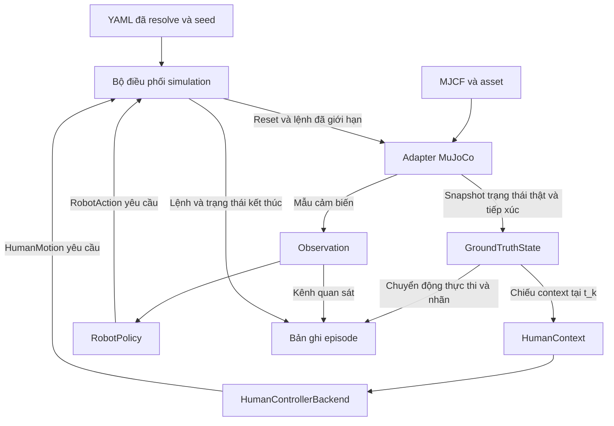

# 02 · Luồng dữ liệu

## Reset và một bước điều khiển

TASK 03 nhận lệnh robot qua `step(RobotAction)`, giữ người tại spawn và công bố các slot cảm biến chưa khả dụng. Luồng dưới đây mô tả cả các cổng dành cho controller và cảm biến khi được kết nối. [Runtime hiện tại](05_MUJOCO_RUNTIME.md)

1. Entry point resolve YAML, tham chiếu asset và seed, tạo adapter, robot policy và backend người. Bộ điều phối reset cả ba, lấy snapshot vật lý và quan sát có sẵn ở `t_0`, rồi công bố bản ghi reset.
2. Tại `t_k`, robot policy nhận `Observation` mới nhất tại mốc điều khiển này. Backend người nhận `HumanContext` chiếu từ snapshot cùng mốc, gồm người, robot và vật cản cần để mô hình hóa tương tác. Context này chỉ dành cho mô hình hành vi người.
3. Thu đủ đề xuất lệnh tại `t_k` trước khi thay đổi trạng thái vật lý. Kiểm tra ID, frame, kích thước và tính hữu hạn. Bộ điều phối áp giới hạn chung trên mỗi lệnh để tạo `limited`, rồi adapter áp lệnh mục tiêu trong các substep của khoảng `[t_k, t_{k+1})`.
4. Tại `t_{k+1}`, adapter trả snapshot trạng thái thật, tiếp xúc và các mẫu cảm biến mới thu. Bộ điều phối đưa mẫu vào hàng đợi và công bố mẫu đã sẵn sàng để tạo `Observation` mới. Nó tính chuyển động thực thi từ trạng thái vật lý đo được và xét điều kiện kết thúc. Bản ghi step gắn lệnh với trạng thái cuối khoảng. Không đưa mẫu có thời điểm sẵn sàng sau `t_k` vào quyết định tại `t_k`.
5. Công bố snapshot theo [schema episode](../schemas/EPISODE_SCHEMA.md). Lỗi runtime được ghi riêng khỏi kết thúc hợp lệ. Vòng điều khiển chỉ tiếp tục khi step hoàn thành và episode còn mở.

## Phân tuyến về sau

- Quan sát và lịch sử hành động đã sẵn có đi vào perception và prediction. Hành động ứng viên tương lai đến từ bài toán điều hướng tại thời điểm suy luận.
- Ground truth đi vào nhãn hoặc evaluation qua kênh tách biệt. Không dùng kênh này để lấp sensor thiếu, tạo pose thật dưới tên odometry hoặc làm input cho robot policy.
- Prediction trả dự báo tới 3 giây. Risk nhận dự báo và frame hợp lệ để tạo Risk Map. Navigation dùng Risk Map theo điều kiện baseline đã khai báo. [Ma trận baseline](../research/BASELINE_MATRIX.md)
