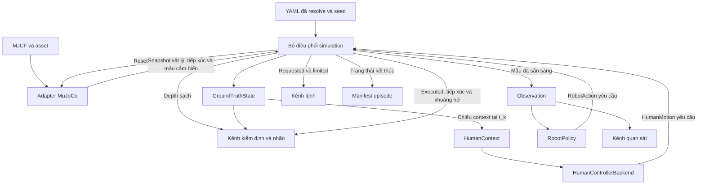

# 02 · Luồng dữ liệu

`step(RobotAction)` nhận lệnh robot từ bên gọi và trả snapshot trong bộ nhớ. Profile active nhận một backend người đã inject. Profile stationary giữ người tại spawn. `sensors=d435i` thu sau substep đến hạn, đưa mẫu đo vào `Observation` và cấp frame sạch qua `get_clean_depth()` cho kiểm định. Các sensor chưa có nguồn trả `missing`. [Runtime](05_MUJOCO_RUNTIME.md) · [Biên điều khiển người](HUMAN_2D_3D_BRIDGE_NOTES.md)

## Luồng runtime và các cổng lắp ghép

## Reset và một bước điều khiển

Smoke và các entry point thực nghiệm lắp backend người. Robot policy là bên gọi cổng `step`, ví dụ bộ phát lệnh twist cố định. Runtime thực hiện các bước sau.

1. Entry point resolve YAML và lắp adapter cùng backend người đã chọn. Runtime reset MuJoCo và camera nếu có, lấy snapshot cùng các mẫu đầu tiên ở `t_0`, rồi reset backend với seed người và roster của scene trước khi công bố kết quả. Robot policy do bên gọi quản lý.
2. Tại `t_k`, robot policy nhận `Observation` mới nhất tại mốc điều khiển này. Backend người nhận `HumanContext` chiếu từ snapshot cùng mốc, gồm người, robot và vật cản cần để mô hình hóa tương tác. Context này chỉ dành cho mô hình hành vi người.
3. Tại `t_k`, runtime xác thực lệnh và áp limiter để tạo `limited`. Backend người chỉ được gọi khi đến nhịp người. Hai batch requested và limited của người được giữ qua các tick xen giữa. Adapter giữ mục tiêu bánh robot, kiểm đường đi và áp dịch chuyển người theo từng substep.
4. Sau mỗi substep, adapter lấy tiếp xúc native và render D435i nếu đến lịch. Tại `t_{k+1}`, runtime kiểm stamp và roster, tính executed từ dịch chuyển vật lý, đo khoảng hở và xét điều kiện kết thúc. Với D435i, mẫu đo sẵn sàng tại thời điểm capture. Observation mới lấy mẫu mới nhất, hoặc giữ mẫu đã công bố nếu tick này chưa đến lịch.
5. Runtime công bố kết quả đồng bộ theo [schema episode](../schemas/EPISODE_SCHEMA.md). Recorder D435i ghi riêng depth đo, lệnh và ground truth kèm depth sạch. Benchmark người hiện dùng cấu hình sensor rỗng và lấy lệnh, ground truth, clearance và contact để đánh giá. Lỗi runtime được ghi riêng với tick lỗi và prefix hợp lệ cuối. [Recorder D435i](../MUJOCO_D435I_DEPTH.md) · [QA benchmark](../benchmarks/DATA_QA_PROTOCOL.md)

## Phân tuyến về sau

- Quan sát và lịch sử hành động đã sẵn có đi vào perception và prediction. Hành động ứng viên tương lai đến từ bài toán điều hướng tại thời điểm suy luận.
- Ground truth đi vào nhãn hoặc evaluation qua kênh tách biệt. Không dùng kênh này để lấp sensor thiếu, tạo pose thật dưới tên odometry hoặc làm input cho robot policy.
- Prediction trả dự báo tới 3 giây. Risk nhận dự báo và frame hợp lệ để tạo Risk Map. Navigation dùng Risk Map theo điều kiện baseline đã khai báo. [Ma trận baseline](../research/BASELINE_MATRIX.md)
