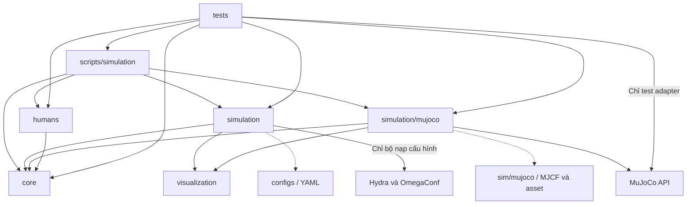

# 03 · Quy tắc phụ thuộc

Trong đồ thị, mũi tên đi từ bên sử dụng đến module hoặc tài nguyên nó cần. Đường liền là phụ thuộc Python. Đường nét đứt là truy cập tài nguyên khi chạy.

- `core` chỉ dùng thư viện chuẩn cho hợp đồng nền tảng. `simulation` gọi cổng từ `core` và không import `humans` hay adapter cụ thể trong bộ điều phối. Adapter dùng `core` và MuJoCo. Giữ `simulation/__init__.py` độc lập với adapter. Khởi tạo các lựa chọn cụ thể ở entry point.
- Bộ nạp `simulation/configuration.py` sở hữu dependency Hydra và OmegaConf. Nó chuyển các thiết lập đồng hồ và seed đã kiểm tra thành `EpisodeConfig`. Cổng `core` dùng kiểu Python và không nhận `DictConfig`.
- Chỉ `simulation/mujoco/` import MuJoCo trong mã sản phẩm. Test riêng của adapter có thể dùng API native để kiểm tra. Kiểm tra này không tạo ngoại lệ cho interface của runtime.
- `visualization` giữ rig, clip và lắp ghép MJCF skin dùng chung với demo. Tầng này dùng Python/NumPy, còn thao tác trên bone mocap của MjData thuộc adapter MuJoCo. [ADR hình ảnh người](../decisions/ADR-0002-shared-human-visuals.md)
- Backend người độc lập với backend khác. Một backend hybrid được khai báo có thể phối hợp chúng qua interface của `core`, với cấu hình và kết quả riêng. Controller chỉ nhận snapshot hoặc context thuộc hợp đồng.
- YAML và MJCF chỉ chứa dữ liệu. YAML dùng ID hoặc đường dẫn tài nguyên trong repo được kiểm tra khi resolve. MJCF dùng đường dẫn asset dưới `sim/mujoco/`. Một run ghi hash cho các tài nguyên thực tế đã nạp.
- Khi có module tương lai, dataset và evaluation tiêu thụ bản ghi công bố. Perception, prediction, risk và navigation trao đổi qua cổng và schema công bố, được lắp ghép từ entry point. Navigation không truy cập ground truth hoặc engine. ROS 2 chuyển đổi ở biên và không trở thành dependency của `core` hay `simulation`.
- Kiểm tra import và quyền truy cập dữ liệu khi review. Trước khi thay đổi hướng phụ thuộc hoặc quyền truy cập, ghi ADR và cập nhật [ranh giới module](01_MODULE_BOUNDARIES.md), [luồng dữ liệu](02_DATA_FLOW.md), schema và test chịu ảnh hưởng.
