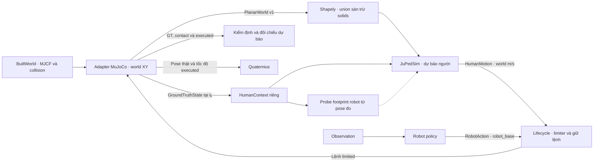

# Bridge JuPedSim 2D và MuJoCo 3D

TASK 04 kiểm bridge dùng chung bằng `CollisionFreeSpeedModel` thế hệ 1, trong test kỹ thuật. Tầng lắp ghép nghiên cứu vẫn chờ cổng tương tác robot động `BLOCKED_CAPABILITY`. SFM, AVM và CSM V2 chưa được đăng ký hay chạy episode trong task này. [Kiểm chứng API 1.4.2](../backends/JUPEDSIM_API_COMPATIBILITY.md)

## Hình học

- Tầng lắp ghép lấy `inspect_world(built, allow_rotated_walls=True).planar_world()`. Adapter chỉ xuất primitive collision tĩnh của worldbody thuộc group sàn 0 hoặc vật cản 1/3. Geom có cả hai mask bằng 0, mesh hiển thị và body actor đi theo đường riêng. Pose và nửa kích thước lấy từ model đã compile. Frame JPS là world XY, cùng mét và gốc tọa độ. Sàn nằm ngang, đỉnh Z = 0. Kiểm hình học opt-in cho tường xoay yaw bằng bốn đỉnh thực. Profile runtime và bộ nạp authored hiện vẫn yêu cầu tường song song trục. Trụ đứng dùng đa giác ngoại tiếp 64 cạnh. Floor xoay, nghiêng, cao độ khác Z = 0 và primitive ngoài danh mục cần mở rộng adapter.
- Geometry là hợp các miền sàn trừ hợp vật cản. Giữ sàn ngoài trời nếu MJCF có floor collision hữu hạn, giữ lỗ, cửa và mọi thành phần liên thông. Không dùng convex hull hay render mesh để lấp khoảng trống. API native nhận một `Polygon`. Khi có nhiều thành phần, phải chọn duy nhất thành phần chứa mọi endpoint của episode. Từ chối roster đi qua nhiều thành phần hoặc thiếu điều kiện để chọn.
- `validate_route` sàng lọc spawn/goal và liên thông của tâm đĩa trên polygon inset bảo thủ theo bán kính. `opening_width` đo bề rộng tại tiết diện chỉ định và yêu cầu hai đầu tia vượt qua mặt chắn. Với nhiều tiết diện được khảo sát, bề rộng cổ chai là giá trị nhỏ nhất đo được. Các phép kiểm riêng dùng bán kính thật, còn polygon native vẫn chưa inflate. Khả thi hình học cho một actor không bảo đảm tránh nhau hoặc tìm đường thành công cho cả nhóm.
- Hash là SHA-256 của WKB little-endian đã normalize của toàn bộ miền đi được, trước chọn component và trừ proxy. `projection_error` là cận dư bán kính tĩnh theo công thức `r × (sec(π/64) − 1)` theo m. Tường box và tọa độ sàn có phép chiếu XY trực tiếp. Kiểm 3.524 điểm bằng tia MuJoCo ở fixture cửa có tường xoay, một trụ và một geom thuần hình ảnh.

World thực đã thử gồm corridor, blind corner, hospital medium, school floor và arena obstacle. Cửa và giao cắt độc lập dùng fixture MJCF kỹ thuật. Checkout có cửa lớp ở school, nhưng thiếu bản đồ riêng được xác nhận cho Card ND/IN và thiếu warehouse MJCF. Xem diện tích, component và lỗ đã đo trong báo cáo. [Bằng chứng hình học](../reports/human_models/TASK_04_REPORT.md)

## Đồng hồ và quyền sở hữu XY

| Lưới | Bước | Cách sử dụng |
| --- | --- | --- |
| Vật lý MuJoCo | 2 ms | Dynamics bánh xe, mocap, solver contact |
| Robot và observation | 50 ms | Bước lifecycle và snapshot |
| Người | 100 ms | Một callback tại biên đầu khoảng, giữ lệnh qua hai tick robot |
| JuPedSim nội bộ | 10 ms | Mười bước dự báo trong mỗi callback, kiểm số bước nguyên |
| GT kiểm định | 100 ms | Mốc lấy mẫu 10 Hz riêng. Test đối chiếu trên lưới này. |

Mỗi callback so vị trí JuPedSim từ lần dự báo trước với snapshot MuJoCo cùng thời điểm. Khi ở trong dung sai, tiến đúng mười bước rồi lấy sai phân vị trí đầu và cuối của **dự báo native**, chia 0,1 s để trả `HumanMotion`. Lifecycle giới hạn tốc độ/gia tốc và giữ lệnh. MuJoCo là bộ tích phân duy nhất cho tọa độ thực thi. So sánh ở biên tiếp theo hoặc biên cuối episode chỉ đọc, kể cả khi tạm dừng. Reset dựng instance native và ánh xạ agent mới. Bridge từ chối callback sai lưới, sai episode/roster và sai số lớn hơn ngưỡng do caller cấp.

Probe 10 giây dùng giới hạn kỹ thuật **0,25 m** cho sai lệch Euclid dự báo–GT. Sai số có thể tích lũy do limiter hoặc guard. Cổng này dừng khi vượt ngưỡng và giữ số đo cuối để chẩn đoán. API 1.4.2 chưa có cách chỉnh pose native được hỗ trợ. Không dùng số bước bổ sung để bù sai số. Telemetry probe lưu `geometry_hash`, `projection_error`, `robot_proxy_error`, `state_sync_error`, `internal_dt` và `unsupported_capabilities` trong log kiểm thử. Episode writer nằm ở mốc riêng.

## Robot và contact

Footprint proxy lấy tâm, vận tốc world và bán kính từ snapshot robot thật. Lỗ 64 cạnh chỉ biểu diễn hình học tại lúc lấy mẫu. Sai số giữ mẫu đo từ độ dịch chuyển tâm thật cộng cận đa giác và chênh bán kính nếu có. Vận tốc đo được chỉ dùng kiểm định. Probe robot đứng yên đặt dung sai **0,001 m** cho sai số footprint và **0,001 m/s** cho tốc độ, phục vụ riêng fixture. Lỗ di động chỉ là phép thử khả năng của API. Robot tiếp tục nhận lệnh từ policy/caller và chạy qua actuator MuJoCo.

JuPedSim mô phỏng tương tác trong footprint XY. MuJoCo giữ contact 3D và nguồn GT. Mocap là actor kinematic. Solver robot–tường và robot–người vẫn dùng các mask hiện có. Người–người và người–tường tiếp tục đo clearance hình học và giữ mã `not_observable_solver`. Skin Quaternius bám pose thực thi. Các slot depth, LiDAR, IMU và odometry vẫn `capability_unavailable`. [Biên runtime](HUMAN_2D_3D_BRIDGE_NOTES.md) · [ADR-0006](../decisions/ADR-0006-jupedsim-shadow-bridge.md)
