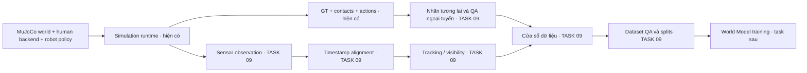

# Bàn giao Human Models sang TASK 09

**Entry status · Có thể bắt đầu tích hợp Sensor/Dataset với các giới hạn nghiên cứu đã ghi.** Benchmark 900 lượt là tập đối chứng Human Navigation và fixture hồi quy cho mô phỏng. Các cổng observation, calibration và dữ liệu huấn luyện thuộc TASK 09 trở đi. [Kết luận 08F](../reports/human_models/TASK_08F_REPORT.md)

## Thành phần có thể dùng ngay

| Thành phần | Bằng chứng hiện có |
| --- | --- |
| World MuJoCo, geometry và scenario bindings | Sáu Card, ba level, pose/reset có provenance, footprint, clearance và phép kiểm route. |
| Human backend registry | ORCA, SFM, AVM và CSM V2 trên native runtime đã xác minh. Mỗi episode chọn một backend cho tất cả người. |
| Robot action schedules và cặp tương tác | Advance, Stop, Yield/Turn, Reverse trong các Card đã duyệt. 180 cặp có common prefix và can thiệp đã thực thi. |
| Episode, seed và provenance | Khóa Git/dependency/config/model/asset, ID và seed streams tách theo mục đích. |
| GT, contact, action recording và QA | GT 10 Hz, trace/action 50 ms, contact 2 ms, requested/limited/executed tách riêng. Dùng được để tạo nhãn ngoại tuyến và làm oracle cho QA. |
| Báo cáo và ca hồi quy | Coverage, metrics, inventory, failure catalog và chín replay. ND thiếu nhãn, AVM còn `PARTIAL` và CSM V2 có lượt người thiếu tiến độ. |

[Cấu trúc module](../architecture/01_MODULE_BOUNDARIES.md) · [Danh mục ca lỗi](../benchmarks/FAILURE_CATALOG.md) · [Gói tái lập](../benchmarks/REPRODUCIBILITY_PACKAGE.md)

## Biên dữ liệu

Adapter sở hữu engine objects. Runtime trao đổi kiểu của `core`. Robot policy chỉ nhận observation đã sẵn sàng tại tick quyết định. GT phục vụ context backend người hiện tại và luồng QA/nhãn ngoại tuyến riêng. Dữ liệu `executed` ghi sau bước vật lý. Lệnh ứng viên tương lai phải đến từ planner/policy tại mốc quyết định, với timestamp và frame đã khai báo. Join các kênh theo `episode_id`, tick, capture time, available time và frame. [Luồng dữ liệu](../architecture/02_DATA_FLOW.md) · [Schema episode](../schemas/EPISODE_SCHEMA.md) · [State và action](../schemas/STATE_AND_ACTION_SCHEMA.md)

## Cổng cần xây dựng trong TASK 09

1. **Audit capability.** Snapshot hiện có mounting frames và hình học D435i/YDLIDAR X3. Depth, LiDAR, IMU và odometry trả `missing/capability_unavailable` khi được yêu cầu. Profile benchmark tắt sensor. GT 10 Hz là kênh trạng thái thật dành cho QA.
2. **D435i depth và YDLIDAR X3.** Tích hợp depth và scan theo frame/đơn vị rõ ràng. Kiểm FOV, range, occlusion, vật chuẩn và tương thích headless trên MuJoCo. Ghi điều kiện `missing`, `invalid`, `stale` theo schema.
3. **IMU và odometry.** Kiểm mốc tích phân, frame, trôi và nhiễu. Tách quan sát đo được khỏi GT.
4. **Noise, calibration và timing.** Đo intrinsics/extrinsics, capture rate, latency, jitter, drop và lệch đồng hồ bằng fixture native. Công bố seed luồng sensor. Gate phải chứng minh không có sample từ tương lai lọt vào observation.
5. **OBS/ACT/GT export và tracking.** Ghi observation, requested/limited và kênh đánh giá riêng. Định nghĩa actor quan sát được, bị che, mất track, hội nhập ID và label tương lai. GT dùng để chấm nhãn và kiểm QA ngoại tuyến.
6. **Cửa sổ action-conditioned.** Định nghĩa anchor, resampling và quy tắc biên 2 giây lịch sử / 3 giây tương lai. Làm rõ mốc bao gồm, cửa sổ thiếu và hành động được biết tại anchor. Kiểm bằng fixture có lệch clock và sample thiếu.
7. **Dataset QA và splits.** Chốt Train/Validation/Test-ID/Test-OOD theo nhóm scene/seed/điều kiện. Giữ các action branch chung reset và các cửa sổ chồng lấn trong cùng split. Đo phân phối, độ phủ, missing, label và leakage trước xuất dataset.
8. **Export, loader và tái lập.** Viết manifest/checksum, kiểm round-trip schema, loader và reproducibility trên tập được duyệt. Protocol train/eval World Model thuộc giai đoạn tiếp theo.

[Trạng thái cảm biến runtime](../architecture/05_MUJOCO_RUNTIME.md#quan-sát-và-contact) · [Lộ trình Sensor/Dataset](../ROADMAP.md#task-04b04c--từ-schema-đến-dataset)
