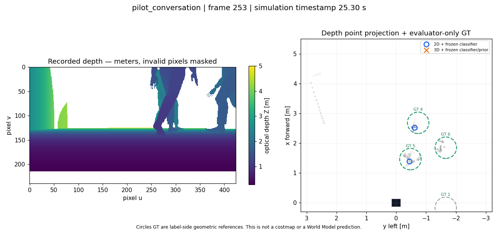
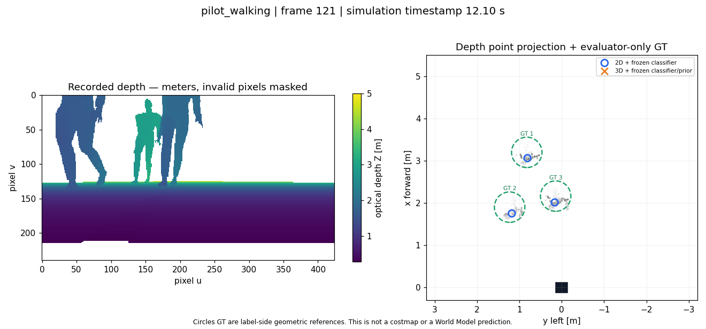

# Kết quả merge detector depth — 30/10/2026

**Đã merge code dưới dạng thử nghiệm. Phần tích hợp phần mềm PASS; chất lượng detector 3D FAIL gate trên cả hai pilot, không thay bản cũ.**

- Merge commit: `b94375a40bc039936ad29737d0b103d601cf4e2e`.
- Nhánh được merge: `feat/depth-person-detector`, commit `70bcda0e26ff86b3389a49295feda3ef72958b1d` đã là ancestor thật của nhánh hiện tại.
- Nhánh đích: `test/gazebo-harmonic-benchmark`.
- [Trang localhost có slider/GIF](http://localhost:35315/depth_person_detector_v1/index.html).
- [Cách chạy và API](../../DEPTH_PERSON_EXPERIMENT.md).
- [Receipt nghiệm thu](acceptance.json), [kết quả số](comparison.json), [protocol và hashes trước replay](plan.json), [sensor seal](sensor_seal.json).

## Đã sửa và đã nghiệm thu

1. Đặt code vào đúng `perception`, không đưa code mới vào các report/archive lịch sử khi giải quyết merge conflict. Giữ lịch sử tác giả nhánh gốc.
2. Một implementation detector chính; bản artifacts chỉ là compatibility shim. Weights, features/inference cũ và IdentityGuard giữ nguyên bytes. Dùng lại weights không đồng nghĩa detector proposal/prior mới đã được chứng nhận.
3. ROS wrapper đọc CameraInfo và TF tại depth timestamp, không hard-code camera D435i hay chiều cao 28 cm. Hỗ trợ odom child base_footprint qua TF sang base_link.
4. Decode 16UC1 → m và 32FC1 → m nhất quán, xử lý padding/endian, giữ NaN/Inf là invalid để projection loại rõ ràng.
5. Buffer odom kiểm header stamp, available stamp và tuổi ≤150 ms. Trùng timestamp bỏ qua; depth timestamp lùi tạo tracker episode mới và chờ input mới.
6. Inference exception/NaN score trở thành invalid và không được promote thành người. JSON có confidence, ID, velocity validity, ambiguity, episode và observation validity. Score sau prior là điểm heuristic, không phải xác suất đã calibration trên dữ liệu mới.
7. Marker ID dựa proposal index, không dùng abs(track_id) gây trùng giữa ID1 và unknown−1. Output nằm trong namespace experimental, không đưa vào costmap/Nav2.
8. Thêm launch riêng và resources cài trong package. Build vào prefix /tmp mới; test node từ /tmp chứng minh không cần source checkout để import resources.
9. Benchmark tổng hợp matching vị trí một-một, reset giữa cảnh tĩnh, đếm chuyển ID theo chuỗi; không chỉ so số người.

Kiểm tra đã chạy:

| Kiểm tra | Kết quả |
|---|---|
| Root suite, gồm 13 test hồi quy mới | 323 tests OK, 2 skip có điều kiện dependency |
| 5 test pipeline được mang từ nhánh | PASS |
| 14 behavior tests IdentityGuard cũ | PASS |
| Build custom_corridor vào prefix riêng | PASS |
| Installed ROS transport/input/reset checks | 8/8 PASS |
| Optional launch show-args | PASS |
| Bộ 30 cảnh tổng hợp với spatial matching mới | 30/30 PASS |
| Replay recordings | 910 frame, 905 frame đủ causal odom/GT để đo |
| Audit seal/source/input/causal odom | PASS, 2.730 sensor rows của ba pipeline |
| Baseline 116 file + hai capture freeze | PASS, giữ nguyên |
| ZIP pilot đã bàn giao | SHA256 vẫn b64bdb394f4a2ddabc6d97f2e9ccd3704dd9c6b0855e5d52fb11c6eeaea23ee2 |

Root suite có các dòng timeout/start Gazebo của test mock failure paths; không có simulator được khởi động từ các test này. ROS smoke dùng một frame depth đã ghi cùng TF/odom/clock có kiểm soát, không phải một lượt live Gazebo perception/nav mới. HTTP 200 được kiểm cả Ubuntu và Windows, 30 asset link/slider ảnh được kiểm tải; JavaScript qua Windows node --check. Browser automation không chạy được vì CUA helper Windows lỗi, nên không tuyên bố đã tự bấm slider trên UI. Các PNG khoa học đã được xem trực tiếp.

## Kết quả trên dữ liệu đã ghi

| Episode | Pipeline | Paired / Unpaired | Coverage proxy | ID switch ≤0,5 s | p95 CPU |
|---|---|---:|---:|---:|---:|
| Conversation | 2D + classifier đóng băng | 1.059 / 90 | 82,6% | 0 | 15,4 ms |
| Conversation | 3D + classifier/prior mới | 93 / 80 | 8,2% | 0 | 27,9 ms |
| Walking | 2D + classifier đóng băng | 488 / 160 | 90,7% | 1 | 7,6 ms |
| Walking | 3D + classifier/prior mới | 41 / 103 | 7,6% | 0 | 18,1 ms |

Paired là ghép hình học một-một với tâm người GT, gate 0,60 m và margin mơ hồ 0,15 m. Coverage proxy dùng GT có ít nhất 18 điểm depth trong bán kính 0,40 m, z từ 0,06–1,95 m làm xấp xỉ khả năng quan sát. **Chưa có instance mask/pixel truth; không gọi đây là semantic recall/precision.** Unpaired cũng bao gồm ghép mơ hồ hoặc sai vị trí. Comparator 2D + classifier được dựng offline từ proposal stage cũ và classifier cũ; không khẳng định đây là một ROS detector đã triển khai trước đó.

Protocol đặt trước replay: giữ ≥95% paired của comparator, unpaired/ID switches không tăng, p95 ≤50 ms. Bản mới chỉ giữ khoảng 8–9% paired, nên gate retention FAIL ở cả hai episode. Các gate khác không đổi sau kết quả. Ít đổi ID khi hầu hết người không được phát hiện không chứng minh tracking tốt hơn. Fragmentation conversation còn tăng 2→4; tất cả số của baseline geometry và ba variant có trong comparison.json.

Đã seal toàn bộ inference sensor-only trước khi parse human_states GT. GT chỉ dùng evaluator và vẽ overlay. Không train, không tune threshold theo kết quả hoặc mở lại held-out classifier test cũ.

## Chẩn đoán và ảnh

[Chẩn đoán 32 frame mỗi episode](diagnosis.json) cho thấy mất người qua nhiều bước: conversation 73 trường hợp GT có hỗ trợ depth → 57 có cluster gần → 47 qua lọc planar → 6 còn dự đoán người. Walking tương ứng 31→30→24→5. Có các proposal classifier score đủ trước prior nhưng bị prior loại. Đây là dấu hiệu cần thiết kế lại geometry/prior trên development set; chưa thể quy hết cho camera thấp.

[GIF conversation](pilot_conversation.gif) · [GIF walking](pilot_walking.gif) · [provenance media](media_provenance.json) · [hash và tên gốc của media commit](committed_media.json).

GIF là slideshow 10 frame chọn đều, 700 ms/hình, không phải video realtime. Depth từ Gazebo đã ghi, ảnh màu/BEV vẽ bằng Matplotlib; vòng GT chỉ để đối chiếu, không truyền vào detector. Không có ảnh AI. BEV trong báo cáo là point cloud projection, không phải costmap hay WM prediction.

Raw/results đầy đủ giữ riêng tại `experiments/social_navigation/perception/depth_identity_guard/generated/integration_20261030_01/`: comparison/, media_v2/, logs và viewer PID receipt. Thư mục media/ đầu tiên chỉ khác việc clip nhãn ra ngoài khung; số liệu inference không đổi. Web server bind loopback 35315, phục vụ viewer hiện tại và báo cáo mới, không ghi đè các trang báo cáo cũ.

## Quyết định bàn giao

Có thể bàn giao API detector/pipeline và launch thử nghiệm cho người port MuJoCo. **Giữ detector này experimental, không thay default, không lấy làm GT hoặc nhãn train.** Dataset pilot/ZIP và hợp đồng bàn giao cũ vẫn dùng được theo phạm vi nghiệm thu của chúng; phần thử detector này không chặn bàn giao backend.

Nếu phát triển tiếp detector: tạo development set nhiều mẫu người/che khuất/calibration, sửa proposal/prior rồi freeze và đánh giá sensor set riêng. Không nới gate của lượt này và không biến bộ 30 hình trụ/hộp thành bằng chứng tổng quát. H1–H5/association, WM/RL và quyền train chưa được bật.
