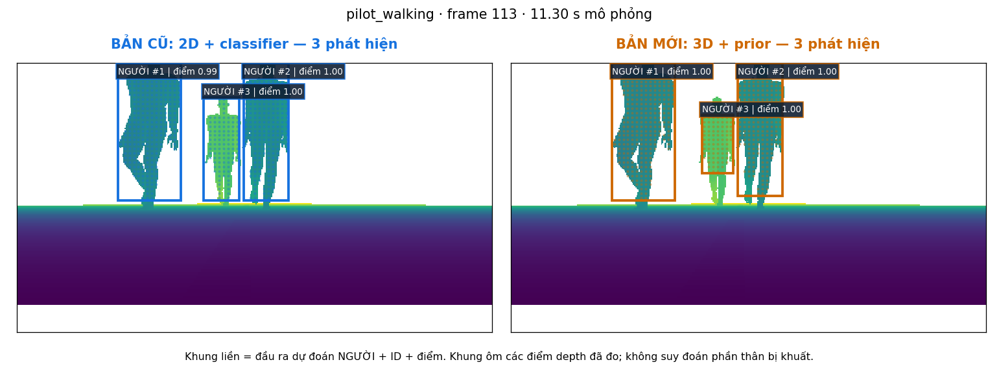
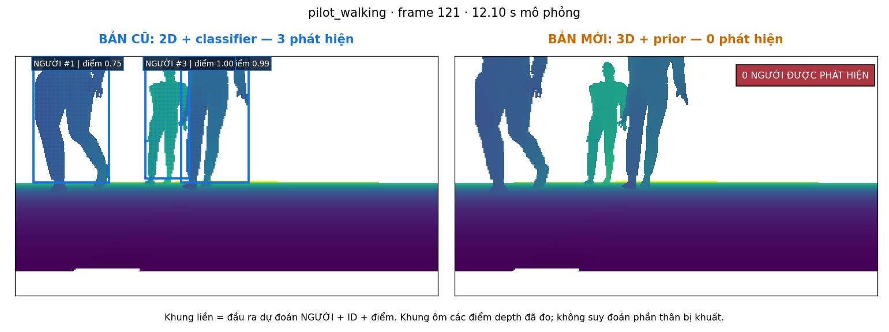
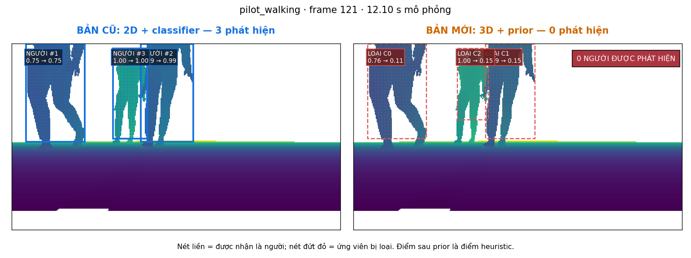

# Overlay detector trực tiếp trên depth — 30/10/2026

Sửa cách trình bày sau phản hồi báo cáo BEV khó hiểu. Không thay detector, weights, ngưỡng hoặc số liệu nghiệm thu trước.

[Mở báo cáo có khung người](http://localhost:35315/depth_person_detector_v2/index.html#detector).

- Hai ảnh cạnh nhau: bản cũ 2D và bản mới 3D.
- Khung liền: dự đoán người cuối cùng, kèm ID và điểm; hiện rõ 0 phát hiện nếu không có output.
- Nút “Ví dụ bản mới bắt được người”: mở một frame có output để quan sát khung. Nút “Ví dụ bản mới bỏ sót”: mở frame bản mới loại người mà bản cũ vẫn giữ.
- Checkbox ứng viên bị loại: khung nét đứt đỏ, điểm trước/sau prior và bảng điểm đầy đủ. Score sau prior chưa phải xác suất calibrated.
- GT để trong mục tham chiếu riêng, không đưa vào khung detector. Khung GT chỉ là proxy vùng depth quanh tâm GT, không phải instance mask.
- Bấm ảnh mở lớn; có slider và GIF với khung người. Các GIF là slideshow, không phải video realtime.

Khung được inverse-project từ chính các điểm của proposal detector. Renderer kiểm khớp số detection, XY, point count với sensor outputs đã seal; điểm mới cũng khớp chính xác. Score cũ được tính lại bằng đúng classifier đóng băng vì file track cũ không lưu score. Không suy ra bbox toàn thân từ GT hoặc chiều cao giả định; khung có thể chỉ ôm phần người camera nhìn thấy.

22 frame minh họa: 10 frame cách đều đã có của mỗi episode cộng ví dụ nhiều ghép hình học 3D và ví dụ bỏ sót. Đây là lựa chọn có chủ đích để giải thích; không thay thống kê 910 frame/gate FAIL đã công bố. Trong walking frame113, cả hai có 3 output; frame121, bản cũ có 3 và bản mới có 0. Các proposal mới ở frame121 có score gốc khoảng 0,76/1,00/1,00 nhưng bị prior giảm còn khoảng 0,11/0,15/0,15, dưới threshold0,45.







[Verification receipt](verification.json) · [Tọa độ khung/score/provenance](detector_overlays.json).

Đã xem trực tiếp các PNG, kiểm HTTP 99 asset và JavaScript hai block qua Windows node --check. Browser automation vẫn không khởi động được CUA helper; không tuyên bố đã tự bấm UI trong browser thật. Source freeze inference và comparison.json giữ nguyên. Không mở Gazebo, không train và không chạy lại benchmark để đổi số.

V1 chỉ thêm link điều hướng sang V2, giữ bản HTML ban đầu ở index_before_detector_overlay.html. Các số liệu và JSON trong V1 không đổi. Media/JSON đầy đủ ở generated/integration_20261030_01/detector_overlay_v2; bản render nháp vẫn giữ ở detector_overlay_v1. Các file ảnh trong tài liệu là bản sao từ output cuối.

Tái lập từ repo root (output phải mới):

```bash
TASK=experiments/social_navigation/perception/depth_identity_guard
RUN="$TASK/generated/integration_20261030_01"
DATA=experiments/social_navigation/datasets/handoff_pilot/generated/pilot01/normalized
OMP_NUM_THREADS=1 OPENBLAS_NUM_THREADS=1 MKL_NUM_THREADS=1 \
 python3 "$TASK/render_detector_overlays.py" --comparison "$RUN/comparison" --normalized-root "$DATA" --previous-media "$RUN/media_v2" --output "$TASK/generated/my_new_overlays"
python3 tools/publish_depth_person_report.py --run-dir "$RUN" --media-dir "$RUN/media_v2" --detector-overlays "$TASK/generated/my_new_overlays" --output /PATH/TO/NEW_REPORT
```
