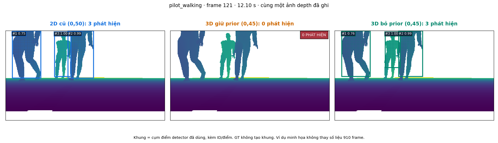
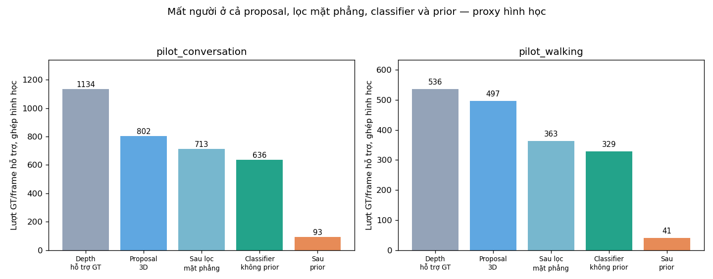

# Nghiệm thu vòng ablation/generalization preparation — 30/10/2026

Branch **feat/depth-detector-generalization**, worktree riêng từ dd7a2b0. [Hướng dẫn đầy đủ](../../DEPTH_GENERALIZATION.md). [Localhost có khung người](http://localhost:35315/depth_generalization_v1/index.html).

**Ablation đã hoàn thành; benchmark ngoài miền mới ở bước chuẩn bị, chưa có dữ liệu độc lập.** Không train, không mở Gazebo, không nâng semantic/association/WM eligibility và không sửa workspace MuJoCo.

| Episode | 2D cũ 0,50 | 3D giữ prior 0,45 | 3D bỏ prior 0,45 | 3D bỏ prior 0,50 |
|---|---:|---:|---:|---:|
| Conversation | 82,6% | 8,2% | 56,1% | 55,7% |
| Walking | 90,7% | 7,6% | 61,4% | 61,2% |

Coverage trên là proxy hình học GT có hỗ trợ depth, chưa phải semantic recall. Hai episode cùng world/mesh là development mở, không là test tổng quát hóa. Gồm 910 frame, 905 frame có input/GT hợp lệ. Lượt runner mới tái lập đúng 1820 dòng output baseline/prior cũ và seal tất cả 3640 dòng của 4 variant trước khi parse GT.

Prior làm mất thêm 831 lượt ghép nhưng unpaired không giảm trong hai recording này. Bỏ prior vẫn FAIL retention ở cả hai episode; conversation fragmentation tăng. Stage before-planar gồm cả density/size/torso/envelope, không quy toàn bộ mất người riêng cho clustering. Có báo mất/lấy lại pairing do ambiguity; không gọi stage counts là upper bound chặt.

**Quyết định:** không tiếp tục ưu tiên current 3D proposal stack/prior để train. Giữ high-recall 2D proposals, tái dùng XYZ/calibration/causal tracking; thử head PointNet-style học từ patch XYZ đa dạng. Head 18.881 tham số đã qua 5 check CUDA trên RTX4060 (forward/backward/padding/permutation/empty-patch, weights không đổi), 0 optimizer step. Đây không phải pretrained person detector, chưa có số accuracy.

Manifest benchmark 8 case disjoint scene/avatar/episode, gồm người và no-human controls. Validator báoNOT_READY với file/capture/mesh hash còn thiếu. Không đổi màu/animation thành mesh test mới: inventory geometry arrays xác nhận tất cảhuman DAE trongrepo cùng fingerprint. Hash khác cũng cần source-family review, không tự chứng minh morphology độc lập. LiDAR hiện thấy collision cylinder, nên dữ liệu pretrained leg detector chưa phải drop-in.

Nguồn dataset/model được rà soát ở source_review.json và report; SDT/DROW/FROG không được tải hoặc dùng làm kết quả mới. Template train/validation/test và recipe đã có, còn cần capture/labelQA của morphology/layout độc lập trước một lượt train rồi freeze và mở test.

## Kiểm chứng

- Root suite 338 tests OK, 2 conditional skips; 38 contract smoke PASS.
- 7 new ablation tests + 8 manifest tests nằm trong 338; 13 integration regression cũng nằm trongsuite.
- 116 protected baseline files PASS. Mainworktree feat/mujoco-backend sạch,HEAD b777e64 giữ nguyên.
- Independent source/input/seal/causal checks PASS 3640 rows. Numeric evaluator reuse source frozen, không tuyên bố audit độc lập toàn bộ metric arithmetic.
-22 HTTP assets PASS, JavaScript syntax Windows PASS, xem PNG trực tiếp. Không có browser click automation.
- Các dòng StartingGazebo/timeout tronglogroot suite là mock failure-path tests, không phải một simulator run.

[Acceptance](acceptance.json) · [Ablation numbers](result.json) · [Source/input freeze](plan.json) · [Sensor seal](sensor_seal.json) · [Integrity](integrity.json) · [Candidate CUDA](candidate_cuda.json) · [Benchmark NOT_READY](benchmark_readiness.json) · [Assets](asset_inventory.json) · [Full tests](full_tests.log).

Khung từ điểm detector đã đo, không từGT; hình là depth ghi thật và biểu đồ Matplotlib. Media đầy đủ/rawJSONL giữ ởgenerated củaworktree vàviewerlocalhost. Bản draft report được giữ riêng; không sửa report trước hoặcfailedcaptures. Không có ảnh AI.
