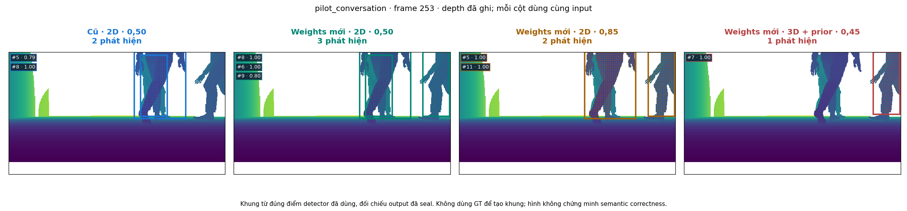
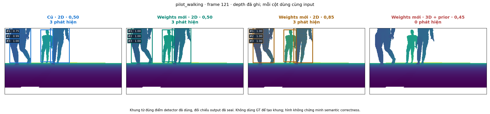

# Nghiệm thu review code mới — 31/10/2026

[Phân tích, quyết định và cách tái lập](../../INCOMING_DETECTOR_REVIEW_2026-10-31.md). [Web có bbox](http://localhost:35315/incoming_detector_review_v1/index.html).

Đã nhập bab853ea và2ffd7c75 vào riêng nhánh detector. Test code nguồn338OK/2skip; sau sửa tích hợp344OK/2skip.116protected filesPASS;5world,defaultmodel/config vàrecipe giữ byte879aaf4. Newweights giữ nguyên ở experimental. Không train hoặc mở Gazebo. Các dòng StartingGazebo/timeout tronglog là mocks.

910frame,905frame đánh giá,4variant; baseline910/910reference khớp. Sensor sealed trước GT; source/input/outputhashesPASS. Coverage chỉ proxy hình học, không semantic acceptance. New2Dweights giảm conversation nên FAIL nonregression tổng, walking có cải thiện ở0,50. PointNet checkpoint/receipts thiếu, không thể tái lập từ phần đã push.

- [Acceptance/scope](acceptance.json)
- [Kết quả](result.json)
- [Source/input freeze và provenance audit](plan.json)
- [Sensor seal](sensor_seal.json)
- [Full suite nguồn](incoming_full_tests.log)
- [Full suite sau sửa](integrated_full_tests.log)
- [Baseline](integrated_baseline.json)

Ảnh là depth Gazebo đã ghi, bbox từ đúng cụm điểm inference đã seal, không có GT tạo bbox hoặc ảnh AI.4frame/episode minh họa cố định, không thay metrics toàn910frame.

