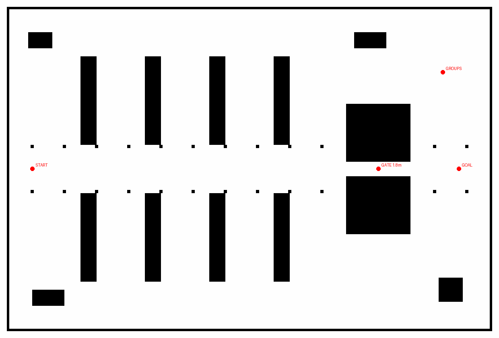

# Nhà xưởng và vòng khảo sát SocNavGym

[Đã có bộ so sánh offline chung36 lượt](benchmark/common_response/README.md):6 cấu hình của3 framework,18 cặp far/near, một seed và6 người. Giữ các overlap native/soft-force; ưu tiên SocNavGym lifecycle variant cho mục tiêu nhóm, CrowdSimPlus ORCA+ làm baseline avoidance. Đây chưa phải benchmark chung Gazebo/Nav2. Pilot ComplexityNav đã commit `c9dffe2`.

[ComplexityNav đã chạy pilot Gazebo4 người](benchmark/complexitynav_gazebo/README.md):60s có robot tiến/ngang, actual proxy/clock/LiDAR đạt, đủ4 IDs,98.33% tia human đủ điều kiện khớp15cm; NVIDIA/GUI/shutdown được kiểm chứng. Có thêm lượt lỗi worker để xác nhận freeze. Đây là geometry variant, chưa benchmark Nav2 hoặc dense crowd. Bản offline đã commit `be816c3`.

[ComplexityNav: adapter tránh vật cản đạt offline](benchmark/complexitynav_geometry/README.md):6 cảnh ghép cặp native/variant,1040 update adapter; đi vòng kệ tới đích, hai chiều qua khe1.8m, đủ42 AABBs, reset80 bước. Chưa nối biến thể mới vào Gazebo. Native preflight trước đó đã commit `b0b3c33`; nhánh native vẫn giữ nguyên hạn chế xuyên kệ.

[ComplexityNav: kiểm định trước Gazebo](benchmark/complexitynav_contract/README.md): ID/clock/reset/native-step đạt; hai probe native ORCA/SFM đi xuyên kệ. Đủ42 AABBs được đối chiếu nhưng chưa được native human solver dùng, nên chưa nối Gazebo; bước kế tiếp là adapter hình học riêng. Ba phần SocNavGym đã lưu ở `2480158`, `779c338`, `b3f0022`.

[Formation/tách nhóm đã chạy trong Gazebo](benchmark/socnavgym_warehouse_lifecycle/README.md): bản sửa adapter riêng hỗ trợ6 người, đủ42 vật cản nhà xưởng và robot có vận tốc đo thực. Ba trace offline đạt; hai lượt Gazebo120s đạt kiểm tra kỹ thuật. Seed42 chỉ có formation, seed43 có nhóm đứng/đi rồi tan; tâm nhóm đi được2.17m. Camera thật, NVIDIA và GUI đã kiểm chứng. Đây là pilot tại một lối đi, chưa chạy Nav2 hoặc benchmark chọn framework.

[Bản sửa formation độc lập](benchmark/socnavgym_lifecycle_fix/README.md) là cơ sở của adapter trên. [Native reference](benchmark/socnavgym_lifecycle/README.md) vẫn giữ nguyên cả nhảy vị trí và overlap đã đo; không gọi bản sửa là hành vi upstream nguyên bản.

[Probe phản ứng người](benchmark/human_response_replay/README.md):6 CrowdSimPlus +18 SocNavGym offline, cùng input robot định trước; hình replay được gắn nhãn riêng. [Gazebo nhóm — hoàn tất lượt bổ sung](benchmark/group_gazebo_demo/README.md): sửa QoS subscriber AMCL trong harness, ba lượt nhóm đi bộ đã chạy; GUI kéo/zoom và Pause/Play hoạt động. Tổng sáu lượt hợp lệ, năm lượt đạt sai số đích thật ≤0.20m; giữ lại một lỗi khởi tạo cũ.

[Kiểm tra nhiều seed](benchmark/localization_validation/README.md):12 lượt so AMCL gốc với LF-prob+beam-skip, seed42/43/44; dữ liệu giữ riêng với pilot cũ.

Đợt thử mới: [workaround shutdown Gazebo trên WSL D3D12](benchmark/shutdown_fix/README.md) và [pilot AMCL gồm 3 cấu hình × 2 human policies](benchmark/localization_trials/README.md). Cả hai nằm trong harness thử nghiệm, chưa thay cấu hình robot gốc.

Tất cả file mới nằm trong `experiments/social_navigation/`. Không sửa launch/model, cấu hình Nav2 gốc, plugin C++ hay môi trường Python ROS
đang có. Dùng workspace
`install/` hiện có; không rebuild các thay đổi chưa commit của người dùng.

## Chạy nhà xưởng trên Ubuntu/WSL

Từ thư mục gốc DynamuhSim:

```bash
bash experiments/social_navigation/run.sh warehouse
```

Lệnh mở Gazebo + RViz + Nav2 MPPI Omni. Robot bắt đầu tại `(-27, 0, 0)`.
Trong RViz dùng **2D Goal Pose**, ví dụ `(26, 0)` để đi qua lối hẹp.
Mặc định ROS domain 73 và Gazebo partition `dynamuhsim_social_warehouse`.
Không mở hai lần cùng domain/partition. Nhấn Ctrl+C trong terminal để dừng.

Chỉ xem world và robot, chưa chạy Nav2:

```bash
bash experiments/social_navigation/run.sh warehouse nav:=false
```

Headless và kiểm tra tự động có timeout, dừng đúng process group được tạo:

```bash
bash experiments/social_navigation/run.sh verify --world warehouse
bash experiments/social_navigation/run.sh verify --world warehouse --nav --goal-x 26 --timeout 240
bash experiments/social_navigation/run.sh verify --world warehouse --nav --goal-x 26 --timeout 240 --gui
```

Không cần colcon build: wrapper nhận world/map bằng đường dẫn tuyệt đối và dùng
launch cũ qua IncludeLaunchDescription. `obstacle:=human` trong wrapper chỉ giữ
nguyên SDF, tránh tạo file `/tmp/corridor_*` dùng chung của launch cũ; world này
chưa có actor/người hoặc plugin RVO2 nên không có người xuất hiện tự động.

Nhà xưởng 60×40m có 8 dãy kệ, sân rộng, cột, khu loading, vùng nhóm trò chuyện,
lối đi chính và cửa hẹp 1.8m dài 8m. Cột hỗ trợ LiDAR 3.5m trên tuyến chính;
chưa khẳng định định vị tốt ở mọi vị trí trong sân rộng. Không có mái để dễ xem
và giảm tải. Bản đồ 0.05m/pixel sinh từ cùng hình học collision của SDF, không
phải bản đồ thu bằng SLAM. Khu màu xanh chỉ đánh dấu sàn, chưa có hành vi người.



Sinh lại world/map/config riêng sau khi chỉnh generator:

```bash
python3 experiments/social_navigation/generate_warehouse.py
```

Generator cần Pillow và PyYAML (máy này đã có). Việc sinh lại cũng cập nhật
`nav2_warehouse.yaml` từ cấu hình Mecanum hiện có; hãy lưu chỉnh sửa riêng trước.

## SocNavGym độc lập

Venv hiện đã cài xong trong `.venv-socnavgym/`. Để tái tạo trên máy này:

```bash
bash experiments/social_navigation/setup_socnavgym.sh
```

Cần Python 3.12, compiler C++, CMake, curl và Git. Script dùng venv
`--without-pip` + bootstrap pip chính thức nếu thiếu `ensurepip`, không cần cài
pip vào Python hệ thống. Các dependency và source được ghim phiên bản; toàn bộ
freeze thực tế nằm trong `reports/environment_freeze.txt`. Không dùng `sudo pip`.
PyTorch dùng bản CPU, không cài CUDA/DGL cho reward `sparse_gotopoint` đang thử.

Chạy demo theo API/source v2 hiện tại với **cấu hình tests/test_env.yaml gốc**:

```bash
bash experiments/social_navigation/run.sh socnavgym --scenario original --steps 500 --show
```

Runner ngoài source upstream gọi reset/step/render, dùng action ngẫu nhiên như
ví dụ README; không dùng joystick. Không chạy nguyên script tests/test_env.py
vì script đó yêu cầu joystick. README v1 và nhiều config cũ không đồng bộ với
source main v2; không sửa source để che lỗi này.

Các lượt quan sát tùy chỉnh, chạy lần lượt:

```bash
bash experiments/social_navigation/run.sh socnavgym --scenario groups --steps 600 --show
bash experiments/social_navigation/run.sh socnavgym --scenario formation --steps 1200 --show
bash experiments/social_navigation/run.sh socnavgym --scenario reactive --steps 600 --show
bash experiments/social_navigation/run.sh socnavgym --scenario blind --steps 600 --show
```

Bỏ `--show` để render video/ảnh không mở cửa sổ. Mặc định seed 42; có thể đổi
`--seed`. Mỗi lượt ghi config, video MP4, 4 ảnh, quỹ đạo JSON và summary trong
`reports/`. Cùng scenario/seed sẽ ghi đè kết quả trước. Nhóm groups/formation:
robot đứng yên để quan sát. Reactive/blind: robot cố tiếp cận người gần nhất;
đây là stress test, không phải một policy điều hướng an toàn hay benchmark Nav2.

Các cấu hình demo là 2D 14×14m, **chưa phải nhà xưởng Gazebo**. Không suy diễn
hiệu năng hay tỷ lệ va chạm của robot ROS từ các lượt này.

## Bằng chứng và trạng thái

Xem [báo cáo vòng đầu](reports/ROUND1.md), video và JSON liên kết trong báo cáo.
SocNavGym đã có [adapter Gazebo thử nghiệm](gazebo_adapter/README.md) cho một nhóm 3 người đi cùng nhau hoặc đứng trò chuyện trong nhà xưởng. Clock, robot feedback, pose proxy và LiDAR đã được kiểm tra. Đã có [pilot Nav2 RVO2 ↔ SocNavGym](benchmark/reports/BENCHMARK_REPORT.md) gồm 9 lượt cùng scene/map/params. Formation/tách nhóm hiện có pilot riêng6 người nêu đầu trang; không gộp kết quả vào benchmark Nav2 cũ.

CrowdSimPlus đã có vòng thử độc lập tại [round2](round2/README.md); ComplexityNav đã có vòng thử độc lập tại [round3](round3/README.md). CrowdSimPlus hiện đã có [adapter Gazebo + Nav2](crowdsimplus_adapter/README.md), với [7 lượt thử và GIF](benchmark/crowdsim_comparison/reports/run01/CROWDSIM_GAZEBO_REPORT.md). ComplexityNav chưa nối vào Gazebo. Xem [bảng so sánh](FRAMEWORK_COMPARISON.md) và [báo cáo adapter](gazebo_adapter/reports/ADAPTER_REPORT.md) trước khi chọn hành vi nhóm.

## Tiến độ CrowdSimPlus SFM

Đã kiểm thử native SFM qua container trong Gazebo, cùng robot Mecanum/Nav2:
[report SFM/ORCA+](benchmark/sfm_comparison/reports/run01/SFM_GAZEBO_REPORT.md).
Bốn lượt đến đích, không overlap >1 cm trong mẫu đo; SFM có hạn chế dừng quanh
waypoint chung và không hoàn tất patrol. Chưa có hành vi nhóm/hội thoại.

## Tiến độ fixture đích riêng

Đã kiểm tra SFM/ORCA+ với endpoint riêng: 4/4 goal Gazebo/Nav2 đạt, mỗi người
hoàn tất 2–4 chặng; không ghi nhận overlap >1 cm trong sample. [Report và GIF](benchmark/individual_goals/reports/run01/INDIVIDUAL_GOALS_REPORT.md).
Giữ native policy và robot/Nav2; đây vẫn là ba người độc lập, chưa có hội thoại.

## Tiến độ cảnh giao cắt

Đã chạy native SFM/ORCA+ với ba người đi cắt ngang: 4/4 goal Gazebo/Nav2 đạt,
mỗi người có 4–9 giao cắt được xác nhận bằng pose Gazebo, không ghi nhận
overlap >1 cm trong sample. [Report, GIF và lệnh demo](benchmark/crossing/reports/run01/CROSSING_REPORT.md).
Robot có vòng tránh; chưa phải kiểm chứng nhường đường trong lối hẹp.

## Tiến độ lối hẹp

Đã chạy một empty control và bốn lượt có người trong khe 1,8×8 m. Cả SFM và
ORCA+ qua được ở seed43, bị Nav2 hủy goal ở seed42; ORCA+ seed42 có AMCL drift
tới 2,23 m. [Report, GIF, chẩn đoán và lệnh demo](benchmark/bottleneck/reports/run01/BOTTLENECK_REPORT.md).
Chưa dùng các lượt này để xếp hạng simulator; cần tách lỗi định vị trước.

## Các phần đã lưu Git

[Xem sáu commit tính năng và bằng chứng tương ứng](COMMIT_HISTORY.md). Các
trạng thái “chưa commit” trong report phản ánh thời điểm chạy thí nghiệm.

## Chẩn đoán bottleneck offline

Đã đối chiếu năm lượt đã lưu: ORCA+ seed42 có AMCL jump 1,992 m trong khi
odom khớp Gazebo trong 1 cm. Sensor score dựng lại đã khớp thư viện AMCL
native; failure SFM có chuỗi khác, cần thêm global plan/particle cloud.
[Report và bằng chứng](benchmark/localization_diagnosis/reports/run01/LOCALIZATION_DIAGNOSIS.md).
Chưa chỉnh ROS/Nav2 hoặc thay kết quả benchmark cũ.

Chẩn đoán bổ sung: [global plan/costmap và particle cloud trong Gazebo](benchmark/navigation_diagnostics/reports/run03/NAVIGATION_DIAGNOSTICS.md). Hai lượt mới tới đích nhưng chưa tái hiện/sửa lỗi cũ; benchmark gốc giữ nguyên.

Lặp sáu lượt sau cleanup: [đã bắt trực tiếp mode AMCL trong khối máy và global reroute](benchmark/stability/reports/run01/STABILITY_REPORT.md). SFM2/3, ORCA+1/3; dữ liệu mới giữ riêng, vẫn chưa có bản sửa Nav2.
