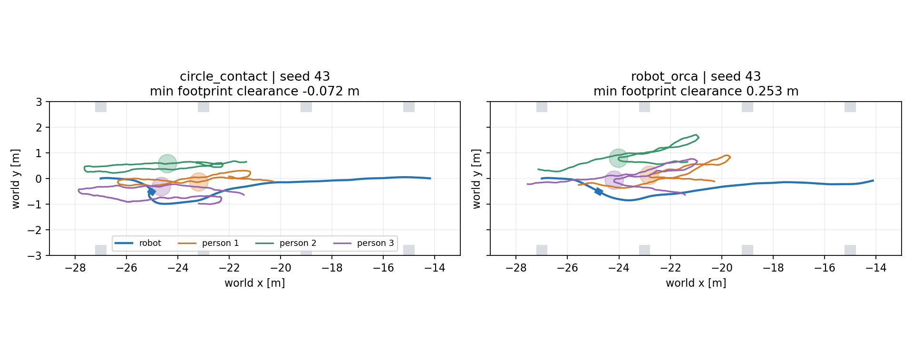
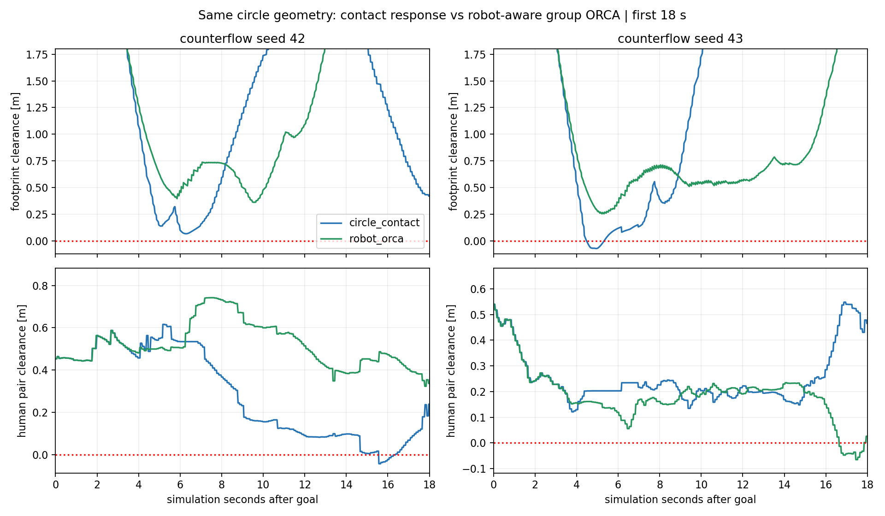
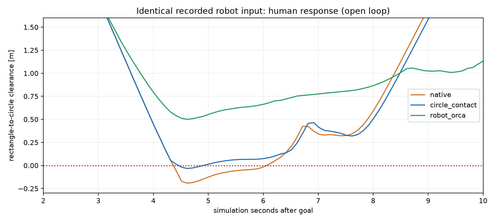

# Thử nhóm người chủ động tránh robot trong Gazebo

Đã commit vòng chẩn đoán/hình học: **954d577 — feat: add SocNavGym collision diagnostics and geometry benchmarks**. Sau đó tạo biến thể **robot_orca** trong adapter và hoàn tất **6/6 lượt Gazebo/Nav2 đến đích**. Code và kết quả biến thể mới đang để riêng để review, chưa commit ở vòng này.

Biến thể mới đưa vị trí/vận tốc thật của robot vào group ORCA. Hai lượt counterflow của nó giữ clearance footprint robot–người tối thiểu **+36,12 cm (seed 42)** và **+25,35 cm (seed 43)**, không có overlap robot–người ở các sample đã ghi. **Tuy nhiên seed 43 vẫn có overlap giữa các thành viên nhóm tới 8,11 cm trong khoảng 4,10 s.** Vì vậy đây là tiến bộ trong tránh robot, chưa phải mô hình nhóm hoàn thiện hoặc lựa chọn production.

## Đã thay gì

Cả hai phía dùng circle_contact radius người 0,36 m và radius robot danh định cố định 0,25 m. Lựa chọn `--robot-avoidance` thay method solver trên đúng instance môi trường của worker: tạo nhóm như native, thêm agent robot với pose và vận tốc world thực đo từ Gazebo, rồi chỉ lấy nghiệm vận tốc nhóm. Không dùng goal để đoán vận tốc robot, không áp dụng nghiệm robot của ORCA vào robot thật.

Nhóm vẫn có radius ORCA **1,44 m**, neighbor distance **2,88 m**, horizon lấy nguyên từ native seeded environment. Native khởi tạo current velocity nhóm bằng 0 mỗi solver call, smoothing 0,9, giới hạn quay, nhiễu, contact response và waypoint đều giữ nguyên. Standing không gọi group solver này nên giữ nguyên phản ứng native.

Không sửa file vendor, kernel source, C++ plugin, robot, LiDAR/IMU, map, Nav2 parameters hoặc World Model. Phạm vi adapter hiện tại đúng một moving group, không có người độc lập/nhóm khác; solver từ chối population ngoài phạm vi. Không có swept guard, clipping/hiệu chỉnh pose hoặc tách người trong nhóm.

Đây là **adapter policy mới**, không phải benchmark SocNavGym nguyên bản. Native và circle_contact mặc định vẫn được giữ để đối chứng. Người nhận robot ground truth từ simulator; robot vẫn sử dụng cảm biến/stack điều hướng đang có.

## Kết quả Gazebo kín vòng

Các cặp cùng initial scene, map, Nav2 và contact geometry; protocol đã đối chiếu SHA với pilot gốc. Cả hai bên đều bật cùng passive diagnostics. Counterflow seed 42/43 và standing seed 43; đổi thứ tự policy giữa seed chẵn/lẻ. Đây là các lượt mới, không trộn kết quả với bảng geometry vòng trước.

Metric robot là rectangle cấu hình Nav2 0,24×0,20 m so với proxy người tròn radius 0,36 m; pair metric là khoảng hở hai proxy tròn. Giá trị âm là lấn hình học. Dữ liệu **Gazebo** khoảng 50 Hz được dùng cho cả hai policy, threshold duration −1 cm; không phải contact-force sensor hoặc bảo đảm mọi physics step.

| Scene | Seed | Policy | Goal | Thời gian sim (s) | Clearance robot min (cm) | Robot overlap >1 cm (s) | Pair clearance min (cm) | Pair overlap >1 cm (s) |
|---|---:|---|---|---:|---:|---:|---:|---:|
| counterflow | 42 | circle_contact | SUCCEEDED | 41.636 | +6.70 | 0.000 | -4.29 | 0.600 |
| counterflow | 42 | robot_orca | SUCCEEDED | 27.652 | +36.12 | 0.000 | +32.29 | 0.000 |
| counterflow | 43 | circle_contact | SUCCEEDED | 25.376 | -7.21 | 0.780 | +12.10 | 0.000 |
| counterflow | 43 | robot_orca | SUCCEEDED | 24.944 | +25.35 | 0.000 | -8.11 | 4.100 |
| standing | 43 | circle_contact | SUCCEEDED | 26.264 | +11.73 | 0.000 | +37.28 | 0.000 |
| standing | 43 | robot_orca | SUCCEEDED | 26.152 | +11.30 | 0.000 | +37.28 | 0.000 |

Footprint có padding mặc định 0,26×0,22 m của biến thể vẫn có clearance dương ở cả hai counterflow: khoảng 35,04 / 24,11 cm. Không ghi nhận proxy người lấn khối nhà xưởng trong các sample; factory clearance nhỏ nhất của hai lượt mới khoảng 80,23 / 93,62 cm. Không khẳng định metric footprint bao trọn mọi collision link hoặc mọi tư thế robot.

Standing là negative control: cả hai giữ vị trí người tới sai số dưới 4×10⁻¹⁵ m, pair clearance giống nhau và variant không gọi solver moving group. Khác biệt nhỏ trên quỹ đạo robot thuộc các lượt điều hướng chưa được khóa chung noise.





## Phản ứng trước contact và replay cùng robot input

Bảy kiểm tra solver/kernel đã đạt: robot ở xa cho cùng nghiệm native; robot tiến gần làm đổi vận tốc nhóm trước khi bất kỳ người nào contact; robot đi xa cho phản ứng khác; đổi frame vận tốc đúng; restore method đúng; 30 bước kernel ở xa và 20 bước standing cho trace giống đối chứng.

Replay bổ sung dùng **251 robot input giống hệt nhau** từ lượt chẩn đoán seed 43. Native tái tạo đúng trace đã lưu (sai số tối đa 0); số liệu native/circle_contact cũng khớp report đã commit. Chỉ phản ứng người thay đổi:

| Replay open loop | Clearance footprint min | Overlap >1 cm | Contact ticks |
|---|---:|---:|---:|
| Native | −19,19 cm | 1,70 s | 17 |
| Circle_contact | −3,27 cm | 0,40 s | 19 |
| Robot_orca | **+50,05 cm** | **0** | **0** |

Đây là replay worker, không tính vào 6 lượt Gazebo. Nó tách tác động policy khỏi thay đổi đường Nav2 nhưng không chứng minh an toàn ngoài các input này.

Trong runtime Gazebo, solver ghi nhận robot như neighbor lần đầu ở t≈3,360 s / 3,144 s sau goal cho seed 42/43; biến thể không ghi nhận tick contact người–robot ở hai lượt counterflow. Log giữ measured robot velocity, group velocity và nghiệm robot bị bỏ qua để kiểm tra.



## Hạn chế đáng chú ý

Seed 43 tránh robot tốt hơn nhưng chất lượng nội bộ nhóm chưa đạt. ORCA xử lý nhóm như một circle lớn, không giải tránh va chạm từng thành viên. Native vẫn cập nhật hướng/tốc độ/nhiễu riêng và cùng waypoint nhóm, không có pair separation. Không được suy từ robot clearance dương sang chất lượng crowd dynamics tốt.

Ở thời điểm pair clearance nhỏ nhất của robot_orca seed 43, t=22.944 s sau goal, robot clearance là 9.240 m. Sự kiện nội bộ nhóm này tách biệt với thời điểm robot đi sát nhóm nhất.


Cohort radius lớn nhất đo từ centroid của nhóm mới khoảng 1,24 / 1,20 m; chưa có ràng buộc giữ đội hình cứng. Cảnh standing vẫn chỉ là bố trí conversation native; chưa có người đang trò chuyện nhường đường hoặc formation/dispersal mới.

RVO2 giả định reciprocal, nhưng nghiệm robot bị bỏ qua để giữ Nav2 là controller duy nhất; không áp dụng bảo đảm từ giả định reciprocal cho hệ kín vòng này. Tầng native smoothing/turning/noise cũng khiến pose thực khác nghiệm agent. Chưa thử crowds nhiều nhóm, bottleneck, các tốc độ robot khác hoặc nhiều lần lặp.

RTF hai policy ở counterflow trong vòng này khá gần nhau, khoảng 0,93–0,95; worker compute mean khoảng 6,1–6,9 ms/tick. Vẫn chưa khóa chung MPPI, AMCL và noise LiDAR. Hai seed và một lần mỗi cấu hình chỉ là pilot, không đủ xếp hạng thống kê hoặc chứng nhận không va chạm.

## Xem và chạy

- [Hướng dẫn đầy đủ và lệnh chạy ma trận/replay](../../README.md).
- [CSV](results.csv), [analysis](analysis.json), [protocol](protocol.json), [solver validation](solver_validation.json), [manifest/raw hashes](run_manifest.json), [bảo toàn source](source_preservation.json).
- Robot-aware seed 43: [GIF](socnavgym_circle_contact_robot_orca_counterflow_s43.gif), [ảnh](socnavgym_circle_contact_robot_orca_counterflow_s43.png), [trial](socnavgym_circle_contact_robot_orca_counterflow_s43.json).
- Đối chứng seed 43: [GIF](socnavgym_circle_contact_counterflow_s43.gif), [trial](socnavgym_circle_contact_counterflow_s43.json).

```bash
bash experiments/social_navigation/benchmark/run.sh trial \
  --backend socnavgym --geometry circle_contact --robot-avoidance \
  --condition counterflow --seed 43 --gui --diagnostics \
  --report-dir experiments/social_navigation/benchmark/avoidance_comparison/reports/gui01
```

Bỏ `--robot-avoidance` để chạy đối chứng. Dùng directory mới nếu trial đã tồn tại, không chạy hai trial cùng ROS domain. Camera/GIF thu từ Gazebo; raw captures trong benchmark/generated/ được ignored và có path/hash trong manifest.

## Bảo toàn và quyết định

Kiểm tra 14.181 tracked paths ngoài experiments/social_navigation, staged index và diff có sẵn đều không đổi; binary RVO2 giữ nguyên. Source vendor/kernel và các report đã commit cũng giữ nguyên. Chỉ có mã/result thí nghiệm mới sau checkpoint; toàn bộ process group thuộc ma trận đã đóng.

Giữ robot_orca như một lựa chọn thí nghiệm, chưa thay native mặc định hoặc chọn làm hành vi người chính thức. Kết quả cho thấy cần đánh giá đồng thời tránh robot và tránh nhau trong nhóm. Bước tiếp theo phù hợp mục tiêu chọn framework là đưa **CrowdSimPlus** đã chạy độc lập vào cùng harness Gazebo/nhà xưởng để so sánh hành vi; không nên tiếp tục tăng mật độ trên SocNavGym khi pair overlap chưa được kiểm soát. Chưa tích hợp CrowdSimPlus hoặc ComplexityNav vào Gazebo trong lượt này.
