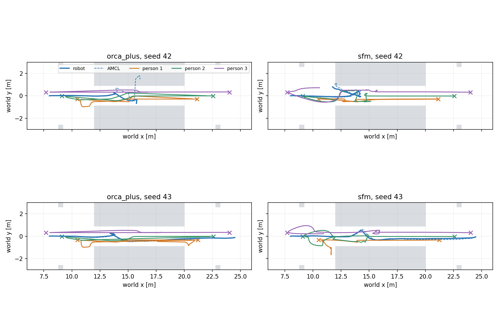
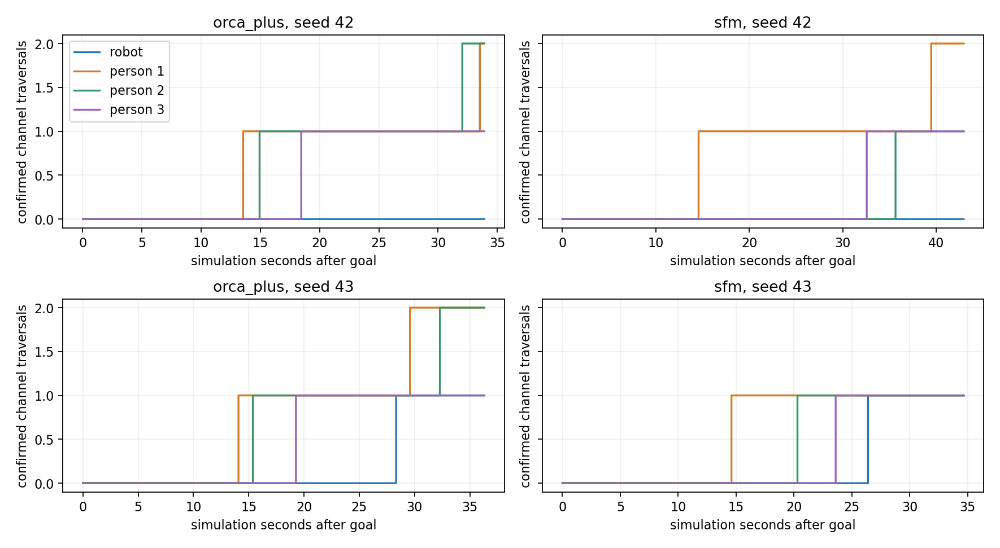
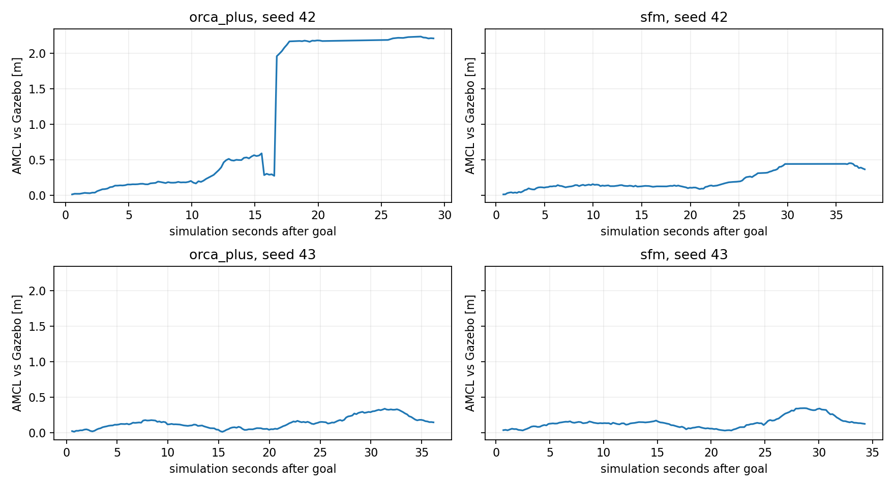
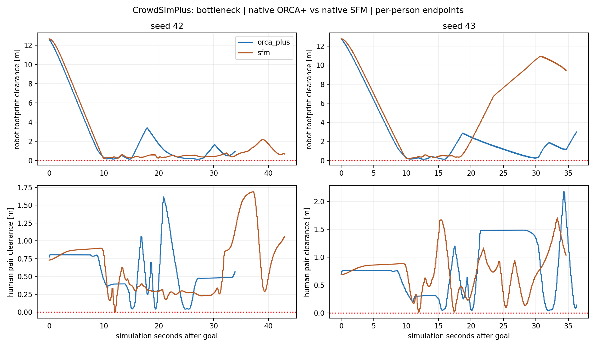

# Lối hẹp Gazebo: có tương tác thật, nhưng định vị làm nhiễu kết quả

Đã kiểm định native worker, chạy **một empty control và bốn lượt có người**
trong khe 1,8×8 m hiện có của nhà xưởng. Empty control đến đích, qua hết khe.
Với cả SFM và ORCA+: **seed 43 qua khe và đến đích; seed 42 ABORTED**.
Tổng cộng **2/4 goal có người đạt**, không chạy lại để thay kết quả thất bại.

Cả ba người đều qua khe ít nhất một lần ở mọi lượt. Robot và người thực sự
cùng ở trong khe khoảng 15–26 sim s mỗi lượt, không ghi nhận bypass đi vòng
ngoài channel trong các traversal đã đo. Tuy nhiên AMCL có sai lệch lớn ở
lượt ORCA+ seed 42, tới **2,232 m**. Chưa thể dùng bốn lượt này để xếp hạng
hành vi người hoặc kết luận framework nào tốt hơn.

## Cảnh và bảo toàn cấu hình

Khe nằm giữa `machine_north` và `machine_south`, x=12..20 m, y=±0,9 m.
Robot spawn **(8,0,0)**, goal với **x=24,5 m, y=0, yaw=0**.
Ba người bắt đầu phía bên phải tại x gần 21,2/22,6/24 m, hướng sang trái.
Mỗi người có hai endpoint riêng, phía trái x=10,5/9,1/7,7 m và phía phải tại
vị trí xuất phát, y gần -0,3/0/+0,3 m; seed thêm jitter nhỏ.

Không ép lane, timing, ưu tiên nhường hay tuyến robot bắt buộc qua waypoint.
Đếm riêng traversal để phát hiện Nav2 đi vòng; không coi chỉ đến goal là
đã test khe. Scene giống nhau trong mỗi cặp SFM/ORCA+, được kiểm hash và pose
thật trước khi mở start gate. Người đứng yên lúc Nav2 khởi động.

Map/world/collision geometry, robot Mecanum, LiDAR/IMU và controller parameters
giữ nguyên. **Chỉ runtime YAML copy thay AMCL initial pose theo spawn mới**;
file `nav2_warehouse.yaml` gốc không sửa. Đã so lại đủ năm runtime config:
ngoài `amcl.initial_pose`, toàn bộ cấu hình giống bản gốc. Hash file Nav2 gốc
và hash runtime YAML được lưu riêng, tránh nhầm hai loại hash.

Human radius=0,36 m, preferred speed=0,8 m/s, dt=0,1 s; native force/safety
parameters và arrival threshold giữ nguyên. Đổi endpoint sau native
`reached_destination`, khoảng cách tới đích <0,36 m. Đây là patrol ngoài
episode, vẫn là ba người độc lập, `groups=[]`, không có hội thoại/formation.
Không rebuild plugin C++ hoặc sửa source ROS/robot đang có.

## Kiểm định native trước Gazebo

Bốn policy/seed đều PASS về bridge/numerical checks:

1. 30 bước đầu khớp full upstream `env.step`, max state error **0**, chưa có
   patrol turn trong đoạn parity.
2. Crossing và individual counterflow cũ khớp snapshot kernel đầu vòng qua
   30 bước, error **0**. Scene shared/individual cũ được so với fixture lưu.
3. Probe 20 sim s, robot cố định ở xa (-14,5): cả ba người qua khe **1/1/1**,
   chặng hoàn tất **1/1/0** ở mọi policy/seed. Người 3 có endpoint xa hơn;
   qua khe không đồng nghĩa đã tới endpoint. State hữu hạn, mọi arrival đạt
   native threshold. Không áp tiêu chí bắt buộc phải patrol thành công.
4. Robot input định sẵn đi từ x=8 với vx=0,5 m/s trong 10 sim s:
   visible/invisible tạo sai khác tối đa **3,10/1,96 cm** ở SFM và
   **69,01/65,09 cm** ở ORCA+ (seed42/43). Probe chỉ quan sát đoạn tiếp cận
   này, không so trực tiếp độ nhạy hay chất lượng tránh của hai model.

Trong distant-robot probe, SFM tiến tới static boundary clearance khoảng
1e-7 m; ORCA+ khoảng 2 cm. PASS không có nghĩa bảo đảm an toàn hay hành vi
đẹp. Các probe là worker open-loop, không cộng thành lượt Gazebo/Nav2.
[Validation SFM42](sfm_s42_validation.json), [SFM43](sfm_s43_validation.json),
[ORCA42](orca_plus_s42_validation.json), [ORCA43](orca_plus_s43_validation.json).

## Kết quả Gazebo

Empty control: **SUCCEEDED**, 30,552 sim s, actual goal error 7,1 cm, một
traversal qua channel; robot–machine footprint gap min 67,4 cm. AMCL error
max 0,391 m, RMS 0,191 m: ngay cả lượt không người cũng có sai lệch định vị.

| Policy | Seed | Goal | Sim s | Robot qua hết khe | Người qua khe 1/2/3 | Robot–người min (cm) | AMCL error max (m) |
|---|---:|---|---:|---:|---|---:|---:|
| orca_plus | 42 | ABORTED | 33.928 | 0 | 2/2/1 | 13.13 | 2.232 |
| orca_plus | 43 | SUCCEEDED | 36.336 | 1 | 2/2/1 | 12.74 | 0.335 |
| sfm | 42 | ABORTED | 42.968 | 0 | 2/1/1 | 18.12 | 0.449 |
| sfm | 43 | SUCCEEDED | 34.672 | 1 | 1/1/1 | 17.76 | 0.343 |

Hai goal thành công có actual world error **12,0 cm** (ORCA+) và **6,7 cm**
(SFM). Hai goal ABORTED là kết quả điều hướng hợp lệ, không phải lỗi harness;
`protocol_valid=true` và protocol PASS không đồng nghĩa goal success.

Traversal xác nhận tâm từ x≤11,5 sang x≥20,5 m hoặc ngược lại, với các mẫu
trong core x=12..20 thuộc strip y±0,9 m. Excursion ngoài strip được phân loại
bypass. Đây là phép đo trên mẫu, không phải bảo đảm liên tục giữa mọi step.
Số lần qua khe tính toàn lượt; không so số đếm thô của các lượt dài khác nhau.

Cả **15/15** arrival events được đối chiếu với proxy pose Gazebo trong cửa sổ
native elapsed −0,002..+0,030 s. Max position mismatch khoảng **2e-6 m**,
actual distance tới endpoint trước khi đổi goal lớn nhất **0,358529 m**.





## Hai failure và sai lệch định vị

Ở lần AMCL cuối được khớp timestamp với Gazebo:

- **ORCA+ seed42**: actual khoảng **(15,736; -0,680)**, AMCL khoảng
  **(16,041; +1,505)**, error 2,206 m; max toàn lượt 2,232 m. Pose ước lượng
  nằm trong `machine_north`, actual footprint vẫn ngoài khối máy. Planner
  báo không tạo được đường từ vị trí ước lượng, rồi Nav2 hủy goal.
- **SFM seed42**: actual khoảng **(11,741; 0,811)**, AMCL khoảng
  **(12,066; 0,971)**, error 0,363 m; max toàn lượt 0,449 m. Pose ước lượng
  cũng nằm trong mép `machine_north`. Robot đã đi vào khe rồi lùi về gần cửa,
  chưa hoàn tất traversal; không mô tả là chưa hề đi vào khe.

Ở hai lượt seed43 thành công, AMCL error max khoảng 0,335/0,343 m và RMS
0,162/0,162 m. Matching dùng timestamp trong AMCL header, lấy pose Gazebo gần
nhất, sai lệch thời gian tối đa **0,012 s** ở các lượt có người (empty 0,016 s).
Mẫu AMCL cuối có thể cũ hơn lúc goal kết thúc, đã ghi thời điểm riêng;
không so hai pose khác thời điểm như cùng một mẫu.

[Chi tiết failure và dòng planner log](failure_diagnosis.json),
[các cặp pose/timestamp](localization_matches.json).
Đây là bằng chứng có yếu tố AMCL/planner cản trở benchmark. **Chưa tách nguyên
nhân gốc** giữa noise, hình học ít đặc trưng trong khe, scan bị che bởi người,
TF/timing hoặc controller/recovery. Không khẳng định model người gây ra drift.
Giữ nguyên cấu hình và kết quả; chưa thay AMCL/costmap để ép lượt đo qua được.



## Khoảng hở và hành vi quan sát

Robot–người dùng footprint Nav2 xoay 0,24×0,20 m so proxy người tròn radius
0,36 m; human pair dùng hai circles. Robot–machine dùng khoảng cách polygon
footprint tới hai box máy (SAT khi overlap, khoảng cách cạnh khi tách rời).

Không ghi overlap >1 cm robot–người, người–người hoặc robot footprint–machine
trong các mẫu lưu. Tuy vậy **SFM seed42 có overlap cặp người khoảng 1,33 mm**;
không gọi là hoàn toàn không overlap. Human pair min ở SFM seed43 chỉ 1,28 cm,
ở ORCA+ khoảng 4 cm. SFM human–factory gap xuống khoảng **1e-7 m**, coi là
sát/chạm biên về mặt thực hành; ORCA+ giữ khoảng 2 cm trong các lượt này.

Robot footprint–machine gap min là **6,35/29,59 cm** ở ORCA+ seed42/43 và
**10,93/24,89 cm** ở SFM. Robot–human gap ghi ở bảng không bao gồm toàn bộ
collision geometry robot. Pose khoảng 42–45 Hz, max sample gap 0,040 s;
worker 10 Hz, proxy kinematic. Không đo contact force hoặc mọi physics step.

Người tiếp tục qua lại, có tránh/lách khi gặp nhau và robot; SFM có đường
vòng quanh mép cửa và người tiến sát biên. Không có model social yielding,
group cohesion hoặc hội thoại. Native SFM giữ `is_bottleneck=False` như các
vòng factory: nhánh đặc biệt upstream dựa thứ tự segment hallway không được
áp vào 168 segments của 42 box nhà xưởng. Đây là test hình học lối hẹp với
cấu hình factory hiện tại, không phải demo hallway đặc biệt nguyên bản.



Hai seed, một lượt mỗi policy/seed; noise robot/Nav2/AMCL/LiDAR chưa khóa chung.
Runtime/goal time và chỉ số biến thiên vận tốc không phải thước đo naturalness.
Không gộp kết quả với crossing/counterflow: spawn, goal và scene đã khác.

## Tương thích, cách demo và dữ liệu

ROS 2 Jazzy/Ubuntu 24.04/Python 3.12 chạy robot/Nav2 như cũ. Worker nằm trong
Docker Python 3.8.13, image `dynamuhsim-crowdsimplus:round2`, ID
`sha256:39929ee8e4fa6d738a381a0b695bf25eaf9fa972cd5b9d8a6854d72f80bd5f3c`,
source `d526a07c013c621fa1ad50894b6ba639f61063de`. Native source hashes và config
giống vòng trước. Container tắt network, root/code mount read-only. Nav2 là
controller robot duy nhất; không cài dependency native vào Python ROS.

Từ terminal Ubuntu ở repository root, đóng phiên trước rồi chạy:

```bash
bash experiments/social_navigation/benchmark/run.sh trial \
  --backend crowdsimplus --human-policy sfm --goal-layout individual \
  --condition bottleneck --seed 43 --gui --diagnostics \
  --report-dir "experiments/social_navigation/benchmark/generated/bottleneck_demo_$(date +%Y%m%d_%H%M%S)"
```

Đổi `--human-policy orca_plus` hoặc `--seed 42` để đối chiếu; dùng directory
mới. Seed43 đã pass ở lượt lưu này, chạy lại không bảo đảm y hệt vì robot
noise chưa khóa chung. Để trình bày đúng vòng đã đo, mở GIF kèm biểu đồ AMCL.
Các lượt báo cáo là headless RGB Gazebo; chưa kiểm thử thao tác GUI vòng này.
GUI đóng khi trial kết thúc; không chạy hai trial cùng ROS domain.

- [Empty GIF](empty_bottleneck_s42.gif).
- ORCA+: [seed42 ABORTED](crowdsimplus_individual_goals_bottleneck_s42.gif), [seed43 SUCCEEDED](crowdsimplus_individual_goals_bottleneck_s43.gif).
- SFM: [seed42 ABORTED](crowdsimplus_sfm_individual_goals_bottleneck_s42.gif), [seed43 SUCCEEDED](crowdsimplus_sfm_individual_goals_bottleneck_s43.gif).
- [Hướng dẫn chạy lại matrix/analysis](../../README.md), [CSV](results.csv),
  [analysis](analysis.json), [protocol](protocol.json), [traversal events](passage_events.json),
  [fixture42](fixture_s42.json), [fixture43](fixture_s43.json),
  [manifest/hash](run_manifest.json), [source preservation](source_preservation.json),
  [analysis regression trên ba vòng cũ](analyzer_regression.json).

## Trạng thái và bước tiếp theo

Preservation PASS: 14.181 tracked paths ngoài social_navigation, phần Git
staged/unstaged có sẵn và binary RVO2 giữ nguyên. Source Python/shell syntax,
geometry measurement cases và whitespace PASS. Analysis các vòng shared,
individual goals và crossing cũ giữ nguyên mọi metric đã ghi. Container và
process mô phỏng của vòng này đã đóng. Phần mới **chưa commit**.

Bước tiếp theo phù hợp là **chẩn đoán AMCL/scan/costmap tại thời điểm failure
seed42 bằng raw diagnostics đã lưu**, tách yếu tố định vị trước khi mở rộng
benchmark hoặc chọn human model. Chưa tự sửa ROS/Nav2 gốc, chuyển Isaac Sim,
triển khai World Model hay nối ComplexityNav vào Gazebo.
