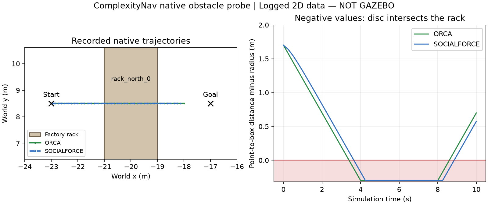

# ComplexityNav trước khi tích hợp nhà xưởng

Ngày22/10/2026, sau ba commit SocNavGym `2480158`, `779c338`, `b3f0022`. Đã hoàn tất bước kiểm định độc lập; **chưa nối ComplexityNav vào Gazebo**, vì geometry native chưa đạt.

## Phần đã đạt

- Image có sẵn, source ComplexityNav `36acac12a940a20dceb7b4e1d36acc4c7a4e344a` sạch. Python3.8.13, Torch1.13.1+cpu, Gym0.21; host Ubuntu24.04/ROS Jazzy/Python3.12 không đổi.
- Ba input robot (đứng, tiến, ngang rồi tiến),6 người gồm3 ORCA +3 SFM, mỗi input80 bước/20s; radius người0.3m, robot0.25m, timestep native0.25s. Không dùng robot policy để thay input; kernel chỉ mô phỏng người, robot input được bơm từ trace.
- Cùng frame/config/input, cập nhật người khớp lời gọi `env.step` gốc chính xác trong các trường vị trí/vận tốc/goal đã assert, max error0. Đối chứng native ở world frame khác native local origin(−24,0) sai khác tối đa0.263mm sau20s do float32; ngưỡng kiểm tra5mm được khai báo trước run02 và tách khỏi parity cùng frame1e−10.
- ID/membership population không đổi; pause không đổi state. Từ chối8 request sai clock/frame/epoch/nonfinite trước mutation. Reset tăng epoch, khởi tạo env mới và lặp80 bước stationary chính xác, gồm native IDs; không tuyên bố native env.reset tự xóa mọi counter.
- Quỹ đạo người thay đổi khi input robot thay đổi, cùng initial fixture: độ lệch vị trí lớn nhất so stationary khoảng2.63m/3.41m trên20s. Đây là đáp ứng đầu vào trong mô phỏng kín của người, không phải pose robot Gazebo đo thực hay kiểm chứng ý định nhường đường.
- Ba fixture ở lối đi không ghi nhận xuyên42 AABBs trong các đoạn tuyến tính nối mẫu. Đường đi tổng người khoảng31.84/33.38/33.40m, không bị đóng băng để vượt gate.

Run02 gồm400 update adapter dùng cho các trace/reset/obstacle và1 update bổ sung trong probe từ chối duplicate;480 update native reference (same-frame/world) riêng. Không cộng lượt lỗi run01 hoặc gọi đây là benchmark thống kê.

## Phần chưa đạt: kệ/cột bên trong

Ledger có đủ42 collision boxes, vertices/pose/size đối chiếu layout và SDF nhà xưởng gốc. Nhưng `CentralizedORCA.predict` không thêm border vào RVO2 (đoạn đó đang comment); `CentralizedSocialForce.predict` tạo Simulator không đưa border vào. Native `outside_check` chỉ chặn ở biên chữ nhật. `CentralizedMultiPolicy` gọi hai planner này, nên thêm ledger ngoài không tự làm người tránh kệ.

Đã kiểm tra trực tiếp với một người bắt đầu(−23,8.5), goal(−17,8.5), robot ở(−27,0), đủ khoảng hở ban đầu. Tuyến đi cắt kệ `rack_north_0` x[−21,−19],y[3,14]:

| Native policy | Lần đầu disc chạm/xuyên kệ | Số đoạn overlap trong10s |
|---|---:|---:|
| ORCA | 3.50s | 22 |
| SFM | 3.75s | 22 |

Khoảng cách segment tới box trừ radius đạt−0.3m khi tâm nằm trong box; số này bị chặn bởi định nghĩa distance tới miền kín, không phải độ sâu xuyên tối đa của toàn thân. Thay border argument giữa hai hình chữ nhật rất khác nhau cho cùng state không đổi action (delta0), phù hợp source. Analyzer GEOS độc lập xác nhận các lần xuyên kệ. **Gate `NOT_READY_FOR_GAZEBO` được giữ**, không thêm clipping hoặc xóa vật cản.

## Lỗi harness được giữ và bằng chứng

Run01 dừng khi so hai native frame: sai khác15.35 micromet vượt ngưỡng10 micromet đặt ban đầu. Đây là ngưỡng số học quá chặt cho RVO2 float32, chưa đi đến kết luận geometry. Giữ `run01/failure.json`, source snapshot và SHA256 log; run02 bổ sung strict parity cùng frame, báo frame error riêng. Không thay native dynamics để vượt kiểm tra. Lần inspect đầu có lỗi tên module `social_force`; tên thật là `socialforce`, được sửa trong lệnh inspect, không phải lỗi tương thích framework.

[Protocol](run02/protocol.json) · [Validation probe](run02/validation.json) · [Audit trace/geometry độc lập](run02/independent_validation.json) · [Execution](run02_execution.json). Mọi trajectory được lưu, source hashes/image ID ghim; native-reference trajectories không xuất riêng nên analyzer không tự nhận đã tính lại parity. Đồ thị trên là vẽ từ dữ liệu2D thật, không phải camera Gazebo hoặc ảnh AI.

Container chạy không mạng,2 CPU/4GB, một BLAS thread; run02 khoảng3.84s wall, đã thoát và không còn container thuộc phép thử. Kiểm tra index/outside patch giữ nguyên và12573 source/evidence file cũ byte-for-byte; ba file trạng thái README/NEXT_STEPS/COMMIT_HISTORY được cập nhật có chủ ý. Không sửa robot/Nav2, vendor hoặc kết quả các cohort cũ.

## Công việc tiếp theo

Bổ sung adapter hình học rõ ràng là biến thể: giữ native reference, đưa đủ42 boxes vào thuật toán tránh, kiểm tra swept disc với robot chuyển động và tiến độ qua goal. Với SFM cần chọn mô hình lực vật cản/radius phù hợp; không mặc định thư viện socialforce này hỗ trợ42 polygons chỉ vì Python signature có border. Sau khi geometry đạt mới nối population nhỏ vào Gazebo và kiểm tra proxy/LiDAR/clock. Chưa triển khai RGL, World Model, Isaac Sim hoặc đổi kiến trúc robot.
