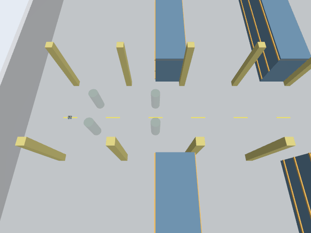

# ComplexityNav đã chạy trong Gazebo với4 người

Ngày22/10/2026. Adapter hình học offline đã commit `be816c3da3`; pilot mới chạy sau commit này, source hashes lưu tại lúc đo. Code robot/Nav2, upstream framework và adapter cũ giữ nguyên. Đây là **biến thể roadmap + native ORCA/SFM intention + ORCA safety projection**, không gọi là SFM native hay RGL đã train.

## Kết quả đã nghiệm thu

- Lượt `live01`: ngân sách đo60sim s, bao gồm startup/teardown ghi được khoảng61.06s ground truth; worker tính246 endpoint0.25s.4 người (2 ORCA-intention,2 SFM-intention), ID ngoài adapter1..4 bền vững. Native human.id là None; không dùng trường này làm bằng chứng nhận dạng.
- Robot Mecanum chạy lệnh riêng rồi dừng: actual displacement tiến0.5985m, ngang0.3010m. Không chạy Nav2 hoặc đánh giá navigation success.
-3,614 mẫu pose có đủ4 proxies và robot từ SceneBroadcaster,14,456 so sánh vị trí với worker/interpolation; sai số lớn nhất khoảng1.1e−14m. Người là proxy kinematic, đây là kiểm chứng đồng bộ, không phải độ chính xác robot vật lý.
- Khe nhỏ nhất trên các đoạn tuyến tính nối pose: người–người0.0400m, người–robot1.0674m, người–42 vật cản0.3181m. Không ghi nhận overlap proxy danh nghĩa trong lượt này. Human radius0.3m, nominal robot radius0.25m; không chứng minh mesh cơ thể hoặc mọi tình huống đều an toàn.
-23 lần tới waypoint được xác nhận bằng pose Gazebo và final goal cũ của native, sai số tại thời điểm ghi nhận<0.3m. ID1/2/3/4 hoàn tất7/6/5/5 legs; tổng quãng đường người khoảng101.66m. Max speed0.6501m/s, max visual yaw rate1.5701rad/s trong sai số số thực.
- LiDAR:7,552 tia có dự đoán nearest target là human, đã xét che khuất từ42 boxes và người khác.98.3316% nằm trong sai số15cm, khớp đủ4 IDs ở các thời điểm; không gọi đây là accuracy của toàn bộ scan.
- Robot odom feedback khớp pose Gazebo trong1.75mm; constant-velocity prediction cho tick0.25s có sai số lớn nhất22.69mm. Khoảng hở nghiệm thu dùng actual pose, không dùng prediction thay thế.
- Pause/resume bằng service: clock và human step đều không đổi trong pause. Người dùng xác nhận trực tiếp **“Thấy 4 người, kéo/zoom được”**; không suy ra đã bấm Pause/Play thủ công.

## Thử lỗi và khởi động session mới

Trước pilot,5 IPC cases qua container/socket thật đạt: duplicate clock, stale epoch, nonfinite robot, nonfinite dt và robot input không khả thi. Mỗi case gửi fatal rồi đóng socket; last planned endpoint giữ nguyên. Khi solver lỗi có thể đã tăng counter nội bộ env, nên không cho retry trong session; restart là contract.

Lượt `fault01` chạy headless Gazebo, cố ý lỗi sau20 update (t=5.0025s), robot luôn đứng. Plugin báo lỗi và giữ **last applied pose**.85 mẫu pose sau lỗi trong khoảng1.47s có độ dời tối đa0m cho cả4 người. Pose đóng băng có thể khác last planned endpoint dưới1mm do ngắt trước endpoint được áp dụng đủ; không teleport tới future endpoint để tạo freeze đẹp. Sai số interpolation cao nhất của lượt lỗi khoảng0.567mm, được báo riêng.

Sau đó launch `live01` là session mới, worker/plugin/container mới, cùng initial fixture/IDs, clock phase bắt đầu lại; chạy bình thường không lỗi. Không claim đã hỗ trợ reset ngay trong world đang chạy.

## Tích hợp và runtime

Plugin C++ riêng trong experiment, không sửa plugin robot. Native0.25s được giữ; physics step chỉ trong generated SDF đổi từ0.004 xuống0.0025s (100 ticks/plan), collision/visual cylinder đều radius0.3m, heading nội suy giới hạn1.57rad/s. Các42 collision AABBs đối chiếu layout/SDF gốc.

Native Python3.8.13 nằm trong image ghim `sha256:edfd591ea7551813419e511b341089ad956b6d3e4c1bd395a326035865ef1d5d`; ROS Jazzy/Python3.12 host giữ nguyên. Container không mạng,2CPU/4GB, một BLAS/OMP thread; native code và geometry code mount read-only. Gazebo dùng fresh Ogre NVIDIA RTX4060 Laptop qua WSL D3D12 trong cả hai lượt. Cả hai server STOPPED sạch, Docker tự thoát, owned cleanup không còn process/container.

## Camera và bằng chứng

GIF là các frame camera RGB Gazebo, quantized khi lưu, phát4×;62 frame0.005→61s, duration15.5s gồm frame cuối. Không phải screen recording, đồ thị2D hay ảnh AI. PNG lấy từ cùng camera.

[Live validation](live01/validation.json) · [Fault validation](fault01/validation.json) · [IPC validation](transport01/validation.json) · [Hướng dẫn chạy](../README.md). Source/command/config, SDF thực, worker/Ogre logs, timestamps và gzip JSONL byte-identical được lưu; manifest SHA256 chốt sau đóng gói. Source cũ/kết quả cũ12645 file và index/outside patch được bảo toàn, chỉ ba file trạng thái chung cập nhật có chủ ý.

## Chưa nghiệm thu và bước tiếp theo

Đây là local-aisle4-person pilot, một seed42, không phải dense-crowd benchmark hoặc xếp hạng framework. Robot vẫn cách người gần nhất1.07m, chưa stress phản ứng sát người. Vòng kệ và khe1.8m mới đạt offline, chưa chạy trong Gazebo ở cohort này. Chưa có Nav2 cho ComplexityNav, chủ động giữ nhóm/hội thoại, trained RGL, gait/mesh realism, World Model hay Isaac Sim.

Bước tiếp theo: lưu riêng pilot này, thống nhất fixture/robot/map/metrics và tách rõ native/biến thể trước khi chạy bộ cảnh chung tuần tự cho SocNavGym, CrowdSimPlus và ComplexityNav. Giữ AMCL/controller gốc; không mở thêm ma trận tuning định vị khi chưa có câu hỏi chẩn đoán.
