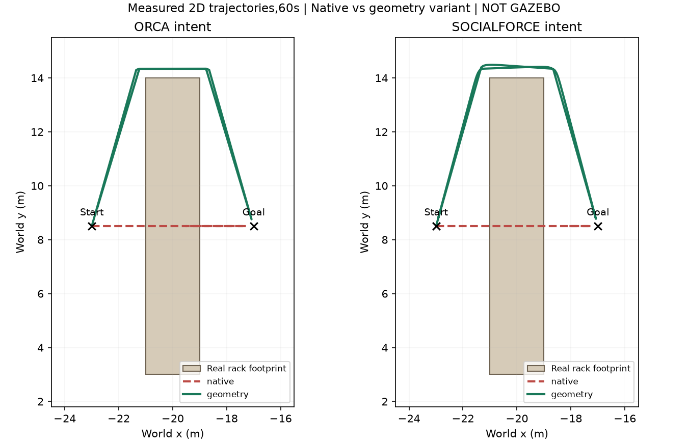
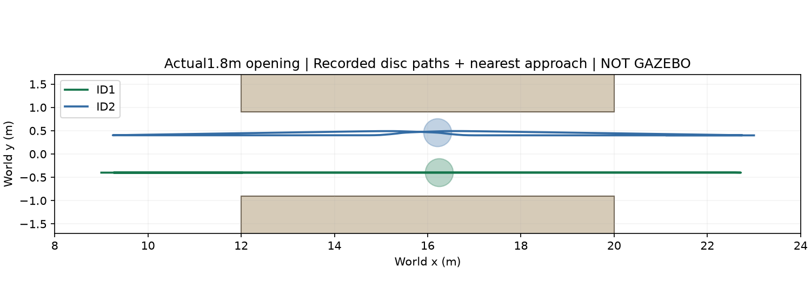

# ComplexityNav: sửa xuyên kệ bằng adapter hình học riêng

Ngày22/10/2026. Native preflight đã được commit `b0b3c336` trước khi làm bước này. Source ComplexityNav vẫn `36acac12a940a20dceb7b4e1d36acc4c7a4e344a`, không sửa upstream. **Kết quả mới đạt offline; chưa tích hợp biến thể này vào Gazebo.**

## Kết quả nghiệm thu

6 cảnh adapter và6 native reference ghép cặp, cùng initial fixture và robot input byte-identical, seed42. Ba cảnh hỗn hợp6 người chạy20s/cảnh; hai cảnh vòng kệ và một cảnh hai người đi ngược chiều qua khe1.8m chạy60s/cảnh. Tổng960 update chính cho mỗi nhánh; reset adapter80 bước bổ sung, nên1040 update adapter và960 native. Không mở thêm framework/ma trận AMCL.

| Cảnh adapter | Khe vật cản min | Khe người–người min | Khe robot–người min | Tiến độ |
|---|---:|---:|---:|---|
|6 người, robot đứng |0.032m |0.040m |0.433m |47.49m tổng quãng đường người |
|6 người, robot tiến |0.024m |0.040m |0.305m |42.95m tổng quãng đường người |
|6 người, robot ngang rồi tiến |0.020m |0.040m |0.564m |43.22m tổng quãng đường người |
|1 người, ORCA intention vòng kệ |0.024m |— |8.844m |Đạt goal30.75s,1 leg trong60s |
|1 người, SFM intention vòng kệ |0.052m |— |8.844m |Đạt goal29.75s; về lại59.00s |
|2 người hai chiều qua khe1.8m |0.108m |0.256m |35.452m |Cả hai hoàn tất2 legs |

Khe lấy từ khoảng cách nhỏ nhất trên toàn đoạn nối pose mỗi timestep0.25s, so với42 AABBs và relative swept disc cho người/robot. Analyzer GEOS độc lập khớp các số đo guard, không ghi nhận khe âm trong6 cảnh adapter. Tốc độ đo tối đa0.595m/s, dưới ceiling1m/s. Không có safe-fraction shortening hoặc full-stop tick trong các lượt chính; người thực sự đi và tới đích, không đứng yên để vượt gate.

Các nhánh native thực thi đủ thời gian nhưng vẫn xuyên kệ/máy: cả hai rack và narrow có khe tĩnh−0.3m theo định nghĩa distance-to-solid trừ radius. `status: PASS` của từng native case chỉ có nghĩa thực thi hoàn tất, không phải geometry đạt. Native được giữ nguyên làm đối chứng, không xóa hoặc thay kết quả cũ.

## Đã sửa ở đâu và vì sao

- Roadmap visibility tính đường vòng cho disc radius0.3m với đủ42 vật cản thật. Góc sample nằm ngoài box đã nở radius+0.04m; từng segment phải có clearance radius+0.002m. Giới hạn ngoài là mặt trong tường thật, không dựng tường quanh vùng lấy mẫu.
- Bản sao FullState đưa waypoint vào hàm native `CentralizedMultiPolicy.predict`; h.gx/gy và goal sequence của env không đổi. Native vẫn quyết định arrival/counter theo final goal. Counter tăng được đối chiếu pose tới goal cũ<0.3m.
- Native ORCA/SFM intention sau đó qua một global disc-ORCA với42 polygons, thêm đệm radius0.02m, rồi analytic swept filter. Nhánh SFM vì thế là **hybrid SFM-intention + ORCA safety projection**, không phải SFM nguyên bản.
- Robot position/velocity lấy từ input ở đầu interval; robot đi trọn dự đoán0.25s kể cả khi thử giảm chuyển động người. Nghiệm ORCA của robot bị bỏ qua; adapter không điều khiển robot. Unit fixtures xác nhận trường hợp phải di chuyển để tránh robot đang tới, input không khả thi phải reject, và xuyên vật cản giữa hai endpoint bị chặn.
- Native time_step0.25s, frame/ID/epoch và update goal giữ rõ contract. Pause không tiến planner. Reset xóa env/planner history, tăng epoch;80 bước repeat khớp cả state người/native IDs. Lỗi epoch cũ và occupied start/goal bị từ chối.

Đây là sửa adapter có chủ ý, không tuyên bố native đã được sửa hoặc giữ parity sau projection. Quỹ đạo và tốc độ có thể khác native; thời gian đến goal trong bảng không dùng xếp hạng policy.

## Hình từ dữ liệu thực đã chạy

Với khe thật x[12,20],y[−0.9,0.9], analyzer xác nhận cả hai đi qua đủ hai phía thay vì vòng ngoài:130/131 mẫu ở trong khe, tâm người có |y| tối đa0.400/0.492m; cộng radius0.3m vẫn nằm trong khe. Các hình là plot trajectory/disc proxy, không phải camera Gazebo hay ảnh AI.

## Bằng chứng và bảo toàn project

[Protocol/source SHA256](run01/protocol.json) · [Fixtures](run01/fixtures.json) · [Probe validation](run01/validation.json) · [Independent audit](run01/independent_validation.json) · [Execution](run01_execution.json). Source snapshot và mọi native/adapter/reset trajectory được lưu. Layout đối chiếu cả JSON lẫn42 collision boxes trong SDF gốc.

Container image ghim theo content ID, chạy không mạng,2CPU/4GB, một thread BLAS/OMP. Lượt Docker thực tế khoảng16.1s wall gồm startup, probe khoảng10.1s. Đã thoát sạch, không còn container thuộc phép thử. Source gốc/kết quả cũ12606 file và index/outside patch được bảo toàn; ba file trạng thái chung cập nhật có chủ ý. Không sửa source robot/Nav2, native framework, adapter cũ hoặc ROS Python.

## Phạm vi và bước tiếp theo

Chỉ một seed và fixtures nhỏ, chưa chứng nhận an toàn/tự nhiên tổng quát. Không có chủ đích giữ nhóm/hội thoại mới. Chưa có Gazebo, renderer/GPU mới, LiDAR, robot pose đo thật, socket/clock/reset live, yaw/gait hoặc Nav2 benchmark ở cohort này. Robot input là trace định trước với dự đoán vận tốc hằng cho tick0.25s; không bảo đảm mọi input tương lai đều khả thi. Live worker cần fail/freeze-until-restart khi planner lỗi; chưa nghiệm thu phục hồi exception ngay trong kernel session.

Bước tiếp theo là commit phần adapter đã đạt, rồi nối pilot Gazebo ít người để đối chiếu endpoint/interpolation, proxy, scan/IMU/odom, robot feedback thật, pause/clock/owned cleanup và NVIDIA. Chỉ sau pilot này mới so cùng cảnh với các backend khác hoặc tăng mật độ.
