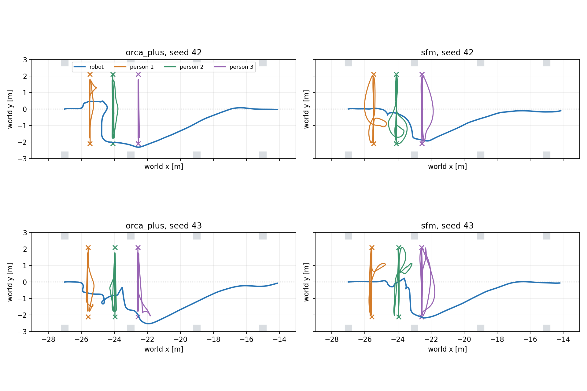
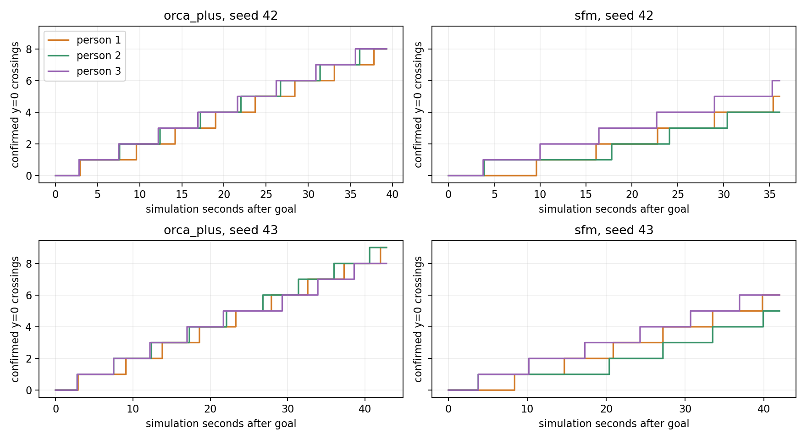
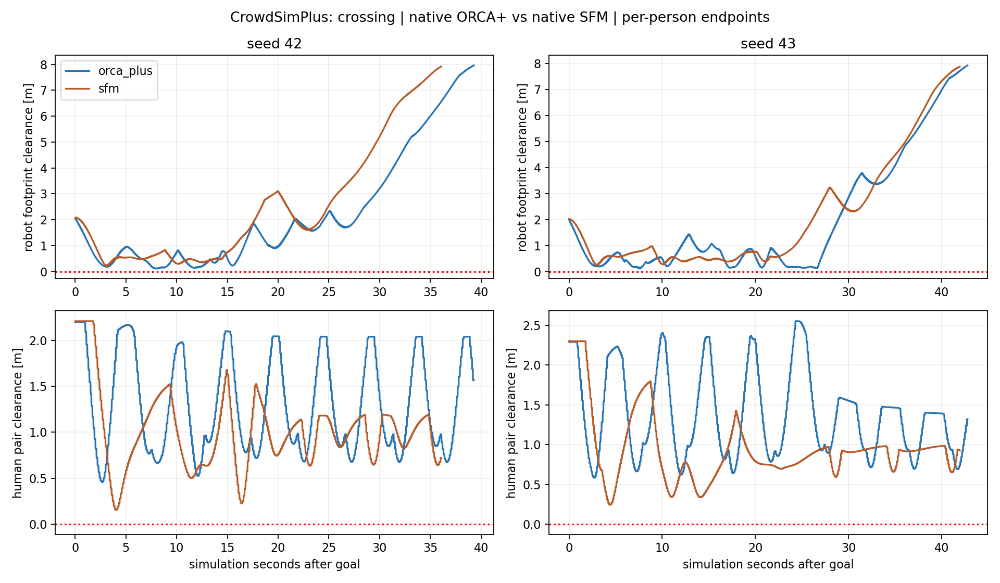

# Giao cắt trong Gazebo: native SFM và ORCA+

Đã chạy kiểm định độc lập trước, sau đó **4/4 lượt Gazebo/Nav2 đến đích**,
SFM và ORCA+ với seed 42/43. Mỗi người cắt qua tim lối chính **4–9 lần**;
không ghi nhận overlap robot–người/người–người trên 1 cm trong mẫu pose đã lưu.
**78/78** lần hoàn tất chặng được đối chiếu với proxy pose thực trong Gazebo.

Đây là ba người độc lập ở lối rộng. Robot có thể vòng tránh khu vực giao cắt;
chưa chứng minh hành vi nhóm, hội thoại, mức tự nhiên hoặc khả năng nhường
trong bottleneck.

## Cảnh mới và phạm vi thay đổi

Ba người xuất phát tại x gần -25,5/-24/-22,5 m, y luân phiên ±2,1 m, hướng
về phía đối diện. Mỗi người có hai endpoint y=-2,1/+2,1 để tuần tra. Seed 43
đảo hướng xuất phát và dùng jitter x khác seed 42 (biên ±0,1 m).
**Initial poses/headings và đích đều mới**, không phải chỉ đổi endpoint của
fixture counterflow cũ. Cùng seed dùng scene giống nhau cho cả hai policy.

Endpoint là ý định di chuyển, không ép làn, quỹ đạo, vận tốc hoặc thời điểm
nhường robot. Chỉ đổi đích khi native `Human.reached_destination` đạt
(khoảng cách tới goal < radius 0,36 m). Vòng patrol là scenario ngoài episode.
Các đoạn dự kiến được screen hình học với 42 khối; clearance thực đo riêng.

Giữ nhà xưởng/map 60×40 m, robot spawn (-27,0), goal (-14,0), Mecanum, LiDAR,
IMU, AMCL, Nav2 MPPI, timestep 0,1 s, human radius 0,36 m và preferred speed
0,8 m/s. Chỉ thêm opt-in `--condition crossing --goal-layout individual`.
Không rebuild robot/plugin C++, thay force/arrival threshold hoặc chuyển
sang Isaac Sim/World Model. Cảnh shared/individual counterflow cũ giữ nguyên.

## Kiểm định độc lập trước Gazebo

Bốn policy/seed đều PASS, chạy trong image Python 3.8.13 đã ghim:

- 30 bước đầu của crossing khớp full upstream `env.step`, max state error **0**.
  Chưa có patrol turn trong đoạn parity; native arrival rule được kiểm riêng.
- Fixture individual counterflow cũ khớp kernel snapshot trước crossing qua
  30 bước, max error **0**. Scene shared và individual cũ cũng so lại với
  fixture đã lưu, không thay đổi.
- Robot cố định ở xa (-14,5), 20 sim s: mỗi người hoàn tất **3 chặng/3 giao cắt**
  ở SFM, **4 chặng/4 giao cắt** ở ORCA+, ở cả hai seed. State hữu hạn, mọi
  chuyển đích thỏa native arrival threshold.
- Cùng robot input định sẵn đi từ (-27,0) về phía người trong 8 sim s:
  visible/invisible tạo sai khác quỹ đạo tối đa **2,49/2,19 m** ở SFM và
  **0,71/0,96 m** ở ORCA+ (seed 42/43). Đây là probe phản ứng trong worker,
  không phải lượt Nav2 đối chứng và không đánh giá social yielding.

[Validation SFM42](sfm_s42_validation.json), [SFM43](sfm_s43_validation.json),
[ORCA42](orca_plus_s42_validation.json), [ORCA43](orca_plus_s43_validation.json).
[Snapshot kernel trước crossing](kernel_before.py) chỉ dùng regression.

## Kết quả Gazebo

| Policy | Seed | Sim s | Giao cắt người 1/2/3 | Chặng 1/2/3 | Robot gap min (cm) | Human pair min (cm) |
|---|---:|---:|---|---|---:|---:|
| orca_plus | 42 | 39.292 | 8/8/8 | 7/8/8 | 11.81 | 45.76 |
| orca_plus | 43 | 42.804 | 9/9/8 | 8/9/8 | 11.91 | 58.46 |
| sfm | 42 | 36.080 | 5/4/6 | 4/4/5 | 21.86 | 15.52 |
| sfm | 43 | 41.956 | 6/5/6 | 6/5/6 | 25.37 | 24.52 |

Các goal đều `SUCCEEDED`, sai số actual world pose lớn nhất **0,217 m**.
Đếm giao cắt từ pose Gazebo với hysteresis: đi từ y≤-0,2 tới y≥+0,2 m hoặc
ngược lại. Đây là xác nhận băng qua **tim lối dự kiến y=0**, không phải thời
điểm giao nhau chính xác với quỹ đạo robot. Số đếm tính toàn lượt, kể cả khi
robot đã đi qua; không so trực tiếp số lần thô giữa các lượt dài khác nhau.

Trong các event xác nhận giao cắt, khoảng hở tới robot <1 m được ghi **5/7**
lần ở ORCA+ seed42/43 và **1/4** ở SFM. Ngưỡng 1 m chỉ mô tả tại thời điểm
xác nhận, không phải personal-space, safety threshold hoặc tổng số encounter.
ORCA+ seed42 người 3 có khoảng hở gần robot nhất khoảng **0,90 m**: không
khẳng định cả ba người đều có encounter sát robot trong mọi lượt.

Clearance chính dùng footprint xoay 0,24×0,20 m so proxy người tròn radius
0,36 m. Human pair dùng hai proxy tròn. Khoảng hở nhỏ nhất với footprint
padding 0,26×0,22 m cũng dương (tối thiểu khoảng 10,4 cm). Human–factory
clearance dương ở cả bốn lượt, nhỏ nhất khoảng 19,0 cm.
Pose lấy khoảng **49,4 Hz**, khoảng trống sample tối đa **0,036 sim s**;
worker cập nhật người **10 Hz**, proxy kinematic. Đây không phải đo contact
force, mọi physics step hoặc toàn bộ collision geometry robot. Overlap
duration dùng threshold −1 cm; không kết luận bảo đảm không tiếp xúc liên tục.

Cả **78/78** native arrival events có pose actual khớp trong cửa sổ native
elapsed −0,002 đến +0,030 s. Max pose error <1e-12 m; khoảng cách actual tới
endpoint trước khi đổi goal lớn nhất **0,359203 m**, đúng ngưỡng <0,36 m.







## Quan sát và hạn chế

- Cả hai model tiếp tục đi qua lại, không còn đứng quanh waypoint chung trong
  các case mới. Khi robot tới, có đường người lệch khỏi đoạn thẳng dự kiến;
  điều này khớp probe visibility. Không có luật nhường ưu tiên hoặc nhóm xã hội.
- Quỹ đạo robot màu xanh cho thấy Nav2 vòng xuống phía dưới khu giao cắt,
  có lúc lệch khoảng 2–2,5 m so tim lối. Kết quả phản ánh tránh nhau kín vòng
  của cả robot và người; không diễn giải thành mọi người luôn tự nhường robot.
- Trong sample này SFM có robot clearance lớn hơn, nhưng human-pair clearance
  nhỏ hơn ORCA+. Chưa có cơ sở chọn policy an toàn/tự nhiên hơn chỉ từ bốn lượt.
- Biến thiên vận tốc p95 khoảng 1,16 m/s² ở SFM và 0,79/1,13 ở ORCA+.
  Đây là mô tả theo timestep, không phải thước đo tính tự nhiên đã kiểm chứng.
- RTF khoảng 0,74–0,75 ở SFM, 0,57 ở ORCA+; worker mean khoảng 34–35/76 ms.
  Native static constraint xử lý 168 đoạn của 42 khối. Không dùng runtime
  hoặc thời gian đến đích để xếp hạng từ hai seed, một lượt mỗi seed.
- MPPI/AMCL/LiDAR noise chưa khóa chung. Crossing thay initial fixture so với
  counterflow nên không gộp số liệu hai vòng như cùng một điều kiện.
- Đây vẫn là 3 người độc lập, `groups=[]`, không có conversation/formation.
  Lối hẹp thật x=12..20 m và crowd mật độ cao chưa được benchmark ở vòng này.

## Tương thích và cách demo

Ubuntu 24.04/ROS 2 Jazzy chạy robot và Nav2 bằng Python 3.12 hiện có.
CrowdSimPlus chạy độc lập trong Docker Python 3.8.13, image
`dynamuhsim-crowdsimplus:round2`, image ID
`sha256:39929ee8e4fa6d738a381a0b695bf25eaf9fa972cd5b9d8a6854d72f80bd5f3c`,
source `d526a07c013c621fa1ad50894b6ba639f61063de`.
Native policy/source hashes và config giống byte-for-byte vòng trước.
SFM `is_bottleneck=False`, không áp quy ước index hallway vào factory.

Adapter nhận pose/vận tốc robot thực, gọi native human action/constraint/step,
đưa pose người vào Gazebo; Nav2 là controller robot duy nhất. Docker tắt
network, root filesystem và adapter mount read-only. Không cài dependency
CrowdSimPlus vào môi trường ROS. Demo upstream dt=0,25 s/DWA đã thử ở vòng
trước; cấu hình Gazebo dt=0,1 s/Nav2 không được gọi là demo nguyên bản.

Từ terminal Ubuntu tại repository root:

```bash
bash experiments/social_navigation/benchmark/run.sh trial \
  --backend crowdsimplus --human-policy sfm --goal-layout individual \
  --condition crossing --seed 42 --gui --diagnostics \
  --report-dir "experiments/social_navigation/benchmark/generated/crossing_demo_$(date +%Y%m%d_%H%M%S)"
```

Đổi `--human-policy orca_plus` để xem đối chiếu, mỗi lượt dùng directory mới.
Robot tự nhận goal; GUI tự đóng khi hết lượt. Các lượt báo cáo chạy headless,
có camera RGB Gazebo; chưa kiểm thử thao tác GUI trực tiếp trong vòng này.
GIF gồm cả đoạn warmup; không đo thời gian benchmark theo thời lượng GIF.
Robot nhỏ hơn người trong góc quay toàn cảnh; dùng đường xanh trên biểu đồ
để theo dõi đường tránh và xem khoảng hở bên cạnh hình ảnh.

- SFM: [seed42 GIF](crowdsimplus_sfm_individual_goals_crossing_s42.gif), [seed43 GIF](crowdsimplus_sfm_individual_goals_crossing_s43.gif).
- ORCA+: [seed42 GIF](crowdsimplus_individual_goals_crossing_s42.gif), [seed43 GIF](crowdsimplus_individual_goals_crossing_s43.gif).
- [Cách chạy lại ma trận và analysis](../../README.md), [CSV](results.csv),
  [analysis](analysis.json), [crossing events](crossing_events.json),
  [protocol](protocol.json), [fixture42](fixture_s42.json), [fixture43](fixture_s43.json),
  [run manifest/hash](run_manifest.json), [source preservation](source_preservation.json),
  [regression của analysis trên các lượt cũ](analyzer_regression.json).

## Trạng thái và bước tiếp theo

Source/index preservation PASS: 14.181 tracked paths ngoài social_navigation,
preexisting staged/unstaged diff và RVO2 binary giữ nguyên. Source Python/shell
syntax và whitespace PASS. Các container/process của vòng này đã đóng.
Phần crossing chưa commit.

Bước tiếp theo là fixture **lối hẹp thật trong nhà xưởng**, kiểm định native
worker trước rồi ghép cặp SFM/ORCA+. Chưa chuyển Isaac Sim, sửa kiến trúc robot,
triển khai World Model hoặc nối ComplexityNav vào Gazebo.
