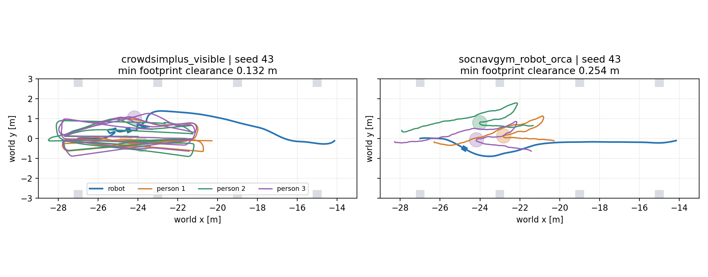
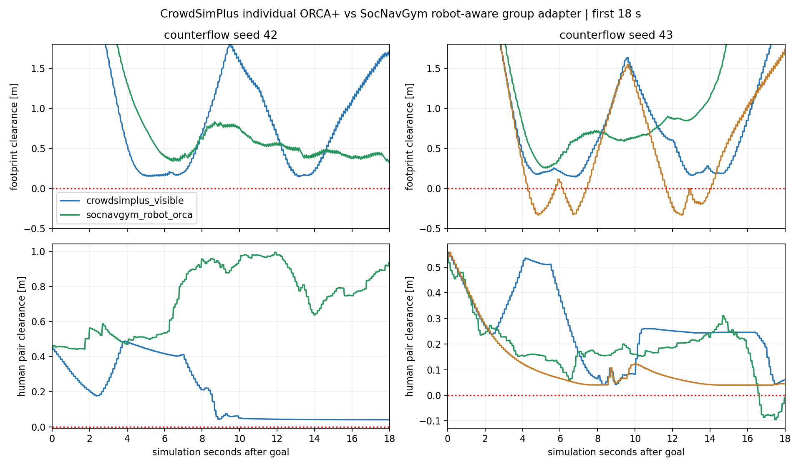

# CrowdSimPlus đã chạy trong Gazebo với Mecanum/Nav2

Đã nối **CrowdSimPlus ORCA+** vào cùng nhà xưởng Gazebo và hoàn tất **7/7 lượt Nav2 đến đích**: 4 CrowdSimPlus visible (standing/counterflow, seed 42/43), 2 SocNavGym robot-aware adapter counterflow và 1 CrowdSimPlus invisible-robot control. Cả hai backend được đo từ pose Gazebo và cùng scene/map/Nav2.

Hai CrowdSimPlus counterflow có nhận biết robot không ghi nhận overlap robot–người hoặc người–người ở sample đã lưu; clearance robot tối thiểu **14,60 / 13,15 cm**, human pair **4,00 / 3,84 cm**. Khi bỏ robot khỏi observation người ở seed 43, vẫn đến đích nhưng robot overlap sâu **33,54 cm**, duration >1 cm khoảng **5,80 s**. Goal success không được coi là không va chạm.

CrowdSimPlus hiện phù hợp thử **người độc lập tránh nhau/robot**, không cung cấp model group walking, conversation hay formation trong bản này. Những người ban đầu đứng gần nhau hoặc cùng waypoint không được gọi là nhóm xã hội. ComplexityNav vẫn chưa đưa vào Gazebo.

## Kiến trúc cô lập và tương thích

Ubuntu 24.04 + ROS 2 Jazzy + Gazebo Harmonic chạy robot/sensors/Nav2 trên host. Worker CrowdSimPlus dùng **Python 3.8.13 trong image đã ghim của vòng 2**, source `d526a07c013c621fa1ad50894b6ba639f61063de`. Không cài CrowdSimPlus vào Python 3.12 hệ thống, không khẳng định hỗ trợ Jazzy/Python 3.12 trực tiếp.

Docker không có network, root filesystem read-only; chỉ code mount read-only và runtime/socket riêng được chia sẻ. Plugin `libcrowdsimplus_adapter.so` riêng gửi pose/vận tốc thật robot qua Unix socket, nhận pose người và áp lên proxy/actor Gazebo. Topic `/crowdsimplus/ground_truth` và camera `/crowdsimplus/observer` riêng. Không dùng DWA/robot controller 2D của CrowdSimPlus trong tích hợp: **Nav2 là controller robot duy nhất**.

Demo gốc `sicnav/simple_test.py` + DWA + config nguyên bản đã được chạy lại thành công, xuất MP4 trong runtime mới `crowdsimplus_adapter/generated/official_demo_oykfw079`, không ghi đè round2. Sau đó mới chạy Gazebo pilot này. Các lượt Gazebo kiểm tra ở mode headless có rendering/camera; lệnh GUI để quan sát trực tiếp ở dưới.

## Phạm vi native và cấu hình benchmark

Native `Human.act`/`ORCAPlus.predict`, `CrowdSimPlus.constrain_agent_action_exact` và `Human.step` được giữ nguyên. Tính hành động của mọi người trên cùng snapshot rồi áp đồng thời; robot state lấy từ Gazebo. Full Gym reward/episode/reset và robot step không dùng trong bridge.

Wrapper đã đối chiếu **30 bước** với `env.step` gốc: sai số x/y/vx/vy/goal tối đa **0**. Kiểm tra native static constraint cho bước không ràng buộc 0,08 m bị giới hạn còn 0,0399999 m trước line; fixture đứng yên giữ chính xác 20 bước. Cùng robot input 90 bước, visible/invisible làm quỹ đạo người khác tối đa **0,672 m**; đây là kiểm tra phản ứng observation riêng với robot input cố định, không phải một lượt Nav2 mới.

Các override được ghi rõ trong [config](crowdsimplus.config): timestep **0,1 s** (demo gốc 0,25 s), human radius **0,36 m**, preferred speed **0,8 m/s**, nominal robot radius **0,25 m**, tắt random attributes. Native ORCAPlus giữ safety_space 0,01 m và cộng thêm 0,01 m trong solver, tức effective radius margin 0,02 m mỗi agent. Native neighbor distance 10 m, horizon 2,0 s, obstacle horizon 0,5 s.

42 khối nhà xưởng được chuyển thành 168 line segments cho native solver/static constraint. Counterflow dùng initial poses fixture đã commit, cùng waypoint center; từng người đổi patrol goal theo native `reached_destination`. Đây là scenario bên ngoài episode, không thêm cohesion. Standing được giữ yên bên ngoài policy để làm sensor/geometry negative control, **không phải conversation model**. Group ID từ fixture nguồn bị bỏ qua, ground truth CrowdSimPlus có `groups=[]`.

Comparator SocNavGym là **circle_contact + robot_orca adapter đã chỉnh**, không phải upstream native. Nó dùng group agent radius 1,44 m và smoothing/turning/noise native, khác ba agent độc lập CrowdSimPlus. Không thể gán mọi khác biệt cho tên framework hoặc dùng bảng này xếp hạng hai framework nói chung.

## Kết quả Gazebo

Bảng dùng actual model poses khoảng 50 Hz. Robot clearance so rectangle cấu hình Nav2 0,24×0,20 m với proxy người tròn radius 0,36 m; pair clearance so hai proxy tròn. Giá trị âm là lấn hình học. Duration dùng threshold −1 cm, xấp xỉ theo sample; không có contact-force sensor và không chứng nhận mọi physics step hay toàn bộ collision links robot.

| Scene | Seed | Model | Goal | Sim s | Robot clearance min (cm) | Robot overlap >1 cm (s) | Human pair min (cm) | Pair overlap >1 cm (s) |
|---|---:|---|---|---:|---:|---:|---:|---:|
| counterflow | 42 | crowdsimplus_visible | SUCCEEDED | 37.452 | +14.60 | 0.000 | +4.00 | 0.000 |
| counterflow | 42 | socnavgym_robot_orca | SUCCEEDED | 27.580 | +24.30 | 0.000 | +44.29 | 0.000 |
| counterflow | 43 | crowdsimplus_blind | SUCCEEDED | 39.584 | -33.54 | 5.800 | +4.00 | 0.000 |
| counterflow | 43 | crowdsimplus_visible | SUCCEEDED | 71.020 | +13.15 | 0.000 | +3.84 | 0.000 |
| counterflow | 43 | socnavgym_robot_orca | SUCCEEDED | 24.920 | +25.40 | 0.000 | -9.55 | 4.720 |
| standing | 42 | crowdsimplus_visible | SUCCEEDED | 27.160 | +11.23 | 0.000 | +49.82 | 0.000 |
| standing | 43 | crowdsimplus_visible | SUCCEEDED | 26.136 | +10.98 | 0.000 | +37.28 | 0.000 |

CrowdSimPlus visible giữ khoảng hở dương với cả footprint padding 0,26×0,22 m; padded minimum counterflow khoảng **13,41 / 11,77 cm**. Proxy người không lấn khối factory trong các sample. Human-pair gap gần 4 cm phù hợp margin nội bộ ORCA, không chứng minh crowd không bao giờ chạm khi tăng mật độ.

SocNavGym robot-aware adapter cũng giữ robot clearance dương ở hai seed, nhưng seed 43 có pair overlap >1 cm khoảng **4,72 s**, sâu nhất **9,55 cm**. CrowdSimPlus tránh nhau tốt trong hai fixture này, đồng thời không có luật giữ nhóm hay trò chuyện để thay thế các tính năng đó của SocNavGym.





Visible/blind Nav2 là hai lượt kín vòng khác nhau, không khóa chung MPPI/AMCL/LiDAR noise. Không gán toàn bộ khác biệt quỹ đạo/timing cho visibility từ một cặp; kiểm tra scripted robot input cố định phía trên cung cấp bằng chứng bổ sung về phản ứng người.

## Quan sát và hiệu năng

Trong quỹ đạo/GIF, CrowdSimPlus điều khiển từng người đi về goal, tránh peer và robot, quay đầu theo tiêu chí đến goal riêng. Patrol chung làm các người nhiều lần gặp lại robot; đây là động học người độc lập, không phải ba người cố giữ đội hình xã hội. Native ORCA+ vẫn dựa trên ORCA/RVO2; đổi framework không tự đảm bảo chuyển động tự nhiên hơn.

Thời gian đến goal CrowdSimPlus visible là **37,45 / 71,02 sim s**, comparator SocNavGym adapter **27,58 / 24,92 sim s**. CrowdSimPlus seed 43 đi khoảng 16,06 m và có khoảng 9,20 s dừng theo ngưỡng metric, so với quãng tiến mục tiêu 13 m. Chưa cô lập nguyên nhân thời gian đi dài.

Worker CrowdSimPlus counterflow khoảng **90,7–91,6 ms/tick**, RTF khoảng **0,52–0,53**; SocNavGym adapter khoảng **6,0–6,6 ms/tick**, RTF **0,93–0,95**. Native static constraint kiểm tra 168 segments cho mỗi người là một phần công việc của bridge giữ nguyên thuật toán. Chưa tối ưu broadphase hoặc đổi cấu hình để che chi phí này. RTF/timer scheduling khác nhau là confound của phép so Nav2; không dùng thời gian đi làm xếp hạng chất lượng hành vi thuần túy.

Standing CrowdSimPlus gần real time vì fixture giữ yên và không gọi solver di chuyển. Các lượt có cùng sensor/rendering/diagnostics, nhưng chỉ có hai human seeds và một lần mỗi cấu hình. Chưa có thống kê, nhiều nhóm, full warehouse route hoặc bottleneck trong vòng này.

## Robot thực sự thấy người

355 ROS scans của CrowdSimPlus visible seed 43 được kiểm tra. Một scan tại t≈24,036 s sau goal có **182/182 tia dự đoán bề mặt người khớp trong 5 cm** với geometry Gazebo. Scan frame `base_scan`; có 313 costmap bản tin nonempty trong frame `odom`. Đây là bằng chứng hỗ trợ sensor/marking, không phải đo nội bộ controller ở mọi lần tối ưu.

Ảnh/GIF là camera RGB của Gazebo, không phải renderer 2D CrowdSimPlus. Native demo video được giữ riêng trong generated runtime.

## Cách chạy và xem

[Hướng dẫn adapter/build/container](../../../../crowdsimplus_adapter/README.md), [CSV](results.csv), [analysis](analysis.json), [protocol](protocol.json), [native parity checks](kernel_validation.json), [LiDAR evidence](sensor_evidence.json), [manifest/raw hashes](run_manifest.json), [source preservation](source_preservation.json).

- CrowdSimPlus visible seed 43: [GIF](crowdsimplus_counterflow_s43.gif), [ảnh](crowdsimplus_counterflow_s43.png), [trial](crowdsimplus_counterflow_s43.json).
- CrowdSimPlus blind seed 43: [GIF](crowdsimplus_blind_counterflow_s43.gif), [trial](crowdsimplus_blind_counterflow_s43.json).
- SocNavGym adapter seed 43: [GIF](socnavgym_circle_contact_robot_orca_counterflow_s43.gif), [trial](socnavgym_circle_contact_robot_orca_counterflow_s43.json).

Từ repository root, dùng output directory mới:

```bash
bash experiments/social_navigation/benchmark/run.sh trial \
  --backend crowdsimplus --condition counterflow --seed 43 --gui --diagnostics \
  --report-dir experiments/social_navigation/benchmark/crowdsim_comparison/reports/gui01
```

Bỏ `--gui` để thu camera headless; thêm `--invisible-robot` chỉ để chạy ablation observation. Không chạy hai trial trong cùng ROS domain. Native source được giữ nguyên trong image; raw JSONL/log/official demo trong generated/ ignored, path/hash lưu trong manifest. Phần mới chưa commit trong lượt này.

## Trạng thái và bước tiếp theo

- **SocNavGym:** đã chạy Gazebo, native và các adapter variants được phân biệt rõ; group walking/conversation layout có, native group avoidance/cohesion còn giới hạn.
- **CrowdSimPlus:** đã chạy Gazebo với ORCA+ native human kernel, cùng Mecanum/Nav2; chưa test SFM trong Gazebo, chưa có group/conversation model.
- **ComplexityNav:** đã thử độc lập ở vòng 3, **chưa nối Gazebo**.

Chưa chọn model hành vi chính thức. Bước tiếp theo hợp lý là thử policy SFM native trên backend CrowdSimPlus và các cảnh giao cắt/lối hẹp, rồi mới chuyển sang adapter ComplexityNav. Giữ từng vòng tách biệt, chưa tăng mật độ trên setup chưa kiểm soát hiệu năng và chưa đổi kiến trúc robot/World Model.

Kiểm tra 14.181 tracked paths ngoài experiments/social_navigation, index và diff có sẵn đều không đổi; binary RVO2 và adapter SocNavGym cũ giữ nguyên. Chỉ thêm backend/kernel/transport/config/report trong experiments. Tất cả process/container thuộc các lượt thử đã được đóng.
