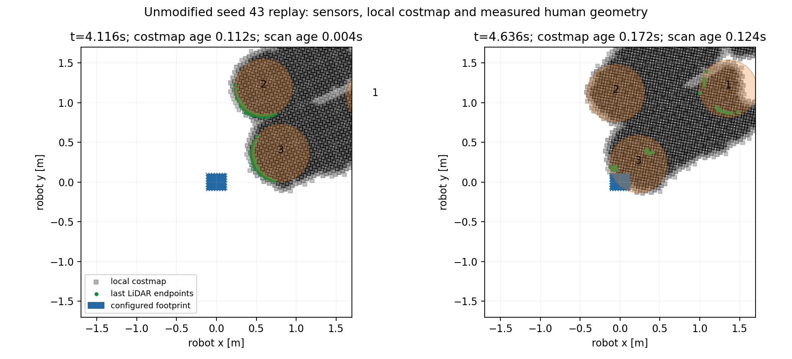

# Chẩn đoán SocNavGym counterflow, seed 43

Đã tái hiện overlap với nguyên scene, map và tham số Nav2 của pilot. Robot đến đích trong **25,076 giây mô phỏng**, nhưng khoảng cách nhỏ nhất giữa footprint cấu hình và proxy người là **−0,1914 m**, kéo dài khoảng **1,616 giây** dưới ngưỡng −1 cm. Lần này người gần nhất là **ID 3**; pilot trước là ID 2, −0,1417 m. Seed người không cố định nhiễu LiDAR, AMCL hay mẫu MPPI. Đây là một lượt chẩn đoán bổ sung, chưa phải thống kê độ an toàn.



## Bằng chứng chính

1. **LiDAR thấy người trước overlap.** Ở t=4,112 s sau goal, 78/78 tia dự đoán trúng bề mặt proxy khớp trong sai số 5 cm; 48 tia thuộc người ID 3. Ở t=4,312 s, 94/95 tia khớp, 69 tia thuộc ID 3. Các endpoint này xuất hiện thành ô lethal/inscribed trong costmap được xuất bản tiếp theo. LiDAR đều 0,2 s/bản tin; không thấy mất chu kỳ trong lượt này.
2. **Không thấy lệch odometry/TF lớn.** Sai lệch vị trí giữa odometry và pose Gazebo sau bù spawn (−27,0) tối đa 6,74 mm; tại lần sát nhất là 0,76 mm. TF odom→base_footprint khớp Odometry tại cùng timestamp (sai số đo 0). TF tĩnh base_scan không có offset XY. So khớp scan với hình học thực cũng xác nhận chuỗi cảm biến đúng trong mặt phẳng ở mức dung sai đang dùng.
3. **Hình học va chạm native khác proxy Gazebo.** `Object.collides` của bản SocNavGym đang dùng tạo ellipse người có bán trục **width/6=0,12 m** theo X và **width/2=0,36 m** theo Y; hàm này không xoay ellipse theo hướng người. Gazebo lại dùng cylinder bán kính **0,36 m**. Native robot radius sau reset thực tế là **0,242879 m**, do mặc định random margin ±0,01 m quanh giá trị cấu hình 0,25 m.
4. **Một bước native trực tiếp tạo overlap đầu tiên.** Tại t=4,416 s (simulation stamp 11,904), giữ nguyên pose robot đầu bước: clearance trước bước +1,42 cm, sau bước −5,82 cm. Người ID 3 đi thêm 7,85 cm; hàm `collides` native trả về **false** trên trạng thái trước bước. Tới t=4,616 s nó mới trả về **true**, khi proxy đã lấn khoảng 19,19 cm; tốc độ cả nhóm được đặt 0. Probe gọi trực tiếp hàm gốc, không thay hành vi hay vendor.
5. **Group ORCA không có agent robot.** `compute_orca_interaction_velocities` thêm người, nhóm và vật tĩnh nhưng không thêm robot. Việc dừng là kiểm tra contact trên trạng thái trước `human.update`, không có kiểm tra swept collision. Gazebo adapter áp pose kinematic mỗi 0,1 s; lượt này người tiến khoảng 7–8 cm/bước, trong khi robot vẫn chạy gần 0,49 m/s trước lần lấn đầu tiên.

## Điều đã xác định và điều còn mở

Đã xác nhận hai vấn đề ở cách thử nghiệm mô hình: **proxy và predicate va chạm không thống nhất**, và nhóm native **không chủ động né robot**. Bước dịch chuyển native nêu trên đủ để tạo lần overlap đầu tiên với proxy tròn. Vì vậy không thể dùng overlap proxy của pilot để kết luận riêng về chất lượng Nav2 hay coi cơ chế native đã đảm bảo tránh người.

LiDAR và costmap có hoạt động, nhưng cũng chưa ngăn được sự kiện. CostCritic đang `consider_footprint: false`, inflation radius 0,2 m; header costmap xuất bản tại lần sát nhất cũ hơn 0,172 s, scan cũ hơn 0,124 s, command speed khoảng 0,421 m/s. Đây là các yếu tố cần A/B riêng, **chưa chứng minh là nguyên nhân duy nhất**. Header costmap xuất bản không cho biết chính xác nội dung costmap nội bộ mà controller đã dùng ở từng lần tối ưu; lần này chưa ghi rollout/cost của MPPI.

Metric footprint trước đây dùng hình chữ nhật cấu hình 0,24×0,20 m. Costmap xuất footprint có padding mặc định 0,01 m mỗi phía, tức 0,26×0,22 m; clearance nhỏ nhất với hình đã padding là −0,2055 m. Metric không bao trọn mọi bánh xe/collision link và không phải số đo lực tiếp xúc. Không có contact sensor trong phép đo.

**Đính chính cách đọc pilot trước:** radius 0,25 m trong scene/metric là radius danh định của quy ước so sánh; không phải radius native thực sau random reset. Human radius 0,36 m là proxy/metric, không phải hình học ellipse của `Object.collides`. CSV, metric hình học và raw report của pilot vẫn được giữ nguyên để truy xuất.

## Cách chạy lại

Từ repository root, dùng thư mục output mới cho mỗi lượt; harness từ chối ghi đè report đã hoàn tất:

```bash
bash experiments/social_navigation/benchmark/run.sh trial \
  --backend socnavgym --condition counterflow --seed 43 \
  --diagnostics \
  --report-dir experiments/social_navigation/benchmark/diagnostic/reports/run02

python3 experiments/social_navigation/benchmark/analyze_diagnostic.py \
  experiments/social_navigation/benchmark/diagnostic/reports/run02

experiments/social_navigation/.venv-socnavgym/bin/python \
  experiments/social_navigation/benchmark/probe_native_collision.py \
  experiments/social_navigation/benchmark/diagnostic/reports/run02
```

Thêm `--gui` vào lệnh đầu để xem trực tiếp Gazebo. Runtime native vẫn dùng virtual environment riêng; ROS subscriptions dùng Python hệ thống/Jazzy. Không build lại robot hoặc plugin RVO2.

Dữ liệu thô nằm trong `benchmark/generated/socnavgym_counterflow_s43_0wpk44_k/diagnostics.jsonl` (16,55 MB, ignored). Capture gồm scan, odom, AMCL, TF động/tĩnh, local costmap, published footprint, cmd_vel, native ground truth và pose Gazebo. Đã đăng ký `/local_plan` nhưng không nhận bản tin; không dùng kênh này để kết luận. JSONL dùng biểu diễn Infinity của Python cho range vô hạn. Có timestamp message, receipt clock và thời gian nhận monotonic; TF tĩnh có thể mang wall time nên không dùng chúng như sample động.

- [Kết quả trial](socnavgym_counterflow_s43.json), [phân tích](diagnosis.json), [timeline](timeline.json), [scan metrics](scan_metrics.json).
- [Probe native](native_collision_probe.json), [các bước native](native_collision_steps.json).
- [Đồ thị thời gian](diagnostic_timeline.png), [camera Gazebo](socnavgym_counterflow_s43.png), [video GIF](socnavgym_counterflow_s43.gif).
- [Manifest](diagnostic_manifest.json), [kiểm tra bảo toàn](source_preservation.json).

## Bước tiếp theo

Trước khi tăng số người hoặc benchmark framework tiếp theo, tạo **biến thể thử nghiệm riêng để thống nhất hình học và quy tắc contact giữa native và Gazebo**, giữ bản native hiện tại làm đối chứng. Gắn nhãn rõ thay đổi ở adapter, không trình bày nó là hành vi native nguyên bản. Quyết định radius robot cố định/nominal và cách xoay hình học phải được ghi trong protocol.

Sau đó chạy lại cặp standing/counterflow với nhiều lần lặp và đánh giá geometric overlap. Chỉ khi hình học nhất quán mới A/B inflation/footprint hoặc nhịp sensor trong config thí nghiệm riêng. Chưa sửa tham số Nav2, source ROS, source SocNavGym, kiến trúc robot hay World Model trong lượt chẩn đoán này.

## Kiểm chứng và giới hạn

Scene/map/Nav2 params có SHA256 giống hệt pilot seed 43. Toàn bộ 14.181 tracked paths ngoài experiments/social_navigation, index và diff có sẵn được bảo toàn; binary RVO2 giữ nguyên. Kiểm tra cú pháp Python, tính nhất quán hash, dấu clearance trước/sau bước và kết quả predicate native đều đạt. Các tiến trình của lượt chạy đã đóng.

Pose Gazebo được lấy khoảng 50 Hz; chỉ nội suy chuyển động robot, giữ pose người giữa hai sample. Native log 10 Hz cung cấp trạng thái chính xác trước/sau bước; độ lệch apply/sample vài ms có thể giải thích chênh lệch nhỏ giữa clearance native và scene. Scan matching dung sai 5 cm chịu ảnh hưởng noise, actor mesh và occlusion. So endpoint với costmap tiếp theo chỉ là bằng chứng hỗ trợ việc marking, không đo mọi cập nhật nội bộ. Passive logging làm RTF quan sát khoảng 0,645; không khẳng định nó không ảnh hưởng lịch chạy. Một lần tái hiện bổ sung không đủ để xếp hạng các simulator.
