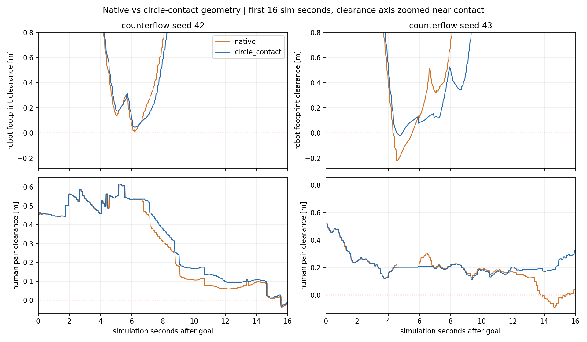
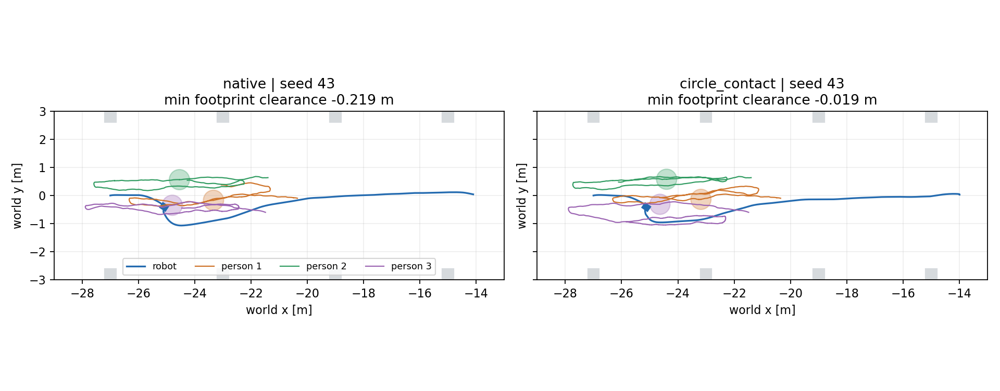
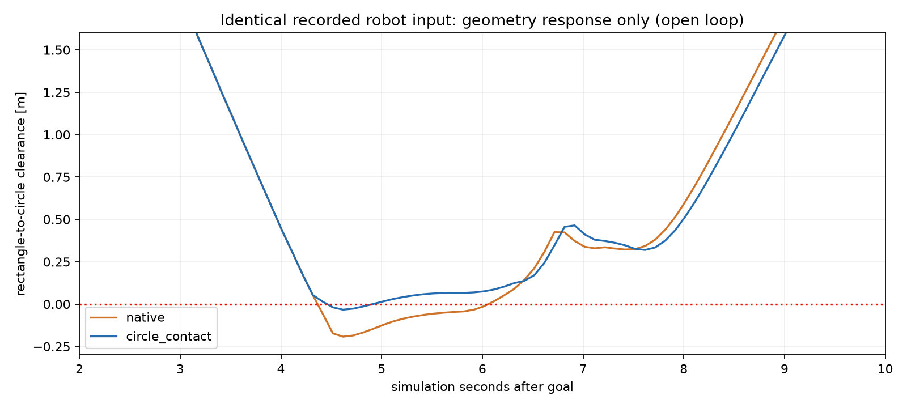

# Đối chứng native / circle_contact trong nhà xưởng

Đã tạo biến thể **circle_contact** và hoàn tất **8/8 lượt Gazebo/Nav2 đến đích**, gồm standing/counterflow × native/circle_contact × seed 42/43. Scene ban đầu, map, proxy, robot, LiDAR và tham số Nav2 giữ nguyên; protocol xác nhận SHA giống từng cặp và khớp pilot gốc.

Counterflow seed 43 của ma trận mới: native có clearance footprint nhỏ nhất **−21,90 cm**, còn circle_contact **−1,93 cm**; duration vượt ngưỡng overlap 1 cm lần lượt **1,180 s** và **0,220 s**. Hình học contact đã nhất quán hơn, nhưng **chưa hết overlap và chưa có tránh robot chủ động**.

## Chính xác đã thay gì

Trong worker thí nghiệm, circle_contact gắn predicate riêng lên từng instance người: circle radius 0,36 m với người/robot/plant; circle với oriented box cho wall/table/chair/laptop. Radius robot native được cố định **sau reset** ở giá trị danh định 0,25 m, không đổi chuỗi RNG hay bố trí ban đầu. Native giữ ellipse 0,12×0,36 m và radius reset lần lượt 0,245501 / 0,242879 m cho seed 42/43.

Native `GroupKernel`, `handle_collision_and_update`, group ORCA, group coherence, response dừng nhóm, tốc độ/nhiễu và tick 0,1 s giữ nguyên. Không thêm agent robot vào group ORCA, không có swept test, clipping, hiệu chỉnh pose, nội suy hoặc guard tách người. Predicate chỉ kiểm tra ở trạng thái trước update; robot vẫn được Nav2 điều khiển như cũ.

Đây là biến thể adapter đã chỉnh geometry, **không phải kết quả SocNavGym nguyên bản**. Robot radius 0,25 m là envelope danh định dùng cho native contact/metric, không phải thay collision links của robot Gazebo. Nhà xưởng có 42 khối; force response với wall vẫn native dù predicate đã đổi.

## Các lượt Nav2 kín vòng

Bảng dùng pose **Gazebo của cả hai phía**, capture khoảng 50 Hz. Clearance dương là khoảng hở, âm là lấn hình học giữa rectangle cấu hình Nav2 0,24×0,20 m và proxy tròn radius 0,36 m. Duration là xấp xỉ từ sample với threshold −1 cm; không phải lực tiếp xúc.

| Scene | Seed | Geometry | Goal | Thời gian sim (s) | Clearance min (cm) | Overlap >1 cm (s) | Pair overlap >1 cm (s) |
|---|---:|---|---|---:|---:|---:|---:|
| counterflow | 42 | native | SUCCEEDED | 41.580 | +0.83 | 0.000 | 0.584 |
| counterflow | 42 | circle_contact | SUCCEEDED | 41.484 | +4.68 | 0.000 | 0.500 |
| counterflow | 43 | native | SUCCEEDED | 25.388 | -21.90 | 1.180 | 1.384 |
| counterflow | 43 | circle_contact | SUCCEEDED | 29.484 | -1.93 | 0.220 | 0.000 |
| standing | 42 | native | SUCCEEDED | 26.532 | +10.56 | 0.000 | 0.000 |
| standing | 42 | circle_contact | SUCCEEDED | 27.328 | +11.25 | 0.000 | 0.000 |
| standing | 43 | native | SUCCEEDED | 26.024 | +11.68 | 0.000 | 0.000 |
| standing | 43 | circle_contact | SUCCEEDED | 26.232 | +11.80 | 0.000 | 0.000 |

Standing là negative control: người giữ nguyên vị trí tới sai số dưới 4×10⁻¹⁵ m, hai policy có cùng pair clearance. Clearance robot đều dương. Khác biệt nhỏ về đường robot không chứng minh hành vi xã hội tốt hơn.

Ở counterflow seed 42, native còn khoảng hở nhỏ nhất +0,83 cm, circle_contact +4,68 cm; không có footprint overlap >1 cm ở hai lượt này. Human pair vẫn overlap >1 cm khoảng 0,584 s / 0,500 s. Circle predicate không thêm cơ chế tách các thành viên nhóm.

Metric padded footprint 0,26×0,22 m ghi riêng trong CSV: counterflow seed 43 là −23,30 cm / −3,34 cm. Circle robot envelope danh định cũng còn overlap; không được dùng footprint không âm ở một seed để khẳng định mọi collision link hoặc mọi physics step đều an toàn. Người không lấn vào khối factory theo metric circle–box của các sample đã ghi.





## Replay cùng robot input: tách tác động geometry

Dùng **251 input pose/vận tốc robot giống hệt nhau** từ lượt chẩn đoán seed 43 trước đó. Native replay tái tạo đúng toàn bộ x/y/yaw/speed/vx/vy đã lưu, sai số tối đa **0**; sau đó cùng input được cấp cho circle_contact.

| Chỉ số ở tick native | Native | Circle_contact |
|---|---:|---:|
| Contact được phát hiện lần đầu sau goal | 4,616 s | 4,416 s |
| Clearance footprint nhỏ nhất | −19,19 cm | −3,27 cm |
| Duration footprint overlap >1 cm | 1,700 s | 0,400 s |

Nhóm dừng sớm hơn 0,2 s trong replay. Kết quả này xác nhận geometry làm khác phản ứng contact ngay cả khi robot input không đổi. Vẫn có overlap do native kiểm tra trước update và robot tiếp tục di chuyển; normalization không tự tạo ra tránh né. Đây là **open-loop worker replay**, không tính vào 8 lượt Gazebo và không phải chứng nhận an toàn.



## Hiệu năng và giới hạn suy luận

Predicate giải tích cũng nhanh hơn native Shapely. Trong các lượt counterflow, worker compute mean native khoảng **48,6–56,0 ms/tick**, circle_contact **6,8–8,0 ms/tick**. RTF quan sát native khoảng **0,64–0,68**, circle_contact **0,90–0,93**. Standing circle_contact khoảng 0,98–0,99, native khoảng 0,64–0,70. Không dùng các giá trị này để suy rộng hiệu năng trên máy khác.

Hai phía cùng bật diagnostics, nhưng tốc độ thực thi và lịch timer vẫn khác. MPPI, AMCL và LiDAR noise chưa được khóa chung; vì vậy không thể gán toàn bộ thay đổi thời gian/đường Nav2 cho shape. Replay cùng input cung cấp bằng chứng trực tiếp hơn cho phản ứng geometry. Thử nghiệm có hai human seeds, một lần kín vòng mỗi seed/policy; chưa đủ thống kê hay xếp hạng simulator.

Circle_contact đổi đồng thời predicate và cố định robot radius reset; đây là normalization kết hợp, chưa tách riêng tác động jitter vài mm bằng ablation thứ ba. Pair overlap và group cohesion vẫn là hạn chế native. Mô hình conversation là bố trí người đứng nhìn vào tâm, chưa có mô phỏng nội dung hội thoại/formation mới trong harness này.

## Cách xem và chạy

Xem [hướng dẫn và protocol](../../README.md), [CSV](results.csv), [analysis](analysis.json), [protocol check](protocol.json), [15 kiểm tra hình học/parity](geometry_validation.json), [replay cùng input](same_robot_replay.json), [manifest và raw hashes](run_manifest.json), [bảo toàn source](source_preservation.json).

- Native seed 43: [ảnh](socnavgym_counterflow_s43.png), [GIF](socnavgym_counterflow_s43.gif), [trial](socnavgym_counterflow_s43.json).
- Circle_contact seed 43: [ảnh](socnavgym_circle_contact_counterflow_s43.png), [GIF](socnavgym_circle_contact_counterflow_s43.gif), [trial](socnavgym_circle_contact_counterflow_s43.json).

Mở GUI riêng từ repository root, dùng output directory chưa tồn tại trial:

```bash
bash experiments/social_navigation/benchmark/run.sh trial \
  --backend socnavgym --geometry circle_contact --condition counterflow --seed 43 \
  --gui --diagnostics \
  --report-dir experiments/social_navigation/benchmark/geometry_comparison/reports/gui01
```

Đổi `--geometry native` để xem đối chứng. Không mở hai trial cùng ROS domain. Matrix và lệnh phân tích có trong hướng dẫn; kết quả nằm riêng, không ghi đè pilot hoặc diagnosis trước. Raw capture JSONL ở benchmark/generated/ (ignored), có path/hash trong manifest; mỗi trial có observer camera Gazebo.

## Bảo toàn và bước tiếp theo

Kiểm tra 14.181 tracked paths ngoài social_navigation, index và diff có sẵn đều không đổi; binary RVO2 giữ nguyên. Vendor SocNavGym và kernel native, world, map, Nav2 params không thay đổi. Chỉ bổ sung mã thí nghiệm và dữ liệu dưới experiments/social_navigation; phần mới được lưu trong checkpoint commit riêng của benchmark. Toàn bộ process group thuộc ma trận đã đóng.

Normalization geometry này có thể giữ làm lựa chọn benchmark; native vẫn mặc định. **Bước tiếp theo đề xuất là đánh giá biến thể tránh robot chủ động ở adapter**, với robot được đưa vào bài toán tránh né và cùng phép replay làm đối chứng. Gắn nhãn rõ mọi thay đổi hành vi, chạy scene ít người trước khi tăng mật độ. Chưa thực hiện bước đó, chưa đổi Nav2/robot hoặc triển khai World Model trong vòng này.
