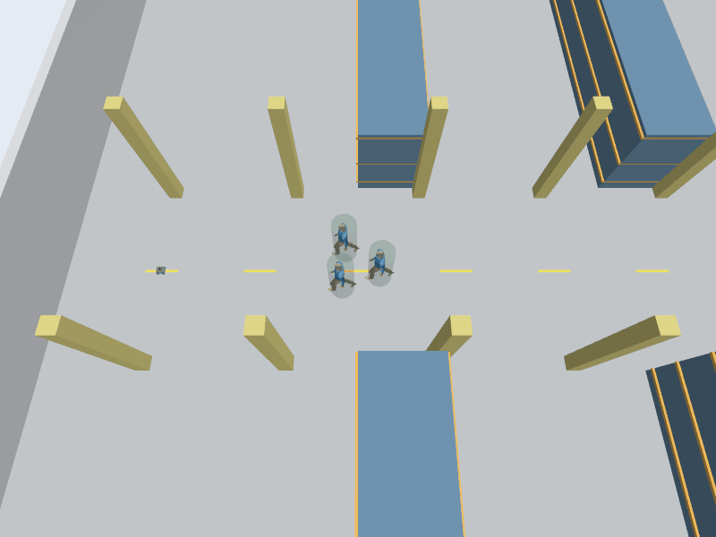

# SocNavGym: Gazebo continuation and AMCL observer fix

All seven attempts are retained: three standing trials, the original counterflow startup error, then three counterflow trials under the explicit observer-QoS amendment. Six scene/variant combinations now have valid measurements; the original six-trial cohort itself remains stopped. This is one seed, not a framework ranking.

| Cohort | Scene | Variant | Nav2 | Actual XY error (m) | Min footprint–human (m) | Footprint overlap >1cm (s) | Min human pair (m) | Pair overlap >1cm (s) |
|---|---|---|---|---:|---:|---:|---:|---:|
| run01 | standing | native | SUCCEEDED | 0.2210 | 0.1118 | 0.0000 | 0.4982 | 0.0000 |
| run01 | standing | circle_contact | SUCCEEDED | 0.1652 | 0.1090 | 0.0000 | 0.4982 | 0.0000 |
| run01 | standing | robot_orca | SUCCEEDED | 0.1668 | 0.1147 | 0.0000 | 0.4982 | 0.0000 |
| run01 | counterflow | native | ERROR | — | — | — | — | — |
| recovery01 | counterflow | native | SUCCEEDED | 0.1759 | 0.0164 | 0.0000 | -0.0886 | 2.0840 |
| recovery01 | counterflow | circle_contact | SUCCEEDED | 0.1624 | 0.0381 | 0.0000 | -0.0241 | 0.4000 |
| recovery01 | counterflow | robot_orca | SUCCEEDED | 0.1373 | 0.2108 | 0.0000 | 0.4429 | 0.0000 |

Nav2 reported SUCCEEDED in 6/6 valid trials; 5/6 also meet actual XY error ≤0.20m. Goal success and geometric overlap are separate results.

AMCL was active in the original failed startup: logs show initial pose and scan/current-time map TF, but the observer received zero AMCL messages. The old subscriber was best-effort/volatile. Jazzy AMCL offers reliable/transient-local pose samples. An isolated synthetic probe recovered a pre-published sample in3/3 durable late subscriptions and0/3 sensor-data subscriptions. All three recovery trials also record the actual AMCL publisher QoS and real late-subscriber samples. This supports a missed-observation mechanism; it does not prove the exact historical DDS packet/discovery sequence.

Jazzy upstream source: [AMCL pose publisher and stationary update path](https://github.com/ros-navigation/navigation2/blob/jazzy/nav2_amcl/src/amcl_node.cpp). The running publisher QoS was also observed directly, rather than inferred solely from this source.

Only experiment subscriber QoS is changed with --amcl-observer-qos transient_local; historical default sensor_data remains available and unchanged. The late-join check is read-only, before goal/start gate: no localization reset, forced update, initial-pose republish, AMCL parameter tuning or robot/controller change. The original failed attempt is not overwritten.

The user confirmed GUI drag/zoom and Pause/Play in the native counterflow recovery trial. Manual pause duration is not instrumented; do not compare that trial’s wall time/RTF as unattended throughput. Qt uses xcb; all completed attempts verified fresh NVIDIA Ogre rendering and clean shutdown/cleanup.

Dense measurements use recorded Gazebo poses during the active gate, the configured0.24×0.20m rotated Nav2 footprint and human circles r0.36m. Signed gaps retain all penetrations. Durations use the right endpoint of successive sampled intervals; they do not establish continuous collision freedom. The older trial circle-proxy metrics remain in raw JSON and are not interchangeable with footprint gaps.

In these six valid trials, all sampled robot-footprint/human gaps are positive; this is narrower than a safety guarantee. Native walking has human–human penetration of8.86cm for2.084s beyond1cm, geometry-only2.41cm for0.400s, and robot-aware minimum pair gap44.29cm with no sampled pair penetration. Robot-aware minimum footprint gap is21.08cm, compared with1.64cm native and3.81cm geometry-only. These are observations from one seed and different closed-loop robot trajectories, not a statistical ranking.

Group membership is fixed at three. Standing conversation is an inward-facing stationary fixture; robot_orca changes the walking solver only. Native and geometry-only walking may retain human overlap; inspect the measured minima rather than interpreting animation as safety. Robot input differs in closed-loop Nav2, so these are not exact-input replay results.

The PNG/GIF files are previews from the live Gazebo observer RGB camera pipeline, not AI images and not screen recordings. Decode and SHA256 checks cover all12 files across the6 valid trials. Existing GIFs subsample camera frames with nominal667ms playback; this is a preview and not a measurement of wall-time performance. No media exist for the startup failure.

Protocols, raw trial results/trajectories, runtime diagnostic hashes, summary.json, manifest.json, GUI confirmation and validation.json retain provenance. ComplexityNav remains standalone; no World Model or Isaac migration was implemented.

