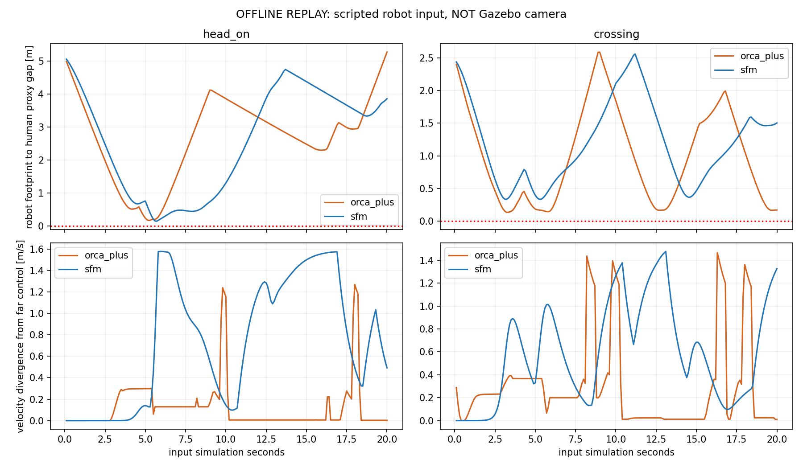
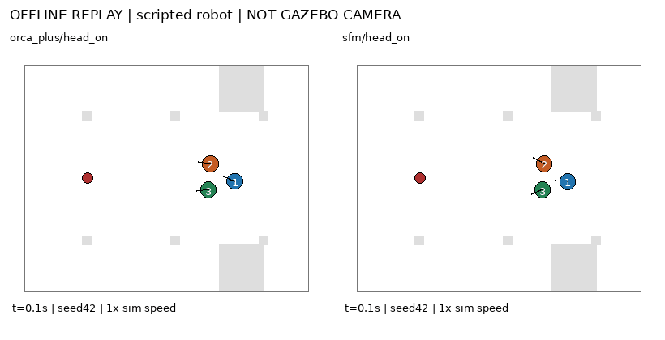
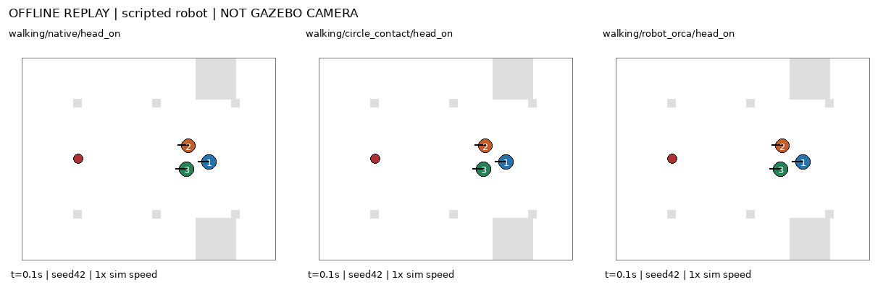
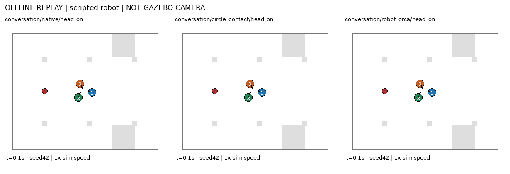

# Phản ứng người với cùng đầu vào robot — offline replay

Đã chạy6 probe CrowdSimPlus (ORCA+/SFM × far/head-on/crossing),20sim s mỗi probe,dt0.1s,seed42. Cùng trace robot world-frame có201 mẫu pose/vận tốc được dùng byte-for-byte cho hai policies. Robot input được lập trình trước, không ghi từ Gazebo; không chạy ROS/Nav2/AMCL.

Ảnh/GIF ở đây là diagram vẽ từ trạng thái simulator đã chạy; có nhãn OFFLINE REPLAY, không phải camera Gazebo hoặc ảnh AI. GIF lấy mỗi2 update và phát200ms/frame (1x sim time), có thể gộp frame trùng nhau. Diagram dùng tỷ lệ XY bằng nhau; vòng đỏ là envelope robot0.25m, các vòng màu là proxy người0.36m. Footprint chữ nhật được đo riêng trong bảng.

## CrowdSimPlus: sáu probe

| Policy | Robot input | Khe robot footprint–người min (m) | Overlap robot >1cm (s) | Khe người–người min (m) | Overlap người >1cm (s) | Đổi vận tốc so far lần đầu (s) |
|---|---|---:|---:|---:|---:|---:|
| orca_plus | crossing | 0.1357 | 0.0 | 0.4143 | 0.0 | 0.0 |
| orca_plus | far | 45.8213 | 0.0 | 0.4727 | 0.0 | — |
| orca_plus | head_on | 0.1677 | 0.0 | 0.4727 | 0.0 | 2.8 |
| sfm | crossing | 0.3347 | 0.0 | 0.4619 | 0.0 | 1.6 |
| sfm | far | 45.8130 | 0.0 | 0.4619 | 0.0 | — |
| sfm | head_on | 0.1435 | 0.0 | 0.0720 | 0.0 | 3.6 |

Cả6 probe được đối chiếu200 update với human integration của full upstream env.step, rồi chạy lại từ đầu cùng seed để kiểm tính xác định. Ngoại lệ endpoint: cùng luật patrol bên ngoài được áp dụng sau bước native cho cả hai phía; không tuyên bố parity của reward, episode loop hoặc robot planning. `metadata.robot_controller` trong kernel tái dùng là mô tả adapter Gazebo, được ghi đè ngữ cảnh bằng execution_context trong result.

Đổi vận tốc là lần đầu norm chênh actual velocity so với cùng-policy far control vượt0.001m/s; không phải thời điểm phát hiện nội bộ hoặc suy luận ý định. Khoảng hở trước update có trong summary để kiểm khác biệt có xuất hiện trước overlap proxy không.

## SocNavGym: một nhóm3 người

Chạy18 probe: walking/conversation × native/circle_contact/robot_orca × cùng3 input robot. Circle_contact giữ đối chứng hình học; robot_orca thêm robot vào solver nhóm, không sửa vendor. Formation/dispersal không thuộc adapter này.

| Mode | Biến thể | Input | Khe robot footprint–người min (m) | Overlap robot >1cm (s) | Khe người–người min (m) | Chênh vị trí lớn nhất so far (m) |
|---|---|---|---:|---:|---:|---:|
| conversation | circle_contact | crossing | -0.4464 | 4.6 | 0.4982 | 0.0000 |
| conversation | circle_contact | far | 48.3030 | 0.0 | 0.4982 | 0.0000 |
| conversation | circle_contact | head_on | -0.3522 | 1.9 | 0.4982 | 0.0000 |
| conversation | native | crossing | -0.4464 | 4.6 | 0.4982 | 0.0000 |
| conversation | native | far | 48.3030 | 0.0 | 0.4982 | 0.0000 |
| conversation | native | head_on | -0.3522 | 1.9 | 0.4982 | 0.0000 |
| conversation | robot_orca | crossing | -0.4464 | 4.6 | 0.4982 | 0.0000 |
| conversation | robot_orca | far | 48.3030 | 0.0 | 0.4982 | 0.0000 |
| conversation | robot_orca | head_on | -0.3522 | 1.9 | 0.4982 | 0.0000 |
| walking | circle_contact | crossing | 0.0537 | 0.0 | -0.2967 | 0.7673 |
| walking | circle_contact | far | 45.8659 | 0.0 | -0.1066 | 0.0000 |
| walking | circle_contact | head_on | -0.1117 | 1.4 | -0.0167 | 1.4452 |
| walking | native | crossing | -0.1188 | 1.1 | -0.2981 | 0.6230 |
| walking | native | far | 45.8659 | 0.0 | -0.1066 | 0.0000 |
| walking | native | head_on | -0.1091 | 1.4 | -0.0188 | 0.9568 |
| walking | robot_orca | crossing | 0.4838 | 0.0 | -0.2142 | 2.7517 |
| walking | robot_orca | far | 45.8659 | 0.0 | -0.1066 | 0.0000 |
| walking | robot_orca | head_on | 0.1129 | 0.0 | 0.4429 | 8.6802 |

Các IDs/membership được giữ cố định bởi scene; không diễn giải như formation tự phát. Conversation là đứng quanh tâm/hướng vào nhau, không có thoại ngôn ngữ. Ba biến thể conversation không có solver đi nhóm khác nhau; negative control được đối chiếu. Group objectives khác private endpoints của CrowdSimPlus, nên không xếp hạng hai framework bằng clearance ở bảng này.

## Giới hạn và bằng chứng

Robot replay không né người: nếu va chạm, đầu vào vẫn giữ nguyên. Đó là phép đo phản ứng một chiều, không chứng minh Nav2 sẽ va chạm như vậy. Khoảng hở dùng robot footprint0.24×0.20m, người r0.36m; circle robot0.25m lưu riêng. Native contact có hình học khác; không gộp signed proxy gap với event contact nội bộ. Đo trước và sau update; không chứng nhận continuous collision giữa samples.

`protocol.json`, `group_protocol.json`, `fixture_checks.json`, `manifest.json`, `summary.json`, `results.csv` và từng trajectory/result giữ input/source hashes, native parity và mọi overlap. Native human policies, ROS robot source và baseline AMCL giữ nguyên. Chưa dùng các probe nhỏ để chọn model production; ComplexityNav vẫn chưa nối Gazebo.
