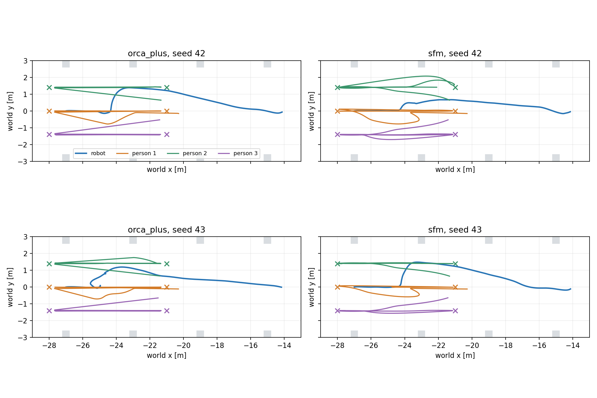
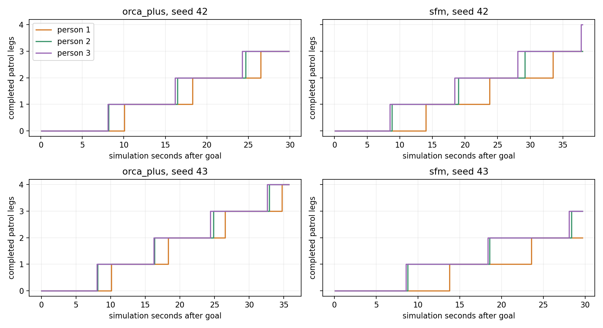
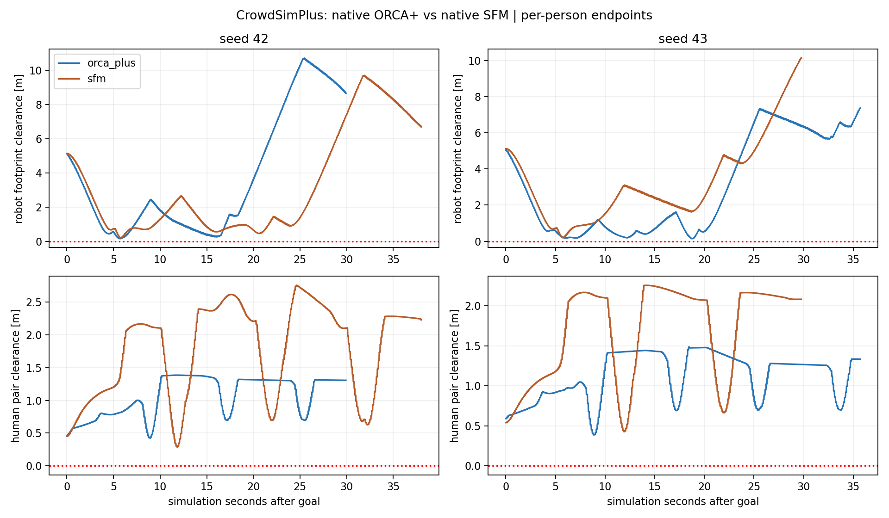

# CrowdSimPlus: đích riêng đã cho phép tuần tra trong Gazebo

Đã hoàn tất **4/4 lượt Gazebo/Nav2 đến đích** với native SFM/ORCA+ seed 42/43.
Mỗi người hoàn tất **2–4 chặng** trong lượt tương ứng. Đã đối chiếu **39/39**
lần đến endpoint với pose proxy Gazebo, sai số vị trí dưới 1 mm (thực đo ở
mức sai số số học); không chỉ dựa vào counter trong worker.

Không ghi nhận overlap robot–người/người–người trên 1 cm trong mẫu pose đã
lưu. Đây là fixture mới để kiểm tra khả năng tuần tra; chưa phải xếp hạng
policy, benchmark full warehouse, giao cắt, lối hẹp hay crowd mật độ cao.

## Thay đổi fixture

Giữ nguyên initial poses/headings seed 42/43 của pilot, robot spawn (-27,0),
goal Nav2 (-14,0), map, physics world, robot, cảm biến, Nav2 MPPI, dt=0,1 s,
human radius=0,36 m và preferred speed=0,8 m/s. Ba người vẫn độc lập.

Thay vì cùng hai endpoint (-28,0)/(-21,0), mỗi người có hai endpoint với cùng
x=-28/-21 và y=-1,4/0/+1,4 theo thứ tự y ban đầu. Endpoint liền kề cách 1,4 m,
được kiểm tra không lấn factory. **Không có luật đi theo làn**: SFM/ORCA+ vẫn
tự chọn quỹ đạo, tránh người/robot/vật cản. Dấu x trên biểu đồ chỉ là đích.

`group_route` và legacy `group_id` còn trong dữ liệu nguồn để bảo toàn initial
fixture; backend dùng `human_routes` trong mode mới, xuất `groups=[]` và không
có model giữ nhóm/hội thoại. Chỉ đổi endpoint sau native
`Human.reached_destination` (khoảng cách tâm tới goal < radius 0,36 m).
Patrol là scenario bên ngoài episode, không đổi native arrival threshold.

Opt-in `--goal-layout individual` chỉ áp cho CrowdSimPlus counterflow. Shared
fixture vẫn mặc định và giữ scene hash cũ. Tên trial có `_individual_goals`,
report/runtime riêng; không ghi đè vòng shared-goal hoặc SocNavGym.

## Native policy và tương thích

Giữ image `dynamuhsim-crowdsimplus:round2`, Python 3.8.13,
source `d526a07c013c621fa1ad50894b6ba639f61063de`. Hash policy files upstream
và config native của cả hai policy khớp byte-for-byte vòng SFM trước. Không
đổi forces SFM, safety margin ORCA+, radius, tốc độ hay timestep.
SFM `is_bottleneck=False` cho factory, native static constraint nhận 168
segments của 42 khối như trước.

Robot Mecanum/Nav2 và ROS 2 Jazzy chạy trên Ubuntu 24.04. Human worker nằm
trong Docker Python 3.8, tắt network, filesystem read-only và adapter mount
read-only. Plugin C++ không rebuild; chỉ thêm fixture/route selection và
telemetry chặng trong Python adapter. **Nav2 vẫn là controller robot duy nhất**.
Không chuyển sang Isaac Sim hoặc thay kiến trúc robot/World Model.

## Kiểm định trước Gazebo

Cả bốn policy/seed đều PASS:

1. Ba mươi bước đầu của fixture mới khớp full upstream `env.step`, sai số x/y/
   velocity/goal tối đa **0**. Trong đoạn parity chưa có patrol turn; loop
   switching bên ngoài episode được kiểm tra riêng bằng native arrival rule.
2. Shared mode mới khớp snapshot kernel trước thay đổi qua 30 bước, sai số **0**.
3. Với cùng robot cố định ở xa (-14,5), mỗi người hoàn tất >=2 chặng trong
   30 sim s: SFM seed 42 là **2/3/3**, SFM seed 43 **3/3/3**, ORCA+ cả hai
   seed **3/3/3**. Mọi transition đều đạt native threshold, state hữu hạn.
4. Đối chứng SFM shared-endpoint seed 42 với cùng robot cố định cho **1/0/2**
   chặng. Không ép đối chứng phải cho kết quả cả ba đứng yên. Điều này cho
   thấy vấn đề endpoint chung phụ thuộc tương tác/quỹ đạo; không kết luận
   shared goal luôn làm mọi người kẹt. Trong hai lượt Nav2 vòng trước, SFM
   shared-goal đã ghi 0/0/0; đó là robot input kín vòng khác.

Các probe này là **worker open-loop**, không cộng thành lượt Gazebo/Nav2.
[Validation SFM42](sfm_s42_validation.json), [SFM43](sfm_s43_validation.json),
[ORCA42](orca_plus_s42_validation.json), [ORCA43](orca_plus_s43_validation.json).
[Kernel snapshot trước thay đổi](kernel_before.py) chỉ dùng kiểm tra regression,
không phải source policy upstream mới.

## Kết quả Gazebo

Cả bốn lượt có goal SUCCEEDED và sai số actual world pose <0,18 m.
Số chặng dưới đây theo thứ tự người 1/2/3; thời lượng lượt khác nhau nên không
so số chặng thô như thước đo hiệu năng policy.

| Policy | Seed | Sim s | Chặng hoàn tất 1/2/3 | Robot clearance min (cm) | Human pair min (cm) |
|---|---:|---:|---|---:|---:|
| orca_plus | 42 | 29.928 | 3/3/3 | 15.30 | 42.47 |
| orca_plus | 43 | 35.724 | 4/4/4 | 14.25 | 38.73 |
| sfm | 42 | 37.996 | 3/3/4 | 19.03 | 28.79 |
| sfm | 43 | 29.776 | 2/3/3 | 18.71 | 42.72 |

Robot clearance chính dùng footprint Nav2 hình chữ nhật 0,24×0,20 m có xoay,
so proxy người tròn radius 0,36 m. Human pair dùng hai proxy tròn. Pose Gazebo
được lưu khoảng 45–47 Hz trong vòng này; duration overlap dùng threshold −1 cm.
Không đo contact force, mọi physics step hay toàn bộ collision links robot.
Cả bốn lượt cũng có clearance dương với footprint padding 0,26×0,22 m và
không lấn khối factory trong sample. SFM seed 42 có human–factory clearance
nhỏ nhất khoảng 16,90 cm, cần tiếp tục quan sát ở cảnh khó hơn.

Đối chiếu event dùng cửa sổ native time −0,002 đến +0,030 sim s để khớp nhịp
lấy mẫu pose. Cả **39** event có pose actual khớp, khoảng cách actual đến
endpoint trước khi đổi goal đều <0,36 m, lớn nhất khoảng **0,359824 m**.
Không phải bảo đảm tiếp xúc liên tục, nhưng xác nhận người thực sự tới
endpoint trong Gazebo trước khi quay đầu.







## Quan sát và diễn giải

- SFM không còn đứng quanh một waypoint chung trong hai lượt mới; cả ba người
  tiếp tục tới endpoint riêng và quay đầu. SFM seed 42 ghi 3/3/4 chặng, seed
  43 ghi 2/3/3. Đây là bằng chứng cải thiện fixture ở các case này, không
  bảo đảm SFM không kẹt với mọi vị trí/đích/crowd.
- ORCA+ tiếp tục tuần tra: 3/3/3 và 4/4/4 chặng. Cả hai model có tránh robot
  và người, nhưng chưa có membership, conversation hoặc formation/dispersal.
- Không có bằng chứng từ chỉ số hiện tại rằng SFM luôn đổi vận tốc êm hơn:
  p95 biến thiên vận tốc theo thời gian khoảng 0,95/1,05 m/s² ở SFM và
  0,64/0,72 ở ORCA+ trong các lượt này. Đây là metric mô tả theo timestep,
  chưa được kiểm chứng là thước đo tính tự nhiên; cảnh shared-goal đứng yên
  ở vòng trước cũng làm giảm mean acceleration.
- RTF SFM khoảng 0,66–0,70, ORCA+ 0,48–0,53; worker mean khoảng 42–50 ms và
  88–107 ms. Khác timing/scheduling và chỉ một lần mỗi seed không cho phép
  dùng thời gian robot đến đích hay RTF để xếp hạng mức tự nhiên của model.
- Chỉ tách endpoint; không chỉnh force coefficients để ép kết quả. So sánh
  trước/sau với shared-goal là khác fixture và khác robot input kín vòng,
  không phải ablation deterministic của toàn hệ Nav2/AMCL/LiDAR.

## Cách chạy và xem

[Hướng dẫn đầy đủ](../../README.md). Từ terminal Ubuntu ở repository root:

```bash
bash experiments/social_navigation/benchmark/run.sh trial \
  --backend crowdsimplus --human-policy sfm --goal-layout individual \
  --condition counterflow --seed 42 --gui --diagnostics \
  --report-dir "experiments/social_navigation/benchmark/generated/individual_demo_$(date +%Y%m%d_%H%M%S)"
```

Robot tự nhận goal; GUI tự đóng khi trial kết thúc. Các lượt báo cáo chạy
headless có camera RGB Gazebo; ảnh/GIF là từ Gazebo, không phải renderer 2D.
Đóng phiên trước trước khi mở lượt tiếp theo. Đổi `--human-policy orca_plus`
để đối chiếu, luôn dùng report directory mới.

- SFM: [seed42 GIF](crowdsimplus_sfm_individual_goals_counterflow_s42.gif), [seed43 GIF](crowdsimplus_sfm_individual_goals_counterflow_s43.gif).
- ORCA+: [seed42 GIF](crowdsimplus_individual_goals_counterflow_s42.gif), [seed43 GIF](crowdsimplus_individual_goals_counterflow_s43.gif).
- [CSV](results.csv), [analysis](analysis.json), [protocol](protocol.json),
  [fixture42](fixture_s42.json), [fixture43](fixture_s43.json),
  [run manifest/hash](run_manifest.json), [source preservation](source_preservation.json).

Runner `individual-goals-matrix --report-dir <directory mới>` tự chạy native
validation rồi bốn trial tuần tự; `--validate-only` chỉ kiểm tra worker.
`analyze_sfm.py <directory> --goal-layout individual` sinh số đo/biểu đồ.
Raw JSONL/log ở runtime trong generated/, path/hash lưu trong manifest.

## Bước tiếp theo và bảo toàn project

Đã có fixture tuần tra hoạt động để thử tiếp **giao cắt**, rồi **lối hẹp**,
cùng các kiểm tra scene/map/sensor và điều kiện công bằng cho cả SFM/ORCA+.
Chưa tăng mật độ trên adapter ba người hoặc nối ComplexityNav trong vòng này.

Python/shell syntax, whitespace và preservation PASS: 14.181 tracked paths
ngoài social_navigation, index/diff có sẵn và RVO2 binary giữ nguyên. Các
process/container của vòng này đã đóng. Phần mới chưa commit.
