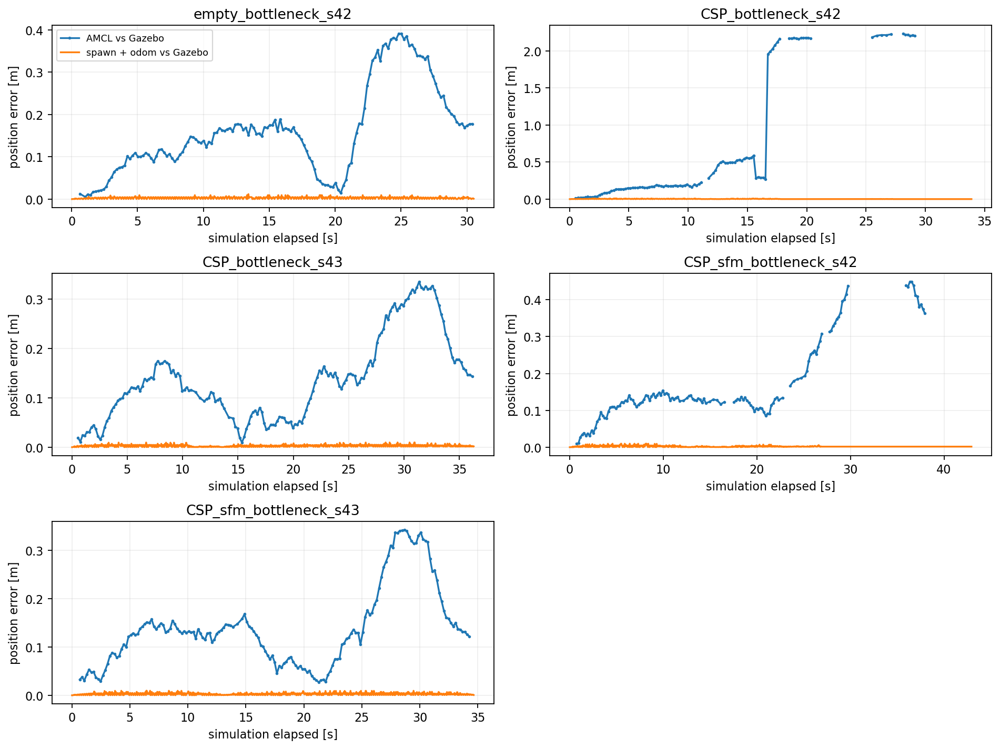
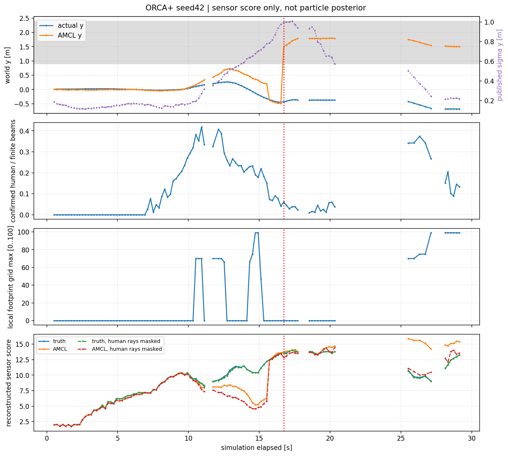
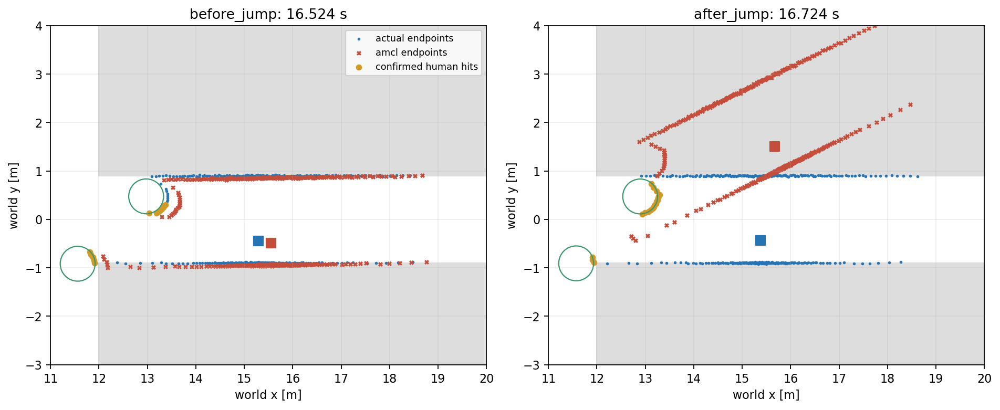
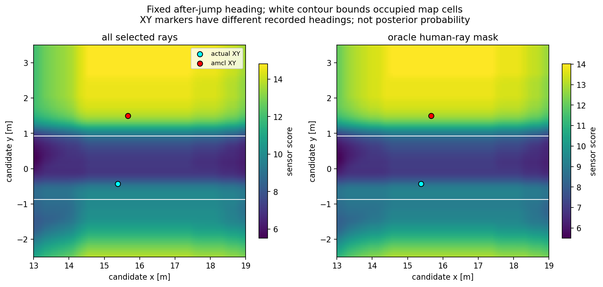
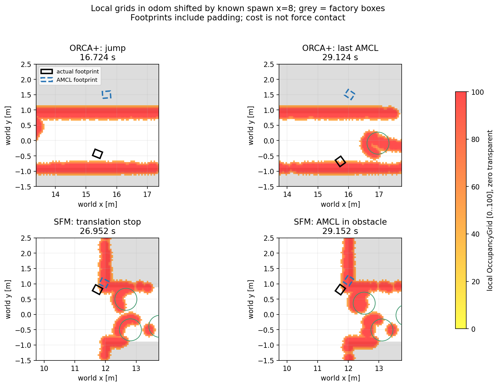

# Chẩn đoán bottleneck: đã khoanh vùng bước nhảy AMCL, chưa tách hết failure SFM

Đã phân tích offline **năm lượt đã lưu**, không chạy thêm Gazebo hoặc chỉnh
tham số robot/Nav2. Kết quả benchmark giữ nguyên: empty control đạt, có người
**2/4 goal đạt**. Không thay bằng lượt chạy lại hoặc xếp hạng simulator.

Kết luận có bằng chứng mạnh nhất: **ORCA+ seed42 có bước nhảy AMCL 1,992 m**
trong 0,2 sim s, trong khi robot thực chỉ dịch khoảng 0,090 m và odometry
khoảng 0,099 m. Odometry vẫn khớp Gazebo trong khoảng 1 cm. Sau cập nhật,
pose ước lượng nằm trong khối máy, rồi planner không tạo được đường đi.

**SFM seed42 có chuỗi lỗi khác**: robot đi lùi về mép cửa, local costmap ở
footprint có giá trị cao, dừng tịnh tiến rồi pose ước lượng mới lọt vào vùng
máy. Không gộp hai failure thành cùng một bước nhảy định vị.

## Dữ liệu và cách đối chiếu

Nguồn là [benchmark bottleneck đã commit](../../../bottleneck/reports/run01/BOTTLENECK_REPORT.md):
scan 5 Hz, odom khoảng 25 Hz, pose Gazebo khoảng 42–45 Hz, AMCL/TF, local
costmap, footprint, cmd_vel và log planner. Đã kiểm SHA256 của cả năm raw
captures với manifest gốc; input và kết quả cũ không sửa.

Timestamp dùng header sensor/AMCL/odom, không ghép theo thời điểm nhận file.
Map odom→world dùng spawn đã biết (8,0,0), không dùng AMCL để tự xác nhận
AMCL. Sai số ghép odom/Gazebo tối đa 0,020 s (empty), 0,016 s (có người).
Điều này giải thích một phần sai số odom cỡ milimet khi robot đang chạy.

| Lượt | Goal | AMCL max (m) | Odom max (cm) | Bước AMCL lớn nhất (m) |
|---|---|---:|---:|---:|
| Không người | SUCCEEDED | 0.391 | 1.18 | 0.145 |
| ORCA+ s42 | ABORTED | 2.232 | 0.95 | 1.992 |
| ORCA+ s43 | SUCCEEDED | 0.335 | 0.97 | 0.146 |
| SFM s42 | ABORTED | 0.449 | 0.96 | 0.136 |
| SFM s43 | SUCCEEDED | 0.343 | 0.95 | 0.144 |

Mọi AMCL max error trong bảng khớp số đã ghi ở benchmark trước. “Bước lớn
nhất” là chênh giữa hai publication liên tiếp, không chuẩn hóa theo thời gian;
ở các lượt bình thường nó gồm cả chuyển động thật. Các đồ thị ngắt đoạn khi
không có publication AMCL trong >0,45 s, không nối như dữ liệu liên tục.

## ORCA+ seed42: lần cập nhật bất thường

Tại elapsed **16,524 → 16,724 s** (scan time 25,0 → 25,2 s):

| Đại lượng | Trước | Sau |
|---|---|---|
| Gazebo x/y (m) | 15,286 / -0,443 | 15,376 / -0,433 |
| AMCL x/y (m) | 15,554 / -0,488 | 15,670 / +1,501 |
| AMCL position error (m) | 0,271 | 1,955 |
| AMCL covariance yy (m²) | 0,955 | 0,989 |
| Tâm AMCL trong cell occupied của map tĩnh | Không | Có |
| Local footprint OccupancyGrid max | 0 | 0 |

Max error về sau là **2,232 m**. Dừng tịnh tiến kéo dài ≥1 s bắt đầu khoảng
**17,840 s**, sau bước nhảy. Đã có giai đoạn local footprint cost cao trước
đó (lần đầu ≥99 ở 14,724 s), nên không coi AMCL là sự cố duy nhất của toàn
quỹ đạo. Tại chính cập nhật bất thường, local footprint max=0 và không có
unknown ở mẫu footprint tương ứng.

TF map→odom ghép với odom→base khớp AMCL dưới 1 cm trong cả năm lượt; riêng
sau bước nhảy khớp ở mức sai số số học. Vì vậy đây không chỉ là cách vẽ nhầm
frame của `/amcl_pose`: phép hiệu chỉnh lớn cũng đã đi vào TF dùng cho điều hướng.

TF được post-date khoảng 0,5 s theo override của episode launch; median
header−receipt là 0,472–0,480 s. Đây là cách xuất TF có hiệu lực trong tương
lai của AMCL, không tự nó là lỗi đồng bộ. Cơ chế này có trong
[source AMCL 1.3.13](https://github.com/ros-navigation/navigation2/blob/1.3.13/nav2_amcl/src/amcl_node.cpp).

Scan receipt trễ tối đa **0,092 s** ở case này, 0,100 s trên năm lượt. Scan
được so với Gazebo tại header time, không phải receipt time. Không có bằng
chứng độ trễ nhỏ này giải thích bước nhảy gần 2 m. Không tuyên bố đã loại
trừ mọi lỗi TF/timing hoặc xác minh danh tính publisher vì dữ liệu không có GID.

## Vì sao pose sai vẫn có thể được sensor model ưu ái?

Đã dựng raycast 42 box SDF và circle proxy người radius 0,36 m tại pose thật.
Tia được gắn nhãn người khi người che trước static geometry >5 cm và range
quan sát khớp circle trong 8 cm. Median absolute range residual khoảng
**8,5–9,2 mm**; median tỷ lệ tia hữu hạn khớp mô hình trong 8 cm khoảng
98% ở hai failure. LiDAR x/y/yaw extrinsic bằng 0 trong chain đã lưu.
Đây là screening từ hình học/ground truth, không phải detector deploy.

Ngay sau bước nhảy: **313** tia hữu hạn, **19** tia xác nhận trúng người.
Nhánh lấy mẫu likelihood_field dùng **52** tia hữu hạn trong scan này,
trong đó **3** tia nằm trong mask người.

Source likelihood_field lấy khoảng cách từ **đầu tia** tới cell occupied,
kết hợp các beam thành sensor weight gain. Cell occupied có distance field
bằng 0; hàm sensor này không thêm điều kiện pose robot phải ở free space.
Vì vậy đầu tia nằm trong khối đặc vẫn có thể có điểm cao.
[Sensor model](https://github.com/ros-navigation/navigation2/blob/1.3.13/nav2_amcl/src/sensors/laser/likelihood_field_model.cpp),
[distance field](https://github.com/ros-navigation/navigation2/blob/1.3.13/nav2_amcl/src/map/map_cspace.cpp).

Đã đối chiếu phép dựng lại bằng **thư viện AMCL Jazzy đang cài**, version
`1.3.13-1noble.20260903.024944`: một executable riêng trong generated/ gọi
public `LikelihoodFieldModel::sensorUpdate`, prior bằng nhau, không tạo ROS
node. So **168 lượt đánh giá pose** (hai scan, có/không mask, 42 pose mỗi case),
max absolute score error **4,034e-8**. Thư viện cài sẵn không bị sửa/rebuild.
[Native cross-check và library hashes](native_score_check.json).

Điểm native tại scan sau bước nhảy:

| Cùng bộ tia trong mỗi hàng | Tia dùng | Pose thật | Pose AMCL sai | Điểm cao hơn |
|---|---:|---:|---:|---|
| Tia gốc | 52 | 13,644805 | 13,663844 | Pose sai, chênh rất nhỏ |
| Mask tia người bằng ground truth | 49 | 13,496511 | 12,866832 | Pose thật |

Đây là **sensor gain**, không phải xác suất chuẩn hóa hay posterior. Chỉ so
hai pose trong cùng một hàng, không so score tuyệt đối giữa các hàng vì số
tia khác nhau. Mask dùng oracle ground truth, chưa phải giải pháp lọc khả thi
trên robot thực. Chưa chứng minh áp mask sẽ làm toàn bộ AMCL/Nav2 chạy tốt.

Covariance yy đã tăng gần 1 m² trước lúc đổi pose. AMCL công bố mean của
hypothesis/cluster có weight lớn nhất theo
[source 1.3.13](https://github.com/ros-navigation/navigation2/blob/1.3.13/nav2_amcl/src/amcl_node.cpp).
Kết quả **phù hợp với giả thuyết chuyển sang một mode sai trong vật cản**,
nhưng chưa xác nhận được cluster/prior/resampling cụ thể vì thiếu particle cloud.
Native cross-check ở đây chỉ kiểm sensor update, không replay toàn particle filter.

Heatmap giữ cố định heading sau bước nhảy để nhìn mode trong occupied space.
Marker XY của pose thật có heading ghi nhận khác, nên không đọc giá trị tại
marker đó như score pose thật trong bảng. Đường trắng là ranh giới occupied;
điểm sáng trong khối máy không có nghĩa vị trí robot hợp lệ.

## SFM seed42: chưa thể quy cùng nguyên nhân

Không có bước AMCL đột biến tương tự: bước lớn nhất 0,136 m, gần mức chuyển
động thật giữa hai mẫu đó (0,120 m). AMCL max error toàn lượt 0,449 m.
Các mốc đáng chú ý:

- Local footprint grid max lần đầu đạt **99 ở 24,752 s**.
- Dừng tịnh tiến ≥1 s bắt đầu **26,952 s**; actual khoảng (11,741; 0,811),
  AMCL khoảng (11,955; 1,032), error 0,308 m. Tâm AMCL lúc này chưa nằm trong
  cell occupied, nhưng footprint đã có cost cao ở vùng mép cửa.
- Tâm AMCL vào occupied cell khoảng **29,152 s**, sau khi đã dừng tịnh tiến.
  Robot vẫn có xoay trong recovery; “dừng tịnh tiến” không có nghĩa đứng yên
  hoàn toàn. Về sau planner báo không tạo được đường từ vùng ước lượng sát máy.

Robot đã đi vào rồi quay/lùi về cửa trước khi abort. Log không có recovery
`backup` trước lần planner failure đầu, nên không tự gọi đoạn lùi này là
hành vi backup recovery. Chưa có global plan để tách quyết định reroute của
planner khỏi lựa chọn vận tốc MPPI và tránh người ở local costmap.

Local grid có frame odom, chuyển sang world bằng spawn x=8 để xem cạnh hình
học. Footprint lấy mẫu padding 0,26×0,22 m; giá trị 0..100 là OccupancyGrid,
không phải raw cost byte, collision force hoặc bằng chứng đã va chạm. Tại các
mẫu AMCL đã ghép của hai failure, footprint max không đạt 100; không diễn giải
99 như xác nhận collision. Unknown fraction ở các footprint neo là 0.

Ảnh ORCA+ gần dừng dùng publication AMCL gần mốc quan tâm; offset được lưu
riêng trong [failure windows](failure_windows.json). Các snapshot costmap có
header offset riêng trong [snapshot metadata](local_costmap_snapshots.json).

## Điều đã xác nhận và phần cần kiểm chứng

Đã xác nhận bằng dữ liệu: odom/pose thật liên tục; bước nhảy nằm ở ước lượng
AMCL và TF; pose sai lọt vào static occupied; sensor model cho mode sai điểm
cạnh tranh và nhạy với vài tia người ở scan then chốt. Thực hiện lại bằng
native sensor library đã kiểm độ đúng của phép tính offline.

Chưa xác nhận: phân bố particle trước/sau, chính xác ô global costmap tại
planner start, global path lúc SFM lùi ra cửa, và tác nhân đầu tiên khiến
filter có mode sai. Dữ liệu cũ **không ghi global costmap/global plan/particle
cloud**; không dựng các đại lượng này rồi trình bày như đã đo.

Bước kiểm chứng tiếp theo nên giữ nguyên config/human policy, thu thêm các
stream còn thiếu; replay AMCL riêng từ scan+odom+TF odom/base/static, không
phát lại map→odom cũ. Sau đó mới so biến thể lọc tia động trong cấu hình
thử nghiệm riêng. Nếu thử beamskip, source 1.3.13 đưa nó vào nhánh
`likelihood_field_prob`; chỉ đổi `do_beamskip` ở `likelihood_field` hiện tại
không chọn nhánh đó. Các thay đổi này **chưa áp dụng**.

## Chạy lại và trạng thái

[Hướng dẫn đầy đủ](../../README.md). Các công cụ nằm trong
`benchmark/localization_diagnosis/`, reference source/header có URL/tag và
SHA256 cố định, binary offline ở generated/. Thư viện/data gốc chỉ được đọc.

- [Summary](summary.json), [CSV](results.csv), [events](events.json),
  [timeline](timeline.json), [scan snapshots](scan_snapshots.json),
  [input/source manifest](manifest.json), [checks](checks.json).
- [Benchmark/GIF gốc](../../../bottleneck/reports/run01/BOTTLENECK_REPORT.md).

Input integrity, native comparison, ray geometry cases, syntax và preservation
checks PASS. Code runtime ROS/Gazebo, native human policy, config gốc và phần
Git staged có sẵn được giữ nguyên. Bước này chỉ phân tích offline, **chưa commit**.
