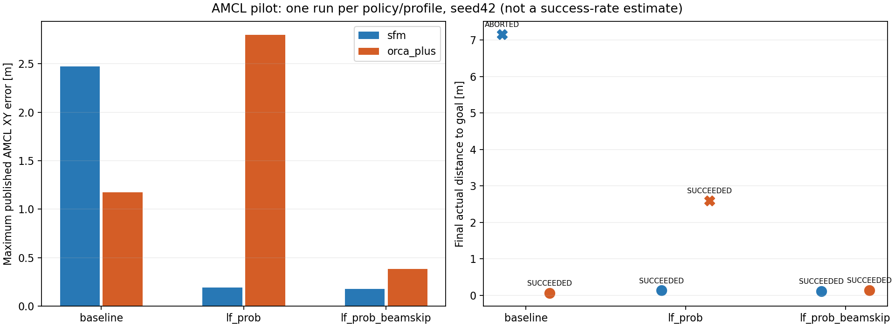

# AMCL localization pilot — 6 lượt, seed42

Provenance: HEAD `2f2bdff694a5c9fd6a3c9be6c0cefc65ff21412d` cùng mã thử nghiệm chưa commit ở thời điểm chạy; `protocol.json` giữ source hash thực tế. Không suy luận mọi thay đổi đã nằm trong HEAD này.

Giữ nguyên robot Mecanum, MPPI, LiDAR 3.5 m, IMU, bản đồ, ba người và native policy. Mỗi profile chạy một lần với mỗi policy; không chạy lại để thay kết quả. Tất cả dùng shutdown WSL D3D12 đã kiểm tra riêng. Đây là pilot nhỏ, chưa đủ kết luận cải thiện ổn định hoặc chọn cấu hình mặc định.

| Profile | Người | Nav2 báo | Thời gian sim (s) | Sai số AMCL lớn nhất (m) | Cách goal thật (m) | Khe người–người nhỏ nhất (m) | Chồng lấn >1 cm (s) |
|---|---|---|---:|---:|---:|---:|---:|
| baseline | sfm | ABORTED | 33.232 | 2.474 | 7.157 | 0.0076 | 0.000 |
| baseline | orca_plus | SUCCEEDED | 42.956 | 1.173 | 0.064 | 0.0407 | 0.000 |
| lf_prob | orca_plus | SUCCEEDED | 41.252 | 2.799 | 2.597 | 0.0407 | 0.000 |
| lf_prob | sfm | SUCCEEDED | 35.212 | 0.190 | 0.134 | -0.0005 | 0.000 |
| lf_prob_beamskip | sfm | SUCCEEDED | 35.368 | 0.177 | 0.119 | -0.0050 | 0.000 |
| lf_prob_beamskip | orca_plus | SUCCEEDED | 34.668 | 0.383 | 0.140 | 0.0403 | 0.000 |

**Nav2 báo thành công nhưng vị trí thật chưa đạt ngưỡng XY 0.20 m:** lf_prob/orca_plus: còn 2.597 m, AMCL error max 2.799 m. Không tính các lượt này là tới đích chính xác.

Các tham số chỉ ghi vào YAML tạm của từng lượt; đối chiếu cấu trúc xác nhận mọi phần ngoài initial pose và profile AMCL giống cấu hình gốc. Đọc lại `/amcl/get_parameters` trước goal xác nhận tham số đang chạy, gồm laser model, beam skipping và initial pose. `transform_tolerance` thực tế vẫn theo override launch hiện có.

- `baseline`: `likelihood_field` gốc.
- `lf_prob`: `likelihood_field_prob`, `do_beamskip=false`. Thay cả cách tính likelihood, nên phải so riêng với beam skipping.
- `lf_prob_beamskip`: cùng model prob, `do_beamskip=true`, distance=0.5 m, threshold=0.3, error_threshold=0.9.

Native Nav2 1.3.13 chỉ bỏ tia khi cờ PF converged bật; quá nhiều tia bị bỏ sẽ quay về dùng toàn bộ. Readback không chứng minh mọi frame đều bỏ tia. Số dòng log cấp bộ nhớ/fallback chỉ là dấu hiệu chạy nhánh, không đo được mask mỗi scan. Không sửa thư viện AMCL để lấy trạng thái ẩn. [Mã nguồn đúng phiên bản](https://github.com/ros-navigation/navigation2/blob/1.3.13/nav2_amcl/src/sensors/laser/likelihood_field_model_prob.cpp).

| Profile | Người | Log cấp temp | Log dùng lại mọi tia | Khe robot–người (m) | Khe robot–máy (m) | Gazebo thoát |
|---|---|---:|---:|---:|---:|---|
| baseline | sfm | 0 | 0 | 0.1847 | 0.1973 | sạch |
| baseline | orca_plus | 0 | 0 | 0.1140 | 0.4660 | sạch |
| lf_prob | orca_plus | 0 | 0 | 0.1128 | 0.3404 | sạch |
| lf_prob | sfm | 0 | 0 | 0.1809 | 0.2338 | sạch |
| lf_prob_beamskip | sfm | 1 | 23 | 0.1879 | 0.2786 | sạch |
| lf_prob_beamskip | orca_plus | 1 | 25 | 0.1256 | 0.3202 | sạch |

Khe hở được đo từ pose Gazebo dày theo footprint robot 0.24×0.20 m, người tròn r=0.36 m và AABB máy. Đây là đo hình học tại mẫu quan sát, không phải contact force hay bảo đảm không va chạm giữa hai mẫu. Dấu âm luôn được giữ, kể cả chồng lấn dưới ngưỡng báo thời gian 1 cm.

Native particle cloud được phân cụm bằng libpf đang cài, sau circular-mean yaw lift độc lập để tránh seam ±pi. `*_circular_clusters.json` là kết quả dùng trong báo cáo này; các plot cluster trong thư mục profile do analyzer cũ tạo vẫn dùng principal yaw, chỉ dùng làm dữ liệu phụ, không suy luận chuyển mode từ chúng. `checks.json` giữ số cloud và sai số khớp với AMCL.

`protocol.json` khóa thứ tự, source hash, cooldown 15 s và ngân sách 75 sim s. `manifest.json` giữ hash dữ liệu raw; `summary.json`, `results.csv` giữ đủ metric, gồm reroute, odometry, occupied pose, traversal và khoảng trống. Log/diagnostics lớn nằm trong generated và bị gitignore; hash không thay thế dữ liệu gốc.

Không gộp pilot này với cohort stability cũ: các tiến trình AMCL/MPPI/LiDAR/physics không được seed đồng bộ và thứ tự profile chưa random hóa. Giữ cả ABORTED/TIMEOUT. Chưa áp dụng profile vào launch robot gốc; cần lặp thêm theo nhiều seed trước khi chọn.
