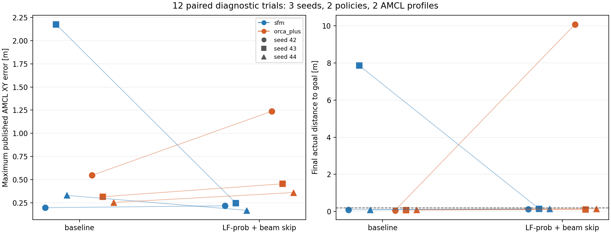

# AMCL nhiều seed: 12 lượt so sánh ghép cặp

HEAD lúc chạy `d0a7bbb2d8c26546b44491d65f0d2be92228e799`; mã runner, mở rộng seed và analyzer mới chưa commit ở thời điểm đo. `protocol.json` giữ source SHA256 thực tế. Các commit trước được lưu trong `commit_checkpoint.json`.

Chạy đúng 12 lượt: seed42/43/44 × AMCL gốc hoặc LF-prob+beam-skip × người SFM hoặc ORCA+. Mỗi ô một lượt, tối đa75 sim s, nghỉ15wall s, headless, GPU NVIDIA và shutdown WSL D3D12. Giữ mọi ABORTED/TIMEOUT, không retry để thay kết quả.

| AMCL | Người | Nav2 báo thành công | Thành công và XY thật ≤0.20m | Báo thành công nhưng ngoài ngưỡng |
|---|---|---:|---:|---:|
| baseline | sfm | 2/3 | 2/3 | 0 |
| baseline | orca_plus | 3/3 | 3/3 | 0 |
| lf_prob_beamskip | sfm | 3/3 | 3/3 | 0 |
| lf_prob_beamskip | orca_plus | 2/3 | 2/3 | 0 |

Đây là số đếm của ba cảnh nhỏ, không phải ước lượng tỷ lệ thành công tổng quát. Hai profile thay cả laser model và beam skipping, nên chưa tách riêng tác dụng bỏ tia. Không chọn cấu hình mới làm mặc định chỉ từ cohort này.

| Seed | AMCL | Người | Nav2 báo | Sim s | Cách goal thật (m) | AMCL error max (m) | Khe robot–người (m) | Khe người–người (m) | Overlap người >1cm (s) |
|---:|---|---|---|---:|---:|---:|---:|---:|---:|
| 42 | baseline | sfm | SUCCEEDED | 34.484 | 0.098 | 0.197 | 0.1759 | -0.0088 | 0.000 |
| 42 | baseline | orca_plus | SUCCEEDED | 58.292 | 0.064 | 0.547 | 0.1190 | 0.0400 | 0.000 |
| 42 | lf_prob_beamskip | sfm | SUCCEEDED | 34.868 | 0.124 | 0.217 | 0.1757 | 0.0016 | 0.000 |
| 42 | lf_prob_beamskip | orca_plus | ABORTED | 45.324 | 10.070 | 1.238 | 0.1308 | 0.0400 | 0.000 |
| 43 | lf_prob_beamskip | orca_plus | SUCCEEDED | 44.396 | 0.105 | 0.455 | 0.0882 | 0.0373 | 0.000 |
| 43 | lf_prob_beamskip | sfm | SUCCEEDED | 34.240 | 0.150 | 0.247 | 0.1994 | 0.0148 | 0.000 |
| 43 | baseline | orca_plus | SUCCEEDED | 34.304 | 0.081 | 0.315 | 0.1219 | 0.0400 | 0.000 |
| 43 | baseline | sfm | ABORTED | 32.932 | 7.857 | 2.175 | 0.1857 | 0.0022 | 0.000 |
| 44 | baseline | sfm | SUCCEEDED | 36.268 | 0.093 | 0.330 | 0.1127 | -0.0237 | 0.316 |
| 44 | baseline | orca_plus | SUCCEEDED | 33.588 | 0.094 | 0.254 | 0.1492 | 0.0402 | 0.000 |
| 44 | lf_prob_beamskip | sfm | SUCCEEDED | 35.964 | 0.141 | 0.169 | 0.1844 | -0.0087 | 0.000 |
| 44 | lf_prob_beamskip | orca_plus | SUCCEEDED | 33.952 | 0.147 | 0.360 | 0.1523 | 0.0400 | 0.000 |

Mỗi đường nối cùng seed và policy giữa hai cấu hình. Màu là policy, marker là seed; không phải quỹ đạo hoặc đường trung bình. Các ảnh/GIF trong thư mục seed/profile được thu từ camera Gazebo của từng lượt, có sampling/nén; biểu đồ này được vẽ từ dữ liệu đo.

## Bảo toàn điều kiện thử

- Seed42/43 giữ nguyên scene byte-for-byte so với fixture cũ. Seed44 sinh mới bằng cùng thuật toán bottleneck và biên jitter; template chỉ lấy thông số cố định radius/speed/robot từ seed42, không giả là đã chạy SocNavGym44. Kiểm tra initial overlap và khoảng trống route trong `fixture_checks.json`.
- Đảo thứ tự profile và policy ở seed43; seed42/44 chạy thứ tự ngược lại. Có đối chứng baseline mới cùng seed và policy. AMCL/MPPI/LiDAR/physics chưa được seed đồng bộ, nên vẫn có nhiễu và không coi là replay xác định.
- Native policy, robot controller, cảm biến và map giữ nguyên. Chỉ initial pose và profile AMCL được ghi vào YAML runtime; đọc lại service AMCL trước goal, so các tham số khác giữa mọi lượt.
- Metric XY thật lấy pose Gazebo; giá trị0.20m là ngưỡng đánh giá vị trí cuối, không kiểm chứng đầy đủ yaw hoặc mọi điều kiện stateful goal checker.
- Khoảng hở signed dùng footprint0.24×0.20m, người r0.36m, AABB máy. Giá trị âm là overlap dù dưới1cm. Không phải contact force hay bảo đảm giữa hai sample.

## Kiểm chứng và giới hạn

Đối chiếu 1998/1998 particle clouds; sai số XY giữa cụm native lớn nhất sau circular-mean lift và AMCL tối đa 0m. Đây là tái phân cụm cloud ghi được, không replay hidden filter hoặc phục hồi whole-turn state.

Beam skipping chỉ chạy khi PF converged và có thể fallback dùng mọi tia. Các counts log bên dưới tính toàn phiên, gồm warmup; không đo mask từng scan. Không sửa thư viện AMCL native.

| Seed | Người | Profile | Cấp temp | Fallback mọi tia |
|---:|---|---|---:|---:|
| 42 | sfm | baseline | 0 | 0 |
| 42 | orca_plus | baseline | 0 | 0 |
| 42 | sfm | lf_prob_beamskip | 1 | 26 |
| 42 | orca_plus | lf_prob_beamskip | 1 | 7 |
| 43 | orca_plus | lf_prob_beamskip | 1 | 32 |
| 43 | sfm | lf_prob_beamskip | 1 | 26 |
| 43 | orca_plus | baseline | 0 | 0 |
| 43 | sfm | baseline | 0 | 0 |
| 44 | sfm | baseline | 0 | 0 |
| 44 | orca_plus | baseline | 0 | 0 |
| 44 | sfm | lf_prob_beamskip | 1 | 26 |
| 44 | orca_plus | lf_prob_beamskip | 1 | 25 |

`protocol.json`, `progress.json`, `summary.json`, `aggregate.json`, `results.csv`, `amcl_readbacks.json`, `checks.json`, `manifest.json`, `validation.json` giữ nguồn, mọi outcome và hash raw. Log/diagnostics lớn nằm trong runtime/generated và bị gitignore. Các `*_circular_clusters.json` là bản cluster dùng trong báo cáo; plot cluster phụ do analyzer cũ tạo dùng principal yaw nên không dùng để kết luận chuyển mode quanh±pi.

Cohort chỉ xác định yếu tố định vị trong bottleneck ba người độc lập. Chưa đánh giá group/conversation, chưa nối ComplexityNav, chưa có World Model hoặc thay kiến trúc robot.
