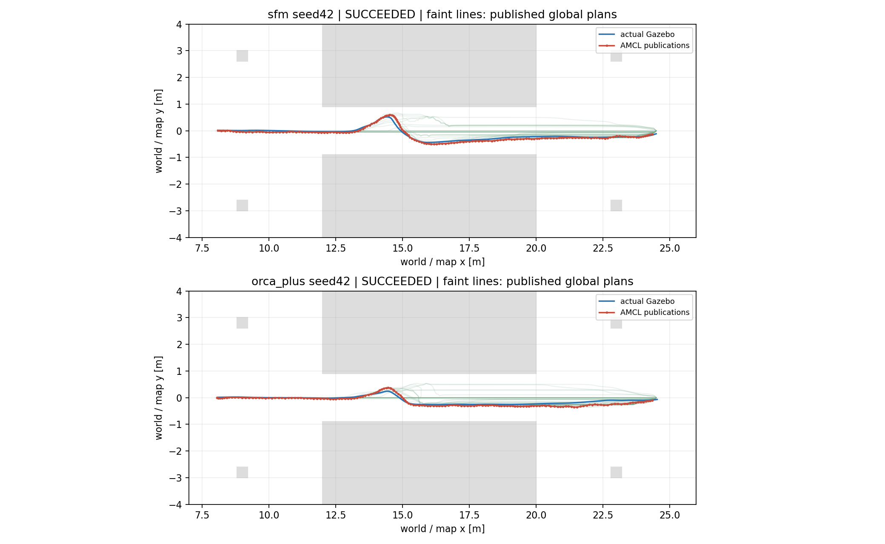
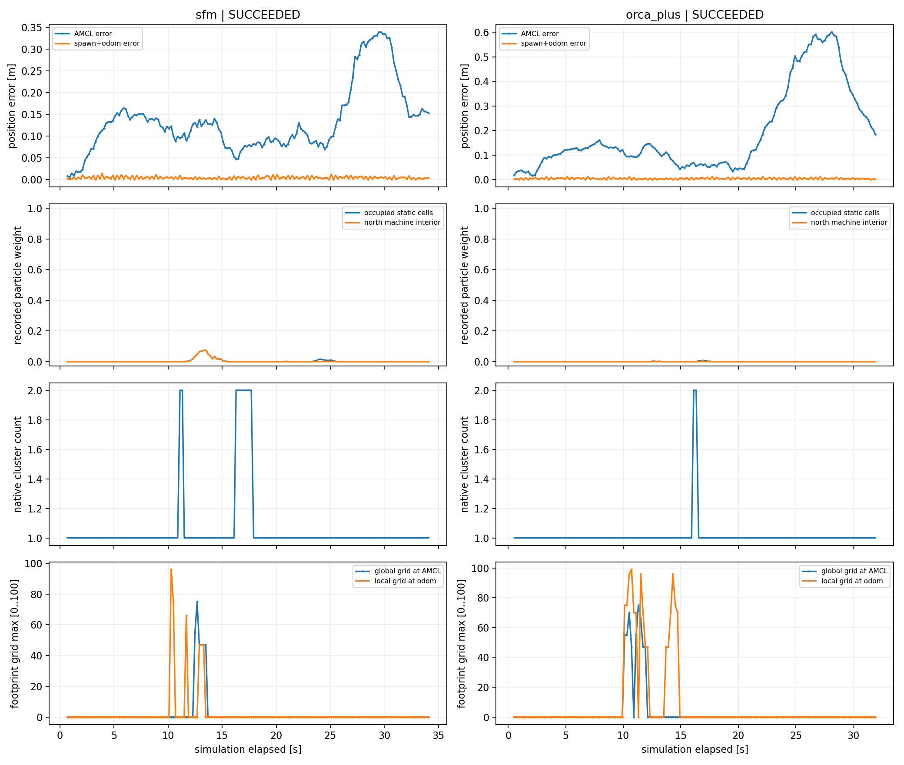
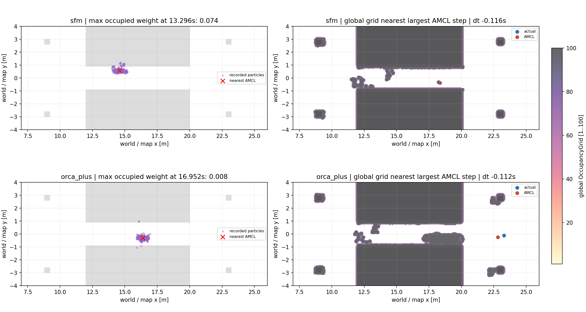

# Đã ghi đủ kênh chẩn đoán; hai lượt mới chưa tái hiện lỗi cũ

Ngày 19/10/2026, chạy lại **SFM seed42 rồi ORCA+ seed42** tuần tự trong
Gazebo Harmonic, ROS 2 Jazzy, Ubuntu 24.04/Python 3.12. Cả hai lượt mới tới
đích và thực sự qua channel. Không đổi tham số định vị/controller/human policy.
**Chưa xác nhận nguyên nhân đầy đủ hoặc sửa được lỗi cũ.**

Benchmark gốc vẫn giữ kết quả **2/4 đạt**, gồm hai ca seed42 ABORTED. Đây là
hai lượt chẩn đoán bổ sung, không thay hay gộp thành tỷ lệ thành công mới.
[Ca lỗi và chẩn đoán trước](../../../localization_diagnosis/reports/run01/LOCALIZATION_DIAGNOSIS.md).

## Thay đổi đã thực hiện

Thêm flag `--navigation-diagnostics` vào runner thử nghiệm; tự bật bộ ghi cũ.
Module mới chỉ subscribe global plan, global costmap, native particle cloud,
ROS logs và action status; chụp graph publishers trước goal/trước shutdown.
Không thêm publisher, đổi parameters hoặc gọi planner/recovery service.
Hai kênh global grid và cloud phải có dữ liệu trước khi phát goal hiện có.

Map, scene seed42, YAML Nav2 gốc, runtime YAML chỉ đổi initial pose và Docker
image đều có SHA/identity **khớp ca lỗi gốc**. Docker vẫn chạy native human
ORCA+/SFM; không sửa mô hình hành vi. Seed scenario không cố định toàn bộ
AMCL, LiDAR/physics, controller và scheduling, vì vậy đây không phải replay
đúng hidden state của lần lỗi. Bộ ghi cũng tạo thêm tải CPU/I/O.

## Kết quả hai lượt chẩn đoán

| Đo trực tiếp | SFM seed42 | ORCA+ seed42 |
|---|---:|---:|
| Goal | SUCCEEDED | SUCCEEDED |
| Thời gian mô phỏng (s) | 34,148 | 32,080 |
| Sai số đích thật Gazebo (m) | 0,109 | 0,098 |
| AMCL position error tối đa (m) | 0,340 | 0,602 |
| Odom so với Gazebo tối đa (cm) | 0,969 | 0,949 |
| Bước publication AMCL lớn nhất (m) | 0,135 | 0,150 |
| Chuyển động thật trong bước đó (m) | 0,112 | 0,095 |
| Robot qua channel / bypass | 1 / 0 | 1 / 0 |
| Người 1/2/3 qua channel | 1/1/1 | 2/2/1 |
| Global plans ghi trong lượt | 54 | 67 |
| Global grids ghi trong lượt | 26 | 24 |
| Particle clouds trong lượt | 167 | 158 |

Không xuất hiện publication jump gần 2 m, tâm AMCL vào occupied cell, hoặc
đợt dừng tịnh tiến ≥1 s sau 2 s đầu. ORCA+ vẫn có sai số **0,602 m** khi robot
đã ra khỏi khe, nên không mô tả định vị là đã ổn định hoàn toàn.

Trong số plans có điểm ở core x=12..20, **40 SFM và 49 ORCA+** đều ở y±0,9.
Các plans còn lại nằm sau core vì robot đã đi qua. Không có đường global
được ghi nào vòng ra ngoài strip trong core. Cả hai robot đi qua thật theo
counter cùng quy tắc benchmark trước. Không quan sát lại việc SFM quay/lùi
về cửa như ca lỗi cũ; dữ liệu mới không giải thích thay cho đoạn đó.

## Particle cloud giúp kiểm được điều gì?

Phân tích offline từng native cloud bằng **thư viện libpf_lib.so Jazzy đang
cài**, dùng `pf_kdtree_insert` và `pf_cluster_stats`; không chạy ROS node,
motion/sensor update hoặc resampling mới. Đối chiếu 325 cloud với AMCL gần
nhất theo receipt wall time: trung bình x/y của cụm có weight lớn nhất khớp
pose AMCL, max discrepancy **0 trong độ chính xác double đã lưu**.
Đã kiểm thêm cloud tổng hợp có hai cụm tách rời để kiểm pipeline clustering.
[Native checks](native_cluster_check.json).

AMCL pose đóng dấu thời gian scan, ParticleCloud đóng dấu `now()` theo
[source official 1.3.13](https://github.com/ros-navigation/navigation2/blob/1.3.13/nav2_amcl/src/amcl_node.cpp).
Giữ cả hai timestamps và offset; các cặp có receipt wall offset tối đa 84,3 ms
(SFM), 78,3 ms (ORCA+), header offset tối đa 104/56 ms. Không coi header cloud
là timestamp acquisition LiDAR. Dữ liệu này cho phép kiểm cluster đã công bố,
không khôi phục mọi prior/random state ẩn của particle filter.

Cả hai lượt có tối đa hai cụm, nhưng cụm nhỏ không trở thành mode sai trong
khối máy. Trọng số particle nằm trong occupied cells tối đa **7,385% SFM** và
**0,798% ORCA+**. Riêng SFM tại 13,296 s có tail vượt mép máy nhưng vẫn chỉ
một native cluster, trung bình ở free space. Không đồng nhất tail này với
bước nhảy sang mode sai của lần benchmark trước, cũng không dùng nó xếp hạng policy.

## Global costmap và giới hạn phép đo

Grid là OccupancyGrid thực được publish, giữ mọi byte int8 bằng nén không mất
dữ liệu. Lấy grid gần nhất khi đối chiếu AMCL; đủ coverage mọi 167/158 mẫu,
nhưng offset có thể tới **1,196/1,124 sim s**, gồm cả publication ở tương lai.
Đây là snapshot chẩn đoán, không chứng minh đúng cell planner đã đọc tại
một lần ComputePath cụ thể. Cost lấy mẫu footprint padded 0,26×0,22 m;
giá trị OccupancyGrid 0..100 không phải force contact/raw costmap byte.

Hai cột hình dùng thời điểm khác nhau được ghi ở tiêu đề; bước AMCL lớn nhất
ở các lượt này vẫn có kích thước gần chuyển động thật. Vùng grid không tô
là cell ≤0 (free/unknown); màu biểu diễn cell dương.

Dense Gazebo sampling: 1.478/1.383 mẫu, gap tối đa 0,040 s. Theo cùng hình học
benchmark, minimum robot–human footprint **0,183/0,145 m**, human–human
**0,0136/0,0401 m**, robot–machine **0,245/0,510 m**. Không có overlap được đo
ở các mẫu này. Đây không phải mọi physics step hoặc toàn bộ collision mesh.

Chỉ thấy một publisher AMCL và một publisher `/plan` ở mỗi graph snapshot.
Bản MessageInfo đang cài thiếu GID per message; graph GID không tự gán được
cho từng message và không loại trừ mọi lỗi TF/timing. Scan receipt lag tối đa
0,100/0,052 sim s. Bộ ghi bổ sung tốn tổng callback wall time 4,146/3,971 s
trên toàn phiên, callback lớn nhất 81,6/74,7 ms; không dùng hai lượt này để
benchmark hiệu năng hoặc suy diễn bộ ghi hoàn toàn không ảnh hưởng closed loop.

## Tính toàn vẹn và cách xem lại

Có **bốn lần khởi động**: run01/run02 lỗi API MessageInfo ở warmup, trước goal,
không có mẫu trajectory; run03 gồm hai lượt hợp lệ nêu trên. Tất cả giữ nguyên
trong [attempts](attempts.json), không tính lỗi bộ ghi thành failure navigation.
Hai Gazebo server của warmup lỗi còn tồn tại trong lúc chạy hai trial mới
(ROS/Gazebo partition riêng, bridge đã dừng); cuối bước đã kiểm đúng runtime
và dọn hết. Chúng có thể tạo thêm tải máy, nên wall time/RTF chỉ là thông tin
phiên chạy, không phải phép so sánh hiệu năng có kiểm soát. [Cleanup](cleanup.json).

Hai lỗi lần lượt do dùng attribute rồi trông đợi GID không được rclpy cung cấp;
code cuối ghi toàn bộ metadata sẵn có và để GID null nếu thiếu.

- [Hướng dẫn chạy](../../README.md), [CSV](results.csv), [summary](summary.json),
  [timeline/offsets](timeline.json), [raw/config/source manifest](manifest.json).
- GIF camera Gazebo: [SFM](crowdsimplus_sfm_individual_goals_bottleneck_s42.gif),
  [ORCA+](crowdsimplus_individual_goals_bottleneck_s42.gif).
- [Checks](checks.json), [source preservation](source_preservation.json).

Đã kiểm schema/counts, giải nén grid, weights, native clusters, input hashes,
Python/whitespace và bảo toàn staged/outside changes có sẵn. ROS/Nav2/human
sources gốc và năm captures trước không đổi. Headless đã chạy; chưa xác nhận
GUI thao tác trong bước này. Thay đổi hiện **chưa commit**.

Bước hợp lý tiếp theo là một ma trận lặp có số lượt/tiêu chí dừng định trước
với recorder này luôn bật, hoặc replay AMCL riêng từ dữ liệu lỗi cũ. Chỉ khi
thu được failure có đủ kênh mới kết luận về mode switching/global reroute;
không chỉnh Nav2 và tuyên bố đã sửa dựa vào hai lượt thành công.
