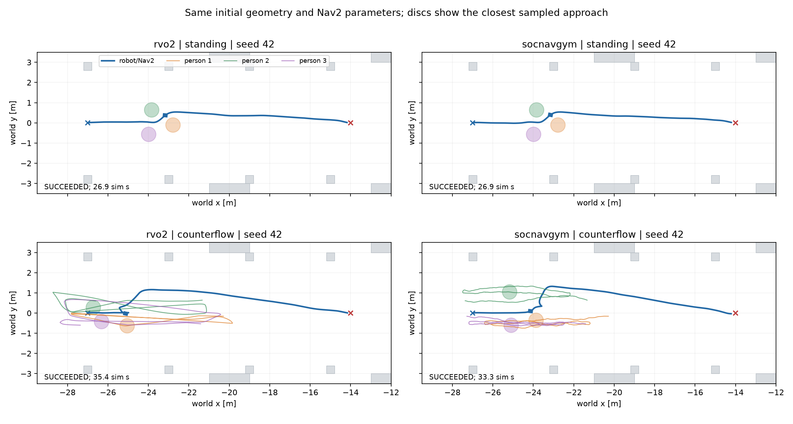
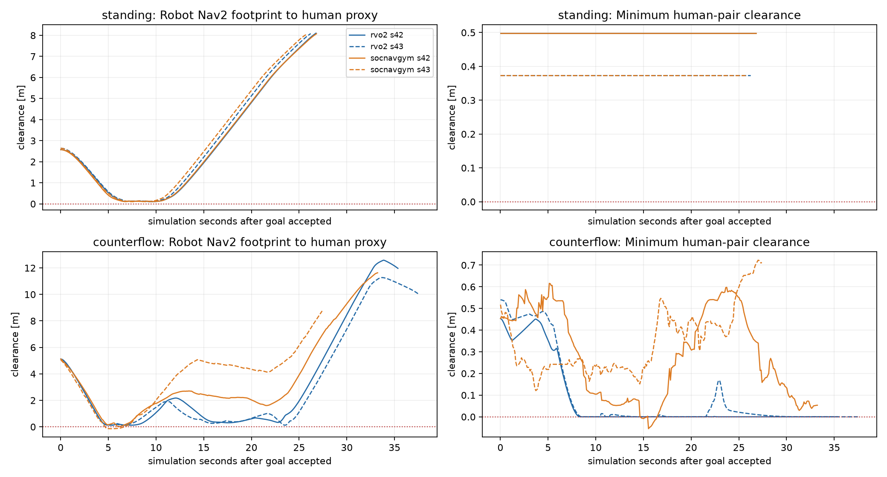
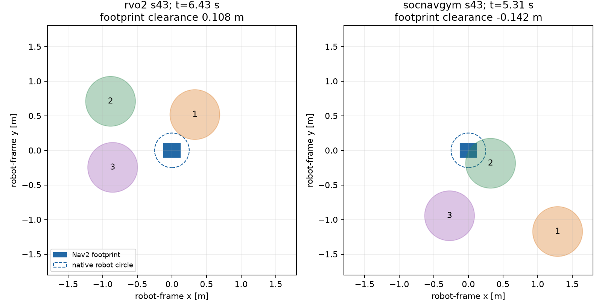

# Pilot Nav2: RVO2 ↔ SocNavGym — 18/10/2026

Đã hoàn tất **9 lượt**, gồm một đối chứng không người và 8 lượt ghép cặp. Cả 9 goal đều `SUCCEEDED`, vị trí thật cuối cùng cách goal dưới 0.5 m. **Đạt goal không đồng nghĩa đạt chất lượng hành vi:** SocNavGym counterflow seed 43 có overlap giữa proxy người và footprint Nav2; seed 42 có overlap nội bộ nhóm.

## Kết quả chính

Clearance dưới đây dùng **footprint Nav2 0.24×0.20 m** với proxy người radius 0.36 m. Thời gian overlap chỉ tính khi clearance âm hơn **1 cm**, theo các mẫu Gazebo khoảng 10 Hz.

| Backend | Cảnh | Seed | Thời gian goal, sim s | Footprint clearance nhỏ nhất, m | Robot/người overlap >1 cm, s | Người/người overlap >1 cm, s | RTF |
|---|---|---:|---:|---:|---:|---:|---:|
| empty | standing | 42 | 24.408 | — | 0.000 | 0.000 | 1.000 |
| rvo2 | counterflow | 42 | 35.444 | 0.123 | 0.000 | 0.000 | 0.990 |
| socnavgym | counterflow | 42 | 33.328 | 0.021 | 0.000 | 0.800 | 0.714 |
| rvo2 | counterflow | 43 | 37.600 | 0.108 | 0.000 | 0.000 | 0.997 |
| socnavgym | counterflow | 43 | 27.508 | -0.142 | 2.000 | 0.000 | 0.717 |
| rvo2 | standing | 42 | 26.868 | 0.103 | 0.000 | 0.000 | 1.000 |
| socnavgym | standing | 42 | 26.920 | 0.109 | 0.000 | 0.000 | 0.627 |
| rvo2 | standing | 43 | 26.276 | 0.114 | 0.000 | 0.000 | 1.000 |
| socnavgym | standing | 43 | 25.804 | 0.105 | 0.000 | 0.000 | 0.737 |

Nguồn: [CSV](results.csv), [phân tích đầy đủ](analysis.json), [kiểm định ghép cặp](matrix_protocol.json), các JSON/trajectory/GIF riêng theo tên trial trong thư mục này.

- **Standing:** hai backend giữ người bất động với cùng bố trí ban đầu. Robot đi vòng qua cả hai scene và đạt goal. Thời gian khoảng 25.8–26.9 s, so với 24.4 s không người. Đây là đối chứng về geometry và Nav2; không dùng chênh lệch nhỏ để kết luận backend xã hội nào tốt hơn.
- **Counterflow RVO2:** hai goal đạt trong khoảng 35.4–37.6 s. Footprint clearance nhỏ nhất khoảng 10.8–12.3 cm; không ghi overlap trên 1 cm giữa robot/người hoặc người/người trong mẫu đo. Raw strict `<0` vẫn đếm một số tiếp xúc số học giữa người ở mức khoảng 1–2 micromet; đã phân biệt với overlap có ý nghĩa.
- **Counterflow SocNavGym seed 42:** goal đạt sau 33.328 s, footprint clearance chỉ còn khoảng 2.1 cm. Một cặp người có clearance nhỏ nhất khoảng −5.5 cm; overlap sâu hơn 1 cm kéo dài xấp xỉ 0.8 s.
- **Counterflow SocNavGym seed 43:** goal đạt sau 27.508 s nhưng footprint clearance nhỏ nhất **−14.2 cm**. Overlap sâu hơn 1 cm kéo dài khoảng **2.0 s**. Không được dùng thời gian đạt goal ngắn hơn để kết luận model tốt hơn.

## Đối chiếu trực quan

Hình cuối dùng cùng hệ tọa độ robot: hình chữ nhật xanh là footprint, vòng tròn nét đứt là robot radius native 0.25 m, các đĩa màu là proxy người 0.36 m. Sự kiện SocNavGym ở khoảng 5.31 s sau khi goal được chấp nhận; dữ liệu gốc trong [closest_events.json](closest_events.json). Đây là **overlap hình học**, không phải số đo lực tiếp xúc: pilot chưa gắn contact sensor.

Xem camera Gazebo: [RVO2 counterflow seed 43](rvo2_counterflow_s43.gif), [SocNavGym counterflow seed 43](socnavgym_counterflow_s43.gif). Camera có thể bị actor/proxy/cột che robot ở đúng thời điểm gần nhất, vì vậy có thêm đồ thị hình học độc lập ở trên.

## Protocol đã xác nhận

- Cùng warehouse SDF gốc, Mecanum, spawn `(-27,0,0)`, goal `(-14,0,0)`, map, params MPPI và geometry proxy. Hash scene/map/params giống nhau cho **cả bốn cặp** backend/condition/seed. [Matrix protocol](matrix_protocol.json) có 9/9 trial hợp lệ.
- Người đứng yên trong lúc Nav2/AMCL khởi động; pose model thật khớp scene đầu vào dưới 1 cm. Chỉ mở gate sau khi `bt_navigator` active và action goal đã được chấp nhận. Gia tốc, cadence và thời điểm dịch chuyển sau gate vẫn theo từng model native; các số đo onset có trong analysis JSON.
- Dữ liệu của cả hai backend lấy từ **model pose Gazebo**, cùng quy trình sampling. `/clock`, `/scan`, `/imu`, `/odom`, AMCL và heartbeat backend đều có dữ liệu. Goal được đối chiếu thêm với world pose thật, không chỉ dựa vào action status.
- Phép tính footprint được đối chiếu với tọa độ footprint trong YAML local/global costmap và ba trường hợp hình học có nghiệm giải tích: [metric_calibration.json](metric_calibration.json).
- Proxy người radius 0.36 m, cao 1.7 m. Radius robot native của hai backend là 0.25 m; chỉ số circle đó được giữ riêng trong CSV/raw JSON. Một giá trị circle âm nhỏ chưa chứng minh footprint đã chồng lấn.
- Cả 9 lượt chạy server headless nhưng có rendering và camera Gazebo. GUI demo riêng có sẵn qua `--gui`; chưa dùng kết quả GUI để trộn vào bảng này.

## Phiên bản, giới hạn và cách diễn giải

[Run manifest](run_manifest.json) ghi phiên bản, hash source/artifact, map và tham số. Runtime là Ubuntu 24.04, ROS 2 Jazzy, Gazebo Harmonic 8.15.0, Python 3.12. SocNavGym commit `95fbc9cebe4357201145a7d0a28c7736c0efe6cf`, vendor giữ nguyên.

Baseline là **RVO2 shared library đang cài trong workspace**, SHA256 `1142d6e645e6fb7978d5fea6d8dac8bc9b1cf3ea106ad44b3ad8961347842d4e`. Không rebuild/ghi đè thư viện này, không khẳng định nó tương đương working-tree source đang có thay đổi riêng của người dùng. Runtime baseline dùng H4 cho standing, H1 cho counterflow; tắt random persona và đặt radius/preferred speed theo scene benchmark. Không gọi đó là toàn bộ cấu hình mặc định production.

Đây là so sánh **hai cấu hình runtime đang thử**, chưa phải ablation cô lập thuật toán. RVO2 điều khiển từng người độc lập; SocNavGym điều khiển một nhóm. Native update rate, dynamics, noise và quy tắc quay đầu khác nhau. Cùng waypoint center không bảo đảm cùng quỹ đạo hay tốc độ thực. Kernel SocNavGym này không bao gồm full RL episode hoặc formation/dispersal. Hàm ORCA nhóm vẫn không thêm robot; contact handler mới dừng tốc độ khi overlap theo vòng tròn. Probe phản ứng native ở [báo cáo adapter](../../gazebo_adapter/reports/ADAPTER_REPORT.md) vẫn là bằng chứng riêng.

Source RVO2 hiện tại chỉ đăng ký tường cho corridor mode; pilot giữ open-arena với binary có sẵn. SocNavGym nhận 42 khối nhà xưởng. World vật lý chung không chứng minh hai solver có cùng kiến thức vật cản. Vì vậy chỉ đánh giá ở lối chính rộng, không suy rộng tới rack/bottleneck 1.8 m hoặc toàn nhà xưởng.

Hai seed chưa đủ để xếp hạng thống kê; seed human không khóa MPPI hoặc noise LiDAR. Overlap seed 43 có thể phụ thuộc đồng thời vào model người, cadence adapter/proxy, cảm biến và controller; chưa quy nguyên nhân duy nhất cho một thành phần. Không kết luận mọi phiên bản SocNavGym đều có cùng kết quả, và không coi các lượt không overlap trong mẫu là chứng nhận an toàn giữa mọi physics step.

RVO2 đạt RTF xấp xỉ 1, SocNavGym chậm hơn do thêm worker đồng bộ; thời gian goal trong bảng là **simulation time**. Các lỗi Gazebo khi shutdown sau khi đo xong được giữ trong log và phân biệt với lỗi runtime. Không trial nào phải loại bỏ vì ERROR trong ma trận cuối.

## Bảo toàn project và bước tiếp theo

[Audit](source_preservation.json) đối chiếu checkpoint đầu lượt này, có cả các thay đổi dọn repo/deletion sẵn có của người dùng: không thay đổi tracked path ngoài thí nghiệm, giữ nguyên staged diff và unstaged diff ngoài thí nghiệm. Binary RVO2 giữ nguyên hash. Không thay kiến trúc ROS hoặc triển khai World Model.

Kết quả hiện tại phù hợp để tiếp tục quan sát, **chưa chọn SocNavGym thay baseline điều khiển người**. Bước tiếp theo nên tái hiện counterflow seed 43 và ghi đồng bộ LiDAR/costmap/TF để phân biệt nguyên nhân overlap, rồi bổ sung cảnh người đi riêng/cắt ngang và nhiều seed hơn. Chưa tăng mật độ hoặc sửa luật native để che sự kiện này.

Chạy lại theo [README benchmark](../README.md). Các báo cáo và ảnh được tạo từ dữ liệu đo, không phải quỹ đạo dựng sẵn.
