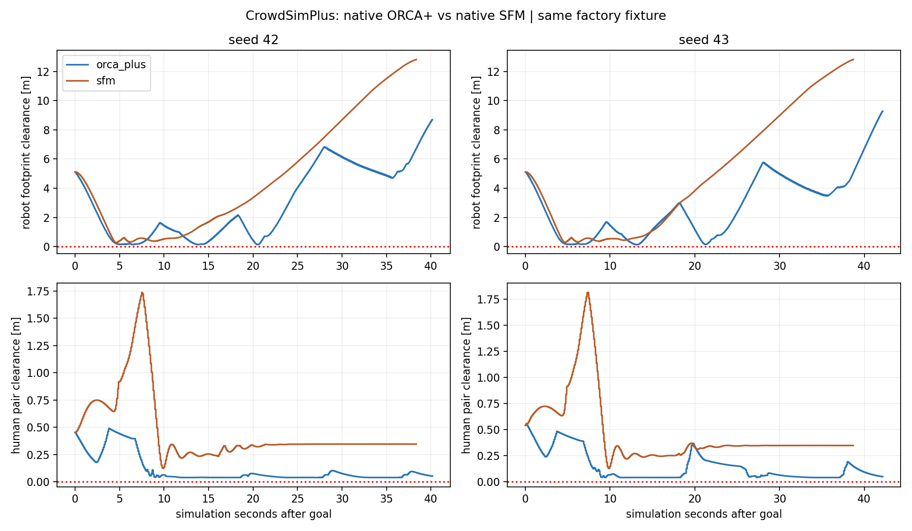
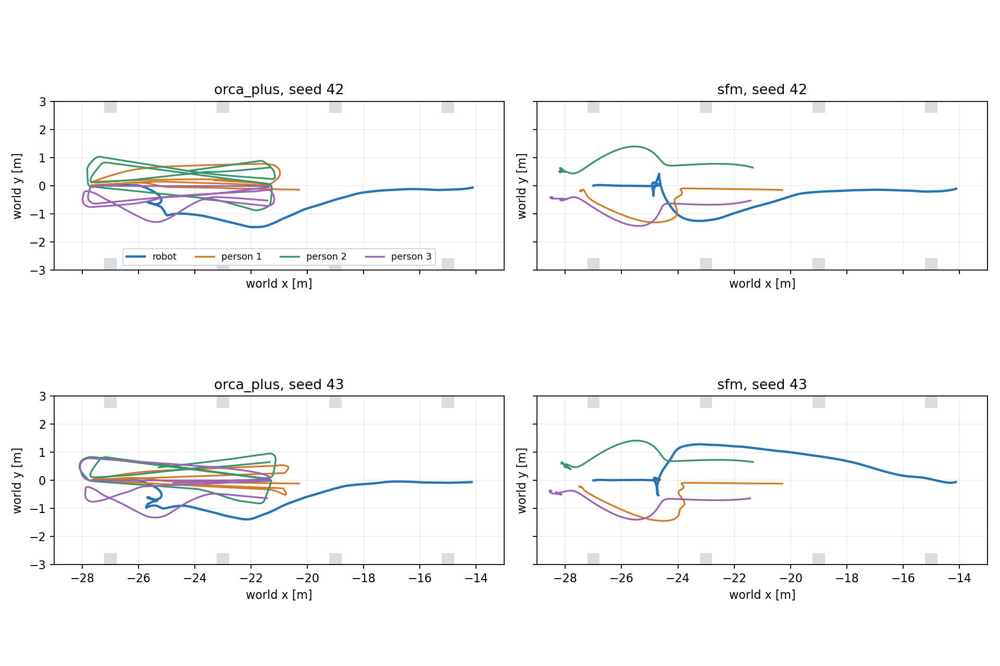

# CrowdSimPlus: SFM native đã chạy trong Gazebo

Đã chạy demo SFM gốc bằng `sicnav/simple_test.py`, kiểm định kernel với full
`env.step`, rồi hoàn tất **4/4 lượt Gazebo/Nav2 đến đích**: ORCA+ và SFM native,
seed 42/43. Không ghi nhận overlap robot–người hoặc người–người trên 1 cm ở
các mẫu đã ghi. Đây là pilot cùng fixture, chưa phải xếp hạng framework/policy.

**Giới hạn chính:** SFM dừng quanh waypoint chung, không đổi patrol goal ở cả
hai seed. ORCA+ có tổng 12 lần đổi goal của ba người trong mỗi lượt. Vì vậy
không dùng clearance/thời gian toàn lượt để kết luận SFM tốt hơn: số lần người
và robot gặp lại nhau khác nhau sau lần tránh đầu tiên.

## Demo gốc và tương thích

[Video demo SFM upstream](native_sfm_demo.mp4), [kết quả](native_sfm_summary.json),
[config](native_sfm.config). Chạy nguyên `sicnav/simple_test.py --policy dwa
--test_case 0`, chỉ đổi `humans.policy=sfm` trong bản sao env.config. Giữ timestep
0,25 s, random attributes và vòng episode/DWA gốc. Demo bottleneck 2D đạt goal
sau 7,5 sim s, 30 bước; native logger ghi 0 Collision/WallCollision/Frozen/Danger.
Đây là kết quả demo 2D, không phải benchmark Mecanum hay bằng chứng 3D bottleneck.

Host Ubuntu 24.04 + ROS 2 Jazzy vẫn chạy robot Mecanum, cảm biến và Nav2.
Human worker chạy Python 3.8.13 trong image `dynamuhsim-crowdsimplus:round2`,
source `d526a07c013c621fa1ad50894b6ba639f61063de`. Không cài SFM vào Python 3.12
hệ thống hoặc khẳng định upstream hỗ trợ Jazzy trực tiếp. Docker không có
network, root filesystem read-only, mount adapter read-only và runtime riêng.

## Thay đổi và kiểm định

Thêm lựa chọn `--human-policy sfm` cho backend `crowdsimplus`; mặc định vẫn
`orca_plus`. Tên report SFM có suffix riêng, không ghi đè ORCA+ hay pilot cũ.
Chỉ sửa adapter/runner trong experiments, không sửa policy upstream, plugin
transport C++, robot, Nav2, map hay workspace build/install. Analyzer ORCA+ cũ
báo lỗi nếu nhận SFM thay vì gắn nhãn nhầm.

Native `Human.act`, `SFM.predict`/`ORCAPlus.predict`,
`CrowdSimPlus.constrain_agent_action_exact`, `Human.step` được giữ nguyên. Mọi
người tính action trên cùng snapshot và cập nhật đồng thời. Robot state là
pose/vận tốc thật Gazebo; **Nav2 là controller robot duy nhất**.

[ORCA+ validation](orca_plus_validation.json) và [SFM validation](sfm_validation.json):
30 human updates khớp full upstream `env.step`, sai số trạng thái tối đa **0**.
Kiểm tra static line giữ bước 0,08 m còn 0,0399999 m trước biên; stationary fixture
giữ chính xác 20 bước. Cùng 90 robot input cố định, visible/invisible làm quỹ đạo
người khác tối đa 0,647 m với ORCA+, 3,729 m với SFM. Đây là probe phản ứng robot,
không phải lượt Nav2 bổ sung hay kết luận độ an toàn.

## Protocol Gazebo

Cùng initial fixture seed 42/43, scene/map/Nav2 hashes, robot spawn (-27,0),
Nav2 goal (-14,0), proxy người radius 0,36 m, preferred speed 0,8 m/s, timestep
0,1 s. Chỉ dùng lối chính 13 m bên trái nhà xưởng 60×40 m; chưa thử giao cắt,
bottleneck hay crowd mật độ cao trong Gazebo ở vòng này. Gate mở sau khi robot
và cảm biến sẵn sàng, Nav2 chấp nhận goal. Các lượt chạy tuần tự, headless có
rendering camera RGB; GUI không được dùng để đo vòng này.

Giữ nguyên SFM A=3, B=0,18, KI=1, A_static=2, B_static=0,025,
A_bottleneck=6, B_bottleneck=0,12. `is_bottleneck=False` ở scene nhà xưởng:
nhánh hallway native dùng thứ tự segment, không thể áp ngầm vào 168 segment
của 42 khối factory. [SFM config](sfm.config), [ORCA+ config](orca_plus.config).
ORCA+ vẫn có native radius margin 0,02 m/agent; SFM là lực mềm, không có ràng
buộc ORCA người–người. Giữ các tham số này để thử native policy, không chuẩn hóa
chúng thành cùng thuật toán hay thêm guard tránh người.

## Kết quả

| Policy | Seed | Goal | Sim s | Robot clearance min (cm) | Human pair min (cm) | Tổng human goal switches |
|---|---:|---|---:|---:|---:|---:|
| orca_plus | 42 | SUCCEEDED | 40.184 | 13.61 | 4.00 | 12 |
| orca_plus | 43 | SUCCEEDED | 42.200 | 13.72 | 4.00 | 12 |
| sfm | 42 | SUCCEEDED | 38.356 | 25.67 | 12.36 | 0 |
| sfm | 43 | SUCCEEDED | 38.704 | 28.27 | 12.78 | 0 |

Clearance chính đo hình chữ nhật Nav2 **0,24×0,20 m**, xoay theo yaw, với proxy
người tròn radius 0,36 m. Pair clearance so hai circle. Số liệu lấy pose model
Gazebo khoảng 50 Hz; overlap duration dùng threshold −1 cm. Không đo contact
force, không chứng nhận toàn bộ collision links robot hoặc mọi physics step.
Cả bốn lượt cũng giữ khoảng hở dương với footprint padding 0,26×0,22 m và không
lấn khối factory trong mẫu đo. Goal được xác minh bằng actual world pose,
không chỉ nhận action SUCCEEDED; sai số goal khoảng 0,14–0,17 m.





## Quan sát hành vi và giới hạn

- **SFM:** người đổi vận tốc theo lực kéo goal và lực đẩy người/robot/vật cản.
  Sau lần gặp robot đầu, ba người dừng quanh waypoint (-28,0), khoảng cách đến
  goal trung bình cuối lượt khoảng **0,616 m**, lớn hơn native arrival threshold
  radius 0,36 m. Vận tốc cuối gần 0; không có lần đổi patrol goal. Hiện tượng
  phù hợp với cân bằng lực quanh chung một đích, không phải hội thoại/giữ nhóm.
- **ORCA+:** người tiếp tục đi và đổi hướng tuần tra, nên có thêm các lần gặp lại
  robot. Robot clearance min ở khoảng 20,484/13,200 s, còn SFM ở 4,668/4,664 s.
  CSV giữ thêm minimum của 12 giây đầu để tách lần gặp ban đầu khỏi toàn patrol.
- RTF SFM khoảng 0,74, ORCA+ 0,56–0,57; worker mean khoảng 35 ms và 77–78 ms.
  SFM dừng nhiều ở cuối lượt, nên những số này không chứng minh SFM tính nhanh
  hơn khi cùng chuyển động/crowd. Các velocity-change metrics là mô tả, không
  phải thước đo đã kiểm chứng về tính tự nhiên; thời gian đứng yên cũng làm
  giảm mean acceleration.
- Hai seed, một lượt mỗi case; MPPI/AMCL/LiDAR noise chưa khóa chung. ORCA+
  seed 43 lần này mất 42,2 sim s, lượt trước 71,02 sim s: không gán toàn bộ
  chênh lệch giữa các vòng cho policy người. SFM cũng không có bảo đảm hard
  avoidance người–người; không overlap trong hai fixture chưa đủ kết luận an toàn.
- SFM và ORCA+ đều là **người độc lập**, `groups=[]`, chưa có membership,
  conversation, formation/dispersal. ComplexityNav vẫn chưa nối Gazebo.

## Cách chạy và xem lại

Từ terminal Ubuntu, tại repository root; đợi phiên trước đóng rồi mới chạy:

```bash
bash experiments/social_navigation/benchmark/run.sh trial \
  --backend crowdsimplus --human-policy sfm --condition counterflow --seed 42 \
  --gui --diagnostics \
  --report-dir "experiments/social_navigation/benchmark/generated/sfm_demo_$(date +%Y%m%d_%H%M%S)"
```

Robot tự nhận goal. `--gui` mở cửa sổ và tự đóng khi lượt benchmark kết thúc;
bỏ `--gui` vẫn thu ảnh/GIF. Dùng `--human-policy orca_plus` để đối chiếu.
Nếu WSLg chỉ hiện taskbar icon, cần khôi phục WSLg trước, không sửa policy người.

- SFM: [seed 42 GIF](crowdsimplus_sfm_counterflow_s42.gif), [seed 43 GIF](crowdsimplus_sfm_counterflow_s43.gif).
- ORCA+: [seed 42 GIF](crowdsimplus_counterflow_s42.gif), [seed 43 GIF](crowdsimplus_counterflow_s43.gif).
- [CSV](results.csv), [analysis](analysis.json), [protocol](protocol.json),
  [validation/runtime paths](validation_manifest.json), [hash manifest](run_manifest.json),
  [source preservation](source_preservation.json).

Ma trận `sfm-matrix --report-dir ...` chạy bốn lượt tuần tự sau khi trong output
directory có hai validation JSON PASS. `analyze_sfm.py <report_dir>` sinh bảng/
biểu đồ. Các raw logs/JSONL giữ trong generated runtime và hash trong manifest;
không ghi đè report của vòng trước.

## Bước tiếp theo

Tạo fixture có **đích riêng cho từng người** và kiểm tra cùng fixture cho cả
SFM/ORCA+, tránh phụ thuộc vào việc ba người cùng phải chạm một waypoint.
Sau đó mới đánh giá giao cắt/lối hẹp và tăng mật độ; giữ native parameters,
gắn nhãn rõ scenario mới. Chưa chọn model chính thức, chưa chuyển sang
ComplexityNav trong vòng này, không đổi kiến trúc robot/World Model.

Đã kiểm tra cú pháp Python/shell, git whitespace và preservation: 14.181 tracked
paths ngoài social_navigation, staged index, diff có sẵn và RVO2 binary không
đổi. Mọi process/container thuộc bốn lượt đã đóng. Phần SFM mới chưa commit.
