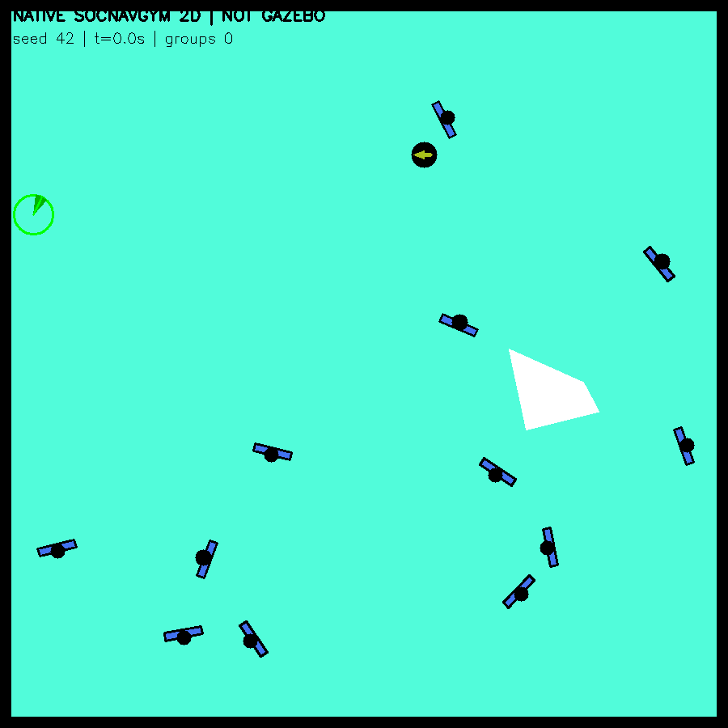

# SocNavGym native group lifecycle validation

Three predeclared seeds42/43/44,1200 native steps each (120s), with a500-step same-seed reset prefix for seed42. Existing14×14m formation demo config is copied byte-for-byte. The robot remains stationary; there is no ROS/Gazebo or warehouse mapping. No group event is injected and native source/policy parameters are unchanged.

| Seed | Status | Membership changes | Native formations finished | Min pair gap (m) | Pair overlap >1cm (s) | Largest finish snap (m) |
|---|---|---:|---:|---:|---:|---:|
| 42 | PASS | 5 | 3 | -0.6588 | 24.0 | 0.0000 |
| 43 | PASS | 6 | 3 | -0.5614 | 29.1 | 0.0000 |
| 44 | PASS | 8 | 4 | -0.6986 | 111.7 | 0.3264 |

Each state has12 unique human IDs, with no lost/duplicated member across independent, pending and active-group ownership. The worker also checks that each numeric human ID retains the same actual Human object within an epoch. Native group objects lack a persistent numeric group-ID contract; observer labels are assigned from object identity and stay stable for the life of that object. They are external measurement labels, not new upstream IDs.

Reset is a new epoch: numeric human IDs are reused and objects are recreated. The seed42 reset after the120s episode clears active/pending groups; its first500 steps are compared with the original prefix, including positions/headings/speeds and group/pending membership. Recorded error and outcome remain in summary.json. A future adapter needs an epoch/reset handshake, rather than assuming human ID alone is globally unique.

Native finish_human_crowd_formation may call arrange_humans, changing positions instantly inside that method. The passive method wrappers record before/after states and per-human deltas without changing RNG or return values. The approximate branch changes headings instead. Finish snapshots are separated from ordinary per-step integration; all measured snaps remain in summary.json/native_calls.json. No smoothing or clipping is applied to make them appear continuous.

Sampled geometric gaps use human circles of radius0.36m, nominal robot radius0.25m, and the inner edges of the native square walls (MAP/2−wall_thickness). Minimum signed gaps and durations beyond1cm are retained, including overlaps. This is neither a collision-free guarantee nor validation in warehouse geometry.

The historical seed42 recording agrees in position through666 completed steps, then differs at step667 by about1.06cm and eventually has4 membership changes versus5 here. Historical data are retained in place; the cause is not established. Do not claim full1200-step historical determinism from the successful500-step reset prefix. See historical_comparison.json.

Measured human circle-proxy penetration reaches0.56–0.70m across the three seeds. These are circle geometries proposed for Gazebo proxies, not a direct measurement of native ellipse contacts or animated-body mesh collisions. Seed44 has two instantaneous native formation position snaps,0.3264m and0.2049m, plus approximate-formation yaw snaps. On this evidence, automatic formation is NOT promoted into Gazebo in this milestone; fixed-group Gazebo demonstrations remain available. This closes the native capability/limitation check without hiding overlaps or adding new avoidance rules.

These data validate ownership/reset observability; they do not yet accept the formation lifecycle in Gazebo. The current Gazebo GroupKernel supports one fixed group and omits full native formation/episode logic. Extending it needs all individual and group update paths, stable actor/proxy IDs, reset/clock synchronization and an explicit decision about representing native arrangement snaps. Do not silently reset the scene or teleport actors and call the result natural formation.

Gymnasium observation-space warnings are retained. The full native step path was exercised, but invalid RL observations are not certified for training. Preview GIF uses native2D render frames with explicit NOT GAZEBO label, every1sim second at4× playback (30s for120sim seconds); no AI image generation or Gazebo camera is involved.

All source hashes, native method calls, episode trajectories, reset prefix, event PNGs, validation and image hashes are saved. Source vendor, original robot source, current Gazebo adapter and warehouse files match the audit checkpoint. ComplexityNav is unchanged.

