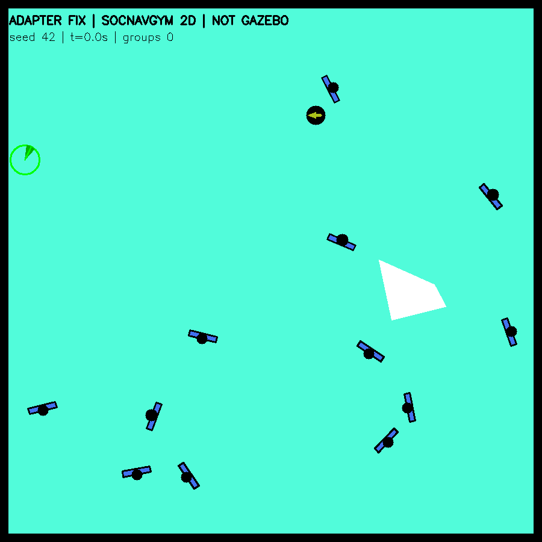
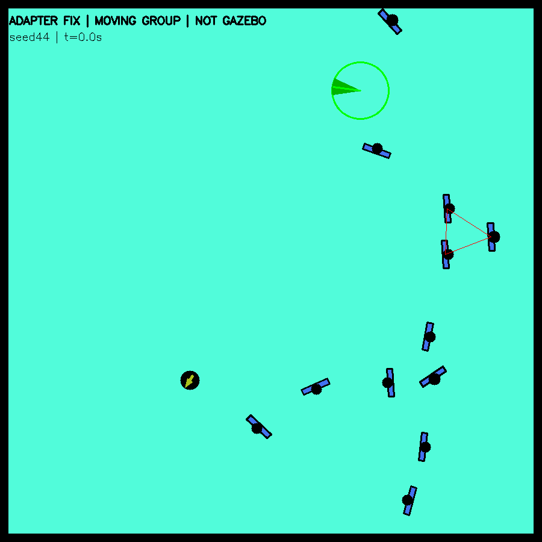

# Formation repair: measured standalone acceptance

The repair is an opt-in experiment adapter, not an upstream SocNavGym fix and not a Gazebo integration. Vendor code, baseline fixed-group Gazebo adapter and ROS robot source are unchanged. Original native results remain under socnavgym_lifecycle/reports/run01. Three fixed-adapter120s runs use the exact same initial state and copied config as seeds42/43/44 in that reference.

| Seed | Native min sampled pair gap (m) | Fixed min swept pair gap (m) | Formations / dispersal calls | Largest step (m) | Human path total (m) |
|---|---:|---:|---|---:|---:|
| 42 | -0.6588 | 0.1117 | 3 / 3 | 0.0800 | 441.3 |
| 43 | -0.5614 | 0.0100 | 3 / 2 | 0.0800 | 421.6 |
| 44 | -0.6986 | 0.0091 | 4 / 2 | 0.0800 | 358.5 |

Repair1: keep current member positions and original Human objects when native formation commits. The native method still selects membership/type/goals and consumes its original RNG draws, but its immediate arrangement positions and heading snap are not exposed. Group centers are recomputed from accepted members. Final heading changes are bounded to1.57rad/s (0.157rad per0.1s tick). Native instantaneous normal-arrangement proposals are recorded separately in repair_events.json; measured formation commit position change is zero.

Repair2: feed native intended motion into a global individual-disc ORCA pass, with current accepted positions/velocities, all humans, room walls and a stationary robot. Human radius remains0.36m, ORCA padding5mm per agent. Standing group members are held in place and turn gradually inward; native individual and moving-group paths still supply intended motion. This explicitly changes the movement policy and stationary-group treatment. Do not describe it as unmodified native behavior.

An analytic swept-disc limiter is an emergency fallback over each full linear tick (2mm clearance margin), covering pair, fixed robot and square-wall boundaries. It shortens the common integration interval before first contact; it never pushes already-overlapping people apart. Initially overlapping scenes and moving-robot use are rejected. In the3 measured episodes this fallback never shortened a step; unit fixtures separately exercised crossing paths that have safe endpoints but collide between ticks, wall crossing, robot crossing, free motion and rejection of an invalid start.

Independent analysis uses closest approach of relative line segments rather than the fallback root solver. Main runs have no swept proxy penetration; maximum displacement is0.080000011m per0.1s tick (RVO float tolerance), yaw0.157rad per tick. The fixed runs still form/disperse groups and travel358–441m in aggregate per episode; there are no common-interval full-stop steps. This does not prove subjective naturalness or general crowd safety.

All spontaneously completed formations in these3 repaired runs are standing groups. A separate initial-moving-group fixture (9 independent people+1 group of3, seed44,600 steps) verifies walking and native moving-group dispersal: initial group center travels15.12m before/while remaining moving; a moving dispersal occurs at step330. Pair/wall swept checks and speed/yaw bounds pass. Its initial scene differs from the primary paired trials and is not included as another paired native comparison. Supplemental robot pose is not logged, so independent robot-gap claims apply to the3 primary runs only.

Reset checks: main seed42 repeats500 steps exactly after the full episode. A supplemental probe resets at the first actually formed active group (step276), clears group membership and adapter velocity state, creates new Human objects with reused numeric IDs, then repeats500 steps with zero measured state error and matching membership. Use (reset_epoch,human_id), not human_id alone.

Validation covers 5476 fixed-adapter updates:4100 primary/reset-prefix,776 active-group reset probe and600 moving regression. IDs, exact initial-state equality, original user index/outside-worktree and11298 preserved files are checked. GIFs decode to30s and15s, both4× simulation time. The2D renders are from recorded simulations, labelled ADAPTER FIX / NOT GAZEBO, with no AI image generation.

Limits: stationary robot, empty14×14m native square room only; furniture/warehouse obstacles and measured moving robot are not supported by this prototype. No Gazebo lifecycle acceptance is claimed. This validation does not resolve native RL observation-space warnings or full historical1200-step determinism. Formation/dispersal timing and human trajectories differ from native after the adapter changes dynamics. No framework ranking is implied.

Next: extend and validate the adapter contract for warehouse obstacles and measured robot motion, then run a small live Gazebo formation test while retaining this standalone and native evidence. ComplexityNav work remains deferred until this step is clear.

