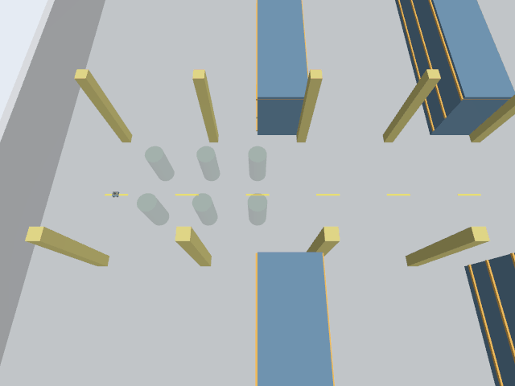

# SocNavGym formation/tách nhóm trong nhà xưởng Gazebo

Ngày nghiệm thu:22/10/2026 (Asia/Bangkok). Đây là pilot tích hợp6 người với robot Mecanum/LiDAR/IMU hiện có, không phải benchmark Nav2 hoặc kết luận an toàn tổng quát. Native vendor và code robot/config gốc giữ nguyên. Bản sửa là adapter hành vi riêng.

## Kết quả đã đo

| Lượt | Seed / robot | Hình thành | Rời/tan nhóm | Khe proxy người–người min | Khe robot–người min | LiDAR trong15cm |
|---|---|---:|---:|---:|---:|---:|
| live01 | 42; tiến0.36m, ngang0.24m | 2 | 0 | 0.143m | 0.691m | 98.13% |
| live02 | 43; ngang0.60m, tiến0.60m | 3 | 3 | 0.010m | 0.100m | 98.91% |

Live01 đạt kiểm tra kỹ thuật nhưng chỉ quan sát được hình thành, nên coverage lifecycle được ghi PARTIAL. Live02 được khai báo bổ sung để kiểm tra rời nhóm, không thay thế live01. Seed43 có nhóm đứng hình thành/tan ở19.004→22.904s và35.104→41.304s; nhóm moving hình thành76.904s, tan87.304s. Sau các lần tan nhóm, thành viên rời đi được xác nhận từ pose Gazebo (độ dời lớn nhất trong5s khoảng1.54m,2.05m và1.66m). Một số người được native giữ đứng độc lập, không yêu cầu mọi thành viên đều đi.

Nhóm moving ID3 đi được 2.168m theo quãng đường tâm nhóm đo từ SceneBroadcaster trong khoảng76.904–87.304s. Đây là chuyển động thực trong Gazebo, không chỉ một nhãn moving.

Tất cả6 human IDs và actor/proxy names được giữ bền vững qua các thay đổi membership. Group IDs là nhãn theo vòng đời object ở adapter, không phải native persistent ID toàn cục. Không có bước spawn lại người khi nhóm hình thành/tan. Tốc độ proxy đo tối đa0.800001m/s và tốc độ quay1.570001rad/s nằm trong sai số số thực của giới hạn0.8m/s,1.57rad/s. Không ghi nhận khe âm trên các đoạn tuyến tính nối mẫu pose được ghi; không suy ra continuous collision freedom ở mọi tình huống.

## Những gì đã thay đổi

- Phiên bản plugin riêng hỗ trợ6 người, dùng map animation theo ID thay cho mảng cố định3 người. Adapter cũ không sửa.
- Worker lập endpoint cho tick kế tiếp0.1s; plugin nội suy ở tick vật lý. Đối chiếu trực tiếp SceneBroadcaster với endpoint/interpolation cho sai số vị trí proxy cỡ1e−14m trong hai lượt (người là proxy kinematic do Python điều khiển). Không dùng command pose tự phát làm bằng chứng actual pose.
- Đưa đủ42 AABB từ layout nhà xưởng vào native walls, global ORCA và kiểm tra swept bằng hình học riêng. Đối chiếu pose/size42 collision boxes trong SDF với layout.
- Mỗi tick dùng pose/vận tốc robot đo trong Gazebo; dự đoán vận tốc hằng trong0.1s kế tiếp, không ép robot đi theo nghiệm ORCA. Sai số dự đoán robot lớn nhất khoảng9.1mm/11.3mm trong hai lượt; khoảng hở nghiệm thu lấy từ pose Gazebo thực.
- Khi xét giảm chuyển động người, robot vẫn đi trọn interval dự đoán. Nếu không tìm được proposal hợp lệ, adapter báo lỗi; không thu ngắn hoặc bỏ qua chuyển động robot để tạo kết quả đẹp.
- Mở rộng wall observation schema của riêng instance từ capacity32 lên42 đoạn (336 phần tử), vì native padding lỗi với42 vật cản. Không bỏ vật cản hoặc sửa vendor. Đây không phải nghiệm thu observation/reward cho RL.

## Kiểm chứng

Trước Gazebo: ba trace robot định trước (đứng, tiến, ngang rồi tiến), mỗi trace1200 bước ởseed42, đều có formation và đạt swept-check độc lập dùng GEOS/Shapely với đủ42 boxes. Lượt offline01 lỗi schema trước khi chạy step được giữ cùng source snapshot khớp SHA256; offline02 là lần chạy sau sửa schema, không xóa failure. Unit fixtures kiểm tra xuyên box giữa endpoint, góc box, robot tiến tới, và input không khả thi phải báo lỗi.

Trong Gazebo: sensor scan/IMU/odom/clock có dữ liệu; tiến/ngang được đo bằng pose thật. Pause/Play giữ nguyên clock và human step trong thời gian pause. Khe tĩnh nhỏ nhất khoảng0.418m/0.354m ởhai lượt. LiDAR được đối chiếu bằng ray-circle từ proxy Gazebo, đồng thời loại các tia bị42 vật cản hoặc người khác che:31,134 và49,966 tia đủ điều kiện, tỷ lệ trong15cm lần lượt98.13%/98.91%. Lượt2 khớp đủ6 IDs qua các thời điểm.

Hai lượt xác nhận fresh Ogre NVIDIA RTX4060Laptop qua WSL D3D12 và thoát server sạch, không còn owned process. Người dùng xác nhận nhìn thấy6 người và kéo/zoom được ởlive01; không tự suy ra một lần xác nhận GUI thứ hai.

## Phạm vi và hạn chế

- Hai seed, population6; sampling goal tập trung tại lối đi world x[−27.5,−20.5], y[−1.5,1.5], native local origin(−24,0). Đây là cửa sổ lấy mẫu goal, không thêm tường giả. Toàn bộ42 vật cản vẫn tồn tại và được ánh xạ; chưa kiểm tra người đi khắp nhà xưởng hoặc qua cửa1.8m.
- Robot chạy lệnh vận tốc định trước rồi dừng quan sát; không chạy Nav2 trong các lượt này. Chưa so sánh công bằng với CrowdSimPlus/ComplexityNav và chưa chọn mô hình cuối.
- Group đứng là bố trí/hướng nhìn vào nhau, không có nội dung hội thoại. Global disc-ORCA, giữ vị trí khi commit và giới hạn quay là hành vi adapter đã sửa, không gọi là native nguyên bản.
- Reset đang theo contract khởi động session mới: mỗi lượt tạo worker/plugin mới với6 IDs và clock mới. Reset world ngay trong session bị từ chối, cần restart; chưa nghiệm thu in-place reset.
- Actor dùng walking mesh/clip; khi đứng animation giữ theo tốc độ. Chưa chuyển clip đứng riêng hoặc nghiệm thu chất lượng cử động cơ thể.

## Camera và dữ liệu

Các PNG/GIF dưới đây là camera RGB thật của Gazebo, không phải ảnh AI hoặc biểu đồ2D. GIF phát4×, khoảng30.5s cho khoảng122sim s của camera; thời gian gốc từng frame lưu trong result.json. Ảnh moving_group_camera.png được trích nguyên nội dung từ GIF tại thời gian có nhóm đi.

[Live01](live01/validation.json) · [Live02](live02/validation.json) · [Offline độc lập](offline02/independent_validation.json). JSONL thô giữ cục bộ, có bản gzip byte-identical cùng archives.json/SHA256 để lưu Git. Worker trace và SDF thực của từng lượt cũng được lưu. Code vendor, robot, bản sửa standalone cũ và staging ngoài experiment được kiểm tra bảo toàn11355 file.

Kiểm toán hậu kỳ: [suite_validation.json](suite_validation.json) ghi trạng thái tổng hợp và [suite_manifest.json](suite_manifest.json) ghi SHA256 nguồn/bằng chứng. `protocol.json` là snapshot trước chạy, giữ sentinel `status: ERROR` mặc định của recorder; outcome cuối nằm ở `result.json` (RECORDED) và `validation.json` (kết luận analyzer), không dùng sentinel để diễn giải kết quả. Wrapper `run.sh analyze` đã chạy trên cả hai lượt; build/plugin và live runner được kiểm chứng bằng các lần chạy trực tiếp, không tự nhận đã chạy lại toàn bộ qua wrapper.
