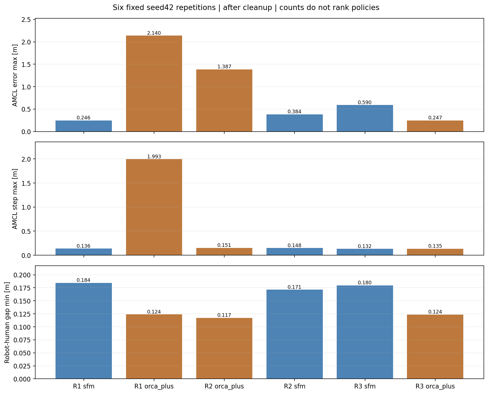
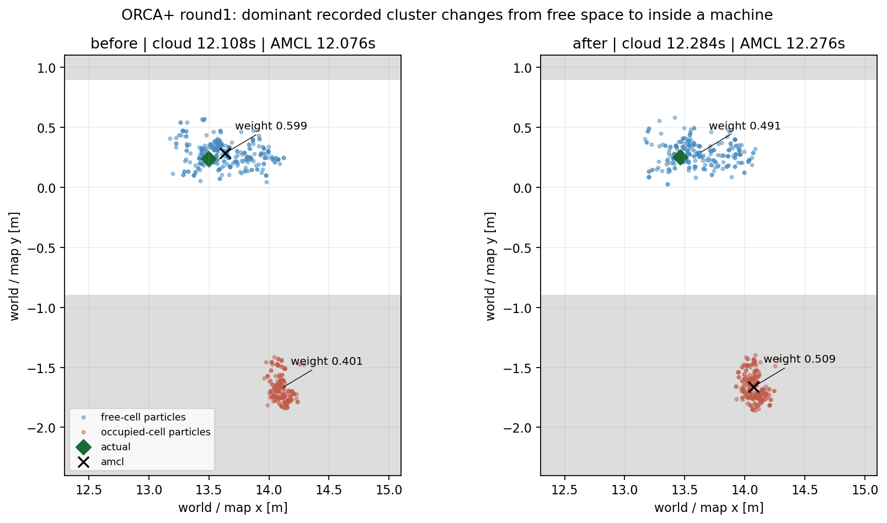
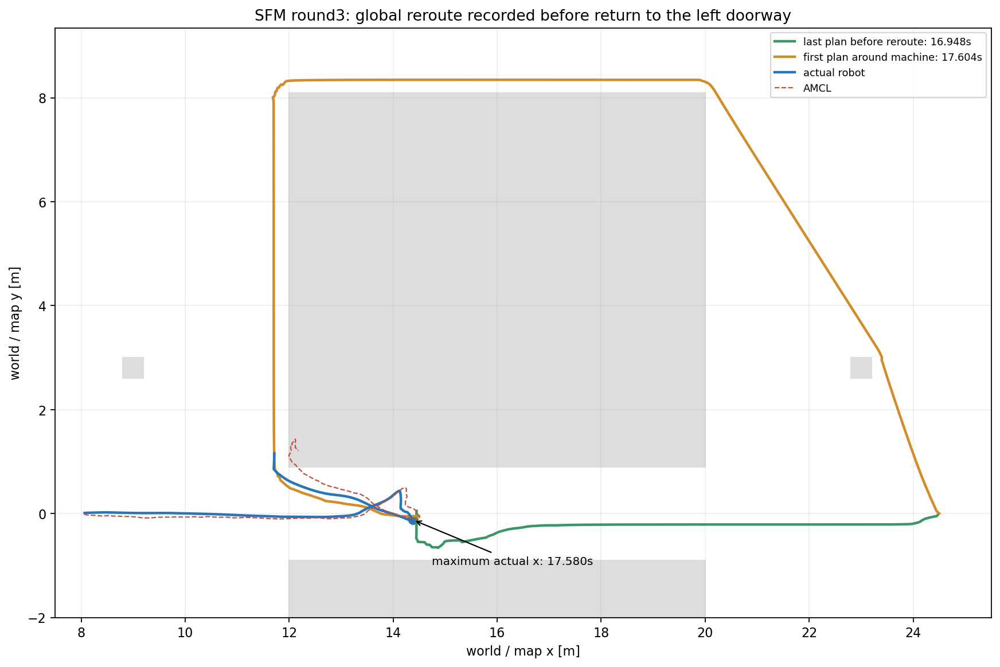

# Sáu lượt lặp: đã bắt lại lỗi định vị và xác nhận đường global quay về cửa

Đã hoàn tất **đúng sáu lượt định trước**, cùng seed42, không retry/thay lượt,
không tune Nav2 hay human policy. SFM **2/3 tới đích**, ORCA+ **1/3 tới đích**.
Loạt này đủ thu lại failure có dữ liệu đầy đủ; chưa đủ xếp hạng framework.

Trước khi chạy đã commit riêng ba phần:

- `1186e1d` — chẩn đoán offline dữ liệu bottleneck cũ.
- `e8bf1c0` — ghi global plan/costmap và native particle cloud.
- `2f2bdff` — kiểm GPU thật và cleanup child của phiên.

Toàn bộ sáu trial báo HEAD `2f2bdff`; source hashes cố định từ trước lượt đầu.
Cohort mới giữ riêng với benchmark gốc 2/4 đạt và hai diagnostic reruns trước.
Các thay đổi staged có sẵn ngoài experiment được bảo toàn.

## Cách chạy và protocol

[Hướng dẫn](../../README.md), [protocol ghi trước khi chạy](protocol.json),
[lịch và mọi attempt](progress.json). Vòng1 SFM→ORCA+, vòng2 ORCA+→SFM,
vòng3 SFM→ORCA+. Chạy tuần tự, nghỉ 15 wall s; mỗi lượt budget75 sim s,
headless, recorder navigation luôn bật. Không có infrastructure retry hoặc
cắt loạt khi gặp goal ABORTED. Phân tích offline chỉ chạy sau sáu mô phỏng.

Vẫn là ba người độc lập native CrowdSimPlus, không phải group/conversation.
Cùng nhà xưởng, khe1,8×8m, robot(8,0)→(24,5,0), routes người seed42, ảnh
Docker native và cấu hình cảm biến/controller. Seed không cố định hoàn toàn
AMCL, LiDAR/MPPI/physics scheduling; không diễn giải ba lần như failure rate
trên mọi môi trường hoặc bằng chứng SFM an toàn hơn ORCA+.

## Kết quả theo từng lượt

AMCL error/step tính theo mét; cột cuối là signed clearance giữa hai circle
proxy người radius0,36m, tính bằng cm. Số âm là overlap hình học.

| Vòng | Policy | Goal | Sim s | AMCL max m | AMCL step max m | Min human–human cm |
|---|---|---|---:|---:|---:|---:|
| 1 | sfm | SUCCEEDED | 33.952 | 0.246 | 0.136 | 0.688 |
| 1 | orca_plus | ABORTED | 25.784 | 2.140 | 1.993 | 4.242 |
| 2 | orca_plus | ABORTED | 29.592 | 1.387 | 0.151 | 4.434 |
| 2 | sfm | SUCCEEDED | 35.996 | 0.384 | 0.148 | -2.650 |
| 3 | sfm | ABORTED | 38.476 | 0.590 | 0.132 | -0.035 |
| 3 | orca_plus | SUCCEEDED | 35.992 | 0.247 | 0.135 | 4.060 |

Ba lượt SUCCEEDED đều thực sự đi qua channel một lần, sai số đích Gazebo
0,060–0,124m; ba lượt ABORTED chưa qua hết. Robot–human footprint clearance nhỏ nhất toàn loạt **0,117m**,
robot–machine nhỏ nhất **0,0869m**, đều dương tại các mẫu. Odometry so với
Gazebo lệch tối đa **1,19cm**. Đây là hình học proxy/footprint tại khoảng
42–45Hz, không phải mọi physics step, mesh/contact force hoặc chứng nhận an toàn.

**SFM vòng2** dù tới đích có human–human overlap lớn nhất **2,650cm**, vượt
threshold1cm cũ trong **0,100sim s** theo tích phân mẫu. SFM vòng3 có overlap
nhỏ **0,035cm** (~0,35mm), cũng được giữ trong bảng. Không gộp goal success
với việc không va chạm. ORCA+ min human–human gap khoảng4,06cm trong loạt này.

## ORCA+ vòng1: nhìn thấy cụm sai thắng trọng số

Ở elapsed **12,076→12,276s**, AMCL nhảy **1,993m** trong0,2s; actual Gazebo
chỉ dịch **0,040m**. Trước: AMCL(13,635;0,283), actual(13,499;0,240).
Sau: AMCL(14,073;−1,661) nằm trong máy phía nam, actual(13,460;0,252) vẫn
ở hành lang. Maximum position error về sau **2,140m**.

Hai clouds gần các cập nhật có offset header cloud−scan **+32/+8ms**:

| Cụm native trong cloud sau resampling | Trước | Sau |
|---|---:|---:|
| Mean ở free space gần robot thật | 59,880% | 49,102% |
| Mean nằm trong khối máy phía nam | 40,120% | 50,898% |

Mean x/y của cụm weight lớn nhất khớp pose AMCL đã publish. Như vậy ở **lượt
mới này** đã có bằng chứng trực tiếp về việc cụm occupied trở thành cụm được
chọn, thay vì chỉ suy luận từ covariance hoặc sensor score. Đây là phân bố
cloud sau resampling; không có prior trước sensor update hay RNG state để
kết luận trọn vẹn vì sao weight chuyển hoặc replay chính xác filter ẩn.

Global grid được lấy mẫu tại pose AMCL sau cập nhật có max100 (publication
sớm hơn khoảng0,328s); log planner lần đầu không tạo được đường khoảng
**12,776s**, sau jump. Dừng tịnh tiến kéo dài bắt đầu12,968s. Global planner
đã từng chọn đường vòng từ10,280s, **trước jump**, nên không quy mọi diễn biến
của toàn quỹ đạo cho một cập nhật AMCL duy nhất.

## ORCA+ vòng2: drift từ từ, không cùng kiểu jump

AMCL max error **1,387m**, publication step lớn nhất chỉ0,151m. Global plan
đã có đường vòng từ10,380s; tâm AMCL vào occupied13,376s; persistent stop
bắt đầu14,564s. Planner báo start quanh(13,46;0,90) không tạo được đường.
Không mô tả ca này như một bước nhảy2m; người vẫn chạy native policy.

## SFM vòng3: global planner đổi đường trước khi quay về cửa

Actual robot đi vào tới x≈14,380 tại17,580s, error AMCL lúc đó khoảng0,136m.
Plan trước reroute ở16,948s còn đi qua khe. Plan lúc **17,604s** đổi sang đi
ngược về đầu trái rồi vòng phía bắc máy (y≈8,35m). Đây là global path đã
publish thực, không phải suy từ quỹ đạo hoặc tưởng tượng behavior người.

Sau đó actual quay về cửa, x giảm tối đa **2,676m** từ đỉnh trước đó. Tâm AMCL
lần đầu vào occupied ở24,980s, global footprint grid max100, local max99;
persistent translation stop bắt đầu25,592s. Backup action EXECUTING đầu tiên
mãi33,184s, sau chuỗi planner failure; **đoạn quay về ban đầu không phải
backup recovery**. SFM max AMCL error0,590m, không có jump lớn.

Dữ liệu mới xác nhận hướng global reroute dẫn về cửa. Chưa chứng minh nguyên
nhân ban đầu khiến Navfn chọn route đó: costmap publish khoảng1Hz, snapshots
không phải đúng nội bộ grid ở từng ComputePath callback. Cần replay/ablation
riêng để tách obstacle marking, projection do định vị và quyết định planner.
Không thay thế diễn biến SFM ca lỗi cũ bằng chronology của lượt mới này.

ORCA+ vòng3 cũng từng có global plans vòng ngoài nhưng vẫn tới đích; vì vậy
reroute tự nó không đồng nghĩa navigation thất bại.

## Dựng lại cluster: xử lý đúng góc quanh ±π

Native cloud gửi quaternion, không giữ số vòng yaw nội bộ. Omni model cộng
góc quay vào pose và KD-tree dùng bins góc; ép mọi particle về[-π,π] có thể
tạo vết cắt giả khi robot spin. Source đúng tag1.3.13:
[Omni motion](https://github.com/ros-navigation/navigation2/blob/1.3.13/nav2_amcl/src/motion_model/omni_motion_model.cpp),
[KD-tree](https://github.com/ros-navigation/navigation2/blob/1.3.13/nav2_amcl/src/pf/pf_kdtree.c).
URLs và SHA256 của hai source đọc thêm được ghi trong manifest.

Pipeline canonical ban đầu có sai khác mean tối đa0,112m ở recovery quanh
±π, làm check strict dừng. Không nới tolerance để ép PASS. Bổ sung bước lift
các góc quanh **mean circular tính từ cloud**, không dùng AMCL để chọn nhánh,
rồi gọi lại native libpf. Với **819 cặp** cloud/AMCL ghép receipt, mean x/y
của cụm lớn nhất khớp trong độ chính xác double đã lưu. Synthetic test hai
góc sát±π kiểm hiện tượng cắt nhầm và sửa biểu diễn. Không tuyên bố đã phục
hồi mọi internal cluster ID/whole-turn state hoặc replay toàn PF.

Canonical intermediate JSON/plots của round analyzer giữ nguyên để audit;
khi xem cluster phải dùng các file `*_circular_clusters.json` và summary/events
gộp. Chỉ số trước/sau jump ORCA vòng1 ở xa seam±π nên kết luận mode switch
không phụ thuộc vào sửa biểu diễn ở các đoạn spin phía sau.

## GPU, cleanup và giới hạn shutdown

Cả6 lượt: preflight OpenGL và **Ogre2 log mới của chính phiên** đều xác nhận
`D3D12 (NVIDIA GeForce RTX4060 Laptop GPU)`; process cleanup PASS, còn0 node
của phiên trước mỗi lượt kế tiếp. Nhiệt GPU snapshot trước/sau nằm38–43°C;
không phải peak trong lượt và không phải nhiệt CPU. Không dùng nvidia-smi
GPU-util snapshot0% để phủ nhận renderer D3D12 đã kiểm trực tiếp.

**Cả6 teardown** có Gazebo không thoát sau SIGINT5s rồi exit−11 khi shutdown;
worker có ConnectionReset ở một số lượt. Những dòng này xảy ra sau khi trial
đã nhận goal result và bắt đầu dừng, được giữ trong
[shutdown notes](shutdown_notes.json). Không có process sót sau đó. Cleanup
PASS chỉ xác nhận đã dọn PID, không có nghĩa shutdown library hoàn toàn sạch.
Lỗi teardown cần xử lý riêng; không giấu nó hoặc coi là runtime goal failure.

## Bằng chứng và phạm vi tiếp theo

- [CSV](results.csv), [summary](summary.json), [event windows](events.json),
  [raw/source manifest](manifest.json), [checks](checks.json),
  [preservation và validation](validation.json).
- Vòng1: [ORCA+ failure GIF](round01/crowdsimplus_individual_goals_bottleneck_s42.gif),
  [SFM GIF](round01/crowdsimplus_sfm_individual_goals_bottleneck_s42.gif).
- Vòng2: [ORCA+ failure GIF](round02/crowdsimplus_individual_goals_bottleneck_s42.gif),
  [SFM GIF](round02/crowdsimplus_sfm_individual_goals_bottleneck_s42.gif).
- Vòng3: [SFM failure GIF](round03/crowdsimplus_sfm_individual_goals_bottleneck_s42.gif),
  [ORCA+ GIF](round03/crowdsimplus_individual_goals_bottleneck_s42.gif).

Không thêm World Model, chuyển Isaac Sim, đổi human policy hay sửa cấu hình
ROS/Nav2 gốc. Bước tiếp hợp lý là xử lý teardown và thử phương án định vị
trong cấu hình thử nghiệm riêng, giữ baseline và oracle comparison; chưa thể
chọn mô hình người chỉ bằng tỷ lệ tới đích bị ảnh hưởng bởi navigation.
Ba commit trước loạt đã hoàn tất; **code/kết quả loạt mới này chưa commit**.
