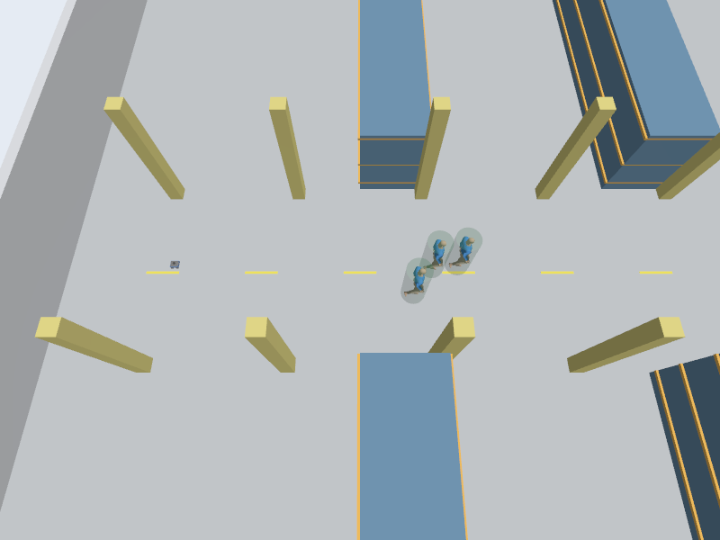
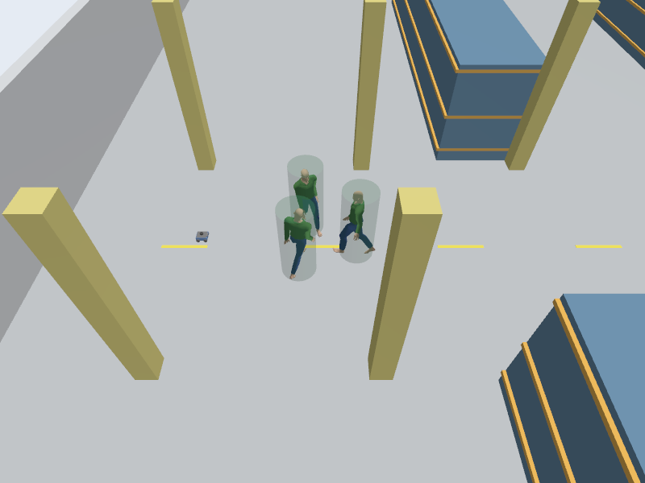

# Kết quả adapter SocNavGym vào Gazebo — 18/10/2026

Đã chạy một nhóm 3 người trong nhà xưởng Gazebo, có robot Mecanum và cảm biến ROS thật. Phần kết nối đạt kiểm định. Chất lượng hành vi nhóm còn hai vấn đề: không chủ động tránh robot và có overlap giữa thành viên. Chưa tăng mật độ, chưa chạy benchmark Nav2 chung.

## Môi trường và nguồn

- Ubuntu 24.04, ROS 2 Jazzy, Gazebo Harmonic 8.15.0 trong WSL2/WSLg.
- Python hệ thống 3.12.3 chạy launch/verifier; worker dùng `.venv-socnavgym` của vòng 1, cũng Python 3.12.
- SocNavGym commit `95fbc9cebe4357201145a7d0a28c7736c0efe6cf`; không sửa vendor. Python-RVO2 là dependency native đã build ở vòng 1.
- Plugin CMake riêng tại `gazebo_adapter/build/libsocnavgym_adapter.so`, không rebuild hoặc sửa gói ROS hiện hữu.
- World nhà xưởng 60×40 m, 42 khối collision được chiếu sang hình chữ nhật native; robot spawn `(-27,0,0)`, group ban đầu quanh `(-24,0)`, seed 42.

## Những gì đã kiểm tra

| Lượt | Thời gian quan sát qua ROS | Kết quả kết nối | LiDAR hợp lệ, sai lệch <15 cm |
|---|---:|---|---:|
| [Đi nhóm, bản cuối headless](walking_headless.json) | 15.5 s simulation | PASS | 17/17, thấy cả ID 1–3 |
| [Đứng trò chuyện, GUI](conversation_gui.json) | 15.6 s simulation | PASS | 237/237, thấy cả ID 1–3 |
| [Đi nhóm, GUI](walking_gui.json) | 9.8 s simulation | PASS | 8/8, ID 2–3 nằm trong các tia hợp lệ |
| [Đi nhóm dài, headless](walking_long_headless.json) | 40.9 s simulation qua ROS | PASS phần kết nối | 8/8 theo bộ lọc LiDAR ban đầu |

Các mẫu LiDAR ở bảng là những tia hướng vào người, trong tầm đo và không bị người khác che. Đây không phải tỷ lệ phát hiện trên toàn bộ scan hoặc bằng chứng tránh va chạm an toàn. LiDAR đang nhìn proxy hình trụ bán kính 0.36 m; không phải phép đo giải phẫu chân/tay của actor.

Hai lượt bản cuối dùng simulation time cho thời lượng lệnh: 0.12 m/s trong 3 s tiến và 2 s ngang, đo được 0.36 m và 0.24 m. Sai lệch world pose robot so với odometry cộng offset spawn dưới 1 µm trong cảnh yaw=0. Worker nhận vận tốc thực khoảng 0.12 m/s theo cả hai hướng. Các lượt GUI đi nhóm và tuần tra dài thực hiện trước khi đổi verifier sang thời lượng simulation; không dùng độ dịch chuyển của chúng để so hiệu năng controller.

Pause 1.5 s wall time làm cả clock và human step đứng yên; resume tiếp tục đúng 0.1 s/step. Ba ID được giữ ổn định. SceneBroadcaster xác nhận pose proxy thật: nhóm đứng sai lệch ở mức số học, nhóm đi sai lệch tối đa khoảng 8.9 cm ở bộ so khớp timestamp này. Chưa chứng minh sai lệch bằng 0 giữa mọi pha cập nhật physics/render.

Worker đo trung bình khoảng 40 ms/bước ở bản cuối headless, khoảng 67 ms/bước khi GUI chạy nhóm đứng. Có bước vượt 100 ms. Cơ chế đồng bộ sẽ giảm tốc độ chạy thực khi worker chậm; không cam kết real-time factor 1.

## Quan sát hành vi

[Phân tích quỹ đạo đầy đủ](patrol_analysis.json) gồm 440 trạng thái từ 0.004 đến 43.904 s simulation; nhiều hơn khoảng quan sát qua ROS vì worker hoạt động trước lúc verifier sẵn sàng và trong thời gian đóng. Tâm nhóm đi khoảng 23.52 m, đổi chiều tại khoảng 15.4 và 30.1 s. Cả ba ID giữ nguyên, không tái sinh episode. Bán kính nhóm lớn nhất qua ROS khoảng 1.12 m.

Có **199/440 trạng thái** chứa ít nhất một cặp người overlap hình tròn. Overlap đầu tiên tại **4.104 s**, khi nhóm còn đi trên chặng đầu; không chỉ xuất hiện lúc quay đầu. Clearance cặp nhỏ nhất **−0.354 m**, với công thức `distance - radius_a - radius_b`. Clearance nhỏ nhất với khối nhà xưởng vẫn dương khoảng 1.576 m. Vì vậy trường `behavior_quality_pass` là `false`, dù clock/transport/ID đạt. Chưa thêm lực đẩy hay luật tránh nội bộ để che vấn đề của kernel đang đánh giá.

[Probe robot gần/xa](native_robot_response.json), cùng seed và 20 bước, cho độ khác quỹ đạo bằng 0 trong cảnh chưa tiếp xúc. Hàm `compute_orca_interaction_velocities` upstream biểu diễn moving group bằng một agent ORCA và không thêm robot vào solver. Contact handler native vẫn đọc robot: khi cố ý đặt robot overlap một thành viên, tốc độ native của cả nhóm về 0. Điều này không tương đương phản ứng xã hội chủ động nhường đường; tốc độ 0 cũng chưa đảm bảo tuyệt đối không trôi do noise native.

Conversation giữ nguyên vị trí ba người và quay mặt vào tâm theo cách bố trí native. Chưa có mô hình hội thoại ngữ nghĩa. Formation/dispersal vẫn mới được kiểm tra trong demo 2D vòng 1, không thuộc adapter hiện tại.

## Phạm vi adapter và những gì chưa chứng minh

Adapter gọi riêng ba hàm cập nhật người native; không chạy toàn bộ `env.step`, reward, dummy robot hay vòng episode RL. Robot vật lý đã do Gazebo điều khiển; chạy thêm robot native sẽ tạo hai nguồn chuyển động. Observation vector upstream có lỗi giới hạn đã ghi ở vòng 1 và không được dùng làm API pose. Adapter đọc raw state, chiếu geometry nhà xưởng và cung cấp telemetry riêng. Việc đó không sửa lỗi observation trong thư viện gốc.

Goal tuần tra `(-24,0)` ↔ `(-15,0)` do adapter chỉ định, thay cho sampling goal ngẫu nhiên khắp map. Seed tái tạo kịch bản của adapter, không đảm bảo trùng quỹ đạo demo 2D đầy đủ vì thứ tự gọi RNG khác. Không dùng lượt này để xếp hạng thống kê ba framework.

Chưa thử nhóm qua bottleneck 1.8 m; native ORCA dùng bán kính đại diện nhóm 1.44 m nên việc qua lối đó là một câu hỏi riêng. Chưa chạy người đi riêng, nhiều nhóm, group formation hoặc goal navigation Nav2 với đám người. `--nav` chỉ cung cấp cách bật launcher Nav2 cũ; kết quả factory Nav2 vòng 1 là world chưa có người.

## Ảnh và cách chạy

[GIF nhóm đi](walking_headless.gif) và [GIF nhóm đứng](conversation_gui.gif) lấy trực tiếp từ camera Gazebo, thời lượng frame theo simulation timestamp. Khi mô phỏng chạy chậm, GIF vẫn phát theo thời gian mô phỏng. Hình trụ xanh trong suốt là proxy LiDAR có chủ đích.





```bash
cd /home/cuongbien/DynamuhSim
bash experiments/social_navigation/gazebo_adapter/run.sh build
bash experiments/social_navigation/gazebo_adapter/run.sh demo --mode walking --gui
# Ctrl+C rồi thử mode còn lại:
bash experiments/social_navigation/gazebo_adapter/run.sh demo --mode conversation --gui
```

Toàn bộ bước chạy/verify nằm trong [README adapter](../README.md). Một lần GUI đã lỗi khởi tạo trong thư viện driver NVIDIA D3D12; lượt thử lại thành công. [Diagnostic GUI ban đầu](diagnostic_conversation_gui.json) được giữ. [Diagnostic pause ban đầu](diagnostic_conversation_headless.json) cũng giữ: lời gọi dịch vụ đồng bộ trong cùng process nhận ảnh Python không trả ack; verifier hiện dùng client `gz service` riêng và đã qua pause/resume. Log shutdown Gazebo đôi lúc báo segfault hoặc Ruby signal sau khi kiểm định hoàn tất; không dùng thông báo đó để tuyên bố runtime PASS/FAIL thay cho các số đo.

## Bảo toàn project và bước tiếp theo

[Audit](source_preservation.json) kiểm 11,537 file tracked có sẵn: không file nào bị thay đổi bởi công việc này. Staged diff cũ và unstaged diff ngoài thư mục thí nghiệm giữ nguyên. Chỉ bổ sung adapter và cập nhật tài liệu thí nghiệm; không sửa kiến trúc ROS/robot hoặc plugin RVO2 cũ. Adapter được lưu cùng mã nguồn và bằng chứng của vòng thử này.

Bước tiếp theo là dựng benchmark nhỏ RVO2/SocNavGym với cùng scene ban đầu, robot, map, controller và quy ước kích thước người; tách nhóm đi và người đi riêng. Cần ghi overlap nội bộ, khoảng cách robot/người, chờ/nhường đường và thời gian đạt goal. Chưa tăng mật độ hoặc chỉnh hành vi native trước khi có baseline định lượng cho hai hạn chế đã phát hiện.

API Gazebo dùng cho bản nối: [System PreUpdate](https://gazebosim.org/api/sim/8/classgz_1_1sim_1_1ISystemPreUpdate.html), [Actor trajectory/animation](https://gazebosim.org/api/sim/8/classgz_1_1sim_1_1Actor.html). Source SocNavGym được đọc trực tiếp từ checkout vendor theo commit ở trên.
