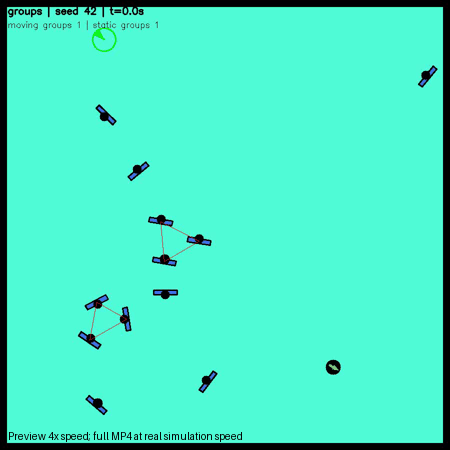
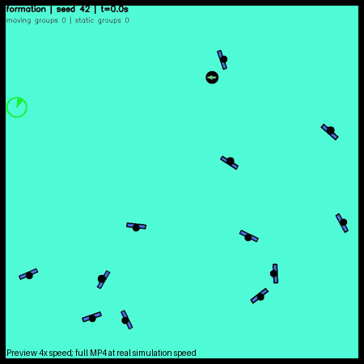

# Vòng 1 — Nhà xưởng và SocNavGym

Ngày thực hiện: 18/10/2026. Đây là khảo sát chạy thực tế một seed, không phải
kết luận thống kê về framework và chưa phải benchmark hai simulator cùng world.

## Phạm vi hoàn thành

- Tạo world nhà xưởng 60×40m, bản đồ collision 0.05m/pixel và wrapper launch riêng.
- Kiểm tra baseline Mecanum/RVO2 hiện có: cảm biến và chuyển động tiến/ngang PASS.
- Nhà xưởng cuối: cảm biến/chuyển động headless PASS; Nav2 MPPI Omni chạy từ
  (-27,0) đến (26,0), xuyên cửa hẹp 1.8m, với Gazebo GUI: action SUCCEEDED,
  sai số AMCL cuối 0.195m, LiDAR còn 19 tia hữu hạn, RTF quan sát 0.996.
- Tuyến dài headless trên hình học cuối cũng PASS: sai số AMCL cuối 0.194m,
  19 tia LiDAR hữu hạn tại goal, RTF 1.000.
- Cài và chạy SocNavGym source nguyên bản, độc lập với ROS; chạy thêm cấu hình
  quan sát nhóm, hình thành/tan nhóm và phản ứng robot. Có video/ảnh/quỹ đạo.
- Adapter SocNavGym↔Gazebo và so sánh RVO2/SocNavGym cùng nhà xưởng CHƯA thực hiện.
  CrowdSimPlus, ComplexityNav, World Model và kiến trúc robot không thay đổi.

## Môi trường và tương thích thực nghiệm

| Thành phần | Phiên bản/cách dùng | Kết quả |
|---|---|---|
| Ubuntu WSL2 | 24.04.5 LTS | Chạy ROS/Gazebo và demo độc lập được |
| Python hệ thống | 3.12.3 | Giữ nguyên, dùng cho ROS |
| ROS 2 | Jazzy | Dùng install workspace hiện có; không rebuild |
| Gazebo Sim | 8.15.0 Harmonic | Cảm biến, Mecanum, AMCL, Nav2 chạy được |
| SocNavGym | source 0.2.0; commit `95fbc9cebe4357201145a7d0a28c7736c0efe6cf` | v2 reset/step/render chạy được |
| Python-RVO2 | commit `c2c46ba8d59556aa10faf03479293236efea154d` | Build C++/Cython được trên Python 3.12 |
| Gymnasium / NumPy | 0.29.1 / 1.26.4 | Runtime chạy, có cảnh báo schema walls upstream |
| PyTorch | 2.14.1+cpu | Chỉ cài trong venv; source import bắt buộc |
| Reward | sparse_gotopoint, từ config test gốc | Không cần DGL/CUDA cho đường chạy này |

SocNavGym ở đây là Python Gymnasium độc lập, không phải một package ROS Jazzy.
Kết quả chứng minh chạy độc lập trên máy này; không có nghĩa đã có tích hợp
Jazzy hay kiểm chứng toàn bộ reward, wrappers và training scripts.

Máy thiếu ensurepip/python3.12-venv đầy đủ. Đã tạo venv riêng và bootstrap pip
bằng script chính thức PyPA; không cài/sửa package Python hệ thống. Các lệnh
và bản ghim nằm trong [hướng dẫn](../README.md), [setup](../setup_socnavgym.sh),
[requirements](../requirements-socnavgym.txt), [freeze](environment_freeze.txt).

## Nhà xưởng: quan sát và giới hạn

Có 8 dãy kệ, lối chính, giao lộ giữa các dãy, machine banks tạo cửa hẹp dài 8m,
khu loading, vùng xanh dành cho nhóm trò chuyện và các cột nhà xưởng. Vùng xanh
hiện chỉ là dấu sàn; chưa có người hoặc hành vi xã hội trong world Gazebo này.
Mái được bỏ để dễ quan sát. Mô hình dùng primitive và không cần tải asset mạng.

World/map sinh từ một danh sách collision duy nhất. Các vạch sàn và gờ kệ trang
trí không tạo vật cản bản đồ. Spawn, goal và cấu hình initial pose đồng bộ với
wrapper; episode initial pose của project được dùng để chờ AMCL và TF đúng thời
gian scan. Chương trình kiểm tra chờ bt_navigator active trước khi gửi goal.

Bản đầu chưa có cột: Nav2 vẫn báo thành công, nhưng LiDAR không có điểm trả về
ở một số khoảng trống/goal do tầm 3.5m. Vì vậy bản đó không đạt tiêu chí kiểm tra
cảm biến. Đã bổ sung cột, sinh lại map và kiểm tra trên hình học cuối; không kéo
dài tầm cảm biến để che hạn chế. Chưa kiểm tra định vị tại mọi điểm của sân rộng.

Bằng chứng: [baseline](baseline_sensors_headless.json),
[cảm biến nhà xưởng](warehouse_sensors_headless.json),
[tuyến dài GUI](warehouse_nav_gui_goal26.json),
[tuyến dài headless](warehouse_nav_headless_goal26.json).
Các file `warehouse_pre_columns_*` là kết quả bản đầu để đối chiếu; không dùng
để đánh giá nhà xưởng cuối. Kết quả `warehouse_nav_headless_goal-23.json` và
`warehouse_nav_headless.json` cũng thuộc lượt chẩn đoán trước khi hoàn thiện.

RTF là tỷ số thời gian mô phỏng/thời gian thực ở nửa sau lượt chạy, không phải
benchmark GPU/VRAM đầy đủ. RViz không bật trong kiểm tra tự động; launch mặc
định cho người dùng có bật RViz. Lỗi cleanup Gazebo sau SIGINT đã xuất hiện:
headless có exit -11, GUI có lỗi signal/Ruby launcher. Navigation và cảm biến
đã hoàn thành trước đó, nhưng chưa coi cơ chế shutdown WSLg là hoàn toàn sạch.
Chương trình chỉ thu dọn process group do chính lượt chạy tạo; không pkill chung.

## SocNavGym: demo gốc trước, cấu hình tùy chỉnh sau

[Repository chính thức](https://github.com/gnns4hri/SocNavGym) mô tả scene xã hội
và chính sách ORCA/SFM. Source main hiện export v2, trong khi README vẫn dùng
v1 và các config cũ không đồng bộ. Script tests/test_env.py cần joystick.
Vì vậy runner ngoài source dùng API v2 + **tests/test_env.yaml nguyên bản**,
action ngẫu nhiên theo mẫu README, gọi render gốc và ghi video. Không gọi đây
là chạy nguyên vẹn chương trình joystick. Source upstream không bị chỉnh sửa.

| Lượt, seed 42 | Bước / thời gian mô phỏng | Quan sát |
|---|---:|---|
| original | 500 / 50s tổng cộng qua nhiều episode | Demo gốc có nhóm đi; robot random va chạm và reset, không dùng đo chất lượng navigation |
| groups | 600 / 60s | Một nhóm đi 3 người và một nhóm đứng 3 người, robot đứng yên |
| formation | 1200 / 120s | Từ 12 người đi riêng, ghi nhận 4 lần thay đổi thành viên/nhóm |
| reactive | 600 / 60s | Robot cố tiếp cận người gần nhất, xác suất người xét robot = 1 |
| blind | 600 / 60s | Cùng seed/controller/config cơ bản, xác suất xét robot = 0 |

**Đi cùng nhau:** tâm nhóm moving đi tổng 32.87m trong 60s; độ dời đầu-cuối
3.97m, bán kính thành viên quanh tâm trung bình 0.897m, lớn nhất 1.224m.
Nhóm duy trì cùng 3 thành viên trong lượt này. Đây là gắn kết hình học, chưa
chứng minh đi hàng ngang thích nghi hay nhường đường như người thật.

**Đứng trò chuyện:** tâm nhóm static không di chuyển trong lượt groups; bán
kính thành viên trung bình 0.691m. Source bố trí người quanh tâm và hướng vào
tâm; đây là mô phỏng tư thế/không gian trò chuyện, không có mô hình nội dung
hội thoại. Chưa có thử nghiệm riêng robot đi xuyên nhóm đứng này.

**Hình thành và tan nhóm:** nhóm [1,3,8] hình thành ở bước 316 (31.6s), tan ở
498 (49.8s). Nhóm [4,5,6] hình thành ở 885 (88.5s); ở 1090 (109.0s) còn [5,6].
Những sự kiện này xảy ra trong cùng một episode, không phải do reset.

**Tránh nhau và phản ứng robot:** có điều chỉnh quỹ đạo với cơ chế ORCA/SFM,
nhưng phản ứng không bảo đảm không va chạm. Trong stress test đuổi theo người,
reactive có 342/600 bước chồng lấn robot-người, blind có 454/600. Đây là số
bước chồng lấn hình tròn, **không phải số vụ va chạm độc lập**. Clearance nhỏ
nhất lần lượt -0.208m và -0.091m. Một lượt reactive ít bước overlap hơn nhưng
xâm nhập sâu hơn; không có cơ sở kết luận tổng thể tốt hơn từ một seed.

Controller đuổi theo người là cố ý gây áp lực, không tránh vật cản và không
phải MPPI/Nav2. Đổi xác suất phản ứng cũng làm các nhánh stochastic và quỹ đạo
khác nhau. Không dùng cặp này để công bố causal effect hoặc tỷ lệ an toàn của
framework. Code ORCA cho người mô hình hóa robot bằng hướng đến goal, cần kiểm
tra lại khi adapter dùng vận tốc robot thực tế.

SocNavGym vẫn dùng ORCA/SFM cho chuyển động tránh nhau; ưu điểm đang quan sát
là lớp scene xã hội/nhóm ở trên, không phải thay toàn bộ ORCA bằng mô hình nhận
thức hoặc hành vi ngôn ngữ. Nhóm đứng có thể giữ nguyên khi robot áp sát; cần
kịch bản kiểm tra định lượng riêng trước khi chọn mô hình hành vi người.

## Video, ảnh và dữ liệu

- [Demo gốc MP4](socnavgym_original_s42.mp4), [summary](socnavgym_original_s42.json).
- [Nhóm đi/đứng MP4](socnavgym_groups_s42.mp4), [summary](socnavgym_groups_s42.json).
- [Hình thành/tan nhóm MP4](socnavgym_formation_s42.mp4), [events](socnavgym_formation_s42.json).
- [Phản ứng bật MP4](socnavgym_reactive_s42.mp4), [summary](socnavgym_reactive_s42.json).
- [Phản ứng tắt MP4](socnavgym_blind_s42.mp4), [summary](socnavgym_blind_s42.json).
- [Phân tích chuyển động nhóm](group_motion_summary.json), [kiểm tra video](video_validation.json).

GIF xem nhanh phát **4× tốc độ**, video MP4 phát 10fps theo timestep 0.1s:

Quỹ đạo `socnavgym_*_trajectory.json` lưu ID, vị trí, hướng, tốc độ người,
thành viên/tâm nhóm, trạng thái robot, action và clearance từng bước. Trong
summary gốc trường `episode_resets` đếm lần episode kết thúc, gồm cả bước cuối
không thực hiện reset mới; hãy dùng trường episode của trajectory khi phân tích.

Các mean_step_ms trong JSON chỉ dùng chẩn đoán: có lượt chạy cùng lúc Gazebo,
render/video cũng khác nhau. Không so hiệu năng framework dựa vào các số đó.

## Hạn chế upstream và quyết định tích hợp

[Chẩn đoán schema](observation_schema.json): shape/dtype đúng nhưng thành phần
walls không nằm trong bounds của observation_space. Cảnh báo xảy ra ở reset
và mọi step của các lượt đã chạy. Chưa sửa source hoặc tắt checker để giấu lỗi.
Đường chạy demo vẫn render được, nhưng chưa coi API observation sẵn sàng cho
training/wrappers. README/config/wrapper v1 cũ cũng cần chọn phiên bản rõ ràng.

**Quyết định vòng này: giữ SocNavGym ở sandbox thử nghiệm độc lập.** Đã có bằng
chứng chạy và hành vi nhóm, nhưng còn cần kiểm tra robot đi xuyên nhóm, phản
ứng trong lối hẹp, xử lý observation bounds và nhiều seed trước khi đạt tiêu
chí “demo hoạt động tốt để tích hợp”. Không tự thay plugin RVO2 hiện có.

Nếu tiếp tục adapter, ưu tiên tiến trình riêng và contract rõ ràng: ID và
membership bền vững; pose/heading/velocity theo mét và radian; robot pose/vận
tốc từ Gazebo; dùng /clock và dt cố định; seed/reset đồng bộ; mỗi người một
actor + collision proxy; chỉ một backend cập nhật người. Cần ánh xạ obstacles
nhà xưởng vào simulator 2D và kiểm tra trục tọa độ, dấu yaw, collider/LiDAR.
Chưa có adapter thực thi hoặc benchmark fair dùng chung môi trường.

## Bảo toàn project

[Kiểm tra SHA256](source_preservation.json): **11.537 file tracked đang tồn tại
lúc bắt đầu không thay đổi nội dung**. Các diff/index và danh sách trạng thái
ban đầu được giữ cục bộ trong reports (gitignored), không reset/stash/revert.
Source vendor SocNavGym và Python-RVO2 cũng không bị sửa. File mới chỉ nằm
trong thư mục experiments/social_navigation; không thay kiến trúc robot.

