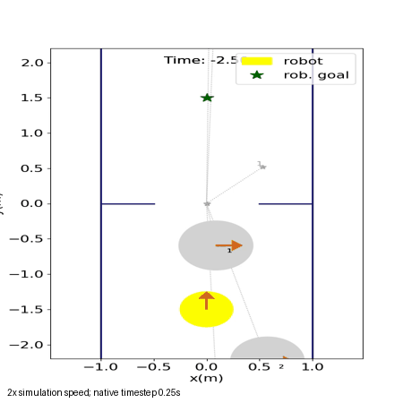
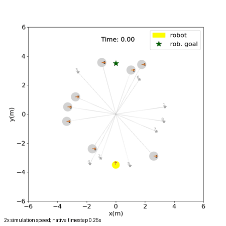
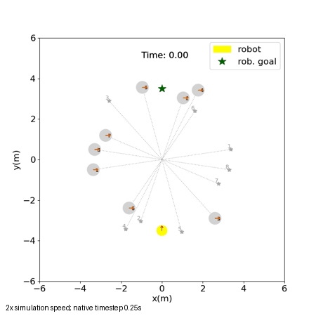
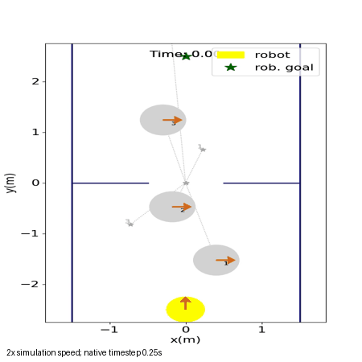

# Vòng 2 — CrowdSimPlus: kết quả chạy thực tế

Ngày thực hiện: 18/10/2026. Vòng 1 đã commit tại **91f3620**:
`Add isolated warehouse and SocNavGym evaluation round` (67 file mới).
Các thay đổi staged/unstaged khác của người dùng được giữ nguyên.

## Kết quả chính

- Demo DWA nguyên bản chạy được và xuất video: goal đạt sau **5.0s mô phỏng**,
  20 bước điều khiển, không có bước báo va chạm người/tường hoặc freezing.
- Đã hoàn tất **24 cấu hình thăm dò**, ORCA/SFM với robot DWA: 18 lượt robot
  hiện diện ở ba cảnh + 6 lượt người không nhìn thấy robot ở cảnh cắt ngang.
- Có **11 MP4 native**, ảnh và GIF xem nhanh; JSON/quỹ đạo/config/CSV để tái lập.
- Phản ứng với robot có khác biệt đo được, nhưng vẫn có chồng lấn và kẹt cửa.
- Bản CrowdSimPlus được thử không có model group walking/conversation/formation
  tương đương SocNavGym. Chưa tích hợp Gazebo hoặc chạy benchmark nhà xưởng.

Đây là khảo sát ít test case, không phải xếp hạng thống kê các framework.

## Nguồn, phiên bản và tương thích

CrowdSimPlus nằm trong [repository SICNav chính thức](https://github.com/sepsamavi/safe-interactive-crowdnav).
Bản main đọc được ở commit `c702fb8ac9ba6439ca61da7dde68b8524bbc6a1f` import
Acados/diffusion ngay từ policy factory và package initializer, kể cả khi chỉ
chọn DWA. Để chạy demo simulator gốc trong phạm vi hiện tại, đã dùng revision
[T-RO 2024](https://github.com/sepsamavi/safe-interactive-crowdnav/tree/d526a07c013c621fa1ad50894b6ba639f61063de),
không sửa source hoặc thêm mô hình diffusion.

| Thành phần | Giá trị được kiểm tra |
|---|---|
| Host | Ubuntu 24.04.5/WSL2, Docker daemon 29.8.1 |
| Container | Debian GNU/Linux 11, Python **3.8.13** |
| CrowdSimPlus/SICNav | `d526a07c013c621fa1ad50894b6ba639f61063de` |
| Python-RVO2 | `c2c46ba8d59556aa10faf03479293236efea154d` |
| Gym / NumPy | 0.21.0 / 1.24.4 |
| Torch / CasADi | 1.13.1+cpu / 3.6.5 |
| Cython / Matplotlib | 0.29.33 / 3.7.5 |
| Container tag | `dynamuhsim-crowdsimplus:round2` |
| Image ID | `sha256:39929ee8e4fa6d738a381a0b695bf25eaf9fa972cd5b9d8a6854d72f80bd5f3c` |

Package ghim `python_requires ==3.8.13`, cùng stack Gym/Torch cũ. Kết quả hiện
chứng minh chạy **trong container trên host Ubuntu 24.04**, không phải chạy native
Python 3.12. Không cài gì vào Python ROS. Không có node/launch ROS Jazzy hoặc
adapter Gazebo được kiểm chứng trong vòng này. Simulator dùng API Gym cũ, reset
và step khác Gymnasium của SocNavGym v2.

[Dockerfile](../Dockerfile), [requirements](../requirements.txt),
[runtime](runtime.txt), [image manifest](image_manifest.json).
Freeze đầy đủ được lưu cục bộ tại `container_freeze.txt`. Image khoảng 3.5GB;
không cần GPU. Container chạy không có mạng, giới hạn 4 CPU/4GB RAM, chỉ mount
round2; thư mục ROS/source robot không mount vào runtime container.

## Cách chạy demo gốc

Từ thư mục gốc DynamuhSim:

```bash
bash experiments/social_navigation/round2/run.sh build
bash experiments/social_navigation/round2/run.sh demo
```

Image hiện đã có, có thể bỏ bước build. Wrapper chạy nguyên:

```text
python /opt/CrowdSimPlus/sicnav/simple_test.py --policy dwa
  --env_config /opt/CrowdSimPlus/sicnav/configs/env.config
  --policy_config /opt/CrowdSimPlus/sicnav/configs/policy.config --test_case 0
```

Cấu hình gốc có hallway_bottleneck, 3 người, random attributes và 10 bước warmup
người trước khi robot di chuyển. Summary gốc ghi 20 bước/5s của robot; video
có 30 frame vì gồm warmup. Không thay config, script, policy hoặc renderer.
Container dùng Matplotlib Agg, nên xem trực quan qua MP4/GIF thay vì cửa sổ GUI.

[Video demo gốc](official_demo.mp4), [summary gốc chuyển sang JSON](official_demo.json).



**Tốc độ phát:** renderer upstream dùng 8fps, timestep 0.25s, tức MP4 chạy
**2× tốc độ mô phỏng**. GIF dùng mỗi 2 frame và duration 250ms, cũng 2×.
Đọc thời gian mô phỏng in trên hình; không dùng độ dài video để suy ra nav_time.

## Thiết kế các lượt quan sát bổ sung

Runner nằm ngoài source: [run_crowdsimplus.py](../run_crowdsimplus.py).
Robot DWA là **unicycle 2D**, không phải Mecanum/Nav2/MPPI trong Gazebo.
Timestep 0.25s; time limit 30s; test_case 0,1,2. Framework tự cộng offset phase
vào seed, nên không đồng nhất số seed này với SocNavGym.

So với demo gốc, các cấu hình thăm dò cố định bán kính người 0.30m, tốc độ mong
muốn 1m/s, bán kính robot 0.25m, không randomize attributes, không warmup.
Cảnh circle có 8 người, radius sinh 3.5m; hallway có 6 người, rộng 3m;
bottleneck có 3 người, hành lang rộng 3m và cửa **1m**. Goal robot ở y=±2.5m
trong hallway/bottleneck. Không nhầm cửa 1m này với cửa nhà xưởng Gazebo 1.8m.

Mọi config nằm trong `configs/`. Có thể chạy lại từng cảnh hoặc toàn ma trận
bằng [hướng dẫn](../README.md). Hai test case bottleneck bị timeout đã chạy lại
để ghi thêm video; bảng dưới vẫn tính 24 cấu hình duy nhất, không cộng lặp.

## Kết quả native scenes khi người nhìn thấy robot

Mỗi hàng là ba test_case 0,1,2. “Đạt sạch” = đạt goal, không có bước gắn cờ
Collision hoặc WallCollision. Các cột va chạm/freezing là **tổng số bước**, không
phải số sự kiện độc lập. Source tiếp tục episode sau chồng lấn; đạt goal không
đồng nghĩa không va chạm.

| Cảnh / chính sách người | Đạt goal | Đạt sạch | Timeout | Bước Collision | Bước WallCollision | Bước Frozen |
|---|---:|---:|---:|---:|---:|---:|
| Cắt ngang / ORCA | 3/3 | 0/3 | 0 | 5 | 0 | 2 |
| Cắt ngang / SFM | 3/3 | 1/3 | 0 | 2 | 0 | 7 |
| Hành lang / ORCA | 3/3 | 3/3 | 0 | 0 | 0 | 0 |
| Hành lang / SFM | 3/3 | 2/3 | 0 | 1 | 0 | 0 |
| Cửa hẹp / ORCA | 2/3 | 2/3 | 1 | 0 | 0 | 70 |
| Cửa hẹp / SFM | 2/3 | 2/3 | 1 | 1 | 100 | 99 |

[Bảng CSV](results.csv), [phân tích JSON](analysis.json),
[kết quả thực thi cuối](matrix_execution.json).

**Cắt ngang:** người đi qua vùng giữa và điều chỉnh quỹ đạo khi gặp robot hoặc
người khác. Có thể quan sát khác biệt ORCA/SFM, nhưng số liệu ít và phụ thuộc
DWA/config. Ví dụ tổng bước overlap của SFM ít hơn ở đây nhưng clearance tệ
nhất sâu hơn (-0.098m so với -0.065m). Chưa kết luận SFM tốt hơn hoặc tự nhiên hơn.

[ORCA video](circle_orca_plus_dwa_n8_s0_visible.mp4) ·
[SFM video](circle_sfm_dwa_n8_s0_visible.mp4)





**Hành lang:** phần lớn test case đi qua được; clearance nhỏ nhất của ORCA trên
ba lượt khoảng 0.027m. Dù không overlap trong ba lượt này, khoảng hở rất nhỏ,
không đủ để khẳng định hành vi thoải mái hoặc an toàn trong thực tế.

**Cửa hẹp:** test_case 2 kẹt với cả hai policy. ORCA có 70 bước Frozen, không
overlap robot-người; SFM có 99 bước Frozen và 100 bước bị constraint tường tác
động. Source điều chỉnh action để không xuyên static line obstacle; WallCollision
ở đây phản ánh các bước action bị chặn, không phải 100 cú va chạm vật lý riêng.
Timeout được ghi 30.25s do source kiểm tra thời hạn trước rồi tăng timestep.
Đây là một hiện tượng deadlock/chờ cần quan sát, không coi là lỗi cài đặt.

[ORCA kẹt cửa](bottleneck_orca_plus_dwa_n3_s2_visible.mp4) ·
[SFM kẹt cửa](bottleneck_sfm_dwa_n3_s2_visible.mp4)




Các hình/video dùng renderer native; phạm vi camera có thể cắt người ở ngoài
viewport và legend có thể đè nhãn thời gian. JSON quỹ đạo vẫn lưu đủ mọi người.

## Phản ứng khi robot đến gần

Ở circle/8 người, so sánh mỗi policy với robot.visible bật/tắt, cùng test_case.
Đã đối chiếu JSON: **6/6 cặp có trạng thái ban đầu giống hệt nhau**. DWA tiếp tục
phản hồi theo crowd, nên đây là khác biệt của hệ kín, không tách riêng causal
response của từng người trong khi giữ quỹ đạo robot cố định.

| Chính sách | Bước Collision khi thấy robot | Khi không thấy robot |
|---|---:|---:|
| ORCA, test_case 0/1/2 | 1 / 3 / 1 | 11 / 9 / 11 |
| SFM, test_case 0/1/2 | 0 / 1 / 1 | 16 / 13 / 15 |

Quỹ đạo người giữa hai nhánh khác nhau, với độ lệch vị trí trung bình trên phần
thời gian chung khoảng 0.28–0.32m cho ORCA và 0.39–0.66m cho SFM. Như vậy đã có
bằng chứng phản ứng với trạng thái robot trong những lượt này, nhưng bật nhìn
thấy robot vẫn không bảo đảm không overlap. “Robot vô hình” là control để phân
tích, không phải hành vi thử nghiệm mặc định được đề xuất.

Nhánh này ban đầu lỗi `AttributeError: CrowdSimPlus has no attribute mode`
trong dòng logging. Runner thêm **alias `env.mode='test'`** bên ngoài source,
không sửa thuật toán. [Lỗi ban đầu](invisible_robot_upstream_error.json) và
[thực thi trước sửa](matrix_execution_initial.json) được giữ để truy vết.
`matrix_execution.json` cuối chỉ rõ 18 lượt giữ nguyên và 6 lượt chạy lại đã xong.

## Nhóm đi, trò chuyện và khả năng tích hợp

Đã kiểm tra source của revision đang dùng: mô hình là các agent đi đến goal
với policy ORCA/SFM và static line obstacles. Chưa có membership/group ID,
formation/dissolution hoặc mô hình trò chuyện. Các vòng tròn đi sát nhau trong
video không chứng minh group walking. “hallway_static” trong source liên quan
đến vật cản tĩnh, không phải một nhóm người đứng nói chuyện.

Đối với mục tiêu chọn mô hình hành vi:

- SocNavGym vòng 1 có cảnh nhóm và quá trình hình thành/tan nhóm quan sát được.
- CrowdSimPlus vòng 2 cung cấp các cảnh tương tác tránh nhau/choke point dễ tái
  lập, ORCA/SFM và phản ứng với robot; hiện chưa đáp ứng riêng nhu cầu conversation.
- Hai vòng dùng khác scene, timestep, kinematics, controller và phiên bản Python.
  **Không so trực tiếp tỷ lệ đạt goal/collision giữa hai framework từ các bảng này.**

Tích hợp về sau có thể lấy pose/velocity/radius và goal của người từ process
container riêng; cần đưa pose/velocity robot thực vào observation và đồng bộ
/clock/reset. Thư viện ROS rclpy Jazzy của Python 3.12 không cài trực tiếp vào
runtime 3.8.13 này. Cần adapter IPC riêng và actor/collision proxy trong Gazebo,
ánh xạ cả static obstacles nhà xưởng và hệ tọa độ. Chưa có adapter đó trong code.

Vòng này **chưa chạy trong nhà xưởng 60×40m**, chưa benchmark chung Gazebo,
chưa chạy ComplexityNav, không đổi kiến trúc robot hoặc triển khai World Model.

## Lưu ý về metric và xác minh

Native Danger luôn bằng 0 trong các lượt này dù có overlap; không dùng nó làm
PSI hoặc bằng chứng thoải mái. Trong source, dmin là khoảng cách tâm, còn ngưỡng
config là 0.2m và collision branch có thể dừng cập nhật dmin. Phân tích riêng đã
lưu clearance biên hình tròn, thời gian có người trong 1.2m từ tâm robot và bước
human-human overlap. Đây là metric lấy mẫu theo timestep, không kiểm tra va
chạm liên tục giữa hai frame và chưa phải PSI anisotropic/group intrusion.

[Video validation](video_validation.json): 11 video có frame/fps hợp lệ và đọc
được frame đầu; đã xem ảnh giữa video và GIF đại diện, gồm hai case kẹt cửa.
Docker pip check không có dependency lỗi; Python và shell mới qua kiểm tra cú
pháp. Container thử nghiệm đã dừng sau các lượt chạy, không dừng phiên ROS khác.

[Audit bảo toàn](source_preservation.json): 11.537 file gốc không đổi nội dung;
diff staged của người dùng và diff unstaged ngoài thư mục experiment giống hệt
snapshot trước vòng 1. Source CrowdSimPlus trong image không có diff. Commit
91f3620 chỉ chứa vòng 1. Vòng 2 và liên kết README đã commit tại 1dbf832; các thay đổi khác của người dùng không được đưa vào commit.
