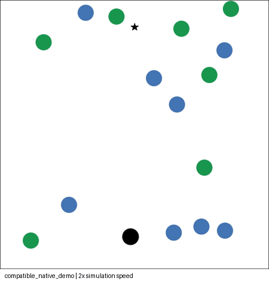
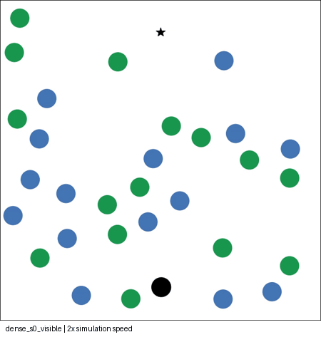
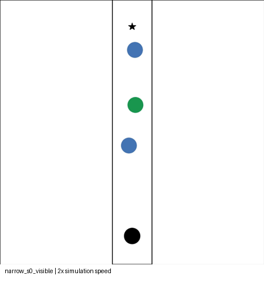
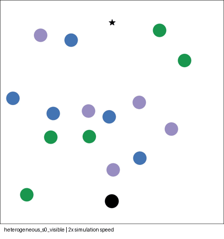

# Vòng 3 — ComplexityNav độc lập

Ngày thực hiện: 18/10/2026. Source chính thức:
[fluentrobotics/ComplexityNav](https://github.com/fluentrobotics/ComplexityNav/tree/36acac12a940a20dceb7b4e1d36acc4c7a4e344a).
Đây là khảo sát chạy thực tế, không tái lập toàn bộ thí nghiệm trong paper và
không phải benchmark chung Gazebo của ba framework.

## Kết quả chính

- Entry point/renderer gốc chạy được với **CV-MPC có sẵn**, đạt goal sau **10s**.
  Cần launcher/config tương thích bên ngoài; chưa chạy demo RGL đã train.
- Hoàn tất **30 cấu hình duy nhất** sau sàng lọc cảnh ban đầu: 27 lượt có robot
  hiện diện và 3 lượt đối chứng người không nhìn thấy robot.
- Có **11 video native** và ảnh/GIF, config, sampling seed, quỹ đạo, CSV và JSON.
- Trong 27 lượt có robot hiện diện: **24 đạt goal, 2 Collision, 1 Timeout**.
  Ba lượt đối chứng không thấy robot đều Collision. Đây chỉ là một mẫu nhỏ.
- Phần grouping là nhận diện/hiển thị cụm người từ quỹ đạo; chưa có model chủ
  động giữ nhóm, đứng trò chuyện hoặc tạo/tan nhóm hội thoại như SocNavGym.
- Không sửa source framework hoặc code robot. Chưa tích hợp Gazebo/nhà xưởng.

## Runtime và tương thích

| Thành phần | Phiên bản/cách chạy |
|---|---|
| Host | Ubuntu 24.04.5/WSL2, Docker 29.8.1 |
| Container | Debian 11, Python **3.8.13**, Torch **1.13.1+cpu** |
| ComplexityNav | `36acac12a940a20dceb7b4e1d36acc4c7a4e344a` |
| Socialforce đúng fork tác giả dẫn | `ChanganVR/socialforce`, `9fdbdf624a1ae8baef850d7c2cc9859198f3c97b` |
| Python-RVO2 | Kế thừa image vòng 2, commit `c2c46ba8d59556aa10faf03479293236efea154d` |
| Gym / NumPy | 0.21.0 / 1.24.4 |
| scikit-learn / Shapely | 1.3.2 / 2.0.6 |
| pytorch-mppi / torchvision | 0.8.0 / 0.14.1+cpu; để imports gốc hoạt động |
| Image | `dynamuhsim-complexitynav:round3` |

Tác giả nêu Python 3.8.10 và Torch 1.13. Runtime thử ở đây dùng bản patch
3.8.13 đã có từ vòng 2; không tuyên bố đã thử đúng 3.8.10 hoặc native 3.12.
HDBSCAN import cần scikit-learn đủ mới; 1.3.2 vẫn hỗ trợ Python 3.8 và đã chạy.
ROS 2 Jazzy vẫn dùng môi trường Python 3.12 hiện có; không cài thư viện vào đó.

Dockerfile kế thừa image vòng 2 để tiết kiệm layers. Khi chạy, container không
có mạng, giới hạn 4 CPU/4GB RAM, chỉ mount thư mục round3. Không mount workspace
ROS vào container. [Runtime](runtime.txt), [manifest image](image_manifest.json),
[Dockerfile](../Dockerfile), [requirements](../requirements.txt). Freeze đầy đủ
được giữ cục bộ tại `container_freeze.txt`. Docker pip check không có lỗi.

## Demo gốc: đã thử trước và các điều chỉnh cần thiết

Lần đầu gọi nguyên `crowd_nav/test.py` với config có sẵn dừng vì đường dẫn YAML
hardcode `/home/socnav/arstr/RelationalGraphLearning/.../sgan.yaml`. Ngoài ra,
config được thử không export đủ ExperimentsConfig mà entry point cần. README
hướng dẫn RGL với model_dir nhưng repo không có checkpoint RGL tương ứng.
Một số checkpoint SGAN có trong source không đồng nghĩa đã có checkpoint RGL.

Để tiếp tục quan sát mà không huấn luyện mới hoặc sửa source:

1. Thêm symlink **chỉ trong image** từ đường dẫn máy tác giả đến source đã clone.
2. Thêm [config bên ngoài](../compatible_demo_config.py): export các concrete
   class và chọn CV predictor cho vecMPC native, tránh checkpoint SGAN hardcode.
3. Dùng [launcher bên ngoài](../native_entrypoint.py) trả về env.unwrapped.
   Entry point gốc gọi reset với positional arguments mà OrderEnforcing Gym
   không nhận. Launcher chạy nguyên file test.py bằng runpy.
4. Giới hạn danh sách điều kiện của config, vì nhánh visualize vẫn pre-generate
   500 cảnh cho từng điều kiện và hardcode chọn experiment 0/condition 2/episode 1.

Không thay file source, hàm step, policy chuyển động hay renderer ở demo này.
**Đây là entry point gốc + config/launcher tương thích, không phải demo RGL
nguyên xi theo README.** Policy thực sự được chạy là vecMPC với CV predictor.

```bash
bash experiments/social_navigation/round3/run.sh demo
```

[Summary demo](compatible_native_demo.json) · [Video](compatible_native_demo.mp4)



Video native dùng 8fps, timestep 0.25s nên phát **2× tốc độ mô phỏng**. GIF lấy
mỗi 2 frame, duration 250ms, cũng 2×. Container dùng Agg, không mở cửa sổ GUI.

## Kiểm tra chất lượng cảnh ban đầu

Ở lượt thô, **7/30 cảnh đã có human-human overlap tại t=0**. Nếu dùng trực tiếp,
va chạm/khoảng hở trong các lượt đó không đủ tin cậy để quy cho phản ứng robot.
[Audit lượt thô](raw_initial_audit.json) ghi rõ các case; bản sao summary,
trajectory/video thô giữ cục bộ tại `reports/raw_initial/` (gitignored).

Runner mới giữ nguyên generator gốc, nhưng kiểm tra hình tròn ở t=0 và lấy
mẫu lại nếu overlap. Root seed = 1000 + seed CLI; mỗi lần thử tiếp cộng 10000.
Có giới hạn 100 lần và ghi sampling_seed/initial_sampling_attempts vào config
và summary. Chỉ chạy lại 7 cảnh không hợp lệ; giữ nguyên các cảnh hợp lệ khác.

Bộ cuối có **30/30 trạng thái ban đầu hợp lệ** theo kiểm tra hình tròn. Cặp
visible/blind baseline vẫn có trạng thái ban đầu giống hệt nhau. Đây là một
lớp lọc cảnh thêm ở runner, nên không gọi bộ này là kết quả generator gốc chưa
qua xử lý. Seed chỉ là nhãn gốc; seed thực tế có thể khác giữa các điều kiện.

## Ma trận quan sát sau sàng lọc

Robot cố định là **ORCA holonomic native**, không phải robot CV-MPC ở demo,
Mecanum vật lý hoặc Nav2 MPPI. Radius robot/người 0.3m, preferred speed 1m/s,
timestep 0.25s. Người đi liên tục theo goal sequences gốc. Mỗi điều kiện có
ba root seed 1000,1001,1002, tối đa 30s cấu hình.

| Điều kiện | ORCA/SFM/linear/static | Rộng × dài | Mật độ danh nghĩa |
|---|---|---|---:|
| sparse | 2/3/0/0 | 10×10m | 0.05 người/m² |
| baseline | 7/8/0/0 | 10×10m | 0.15 |
| dense | 15/15/0/0 | 10×10m | 0.30 |
| narrow | 1/2/0/0 | 1.5×10m | 0.20 |
| medium_width | 2/2/0/0 | 3×10m | 0.133 |
| orca_only | 15/0/0/0 | 10×10m | 0.15 |
| heterogeneous | 5/5/2/3 | 10×10m | 0.15 |
| passing | 7/8/0/0 | 10×10m | 0.15 |
| crossing | 7/8/0/0 | 10×10m | 0.15 |

Mặc định directionality passing_crossing, trừ hai điều kiện passing/crossing.
Baseline được dùng lại giữa các yếu tố để tránh chạy trùng. Width conditions
đồng thời thay số người/mật độ, **không phải phép cô lập ảnh hưởng bề rộng**.
Các điều kiện khác cũng chưa ghép cặp trạng thái ban đầu hoàn toàn sau rejection
sampling. Mật độ là N/(width×length), không phải mật độ cục bộ quanh robot.

| Điều kiện | Đạt goal | Collision | Timeout | Trung vị thời gian kết thúc | Min clearance robot-người |
|---|---:|---:|---:|---:|---:|
| sparse | 3/3 | 0 | 0 | 12.25s | 0.032m |
| baseline | 3/3 | 0 | 0 | 16.00s | 0.017m |
| dense | 3/3 | 0 | 0 | 15.50s | 0.017m |
| narrow | 2/3 | 0 | 1 | 21.00s | 0.003m |
| medium_width | 3/3 | 0 | 0 | 12.50s | 0.023m |
| orca_only | 3/3 | 0 | 0 | 17.25s | 0.019m |
| heterogeneous | 2/3 | 1 | 0 | 14.50s | -0.005m |
| passing | 3/3 | 0 | 0 | 12.25s | 0.078m |
| crossing | 2/3 | 1 | 0 | 14.75s | -0.014m |

[CSV đầy đủ](results.csv) · [Tổng hợp JSON](analysis.json) ·
[Thực thi cuối](matrix_execution.json). Trung vị ở bảng gồm cả lượt thất bại,
không chỉ tính thời gian của các lượt đạt goal. Bộ cuối không có lỗi render.

**Mật độ:** mẫu ba seed này không cho xu hướng thời gian tăng đơn điệu; dense
15.5s còn baseline 16s. Không dùng các số này để khẳng định tái lập kết luận
paper. Khoảng hở robot-người ở cả hai bộ có thể chỉ khoảng 17mm. Dense vẫn có
2 bước human-human overlap trong một case dù trạng thái ban đầu hợp lệ.



**Lối hẹp:** seed CLI 0 timeout ở 29.25s, có 4 bước frozen theo ngưỡng dịch
chuyển 1cm/timestep. Hai seed còn lại đạt goal; clearance tệ nhất chỉ khoảng
3mm. Source kiểm tra timeout theo time_limit-1 rồi vẫn cập nhật timestep,
nên log không kết thúc đúng 30s. Tường là biên hình chữ nhật, chưa phải toàn
bộ hình học kệ/cột/cửa của nhà xưởng.



**Hỗn hợp và người đứng:** có 3 static agents đi rất chậm (v_pref=1e-4), độ dời
đầu-cuối lớn nhất trong ba lượt khoảng 1.45mm. Đây không phải nhóm đứng trò
chuyện. Hai người linear không tránh agent khác; sau khi chạy vẫn có 28 bước
human-human overlap cộng trên ba lượt, xâm nhập sâu nhất khoảng 0.452m. Mô hình
không chặn tiếp xúc người-người bằng physics; không coi đây là mô phỏng cơ thể
người chân thực hoặc an toàn chỉ vì robot đạt goal trong hai lượt.



Renderer native: robot màu đen, ORCA xanh lá, SFM xanh dương, linear/static
màu tím; hai loại tím cần xem JSON/quỹ đạo để phân biệt. Màu này theo policy,
không phải membership xã hội.

## Phản ứng robot và grouping

Cặp baseline visible/blind: **3/3 cặp có trạng thái ban đầu giống hệt nhau**.
Khi robot hiện diện, cả ba đạt goal; khi không được đưa vào observation/planner
của người, cả ba Collision ở 8.0s, 5.75s, 5.5s. Quỹ đạo người thay đổi giữa hai
nhánh, độ lệch vị trí trung bình trên phần thời gian chung khoảng 0.016–0.116m.
Đây là hệ kín: quỹ đạo robot cũng phản hồi theo người, không phải chỉ đo riêng
một human response khi giữ robot path cố định. Ba cặp chưa đủ suy ra tỷ lệ an
toàn tổng quát hoặc so trực tiếp với số va chạm ở vòng 2.

Source có DBSCAN/Coherent Filter và group-space visualization. Tài liệu
[grouping chính thức](https://github.com/fluentrobotics/ComplexityNav/blob/36acac12a940a20dceb7b4e1d36acc4c7a4e344a/crowd_sim/envs/grouping/README.md)
nêu rõ đây là clustering từ vị trí/vận tốc/quỹ đạo. Runner có ghi nhãn DBSCAN
để kiểm tra cụm gần nhau; nhãn có thể thay đổi giữa các frame, không phải group
ID bền vững hoặc bằng chứng ý định đi chung. Chưa thấy mô hình conversation,
formation/dissolution có chủ đích như lớp scene của SocNavGym.

**Lỗi renderer dưới 4 người:** CoherentFilter(K=3) index vượt số người ở case
narrow có 3 agent. Đã lưu [lỗi gốc](small_population_render_error.json); runner
chọn DBSCAN có sẵn cho lời gọi grouping-color trong renderer ở N<4. Source
không sửa, màu policy và dynamics không đổi. Summary ghi render_adjustments.
Lỗi render được tách khỏi trạng thái Collision/Timeout của mô phỏng.

## Khả năng tích hợp và lựa chọn sau ba vòng

ComplexityNav phù hợp làm nguồn cảnh có điều khiển mật độ/hướng/policy và công
cụ phát hiện các trường hợp khó. Nó vẫn dùng ORCA/SFM/linear/static cho người;
không tự tạo ra một mô hình nhận thức/hội thoại mới. Tính liên tục goal hữu ích
cho dòng người, nhưng overlap người-người và screening cảnh ban đầu cần được
kiểm soát trước khi dùng làm ground truth về hành vi thực.

Cả ba framework đã có thử nghiệm độc lập; **chưa framework nào điều khiển người
trong Gazebo**. Nhà xưởng + Mecanum/Nav2 đã chạy riêng từ vòng 1. Muốn so sánh
chung cần một contract pose/velocity/ID/reset/time, đưa trạng thái robot thực
vào backend, map static geometry và đồng bộ actor/collision proxy với /clock.
ComplexityNav bản này chủ yếu dùng biên chữ nhật; việc ánh xạ toàn bộ nhà xưởng
không có sẵn và cần kiểm chứng riêng. Python 3.8 runtime cũng cần IPC riêng
với ROS Jazzy Python 3.12.

Nếu ưu tiên **nhóm đi/trò chuyện**, SocNavGym có bằng chứng tính năng sát mục
tiêu hơn ở vòng 1. Nếu ưu tiên **stress test crowd/lối hẹp**, CrowdSimPlus và
ComplexityNav có các cảnh phù hợp, với các giới hạn đã ghi. Đây là đánh giá
khả năng theo các version đã thử, không xếp hạng mức tự nhiên hay hiệu năng.
Xem [bảng so sánh phạm vi](../../FRAMEWORK_COMPARISON.md).

Vòng này chưa tạo adapter, chưa triển khai World Model, chưa đổi controller
hoặc kiến trúc robot. Mã và kết quả vòng 3 được lưu cùng báo cáo thí nghiệm.

## Xác minh và bảo toàn

[Video validation](video_validation.json): 11 MP4 có frame/fps hợp lệ và đọc
được frame đầu. Đã xem ảnh đại diện crowd dày, narrow và heterogeneous; GIF
xem nhanh đều ghi 2× tốc độ. Kiểm tra hình học ban đầu cuối: 30/30 hợp lệ theo
bán kính; không kiểm chứng continuous collision giữa hai timestep.

[Audit](source_preservation.json): 11.537 file tracked gốc không đổi; staged
diff của người dùng và unstaged diff ngoài experiment giống hệt snapshot trước
vòng 1. Source ComplexityNav trong image không có diff. Các file mới nằm trong
round3, bảng so sánh phạm vi và cập nhật liên kết README. Container chạy thử đã
dừng; không dừng hoặc sửa các phiên ROS khác.
